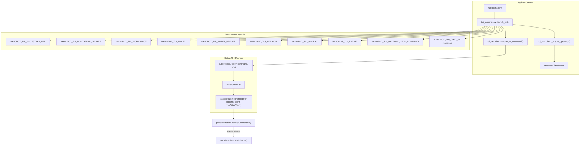

<!-- source: DeepWiki mcp.deepwiki.com · repo HKUDS/nanobot · page 15.2 TUI Launcher & Binary Distribution · fetched 2026-10-26 -->

# TUI Launcher & Binary Distribution

Relevant source files

The following files were used as context for generating this wiki page:

- [CONTRIBUTING.md](CONTRIBUTING.md)
- [docs/cli-reference.md](docs/cli-reference.md)
- [docs/releasing.md](docs/releasing.md)
- [nanobot/__init__.py](nanobot/__init__.py)
- [nanobot/cli/agent.py](nanobot/cli/agent.py)
- [nanobot/cli/tui_launcher.py](nanobot/cli/tui_launcher.py)
- [pyproject.toml](pyproject.toml)
- [scripts/build_tui_wheels.py](scripts/build_tui_wheels.py)
- [tests/cli/test_tui_launcher.py](tests/cli/test_tui_launcher.py)
- [tests/cli/test_tui_release_packaging.py](tests/cli/test_tui_release_packaging.py)
- [tests/cli/test_tui_wheels.py](tests/cli/test_tui_wheels.py)
- [tui/README.md](tui/README.md)
- [tui/RELINKING.md](tui/RELINKING.md)
- [tui/bun.lock](tui/bun.lock)
- [tui/package.json](tui/package.json)
- [tui/scripts/build.ts](tui/scripts/build.ts)
- [tui/scripts/package-release.py](tui/scripts/package-release.py)
- [tui/src/app.test.ts](tui/src/app.test.ts)
- [tui/src/app.ts](tui/src/app.ts)
- [tui/src/index.ts](tui/src/index.ts)
- [tui/src/protocol.test.ts](tui/src/protocol.test.ts)
- [tui/src/protocol.ts](tui/src/protocol.ts)
- [tui/src/runtime-controls.ts](tui/src/runtime-controls.ts)
- [tui/src/transcript.ts](tui/src/transcript.ts)

The Nanobot Terminal UI (TUI) is a TypeScript-based client built on the `@opentui/core` framework [tui/README.md:3-3](). It is designed to be a full-featured alternative to the classic Python prompt, providing a rich, interactive terminal experience while delegating all agent logic, security policies, and session management to the Python gateway [tui/README.md:3-3]().

## Launcher Lifecycle & Environment Injection

The `tui_launcher.py` script manages the lifecycle of the native TUI process. It is responsible for resolving the appropriate binary, injecting bootstrap credentials via environment variables, and coordinating with the local gateway [nanobot/cli/tui_launcher.py:82-136]().

### Environment Variables
The launcher injects several critical variables into the TUI process:
*   `NANOBOT_TUI_BOOTSTRAP_URL`: The endpoint used by the TUI to obtain fresh WebSocket and REST credentials [nanobot/cli/tui_launcher.py:95-95]().
*   `NANOBOT_TUI_BOOTSTRAP_SECRET`: A secret key used to authenticate the bootstrap request [nanobot/cli/tui_launcher.py:113-113]().
*   `NANOBOT_TUI_WORKSPACE`: The canonical path to the active workspace [nanobot/cli/tui_launcher.py:99-99]().
*   `NANOBOT_TUI_MODEL` & `NANOBOT_TUI_MODEL_PRESET`: The active model configuration derived from the agent config [nanobot/cli/tui_launcher.py:97-98]().

### Process Management
The launcher follows a specific sequence to ensure the TUI and Gateway are synchronized:
1.  **Binary Resolution**: Locates the version-matched binary for the current OS/Architecture [nanobot/cli/tui_launcher.py:155-201]().
2.  **Process Spawn**: Launches the TUI process using `subprocess.Popen` [nanobot/cli/tui_launcher.py:121-121]().
3.  **Gateway Lease**: Acquires a `GatewayClientLease`. If no gateway is running, it starts one on-demand [nanobot/cli/tui_launcher.py:134-135]().
4.  **Exit Handling**: Waits for the TUI to exit. If the TUI returns a specific "detach" code (`90`), the gateway lease is marked as persistent so it continues running in the background [nanobot/cli/tui_launcher.py:141-145]().

### Launcher Data Flow
The following diagram illustrates how the Python launcher bridges the configuration space to the native TUI execution environment.

**TUI Launcher Flow**

Sources: [nanobot/cli/tui_launcher.py:74-136](), [tui/src/index.ts:22-49](), [tui/src/protocol.ts:172-183](), [nanobot/cli/tui_launcher.py:94-120](), [tui/src/app.ts:103-120]()

## Binary Distribution & Verification

Nanobot distributes the TUI as pre-compiled binaries for major platforms (Linux, macOS, Windows) [nanobot/cli/tui_launcher.py:164-177]().

### Release Integrity
To ensure security and consistency, the launcher performs the following checks when downloading or using packaged binaries:
*   **Manifest Verification**: Each release includes a `MANIFEST.sha256` file containing hashes for all included files [nanobot/cli/tui_launcher.py:62-62]().
*   **Checksum Validation**: The launcher verifies the SHA-256 checksum of the downloaded zip archive against the published release metadata [tests/cli/test_tui_launcher.py:50-51]().
*   **Asset Mapping**: Binaries are named following the pattern `nanobot-tui-{system}-{machine}` (e.g., `nanobot-tui-linux-x64`) [nanobot/cli/tui_launcher.py:177-177]().

### Release Package Contents
A standard TUI release archive includes the executable and several mandatory legal/source files:
| File | Purpose |
| :--- | :--- |
| `nanobot-tui-...` | The native executable |
| `MANIFEST.sha256` | Checksums for all files in the archive |
| `nanobot-tui-source.tar.gz` | Source code for the specific build |
| `THIRD_PARTY_NOTICES.txt` | Attribution for dependencies |
| `RELINKING.md` | Instructions for relinking the binary |
| `SOURCE_OFFER.md` | Source offer for the bundled software |
| `LICENSE` | Project license |
| `BUN-1.3.13-LICENSE.md` | Bun runtime license |
| `LGPL-2.0.txt` | LGPL-2.0 license |
| `LGPL-2.1.txt` | LGPL-2.1 license |

Sources: [nanobot/cli/tui_launcher.py:43-63](), [tests/cli/test_tui_launcher.py:34-51](), [tui/RELINKING.md](), [CONTRIBUTING.md:147-150]()

## Detach Logic & Exit Codes

The TUI supports a "detach" mode, allowing the user to close the terminal interface while keeping the agent's current turn running on the gateway [tui/README.md:12-12]().

1.  **Trigger**: The user executes the `/detach` slash command [tui/src/app.ts:210-214]().
2.  **Callback**: The `onDetach` handler is invoked in `tui/src/index.ts` [tui/src/index.ts:40-45]().
3.  **Exit Code**: The process sets `process.exitCode = 90` (defined as `_TUI_DETACH_EXIT_CODE`) and terminates [tui/src/index.ts:5-5](), [tui/src/index.ts:41-41]().
4.  **Promotion**: The Python launcher detects exit code `90` and calls `lease.mark_persistent()`, preventing the gateway from shutting down even though the TUI client has disconnected [nanobot/cli/tui_launcher.py:141-145]().

Sources: [tui/src/index.ts:5-5](), [tui/src/index.ts:40-45](), [nanobot/cli/tui_launcher.py:65-65](), [nanobot/cli/tui_launcher.py:141-145](), [tui/src/app.ts:210-214]()

## Herdr Host Mode

When Nanobot is running inside a pane-based terminal multiplexer like Herdr, it enters a specialized "Host Mode" triggered by the `HERDR_ENV=1` environment variable [tui/README.md:20-22]().

### Behavior Changes
In Herdr mode, the TUI modifies its layout and behavior to integrate seamlessly with the host:
*   **Layout**: Uses OpenTUI's `main-screen` mode instead of the `alternate-screen` mode [tui/README.md:22-22]().
*   **UI Simplification**: Removes the launch card and persistent chrome (session/model labels) to maximize space for the transcript [tui/README.md:22-22]().
*   **Status Reporting**: Reports agent state (`working`, `idle`, `blocked`) to the host via the Herdr pane CLI [tui/README.md:24-24]().

**TUI Component Integration**

```mermaid
graph TD
    subgraph "tui/src/app.ts (NanobotTui)"
        Transcript["Transcript"]
        ComposerDraft["ComposerDraft"]
        CommandMenu["CommandMenu"]
        DiffViewer["DiffViewer"]
        ContextPanel["ContextPanel"]
        UsagePanel["UsagePanel"]
        SessionMenu["SessionMenu"]
        BranchMenu["BranchMenu"]
        MentionMenu["MentionMenu"]
        SkillMenu["SkillMenu"]
        PromptQueue["PromptQueue"]
        QueuePreview["QueuePreview"]
        RecoveryNotice["RecoveryNotice"]
        RuntimeControls["RuntimeControls"]
        FooterHints["Footer Hints"]

        Transcript --> ScrollBoxRenderable["@opentui/core::ScrollBoxRenderable"]
        ComposerDraft --> TextareaRenderable["@opentui/core::TextareaRenderable"]
        CommandMenu --> PickerMenu["@opentui/core::PickerMenu"]
        DiffViewer --> BoxRenderable["@opentui/core::BoxRenderable"]
        ContextPanel --> BoxRenderable
        UsagePanel --> BoxRenderable
        SessionMenu --> PickerMenu
        BranchMenu --> PickerMenu
        MentionMenu --> PickerMenu
        SkillMenu --> PickerMenu
        PromptQueue --> BoxRenderable
        QueuePreview --> BoxRenderable
        RecoveryNotice --> BoxRenderable
        RuntimeControls --> BoxRenderable
        FooterHints --> TextRenderable["@opentui/core::TextRenderable"]
    end

    subgraph "tui/src/protocol.ts (NanobotClient)"
        WebSocket["WebSocket"] -- "InboundEvent" --> OnEvent["onEvent handler"]
        OnEvent -- "delta/message" --> Transcript
        OnEvent -- "ready/attached" --> ConnectionStatus["Connection Status"]
        OnEvent -- "file_edit" --> DiffViewer
        OnEvent -- "turn_end" --> UsagePanel
        OnEvent -- "session_updated" --> SessionMenu
        OnEvent -- "runtime_model_updated" --> RuntimeControls
        OnEvent -- "recovery_state" --> RecoveryNotice
        OnEvent -- "goal_status" --> FooterHints
    end

    subgraph "nanobot/cli/tui_launcher.py"
        LaunchTUI["launch_tui()"] -- "Environment Variables" --> TUIEntrypoint["tui/src/index.ts"]
    end

    TUIEntrypoint --> NanobotTui["NanobotTui.mount()"]
    NanobotTui --> WebSocket
    NanobotTui --> OnEvent
```

Sources: [tui/src/app.ts:50-82](), [tui/src/transcript.ts:62-113](), [tui/src/protocol.ts:172-183](), [tui/README.md:20-25](), [tui/src/app.ts:57-102]()

---

