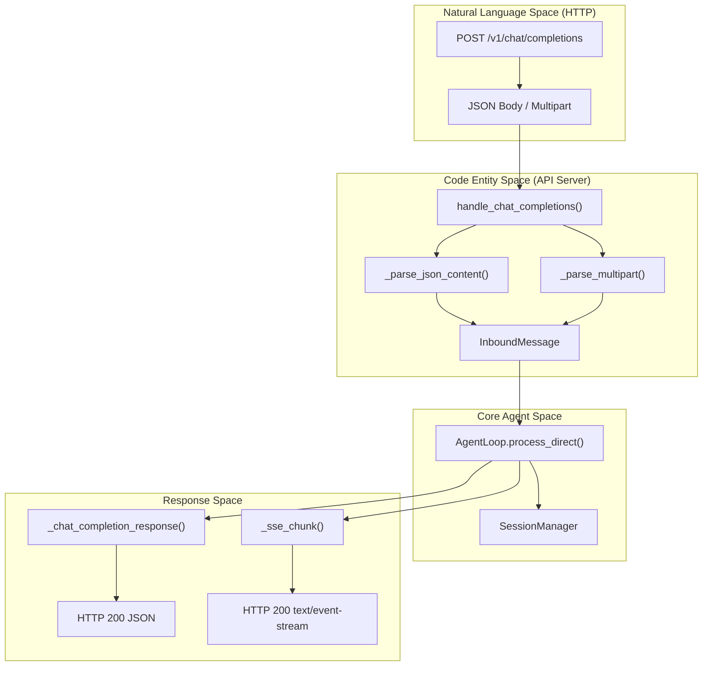
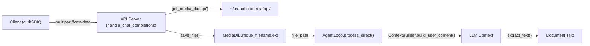

<!-- source: DeepWiki mcp.deepwiki.com · repo HKUDS/nanobot · page 16 OpenAI-Compatible API Server · fetched 2026-10-26 -->

# OpenAI-Compatible API Server

Relevant source files

The following files were used as context for generating this wiki page:

- [nanobot/api/server.py](nanobot/api/server.py)
- [nanobot/utils/document.py](nanobot/utils/document.py)
- [tests/test_api_attachment.py](tests/test_api_attachment.py)
- [tests/test_api_stream.py](tests/test_api_stream.py)
- [tests/test_context_documents.py](tests/test_context_documents.py)
- [tests/test_document_parsing.py](tests/test_document_parsing.py)
- [tests/test_openai_api.py](tests/test_openai_api.py)

The `nanobot serve` command exposes a lightweight, OpenAI-compatible HTTP API server. This allows external applications, scripts, and standard OpenAI client libraries to interact with a nanobot agent instance through a unified `/v1/chat/completions` interface [nanobot/api/server.py:1-5]().

The server is built using `aiohttp` and supports both standard JSON responses and Server-Sent Events (SSE) for streaming output [nanobot/api/server.py:17-43]().

### System Overview

The API server acts as a bridge between the HTTP networking layer and the core `AgentLoop`. It maps incoming OpenAI-formatted requests into `InboundMessage` objects and routes them to specific sessions based on a `session_id` or a default key [nanobot/api/server.py:46-47]().

#### Request Mapping to Code Entities

The following diagram illustrates how an external HTTP request is processed by the internal server components and handed off to the agent loop.

**Sources:** [nanobot/api/server.py:42-43](), [nanobot/api/server.py:193-212](), [nanobot/api/server.py:107-132](), [nanobot/api/server.py:167-184]().

### Core Capabilities

*   **Endpoint Compatibility**: Implements `/v1/chat/completions`, `/v1/models`, and a `/health` check.
*   **Session Isolation**: Uses the `session_id` field in the request body to maintain distinct conversation histories. If omitted, it defaults to `api:default` [nanobot/api/server.py:46-47]().
*   **Streaming Support**: Supports `stream: true` to return `text/event-stream` chunks containing partial deltas, terminated by `data: [DONE]` [nanobot/api/server.py:167-184](), [nanobot/api/server.py:186]().
*   **Attachment Handling**: Supports multimodal inputs (images) via base64 data URLs in JSON, and various document types (PDF, Docx, etc.) via `multipart/form-data` [nanobot/api/server.py:208-212](), [nanobot/api/server.py:220-221]().
*   **Security Enforcement**: If bound to non-loopback interfaces (`0.0.0.0` or `::`), the server requires a configured `api.apiKey` to start, preventing accidental public exposure. For details, see [API Server Reference](#16.1).

### Request and Session Logic

When a request arrives, the server resolves the target session and acquires a lock to ensure that multiple concurrent requests to the same `session_id` are processed sequentially [nanobot/api/server.py:52]().

| Feature | Description | Code Reference |
| :--- | :--- | :--- |
| **Model Mapping** | Returns the current active agent model via `/v1/models`. | [nanobot/api/server.py:50]() |
| **Usage Tracking** | Maps `LLMUsage` from the agent back to OpenAI's `usage` object. | [nanobot/api/server.py:107-132]() |
| **Timeout Control** | Enforces a `request_timeout` (default 120s) for agent processing. | [nanobot/api/server.py:51]() |
| **Direct Processing** | Uses `AgentLoop.process_direct()` to bypass the message bus for low-latency. | [tests/test_openai_api.py:38]() |

### Data Flow: Multi-part Attachment Handling

The server includes specialized logic for handling file uploads, saving them to a temporary media directory before passing their paths to the agent.

**Sources:** [nanobot/api/server.py:209](), [nanobot/api/server.py:220-221](), [nanobot/utils/document.py:100-101](), [nanobot/agent/context.py](), [tests/test_api_attachment.py:210-222](), [tests/test_context_documents.py:27-36]().

### Child Pages

*   **[API Server Reference](#16.1)**: Detailed documentation on server setup, endpoint contracts, session_key mapping, streaming format, document/attachment parsing, and security considerations.
*   **[Audio Transcription](#16.2)**: Details on how the API and other channels handle audio input via transcription providers like Whisper or StepFun.

**Sources:** [nanobot/api/server.py:1-43]().

---

