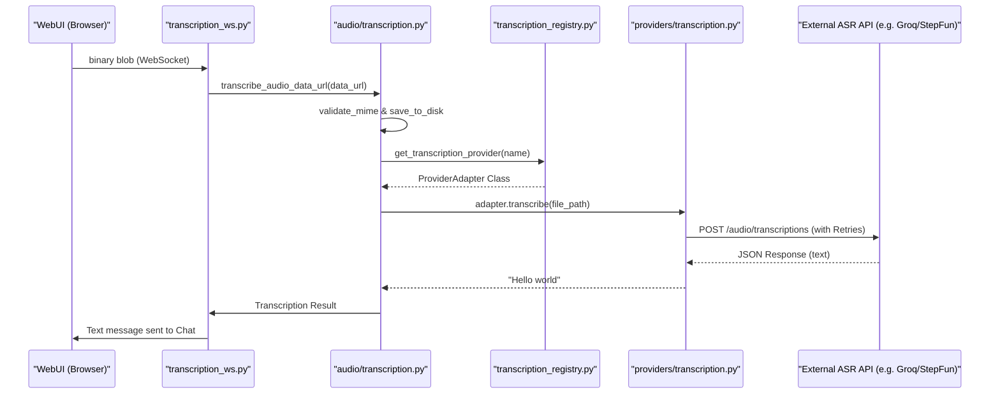
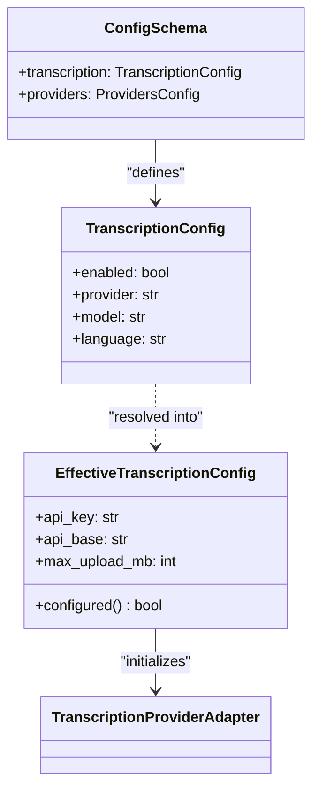

<!-- source: DeepWiki mcp.deepwiki.com · repo HKUDS/nanobot · page 16.2 Audio Transcription · fetched 2026-10-26 -->

# Audio Transcription

<details>
<summary>Relevant source files</summary>

The following files were used as context for generating this wiki page:

- [nanobot/audio/transcription.py](nanobot/audio/transcription.py)
- [nanobot/audio/transcription_registry.py](nanobot/audio/transcription_registry.py)
- [nanobot/channels/base.py](nanobot/channels/base.py)
- [nanobot/channels/manager.py](nanobot/channels/manager.py)
- [nanobot/providers/transcription.py](nanobot/providers/transcription.py)
- [tests/bus/test_outbound_events.py](tests/bus/test_outbound_events.py)
- [tests/channels/test_channel_manager_delta_coalescing.py](tests/channels/test_channel_manager_delta_coalescing.py)
- [tests/channels/test_channel_plugins.py](tests/channels/test_channel_plugins.py)
- [tests/providers/test_stepfun_asr.py](tests/providers/test_stepfun_asr.py)
- [tests/providers/test_transcription.py](tests/providers/test_transcription.py)

</details>


Nanobot provides a pluggable audio transcription system that allows users to send voice messages via supported communication channels (e.g., WebUI, Telegram). The system abstracts provider-specific implementations, handles transient network failures with exponential backoff, and ensures secure handling of audio files within the workspace.

## Architecture Overview

The transcription system is divided into three layers:
1.  **Ingress Layer**: Handles incoming audio data from WebSocket streams or channel-specific media downloads.
2.  **Service Layer**: Manages configuration resolution, file validation, and temporary storage.
3.  **Provider Layer**: Implements specific adapters for external ASR (Automatic Speech Recognition) services.

### Data Flow Diagram

The following diagram illustrates how a voice message from the WebUI is processed into text for the Agent Loop.

"Voice Message Ingress Flow"

Sources: [nanobot/audio/transcription.py:150-196](), [nanobot/providers/transcription.py:197-246](), [nanobot/audio/transcription_registry.py:45-83]()

## Provider Abstraction

Transcription providers must implement the `TranscriptionProviderAdapter` protocol [nanobot/audio/transcription_registry.py:16-28](). This ensures that the application-level service can interact with any backend (OpenAI, Groq, StepFun) using a unified interface.

### Supported Backends

| Provider | Default Model | Adapter Class |
| :--- | :--- | :--- |
| **Groq** | `whisper-large-v3` | `GroqTranscriptionProvider` |
| **OpenAI** | `whisper-1` | `OpenAITranscriptionProvider` |
| **StepFun** | `stepaudio-2.5-asr` | `StepFunTranscriptionProvider` |
| **Xiaomi MiMo** | `mimo-v2.5-asr` | `XiaomiMiMoTranscriptionProvider` |
| **AssemblyAI** | `universal-3-pro` | `AssemblyAITranscriptionProvider` |
| **SiliconFlow** | `FunAudioLLM/SenseVoiceSmall` | `OpenAITranscriptionProvider` |

Sources: [nanobot/audio/transcription_registry.py:45-83]()

### The StepFun SSE Adapter
Unlike standard OpenAI-compatible endpoints that return a single JSON object, the `StepFunTranscriptionProvider` [nanobot/providers/transcription.py:449-514]() utilizes Server-Sent Events (SSE). It parses the stream for `transcript.text.delta` and `transcript.text.done` events to reconstruct the final text [tests/providers/test_stepfun_asr.py:90-106]().

Sources: [nanobot/providers/transcription.py:449-514](), [tests/providers/test_stepfun_asr.py:90-106]()

## Configuration & Resolution

Nanobot uses an `EffectiveTranscriptionConfig` object [nanobot/audio/transcription.py:48-61]() to consolidate settings from the top-level `transcription` block and legacy `channels` settings in `config.json`.

### Resolution Logic
The function `resolve_transcription_config` [nanobot/audio/transcription.py:122-147]() performs the following steps:
1.  **Provider Selection**: Prefers `config.transcription.provider`, falling back to `config.channels.transcription_provider`, and finally defaulting to `groq` [nanobot/audio/transcription.py:125-130]().
2.  **API Key Interpolation**: Resolves environment variables like `${GROQ_API_KEY}` using `resolve_env_refs` [nanobot/audio/transcription.py:91-92]().
3.  **Sanitization**: Ensures models are stripped of whitespace and languages are mapped correctly [nanobot/audio/transcription.py:141-142]().

Sources: [nanobot/audio/transcription.py:122-147](), [nanobot/audio/transcription.py:87-102]()

### Entity Mapping: Configuration to Code

"Transcription Config Entity Map"

Sources: [nanobot/audio/transcription.py:48-61](), [nanobot/audio/transcription.py:122-147](), [nanobot/config/schema.py:1-50]()

## Reliability & Error Handling

### Transient Failure Retries
The system implements a robust retry mechanism in `_request_json_with_retry` [nanobot/providers/transcription.py:113-194]() and `_post_transcription_with_retry` [nanobot/providers/transcription.py:197-207]() to handle flaky mobile connections or provider overloads.
- **Max Retries**: 3 (4 total attempts) [nanobot/providers/transcription.py:101]().
- **Backoff**: Exponential (1.0s, 2.0s, 4.0s) [nanobot/providers/transcription.py:102]().
- **Retryable Errors**: HTTP 408, 429, 500, 502, 503, 504, and `httpx` Timeout/Connect errors [nanobot/providers/transcription.py:103-109]().

Sources: [nanobot/providers/transcription.py:101-110](), [nanobot/providers/transcription.py:113-194]()

### Validation Guards
Before sending audio to a provider, the `transcribe_audio_data_url` function [nanobot/audio/transcription.py:150-196]() enforces several security and operational constraints:
- **MIME Type**: Must be in `_AUDIO_MIME_ALLOWED` (e.g., `audio/mpeg`, `audio/ogg`, `audio/webm`) [nanobot/audio/transcription.py:168-169]().
- **Duration**: Rejected if exceeding `max_duration_sec` [nanobot/audio/transcription.py:164-167]().
- **Size**: Rejected if exceeding `max_upload_mb` (default 25MB) [nanobot/audio/transcription.py:173-175]().
- **Cleanup**: Temporary files are unlinked immediately after the transcription attempt, regardless of success [nanobot/audio/transcription.py:191-193]().

Sources: [nanobot/audio/transcription.py:33-44](), [nanobot/audio/transcription.py:150-196]()

## Voice Input Routing

Voice input from channels is routed through the `BaseChannel.transcribe_audio` method [nanobot/channels/base.py:48-61](). This method loads the current configuration, resolves the transcription provider, and calls `transcribe_audio_file` [nanobot/channels/base.py:57]() to perform the actual transcription. If transcription fails, it logs an exception and returns an empty string [nanobot/channels/base.py:59-60]().

"Voice Input Routing"
```mermaid
graph TD
    A[User Voice Input] --> B{Channel (e.g., WebUI, Telegram)};
    B --> C[BaseChannel.transcribe_audio];
    C --> D[nanobot.audio.transcription.resolve_transcription_config];
    D --> E[nanobot.audio.transcription.transcribe_audio_file];
    E --> F{TranscriptionProviderAdapter.transcribe};
    F --> G[External ASR API];
    G --> F;
    F --> E;
    E --> C;
    C --> H[Transcribed Text to Message Bus];
```
Sources: [nanobot/channels/base.py:48-61](), [nanobot/audio/transcription.py:199-216]()

## WebSocket Integration

The `transcription_ws.py` module manages the real-time routing of voice data from the WebUI. When a user records a message, the browser sends a data URL via the WebSocket. The gateway receives this, calls `transcribe_audio_data_url` [nanobot/audio/transcription.py:150-158](), and injects the resulting text back into the message bus as if the user had typed it.

Sources: [nanobot/audio/transcription.py:150-158](), [nanobot/webui/transcription_ws.py:1-20]()

---

