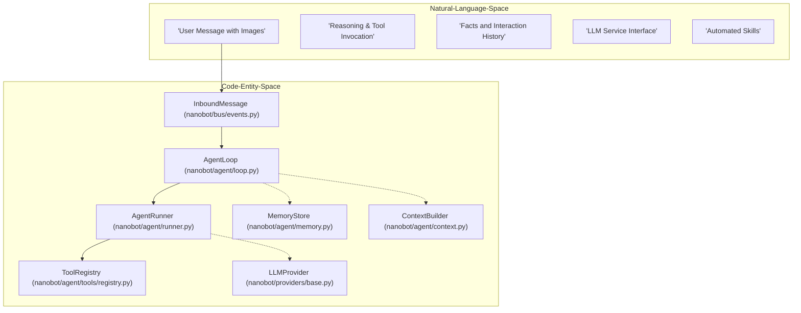
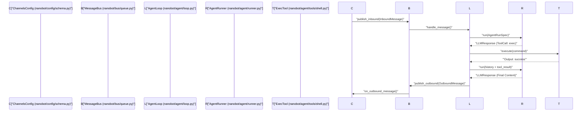

<!-- source: DeepWiki mcp.deepwiki.com · repo HKUDS/nanobot · page 17 Glossary · fetched 2026-10-26 -->

# Glossary

Relevant source files

The following files were used as context for generating this wiki page:

- [README.md](README.md)
- [docs/configuration.md](docs/configuration.md)
- [docs/providers.md](docs/providers.md)
- [nanobot/agent/autocompact.py](nanobot/agent/autocompact.py)
- [nanobot/agent/context_governance.py](nanobot/agent/context_governance.py)
- [nanobot/agent/loop.py](nanobot/agent/loop.py)
- [nanobot/agent/memory.py](nanobot/agent/memory.py)
- [nanobot/agent/runner.py](nanobot/agent/runner.py)
- [nanobot/agent/tools/_windows_job.py](nanobot/agent/tools/_windows_job.py)
- [nanobot/agent/tools/exec_session.py](nanobot/agent/tools/exec_session.py)
- [nanobot/agent/tools/shell.py](nanobot/agent/tools/shell.py)
- [nanobot/cli/commands.py](nanobot/cli/commands.py)
- [nanobot/config/schema.py](nanobot/config/schema.py)
- [nanobot/providers/conversation_state.py](nanobot/providers/conversation_state.py)
- [nanobot/providers/registry.py](nanobot/providers/registry.py)
- [nanobot/session/manager.py](nanobot/session/manager.py)
- [nanobot/templates/agent/consolidator_archive.md](nanobot/templates/agent/consolidator_archive.md)
- [tests/agent/test_auto_compact.py](tests/agent/test_auto_compact.py)
- [tests/agent/test_autocompact_unit.py](tests/agent/test_autocompact_unit.py)
- [tests/agent/test_consolidator.py](tests/agent/test_consolidator.py)
- [tests/agent/test_loop_consolidation_tokens.py](tests/agent/test_loop_consolidation_tokens.py)
- [tests/agent/test_loop_runner_integration.py](tests/agent/test_loop_runner_integration.py)
- [tests/agent/test_new_command_archival.py](tests/agent/test_new_command_archival.py)
- [tests/agent/test_runner_core.py](tests/agent/test_runner_core.py)
- [tests/agent/test_runner_file_reads.py](tests/agent/test_runner_file_reads.py)
- [tests/agent/test_runner_governance.py](tests/agent/test_runner_governance.py)
- [tests/agent/test_runner_runtime_identity.py](tests/agent/test_runner_runtime_identity.py)
- [tests/agent/test_session_manager_history.py](tests/agent/test_session_manager_history.py)
- [tests/cli/test_commands.py](tests/cli/test_commands.py)
- [tests/tools/test_exec_allow_patterns.py](tests/tools/test_exec_allow_patterns.py)
- [tests/tools/test_exec_env.py](tests/tools/test_exec_env.py)
- [tests/tools/test_exec_platform.py](tests/tools/test_exec_platform.py)
- [tests/tools/test_exec_security.py](tests/tools/test_exec_security.py)
- [tests/tools/test_exec_session_tools.py](tests/tools/test_exec_session_tools.py)
- [tests/tools/test_shell_reap.py](tests/tools/test_shell_reap.py)
- [tests/tools/test_tool_loader.py](tests/tools/test_tool_loader.py)

This glossary defines core technical terms, domain-specific jargon, and architectural concepts used within the `nanobot` codebase. It serves as a reference for onboarding engineers to understand the underlying implementation and data flow.

## Core Concepts

### Agent Loop
The central execution engine that manages the lifecycle of a single user interaction. It handles the iterative process of calling the LLM, parsing tool calls, executing them, and returning results until a final response is generated or the iteration limit is reached.

*   **Implementation:** `AgentLoop` class in [nanobot/agent/loop.py:51-51]().
*   **State Machine:** The loop transitions through stages like `RESTORE`, `COMPACT`, `COMMAND`, `BUILD`, `RUN`, `SAVE`, and `RESPOND` within the `handle_message` flow [nanobot/agent/loop.py:382-416]().
*   **Max Iterations:** Configurable via `max_tool_iterations`, defaulting to 200 for robustness in complex tasks [nanobot/config/schema.py:130-130]().
*   **Data Flow:** Receives `InboundMessage` from the `MessageBus`, builds context using `ContextBuilder`, interacts with an `LLMProvider` via `AgentRunner`, and publishes `OutboundMessage` [nanobot/agent/loop.py:382-420]().

### Message Bus
An asynchronous event routing system that decouples communication channels (Telegram, Feishu, Matrix, etc.) from the AI agent logic. It uses a publish-subscribe pattern to handle message flow.

*   **Key Class:** `MessageBus` in [nanobot/bus/queue.py:44]().
*   **Event Types:** `InboundMessage` (from user) and `OutboundMessage` (to user) defined in [nanobot/bus/events.py:46-46]().

### Context Builder
A component responsible for assembling the "System Prompt" and "Message History" sent to the LLM. It aggregates data from the workspace, memory files, and active skills.

*   **Implementation:** `ContextBuilder` in [nanobot/agent/context.py:78-78]().
*   **Bootstrap Files:** Static Markdown files in the workspace (`AGENTS.md`, `SOUL.md`, `USER.md`) used to define agent personality and guidelines [nanobot/agent/context.py:81-81]().
*   **Identity:** Core identity is rendered from templates, including runtime info like OS and Python version [nanobot/agent/context.py:107-107]().

### Subagent
A background execution task spawned by the main agent to perform long-running or autonomous work without blocking the primary conversation.

*   **Implementation:** `SubagentManager` in [nanobot/agent/subagent.py:92-92]().
*   **Isolation:** Subagents use an isolated tool registry and execution environment with their own `ExecSessionManager` [nanobot/agent/subagent.py:150-151]().
*   **Announcement:** Once finished, the subagent result is delivered via the message tool [nanobot/agent/tools/message.py:36-36]().

Sources: [nanobot/agent/loop.py:51-420](), [nanobot/bus/queue.py:44](), [nanobot/agent/context.py:78-107](), [nanobot/config/schema.py:130-130](), [nanobot/agent/subagent.py:92-151]()

---

## System Architecture Diagrams

### Natural Language to Code Entity Mapping
This diagram shows how high-level concepts (Natural Language Space) map to specific classes and files (Code Entity Space).

**Entity Mapping Diagram**

Sources: [nanobot/agent/loop.py:51-51](), [nanobot/bus/events.py:46-46](), [nanobot/agent/runner.py:147-147](), [nanobot/providers/base.py:53-53](), [nanobot/agent/memory.py:57-57]()

### Data Flow: Message Processing
This diagram tracks a message from a Channel through the Bus to the Agent and back.

**Message Lifecycle Diagram**

Sources: [nanobot/agent/loop.py:382-420](), [nanobot/bus/queue.py:44](), [nanobot/agent/runner.py:147-147](), [nanobot/config/schema.py:23-40](), [nanobot/agent/tools/shell.py:162-162]()

---

## Technical Terms & Jargon

| Term | Definition | Code Pointer |
| :--- | :--- | :--- |
| **Dream** | An autonomous memory consolidation process that summarizes history into `MEMORY.md`. | [nanobot/agent/memory.py:54-82]() |
| **Consolidator** | Logic for compressing and pruning session history when approaching context limits. | [nanobot/agent/memory.py:29-29]() |
| **Thinking Blocks** | Internal reasoning steps (e.g., `<think>`) generated by models. | [nanobot/providers/registry.py:126-129]() |
| **Workspace** | The local directory containing agent data. Defaults to `~/.nanobot/workspace`. | [nanobot/config/schema.py:119-119]() |
| **Tool Registry** | Central repository for available capabilities (shell, web, etc.). | [nanobot/agent/tools/registry.py:37-37]() |
| **Gateway** | The server mode running the bus and channels for multi-platform access. | [nanobot/cli/commands.py:47-48]() |
| **Unified Session** | Share one session across all channels (single-user multi-device). | [nanobot/config/schema.py:146-146]() |
| **ThinkingSpinner** | CLI component providing visual feedback during reasoning. | [nanobot/cli/terminal.py:22-22]() |
| **MCP** | Model Context Protocol servers providing external tools/resources. | [nanobot/agent/tools/mcp.py:52-52]() |
| **Context Governor** | Manages token budgeting, H/delta compaction, and length recovery to fit LLM context windows. | [nanobot/agent/context_governance.py:20-20]() |
| **Local Trigger** | A mechanism to trigger agent turns from local scripts or CLI via a coordination file. | [nanobot/triggers/local_turns.py:51]() |

Sources: [nanobot/agent/memory.py:29-82](), [nanobot/config/schema.py:119-146](), [nanobot/cli/commands.py:47-48](), [nanobot/agent/tools/registry.py:37-37](), [nanobot/triggers/local_turns.py:51](), [nanobot/providers/registry.py:126-129](), [nanobot/agent/context_governance.py:20-20]()

## Implementation Specifics

### Provider Architecture
Nanobot utilizes a native provider system that abstracts away differences between various LLM backends.
*   **Base Interface:** `LLMProvider` defines the contract for chat completion [nanobot/providers/base.py:53-53]().
*   **Registry:** `ProviderSpec` metadata determines backend, environment variables, and gateway behaviors for a given model [nanobot/providers/registry.py:32-138]().
*   **Retry Policy:** Supports `standard` and `persistent` retry modes for robust API communication [nanobot/config/schema.py:133-133]().
*   **OpenAI Compatibility:** `OpenAICompatProvider` handles the majority of non-Anthropic APIs [nanobot/providers/openai_compat_provider.py:26-26]() using unified response parsing [nanobot/providers/openai_responses.py:37-48]().

### Session & History Persistence
Conversations are persisted as JSONL files with a cursor-based tracking system for memory consolidation.
*   **Storage:** `MemoryStore` manages `history.jsonl`, `MEMORY.md`, and `.cursor` files [nanobot/agent/memory.py:77-95]().
*   **Session Management:** `Session` objects handle message addition and history slicing for context building [nanobot/session/manager.py:78-78]().
*   **Turn ID:** Every interaction is assigned a unique `turn_id` for tracking and metadata association [nanobot/agent/loop.py:127-127]().

### Image & Media Handling
Nanobot supports multimodal input by detecting MIME types and encoding images as base64 blocks for the LLM.
*   **Detection:** Media handling involves identifying image placeholders and attachments [nanobot/utils/document.py:99-99]().
*   **Context Assembly:** `_merge_message_content` converts media inputs into LLM-compatible content blocks [nanobot/agent/context.py:300-316]() (though the specific function `_merge_message_content` is not directly visible in the provided `nanobot/agent/runner.py` snippet, the concept of converting attachments for LLM context is present).

### Shell Execution & Security
The `ExecTool` provides shell capabilities with strict security boundaries.
*   **Workspace Restriction:** Commands are checked against the workspace scope [nanobot/agent/tools/shell.py:85-91]().
*   **Sandboxing:** Supports sandbox environments for tool execution to isolate the host system [nanobot/agent/tools/shell.py:97-106]().

Sources: [nanobot/providers/base.py:53-53](), [nanobot/providers/registry.py:32-138](), [nanobot/config/schema.py:133-133](), [nanobot/agent/memory.py:77-95](), [nanobot/session/manager.py:78-78](), [nanobot/providers/openai_compat_provider.py:26-26](), [nanobot/agent/tools/shell.py:85-106](), [nanobot/utils/document.py:99-99](), [nanobot/agent/context.py:300-316]()