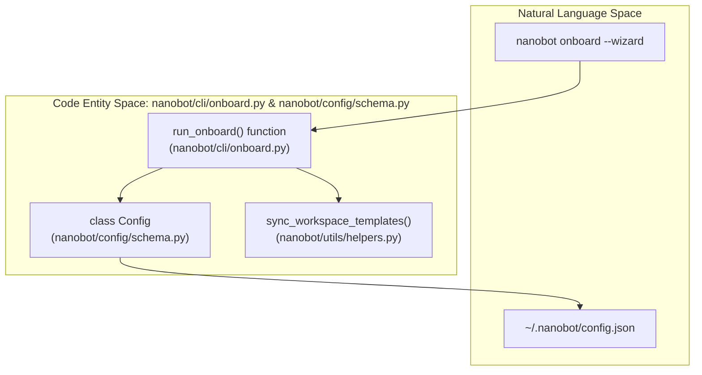
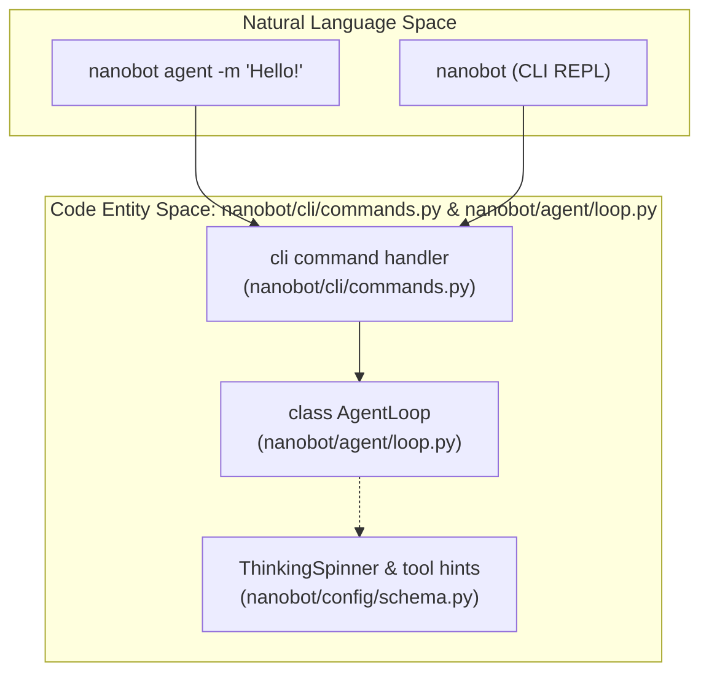

<!-- source: DeepWiki mcp.deepwiki.com · repo HKUDS/nanobot · page 2 Getting Started · fetched 2026-10-26 -->

# Getting Started

Relevant source files

The following files were used as context for generating this wiki page:

- [docs/README.md](docs/README.md)
- [docs/chat-commands.md](docs/chat-commands.md)
- [docs/concepts.md](docs/concepts.md)
- [docs/multiple-instances.md](docs/multiple-instances.md)
- [docs/quick-start.md](docs/quick-start.md)
- [docs/start-without-technical-background.md](docs/start-without-technical-background.md)
- [docs/troubleshooting.md](docs/troubleshooting.md)
- [docs/webui.md](docs/webui.md)
- [nanobot/cli/onboard.py](nanobot/cli/onboard.py)
- [tests/agent/test_onboard_logic.py](tests/agent/test_onboard_logic.py)

This page provides a high-level overview of setting up, initializing, and running nanobot for the first time. It introduces initial installation paths, configuration schemas, workspace bootstrapping, and first-run agent interactions. 

For detailed technical instructions, see the child pages:
- [Installation & Configuration](#2.1) — Detail the installation process via pip/uv, `config.json` structure, and the onboard wizard flow
- [First Run & Interactive Mode](#2.2) — Walk through running nanobot agent for the first time, using the CLI REPL, and understanding the `ThinkingSpinner` and tool hints

---

## Installation & Configuration Overview

nanobot requires Python ≥3.11 and supports multiple installation methods across operating systems [nanobot/cli/commands.py:12-21](), [docs/start-without-technical-background.md:7-10](). The setup process initializes a configuration file (`config.json`) and a managed workspace directory [nanobot/cli/commands.py:121-131](), [nanobot/config/schema.py:116-166]().

Title: Onboard Command & Configuration Flow

The interactive onboarding questionnaire is handled by `run_onboard()` [nanobot/cli/onboard.py:22-23]() and populates the `Config` Pydantic model defined in `nanobot/config/schema.py` [nanobot/config/schema.py:7-10](). Workspace bootstrap templates are synchronized via `sync_workspace_templates` [tests/agent/test_onboard_logic.py:26-26]().

For detailed installation steps via pip, uv, or source, and full structure of `config.json`, see [Installation & Configuration](#2.1).

**Sources:** [nanobot/cli/onboard.py:22-23](), [nanobot/config/schema.py:7-10](), [nanobot/cli/commands.py:121-131](), [tests/agent/test_onboard_logic.py:26-26]()

---

## First Run & Interactive Mode

Once configured, nanobot can be executed via the WebUI workbench or the terminal-based CLI REPL [README.md:15-23](), [docs/quick-start.md:101-120](). The command router bridges user commands directly into the core execution engine [nanobot/cli/commands.py:51-60]().

Title: CLI Execution & Agent Interaction Flow

The `AgentLoop` class orchestrates turn execution, while runtime visual feedback such as the `ThinkingSpinner` and real-time tool hints are configured through `nanobot/config/schema.py` [nanobot/agent/loop.py:51-51](), [nanobot/config/schema.py:134-146]().

For a complete walkthrough of running the agent for the first time, using the CLI REPL, and understanding tool execution hints, see [First Run & Interactive Mode](#2.2).

**Sources:** [nanobot/cli/commands.py:51-60](), [nanobot/agent/loop.py:51-51](), [nanobot/config/schema.py:134-146]()

---

## Next Steps

- For deep-dive installation methods, environment variables, and config schemas, proceed to [Installation & Configuration](#2.1).
- For interactive terminal usage, command shortcuts, and spinner settings, proceed to [First Run & Interactive Mode](#2.2).
- For overall system layout and component design, see [Architecture](#3).

**Sources:** [README.md:41-50](), [docs/quick-start.md:121-135]()

---

