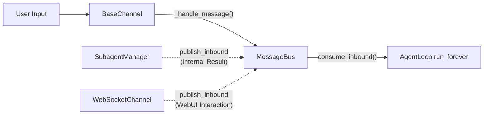
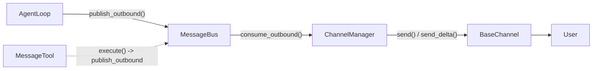
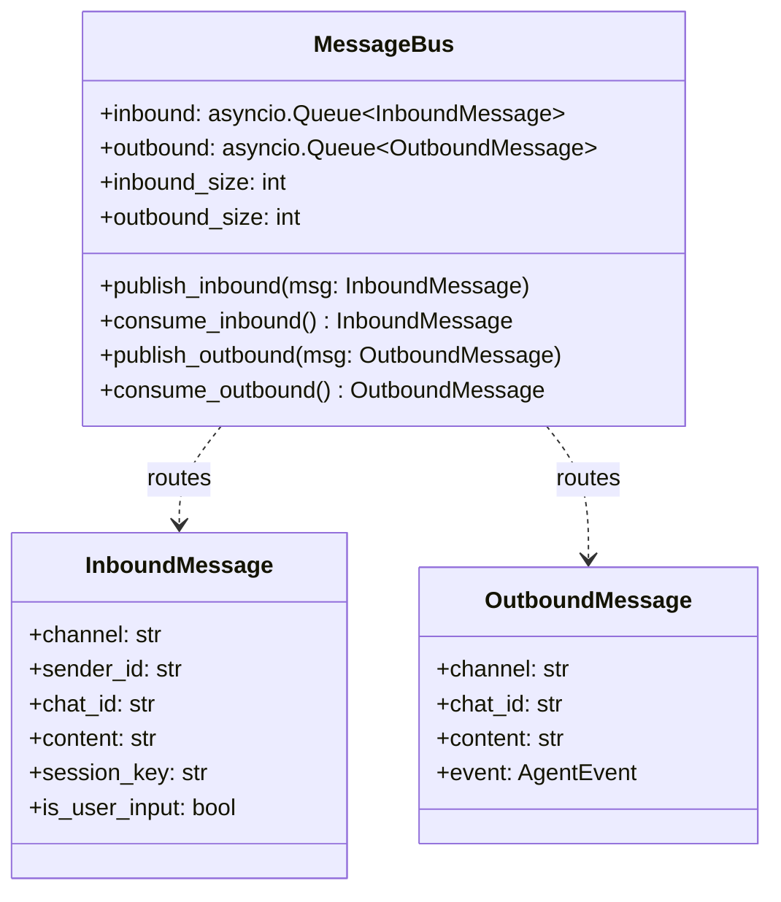
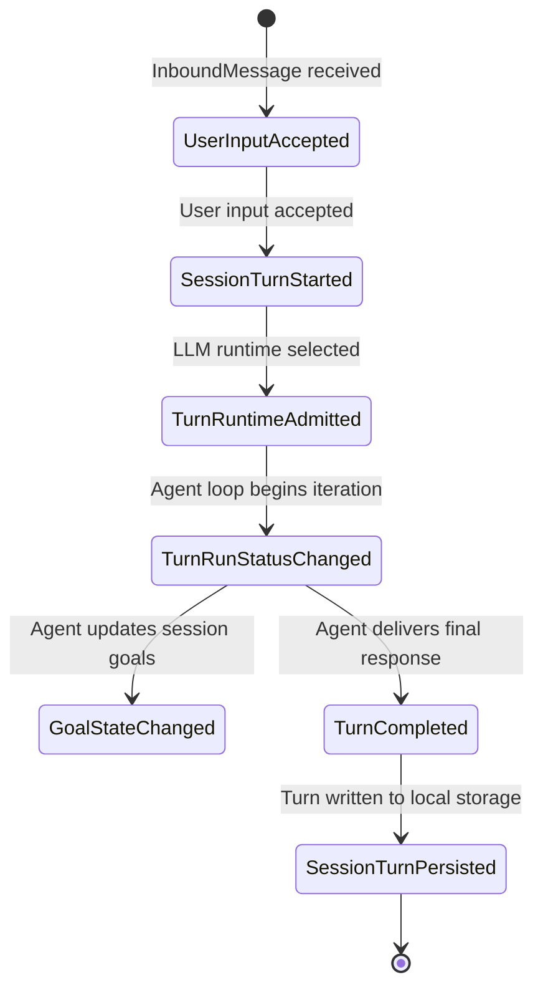
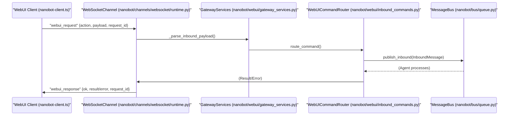

<!-- source: DeepWiki mcp.deepwiki.com · repo HKUDS/nanobot · page 3.1 Message Bus & Event Flow · fetched 2026-10-26 -->

# Message Bus & Event Flow

Relevant source files

The following files were used as context for generating this wiki page:

- [nanobot/agent/tools/sessions.py](nanobot/agent/tools/sessions.py)
- [nanobot/agent/turn_delivery.py](nanobot/agent/turn_delivery.py)
- [nanobot/bus/events.py](nanobot/bus/events.py)
- [nanobot/bus/outbound_events.py](nanobot/bus/outbound_events.py)
- [nanobot/bus/runtime_events.py](nanobot/bus/runtime_events.py)
- [nanobot/channels/websocket/runtime.py](nanobot/channels/websocket/runtime.py)
- [nanobot/channels/websocket/tests/test_websocket_channel.py](nanobot/channels/websocket/tests/test_websocket_channel.py)
- [nanobot/channels/websocket/tests/test_websocket_envelope_media.py](nanobot/channels/websocket/tests/test_websocket_envelope_media.py)
- [nanobot/session/keys.py](nanobot/session/keys.py)
- [nanobot/session/webui_turns.py](nanobot/session/webui_turns.py)
- [nanobot/webui/session_access.py](nanobot/webui/session_access.py)
- [tests/agent/test_turn_delivery.py](tests/agent/test_turn_delivery.py)
- [tests/agent/tools/test_session_history_pagination.py](tests/agent/tools/test_session_history_pagination.py)
- [tests/agent/tools/test_sessions.py](tests/agent/tools/test_sessions.py)
- [tests/bus/test_runtime_events.py](tests/bus/test_runtime_events.py)
- [tests/utils/test_webui_turn_helpers.py](tests/utils/test_webui_turn_helpers.py)
- [tests/webui/test_session_mentions.py](tests/webui/test_session_mentions.py)
- [webui/src/lib/nanobot-client.ts](webui/src/lib/nanobot-client.ts)
- [webui/src/tests/nanobot-client.test.ts](webui/src/tests/nanobot-client.test.ts)

**Purpose and Scope**: This document details the message bus architecture and event flow system in nanobot. The message bus (`MessageBus`) is the central async communication backbone that decouples components and enables concurrent message processing. It routes `InboundMessage` and `OutboundMessage` events between channels, the gateway, and the agent loop. It also describes the `RuntimeEventBus` used for in-process state notifications.

---

## Message Bus Overview

The `MessageBus` implements an async producer/consumer pattern using `asyncio.Queue` primitives. It maintains two separate queues: [nanobot/bus/queue.py:16-18]()

| Queue | Direction | Producers | Consumers |
|-------|-----------|-----------|-----------|
| **Inbound Queue** | Channel → Agent | `Gateway`, `BaseChannel` implementations, `SubagentManager` | `AgentLoop` |
| **Outbound Queue** | Agent → Channel | `AgentLoop`, `MessageTool`, `SubagentManager` | `ChannelManager` |

The bus enables:
- **Decoupled Communication**: Components communicate without direct references. [nanobot/bus/queue.py:9-14]()
- **Concurrent Processing**: Multiple messages can be queued while the agent processes. [nanobot/bus/queue.py:17-18]()
- **Async/Await**: Non-blocking operations throughout the stack using `asyncio`. [nanobot/bus/queue.py:1-44]()
- **System Messages**: Internal components can inject messages into the inbound flow (e.g., subagent completions or internal runtime control). [nanobot/bus/queue.py:20-22](), [nanobot/bus/events.py:15-21]()

**Sources**: [nanobot/bus/queue.py:8-44](), [nanobot/bus/events.py:10-21]()

---

## Event Types

### InboundMessage

Represents a message flowing **into** the agent for processing. [nanobot/bus/events.py:24-25]()

Title: "Inbound Message Routing Flow"

**Key Fields**: [nanobot/bus/events.py:27-37]()

| Field | Type | Description |
|-------|------|-------------|
| `channel` | `str` | Channel identifier (e.g. `"telegram"`, `"discord"`, `"websocket"`) |
| `sender_id` | `str` | User/sender identifier |
| `chat_id` | `str` | Chat/conversation identifier |
| `content` | `str` | Message text content |
| `timestamp` | `datetime` | Arrival time [nanobot/bus/events.py:32]() |
| `media` | `list[str]` | Optional media file paths or URLs |
| `metadata` | `dict` | Channel-specific data |
| `session_key_override` | `str \| None` | Optional override for thread-scoped sessions |
| `require_existing_session` | `bool` | If `True`, message is dropped if no session exists. [nanobot/bus/events.py:36]() |
| `input_role` | `Literal["user", "system"] \| None` | Explicit role for the input message. [nanobot/bus/events.py:37]() |

**Computed Property**:
- `session_key` → `f"{channel}:{chat_id}"` — uniquely identifies a conversation session unless `session_key_override` is provided. [nanobot/bus/events.py:40-43]()
- `is_user_input` → `bool` — indicates if the message should be treated as user input. [nanobot/bus/events.py:45-49]()

**Sources**: [nanobot/bus/events.py:23-50](), [nanobot/bus/queue.py:20-22]()

### OutboundMessage

Represents a message flowing **out** from the agent to a channel. [nanobot/bus/events.py:53-54]() It can carry a typed `OutboundEvent` for runtime/UI semantics. [nanobot/bus/events.py:68]()

Title: "Outbound Message Delivery Flow"

**Key Fields**: [nanobot/bus/events.py:61-68]()

| Field | Type | Description |
|-------|------|-------------|
| `channel` | `str` | Target channel |
| `chat_id` | `str` | Target chat identifier |
| `content` | `str` | Response text |
| `event` | `AgentEvent \| None` | Typed runtime event (e.g., `ProgressEvent`, `StreamDeltaEvent`) [nanobot/bus/events.py:68](), [nanobot/bus/outbound_events.py:119-131]() |
| `reply_to` | `str \| None` | ID of message being replied to |
| `media` | `list[str]` | Optional media attachments |
| `buttons` | `list[list[str]]` | Optional inline keyboard buttons |
| `metadata` | `dict` | Optional metadata (e.g. `_agent_ui` for rich clients) [nanobot/bus/events.py:13]() |

**Sources**: [nanobot/bus/events.py:52-68](), [nanobot/bus/queue.py:28-30](), [nanobot/bus/outbound_events.py:119-131]()

---

## MessageBus Implementation

Title: "MessageBus Class Diagram"

### Core Methods

| Method | Direction | Async | Description |
|--------|-----------|-------|-------------|
| `publish_inbound(msg)` | → Agent | Yes | Enqueue inbound message for agent processing. [nanobot/bus/queue.py:20-22]() |
| `consume_inbound()` | Agent ← | Yes | Dequeue next inbound message (blocks until available). [nanobot/bus/queue.py:24-26]() |
| `publish_outbound(msg)` | Agent → | Yes | Enqueue outbound message for channel delivery. [nanobot/bus/queue.py:28-30]() |
| `consume_outbound()` | ← Channel | Yes | Dequeue next outbound message (blocks until available). [nanobot/bus/queue.py:32-34]() |

**Sources**: [nanobot/bus/queue.py:8-44]()

---

## Channel Manager & Routing

The `ChannelManager` coordinates message delivery across multiple chat platforms. It initializes enabled channels and manages the dispatch loop. [nanobot/channels/manager.py:79-87]()

### Initialization and Discovery
- **Channel Registry**: The manager uses a plugin system to discover and load channel implementations like Telegram or Feishu. [nanobot/channels/manager.py:70-76]()
- **WebSocket Gateway**: For the `websocket` channel, the manager builds `GatewayServices` to bridge the Message Bus to the WebUI. [nanobot/channels/websocket/runtime.py:130-141]()
- **Config Application**: Channel-specific configurations are validated and passed to channel instances during initialization. [nanobot/channels/manager.py:166-173]()

### Dispatcher and Coalescing
- **Delta Coalescing**: Consecutive `StreamDeltaEvent` messages for the same `chat_id` and `stream_id` are merged to reduce network overhead and UI flickering. [tests/channels/test_channel_manager_delta_coalescing.py:153-163]()
- **Retry Policy**: Message sending is protected by exponential backoff (1s, 2s, 4s). [nanobot/channels/manager.py:59-60]()

### Streaming Support
Channels can implement `send_delta` for real-time text delivery. [nanobot/channels/base.py:129-151]()
- **Reasoning Streams**: Specialized methods `send_reasoning_delta` and `send_reasoning_end` allow models to stream "thinking" process to supported UIs. [nanobot/channels/base.py:153-186]()

**Sources**: [nanobot/channels/manager.py:79-190](), [nanobot/channels/base.py:129-210](), [tests/channels/test_channel_manager_delta_coalescing.py:112-212](), [nanobot/channels/websocket/runtime.py:130-141]()

---

## Runtime Events

The `RuntimeEventPublisher` is a helper class that publishes runtime state facts and turn-scoped notifications through the `MessageBus`. These events are primarily for internal agent state tracking and UI updates, not necessarily for direct user consumption. [nanobot/bus/runtime_events.py:101-106]()

### Event Types
- `SessionTurnStarted`: Triggered when a user/system turn has loaded its session and is about to build context. [nanobot/bus/runtime_events.py:29-34]()
- `UserInputAccepted`: Indicates that user input was accepted for dispatch or injection into a session. [nanobot/bus/runtime_events.py:37-42]()
- `TurnRuntimeAdmitted`: The immutable model runtime selected for one admitted turn. [nanobot/bus/runtime_events.py:45-49]()
- `TurnRunStatusChanged`: Visible run status changed for a turn (e.g., "running", "thinking"). [nanobot/bus/runtime_events.py:52-58]()
- `TurnCompleted`: A turn has delivered its final user-visible response, including latency and LLM usage. [nanobot/bus/runtime_events.py:61-74]()
- `SessionTurnPersisted`: A completed turn has been written to local session storage. [nanobot/bus/runtime_events.py:77-81]()
- `GoalStateChanged`: A session's sustained-goal state changed. [nanobot/bus/runtime_events.py:84-88]()
- `RuntimeModelChanged`: The active runtime model/preset changed. [nanobot/bus/runtime_events.py:91-95]()

### Event Lifecycle Management
The `RuntimeEventPublisher` manages the mechanics of building event contexts (`RuntimeEventContext`) and carrying per-turn metadata. It records turn-specific data like latency, runtime, and LLM usage. [nanobot/bus/runtime_events.py:101-162]()

Title: "Runtime Event State Machine"

**Sources**: [nanobot/bus/runtime_events.py:1-236](), [tests/bus/test_runtime_events.py:19-151]()

---

## WebUI-Specific Event Handling

The `WebSocketChannel` and associated WebUI components (`nanobot-client.ts`) handle a specialized set of events and metadata for rich client interactions.

### Inbound WebUI Commands
The WebUI client can send `webui_request` messages to the `WebSocketChannel` to trigger specific actions, such as updating provider settings or installing skills. These requests are correlated by a `request_id`. [nanobot/channels/websocket/tests/test_websocket_channel.py:187-207](), [webui/src/lib/nanobot-client.ts:145-165]()

Title: "WebUI Inbound Command Flow"

**Sources**: [nanobot/channels/websocket/tests/test_websocket_channel.py:187-207](), [webui/src/lib/nanobot-client.ts:145-165](), [nanobot/channels/websocket/runtime.py:45-46]()

### Outbound WebUI Projection
The `WebUIOutboundProjector` transforms generic `OutboundMessage` events into a format suitable for the WebUI, including handling `ProgressEvent` for streaming updates and `TurnEndEvent` for turn completion. [nanobot/channels/websocket/runtime.py:51-56]()

- **`OUTBOUND_META_AGENT_UI`**: A special metadata key used to embed structured, channel-agnostic UI payloads within `OutboundMessage`. [nanobot/bus/events.py:13]()
- **`WEBUI_TURN_METADATA_KEY`**: Used to mark messages related to WebUI turns. [nanobot/webui/metadata.py:6]()
- **`WEBSOCKET_TURN_OWNER_METADATA_KEY`**: Identifies the owner of a WebSocket turn. [nanobot/webui/metadata.py:6]()
- **Turn Lifecycle**: The `nanobot.session.webui_turns` module manages the lifecycle of WebUI turns, including tracking active turns and handling persistence failures. [nanobot/session/webui_turns.py:68-85]()

**Sources**: [nanobot/channels/websocket/runtime.py:51-56](), [nanobot/bus/events.py:13](), [nanobot/webui/metadata.py:6](), [nanobot/session/webui_turns.py:68-85](), [nanobot/channels/websocket/tests/test_websocket_channel.py:25-39]()

### Session Tools and WebUI Access
The `SearchSessionsTool` and `ReadSessionTool` allow the agent to interact with persisted conversation history, which is often managed by the WebUI's session access layer. [nanobot/agent/tools/sessions.py:83-179]()

- **`WebuiSessionAccess`**: Provides methods to search and read session data, filtering for visible user and assistant messages. [nanobot/webui/session_access.py:169-172]()
- **Transcript Reading**: These tools can read from the full WebUI transcript, even after compaction, ensuring comprehensive search results. [tests/agent/tools/test_sessions.py:82-107]()
- **Hidden Content**: Private or non-conversation messages (e.g., runtime context, tool calls) are hidden from these tools. [tests/agent/tools/test_sessions.py:176-195]()

**Sources**: [nanobot/agent/tools/sessions.py:83-179](), [nanobot/webui/session_access.py:169-172](), [tests/agent/tools/test_sessions.py:82-107](), [tests/agent/tools/test_sessions.py:176-195]()

---

## Sender Approval & Pairing

For direct message (DM) channels, nanobot uses a pairing system to authorize senders. [nanobot/pairing/store.py:1-6]()

- **Pairing Store**: A persistent JSON store (`pairing.json`) tracks approved senders and pending codes. [nanobot/pairing/store.py:32-34]()
- **Flow**: When an unknown sender sends a DM, the channel generates a temporary code (e.g., `ABCD-EFGH`). [nanobot/pairing/store.py:113-136]()
- **Approval**: The owner approves the code via the WebUI or a slash command, moving the sender to the `approved` list. [nanobot/pairing/store.py:139-157]()
- **ACL Check**: `BaseChannel.is_allowed` checks this store before publishing to the bus. [tests/channels/test_base_channel.py:60-67]()

**Sources**: [nanobot/pairing/store.py:1-206](), [nanobot/channels/base.py:13-18](), [tests/channels/test_base_channel.py:28-67]()

---

