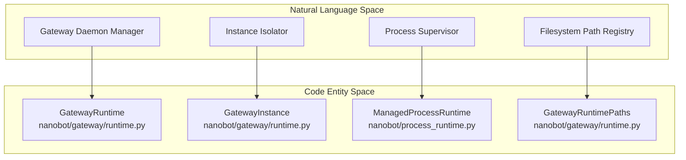
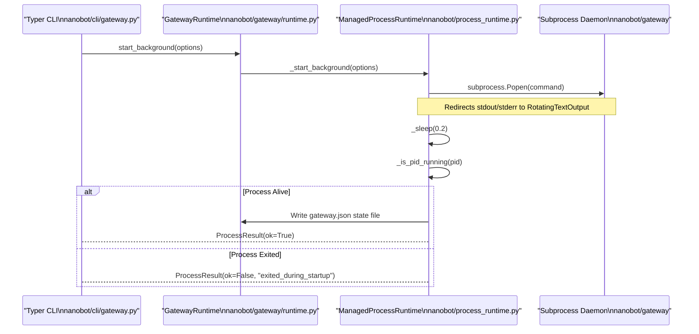
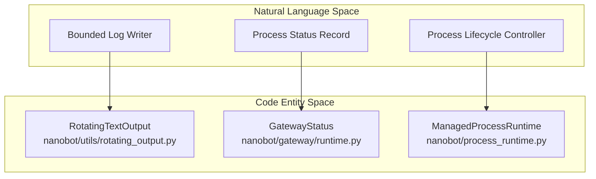

<!-- source: DeepWiki mcp.deepwiki.com · repo HKUDS/nanobot · page 3.3 Gateway Runtime & Process Management · fetched 2026-10-26 -->

# Gateway Runtime & Process Management

Relevant source files

The following files were used as context for generating this wiki page:

- [nanobot/channels/websocket/tests/test_websocket_runtime_lifecycle.py](nanobot/channels/websocket/tests/test_websocket_runtime_lifecycle.py)
- [nanobot/cli/gateway.py](nanobot/cli/gateway.py)
- [nanobot/cli/gateway_runtime.py](nanobot/cli/gateway_runtime.py)
- [nanobot/gateway/__init__.py](nanobot/gateway/__init__.py)
- [nanobot/gateway/runtime.py](nanobot/gateway/runtime.py)
- [nanobot/process_runtime.py](nanobot/process_runtime.py)
- [nanobot/utils/rotating_output.py](nanobot/utils/rotating_output.py)
- [tests/cli/test_gateway_commands.py](tests/cli/test_gateway_commands.py)
- [tests/cli/test_gateway_runtime.py](tests/cli/test_gateway_runtime.py)
- [tests/gateway/test_runtime.py](tests/gateway/test_runtime.py)
- [tests/utils/test_rotating_output.py](tests/utils/test_rotating_output.py)

This page documents the gateway daemon architecture, process runtime supervision, daemon lifecycle modes, rotating log infrastructure, and CLI gateway commands in `nanobot`.

---

## 1. Gateway Architecture & Components

The gateway component runs as a persistent local daemon or in the foreground, coordinating communication channels, the message bus, scheduled automation, and agent turns. Process supervision and runtime layout are factored into reusable classes across `nanobot/gateway/runtime.py` and `nanobot/process_runtime.py`.

* **`GatewayInstance`**: Resolves configuration paths, workspace directories, and runtime file selectors for isolated gateway instances [nanobot/gateway/runtime.py:153-185]().
* **`GatewayRuntimePaths`**: Manages filesystem paths for state files (JSON process records) and rotating log files under the data directory [nanobot/gateway/runtime.py:128-150]().
* **`ManagedProcessRuntime`**: A generic cross-platform base class handling detached background process execution, PID liveness checks, and state file locking [nanobot/process_runtime.py:81-197]().
* **`GatewayRuntime`**: Subclasses `ManagedProcessRuntime` to supervise background `nanobot gateway` instances [nanobot/gateway/runtime.py:202-217]().

### Diagram: Gateway Architecture to Code Entity Mapping

*Sources: [nanobot/gateway/runtime.py:128-217](), [nanobot/process_runtime.py:81-197]()*

---

## 2. Gateway Lifecycle & Execution Modes

The gateway supports two primary launch modes: **foreground** (suitable for terminal debugging, systemd, or docker containers) and **background** (detached daemon managed via CLI commands) [nanobot/cli/gateway.py:142-177]().

When starting a background gateway, `ManagedProcessRuntime._start_background()` spawns the child process with redirected environment variables for rotating output, verifies that the process remains running after 200ms, and writes a state record containing the PID, start timestamp, port, and workspace configuration [nanobot/process_runtime.py:107-154]().

### Diagram: Background Gateway Startup & Readiness Sequence

If a user attempts to start a foreground gateway when another instance is already claiming the configured port and runtime state, a `GatewayAlreadyRunningError` is raised [nanobot/gateway/runtime.py:99-105](). Health readiness is probed via the management HTTP endpoint using `_gateway_health_ready()` [nanobot/gateway/runtime.py:42-66]().

*Sources: [nanobot/cli/gateway.py:142-177](), [nanobot/gateway/runtime.py:42-105](), [nanobot/process_runtime.py:107-154]()*

---

## 3. Process Supervision, State, and Rotating Logs

Background processes managed by nanobot use bounded output streams to prevent log files from growing indefinitely.

* **`RotatingTextOutput`**: Implements a UTF-8 text stream (`io.TextIOBase`) that enforces a maximum size cap (`DEFAULT_MAX_BYTES`, default 10MB) and a backup rotation count (`DEFAULT_BACKUP_COUNT`, default 5) [nanobot/utils/rotating_output.py:22-182]().
* **Environment Injection**: Background processes receive output redirection paths via environment variables such as `_NANOBOT_BACKGROUND_LOG_PATH`, `_NANOBOT_BACKGROUND_LOG_MAX_BYTES`, and `_NANOBOT_BACKGROUND_LOG_BACKUP_COUNT` [nanobot/utils/rotating_output.py:14-16]().

### Diagram: Rotating Output Code Entity Mapping

*Sources: [nanobot/utils/rotating_output.py:22-182](), [nanobot/gateway/runtime.py:74-81](), [nanobot/process_runtime.py:81-197]()*

---

## 4. Graceful Shutdown & Resource Teardown

Foreground gateways install robust signal handlers for `SIGINT` and `SIGTERM` via `_install_gateway_shutdown_handlers()` [nanobot/cli/gateway_runtime.py:100-147](). 

When shutting down, runtime tasks, in-flight agent turns, execution sessions, subagents, and Model Context Protocol (MCP) servers are closed cleanly with bounded timeouts to prevent hanging threads or zombie processes [tests/cli/test_gateway_runtime.py:1-8]() [tests/cli/test_gateway_runtime.py:190-211]().

*Sources: [nanobot/cli/gateway_runtime.py:100-147](), [tests/cli/test_gateway_runtime.py:1-211]()*

---

## 5. CLI Gateway Lifecycle Commands

The `nanobot gateway` CLI command router is constructed via `create_gateway_app()` [nanobot/cli/gateway.py:49-141](). It exposes options to configure port binding, workspace isolation, verbosity, and execution mode.

| Command / Flag | Description | Code Reference |
| :--- | :--- | :--- |
| `nanobot gateway` | Starts the gateway (defaults to foreground mode). | [nanobot/cli/gateway.py:142-152]() |
| `--foreground` | Runs the gateway in the foreground process. | [nanobot/cli/gateway.py:149]() |
| `--background` | Starts the gateway as a detached background daemon. | [nanobot/cli/gateway.py:150]() |
| `--port, -p` | Specifies the listening port for the gateway. | [nanobot/cli/gateway.py:145]() |
| `--workspace, -w` | Specifies an isolated workspace directory. | [nanobot/cli/gateway.py:146]() |
| `--config, -c` | Points to a custom configuration JSON file. | [nanobot/cli/gateway.py:148]() |
| `--verbose, -v` | Enables debug logging output. | [nanobot/cli/gateway.py:147]() |

*Sources: [nanobot/cli/gateway.py:49-177]()*

---

