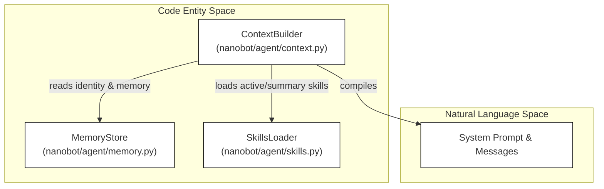
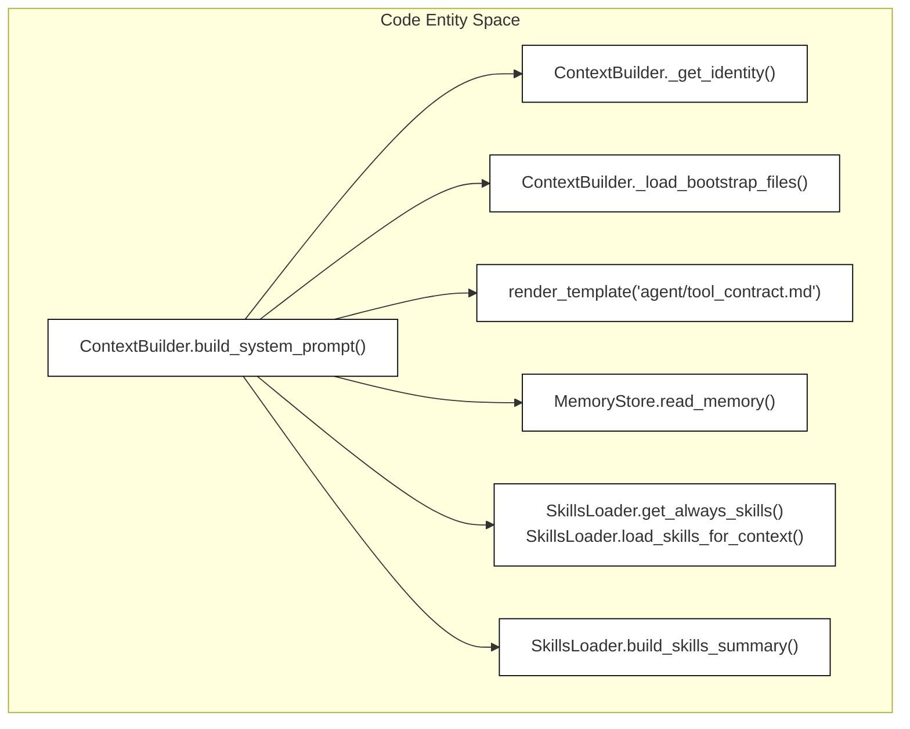

<!-- source: DeepWiki mcp.deepwiki.com · repo HKUDS/nanobot · page 4.2 Context Building · fetched 2026-10-26 -->

# Context Building

<details>
<summary>Relevant source files</summary>

The following files were used as context for generating this wiki page:

- [nanobot/agent/context.py](nanobot/agent/context.py)
- [nanobot/skills/memory/SKILL.md](nanobot/skills/memory/SKILL.md)
- [nanobot/templates/AGENTS.md](nanobot/templates/AGENTS.md)
- [nanobot/templates/HEARTBEAT.md](nanobot/templates/HEARTBEAT.md)
- [nanobot/templates/SOUL.md](nanobot/templates/SOUL.md)
- [nanobot/templates/agent/dream.md](nanobot/templates/agent/dream.md)
- [nanobot/templates/agent/identity.md](nanobot/templates/agent/identity.md)
- [nanobot/templates/agent/tool_contract.md](nanobot/templates/agent/tool_contract.md)
- [nanobot/templates/legacy/SOUL.md](nanobot/templates/legacy/SOUL.md)
- [tests/agent/test_context_builder.py](tests/agent/test_context_builder.py)
- [tests/agent/test_context_prompt_cache.py](tests/agent/test_context_prompt_cache.py)
- [tests/agent/test_dream.py](tests/agent/test_dream.py)
- [tests/tools/test_tool_descriptions.py](tests/tools/test_tool_descriptions.py)

</details>


This page documents `ContextBuilder` — the component responsible for assembling the full prompt payload sent to the LLM on every agent turn. It covers the ordered pipeline for building the system prompt, transcript and message list construction, runtime metadata injection, and session context routing.

For information about how `ContextBuilder` is invoked turn-by-turn, see the **Agent Loop (4.1)**. For the memory consolidation process that feeds data into the context, see **Memory System (4.3)**. For the skills system, see **Skills (4.4)**.

---

## 1. Overview & Component Architecture

`ContextBuilder` is defined in `nanobot/agent/context.py` [nanobot/agent/context.py:89-100]() and instantiated once per agent runtime session. It composes inputs from a `MemoryStore` instance and a `SkillsLoader` instance, centralizing system prompt creation and transcript formatting.



Sources: [nanobot/agent/context.py:89-100]()

---

## 2. System Prompt Pipeline

`ContextBuilder.build_system_prompt()` assembles the static system prompt in a fixed order, joining individual segments with `\n\n---\n\n` separators [nanobot/agent/context.py:101-152]().



Sources: [nanobot/agent/context.py:101-152]()

### Identity & Runtime Block

`_get_identity()` initializes the prompt using the `agent/identity.md` template [nanobot/agent/context.py:154-169](). It includes platform metadata (`platform.system()`, `platform.machine()`, `platform.python_version()`), workspace paths, and platform-specific policies [nanobot/agent/context.py:154-170](), [tests/agent/test_context_prompt_cache.py:36-49](). When a specific communication channel (e.g., `telegram`, `whatsapp`) is active, channel-specific format hints are appended [nanobot/agent/context.py:168](), [tests/agent/test_context_prompt_cache.py:159-186]().

Sources: [nanobot/agent/context.py:154-170](), [tests/agent/test_context_prompt_cache.py:36-49](), [tests/agent/test_context_prompt_cache.py:159-186]()

### Bootstrap Files

`_load_bootstrap_files()` inspects the workspace root for `BOOTSTRAP_FILES = ["AGENTS.md", "SOUL.md", "USER.md"]` [nanobot/agent/context.py:92](). Files matching unchanged default templates are skipped to conserve context tokens [tests/agent/test_context_builder.py:156-166](). Custom modifications are loaded and appended [tests/agent/test_context_builder.py:167-169]().

Sources: [nanobot/agent/context.py:92](), [tests/agent/test_context_builder.py:156-169]()

### Long-Term Memory and Skills

- **Long-Term Memory**: `MemoryStore.read_memory()` reads `MEMORY.md` from the workspace and verifies it is not default placeholder content [nanobot/agent/context.py:127-131]().
- **Active Skills**: `SkillsLoader.get_always_skills()` identifies skills flagged as always-active, loading their full instructions into the prompt [nanobot/agent/context.py:132-136]().
- **Skills Summary**: `SkillsLoader.build_skills_summary()` constructs a catalog summary of remaining on-demand skills [nanobot/agent/context.py:138-143]().
- **Session Summaries**: When `SessionSummary` is provided, archived conversation context is appended [nanobot/agent/context.py:145-150]().

Sources: [nanobot/agent/context.py:127-150]()

---

## 3. Message & Transcript Assembly

`ContextBuilder` transforms raw history entries and current user inputs into formatted message dicts consumed by LLM providers via helper structures like `TranscriptInput` [nanobot/agent/context.py:73-87]().

```python
@dataclass(frozen=True, slots=True)
class TranscriptInput:
    history: list[dict[str, Any]]
    current_message: str | None
    media: Sequence[str] | None = None
    current_role: str = "user"
    session_summary: SessionSummary | None = None
    runtime_context_blocks: Sequence[RuntimeContextBlock] | None = None
```

- **Content Merging**: `_merge_message_content()` handles multi-part message contents (such as text combined with image lists) [nanobot/agent/context.py:171-173](), [tests/agent/test_context_builder.py:23-70]().
- **Runtime Context Blocks**: Dynamic environment details (such as current time, active CLI apps, and channel metadata) are appended to the final user message block [tests/agent/test_context_prompt_cache.py:92-110]().

Sources: [nanobot/agent/context.py:73-87](), [nanobot/agent/context.py:171-173](), [tests/agent/test_context_builder.py:23-70](), [tests/agent/test_context_prompt_cache.py:92-110]()

---

## 4. Runtime Control & Persisted Context Resolution

`ContextBuilder` coordinates turn-attached capabilities and session lifecycle commands:

- **`session_extra(metadata)`**: Aggregates persistent keyword arguments for capabilities across CLI apps, MCP tools, and session tools [nanobot/agent/context.py:35-41]().
- **`handle_runtime_control()`**: Intercepts inbound control messages such as session discard events (`RUNTIME_CONTROL_SESSION_DISCARD`) before standard execution proceeds [nanobot/agent/context.py:44-49]().
- **`PersistedPromptContextResolver`**: Restores prompt routing context and resolves workspace scopes when processing background tasks or sessions lacking an active inbound message [nanobot/agent/context.py:52-70]().

Sources: [nanobot/agent/context.py:35-70]()

---

