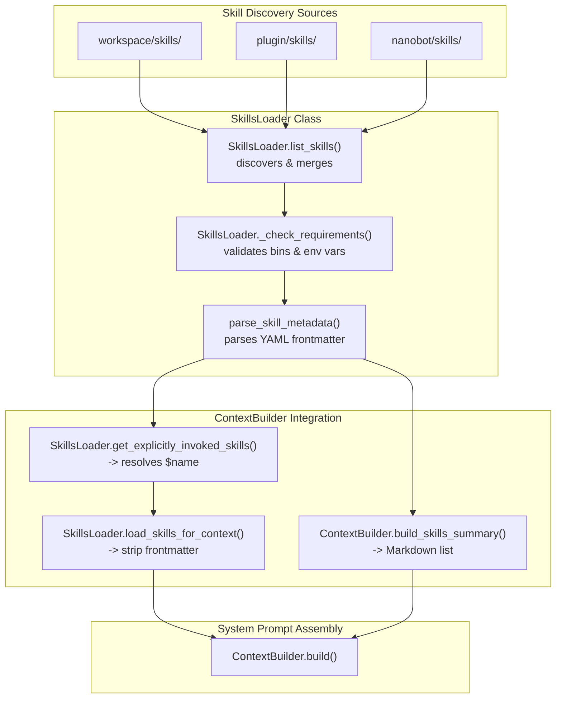
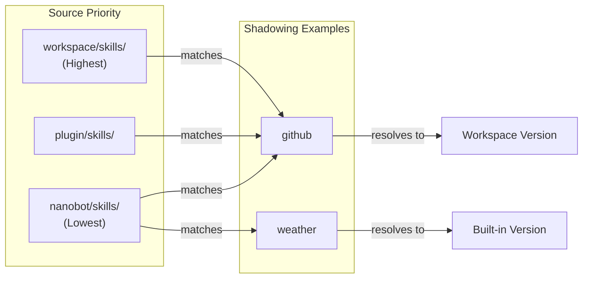

<!-- source: DeepWiki mcp.deepwiki.com · repo HKUDS/nanobot · page 4.4 Skills · fetched 2026-10-26 -->

# Skills

<details>
<summary>Relevant source files</summary>

The following files were used as context for generating this wiki page:

- [nanobot/agent/skills.py](nanobot/agent/skills.py)
- [nanobot/agent/tools/long_task.py](nanobot/agent/tools/long_task.py)
- [nanobot/skills/README.md](nanobot/skills/README.md)
- [nanobot/skills/clawhub/SKILL.md](nanobot/skills/clawhub/SKILL.md)
- [nanobot/skills/skill-creator/SKILL.md](nanobot/skills/skill-creator/SKILL.md)
- [nanobot/skills/skill-creator/scripts/init_skill.py](nanobot/skills/skill-creator/scripts/init_skill.py)
- [nanobot/skills/skill-creator/scripts/package_skill.py](nanobot/skills/skill-creator/scripts/package_skill.py)
- [nanobot/skills/skill-creator/scripts/quick_validate.py](nanobot/skills/skill-creator/scripts/quick_validate.py)
- [nanobot/templates/agent/skills_section.md](nanobot/templates/agent/skills_section.md)
- [nanobot/templates/agent/subagent_system.md](nanobot/templates/agent/subagent_system.md)
- [tests/agent/test_skills_loader.py](tests/agent/test_skills_loader.py)
- [tests/agent/tools/test_long_task.py](tests/agent/tools/test_long_task.py)

</details>


The skills system provides modular knowledge packages that extend the agent's capabilities without requiring code changes. This page documents how `SkillsLoader` [nanobot/agent/skills.py:51-57]() discovers and loads skills, the `SKILL.md` format specification, runtime requirement validation, the progressive disclosure loading strategy, and built-in skill implementations.

Skills integrate with the agent through the `ContextBuilder` [nanobot/agent/context.py:1-8](). For memory and cron virtual tool patterns, see [Memory System](4.3) and [Automation & Scheduling](10).

---

## Overview

Skills are declarative knowledge modules stored as Markdown files. Unlike tools (executable Python functions), skills are documentation artifacts that teach the LLM how to accomplish specific tasks using existing tools [nanobot/skills/skill-creator/SKILL.md:12-22]().

Title: Skill System Data Flow


**Key distinction:** Tools provide runtime execution capabilities; skills provide declarative knowledge injected into context.

Sources: [nanobot/agent/skills.py:51-163](), [nanobot/skills/skill-creator/SKILL.md:12-22]()

---

## SkillsLoader Class

`SkillsLoader` [nanobot/agent/skills.py:51-57]() manages skill discovery, requirement validation, and content loading. It is instantiated during agent setup.

### Skill Discovery and Shadowing

`list_skills()` [nanobot/agent/skills.py:90-130]() implements a three-phase discovery with a specific priority order. If a skill name exists in a higher-priority source, lower-priority sources are ignored for that name.

1. **Workspace skills:** Scanned from `workspace/skills/` [nanobot/agent/skills.py:103]().
2. **Plugin skills:** Discovered via `enabled_agent_plugin_skills(workspace)` [nanobot/agent/skills.py:102-115]().
3. **Built-in skills:** Scanned from `nanobot/skills/` [nanobot/agent/skills.py:116-119]().

Title: Skill Priority and Shadowing


Sources: [nanobot/agent/skills.py:103-119]()

### Public Methods

| Method | Signature | Return | Purpose |
|---|---|---|---|
| `list_skills` | `(filter_unavailable: bool = True)` | `list[dict]` | Discovers all skills; filters unavailable and disabled skills [nanobot/agent/skills.py:90](). |
| `load_skill` | `(name: str)` | `str \| None` | Reads raw `SKILL.md` content and handles aliases [nanobot/agent/skills.py:132-146](). |
| `load_skills_for_context` | `(skill_names: list[str])` | `str` | Loads bodies (sans frontmatter) for inclusion in prompts [nanobot/agent/skills.py:148-163](). |
| `get_explicitly_invoked_skills` | `(text: str)` | `list[str]` | Resolves `$skill-name` references to enabled, available skills [nanobot/agent/skills.py:165-180](). |
| `build_explicit_skill_runtime_context` | `(text: str)` | `RuntimeContextBlock \| None` | Builds dynamic runtime context blocks for explicitly invoked skills [nanobot/agent/skills.py:182-185](). |

Sources: [nanobot/agent/skills.py:90-185]()

---

## SKILL.md File Format

Every skill directory contains exactly one `SKILL.md` file. Its structure follows a strict modular design [nanobot/skills/skill-creator/SKILL.md:46-61]():

```
skill-name/
├── SKILL.md              ← required
│   ├── YAML frontmatter  ← required (name, description)
│   └── Markdown body     ← required (instructions)
├── scripts/              ← optional: executable code
├── references/           ← optional: documentation for on-demand context
└── assets/               ← optional: templates, images, etc.
```

### Frontmatter Fields

The YAML frontmatter block is delimited by `---` [nanobot/agent/skills.py:18-21](). `SkillsLoader` parses it using `parse_skill_metadata` [nanobot/agent/skills.py:26-36]().

| Field | Required | Description |
|---|---|---|
| `name` | Yes | Skill identifier. Must match directory name [nanobot/skills/skill-creator/SKILL.md:67](). |
| `description` | Yes | Primary triggering signal. Shown to the agent in the summary [nanobot/skills/skill-creator/SKILL.md:67](). |
| `metadata` | No | YAML object for advanced config (e.g., `requires`) [nanobot/agent/skills.py:36](). |

### Requirement Validation

Skills can specify environmental or binary requirements in their metadata. `SkillsLoader` validates these via requirement-checking helpers [nanobot/agent/skills.py:129]() before marking a skill as available.

| Requirement Type | Validation Method | Pass Condition |
|---|---|---|
| `requires.bins` | `shutil.which(bin)` | Binary found on system `PATH` [tests/agent/test_skills_loader.py:141-146](). |
| `requires.env` | `os.environ.get(var)` | Variable is defined in environment [nanobot/agent/skills.py:223-225](). |

Sources: [nanobot/agent/skills.py:18-48](), [nanobot/agent/skills.py:129](), [nanobot/skills/skill-creator/SKILL.md:63-69]()

---

## Progressive Disclosure Strategy

Skills employ a three-tier loading strategy to manage context window consumption efficiently [nanobot/skills/skill-creator/SKILL.md:113-120]().

**Three-tier architecture:**

| Tier | Component | Description |
|---|---|---|
| **1: Metadata** | Summary builders | Always in context (~100 words). Includes name and description so the agent knows the skill exists [nanobot/skills/skill-creator/SKILL.md:117](). |
| **2: Body** | `SKILL.md` body | Loaded only when the skill triggers or is explicitly requested via `$name` [nanobot/skills/skill-creator/SKILL.md:118](). |
| **3: Resources** | Bundled files | Loaded as needed by the agent using tools like `read_file` or `grep`. Scripts can be executed without reading them into the context [nanobot/skills/skill-creator/SKILL.md:119-120](). |

**Key Principle:** "Concise is Key." The agent is assumed to be smart; only add context it doesn't already have [nanobot/skills/skill-creator/SKILL.md:26-32]().

Sources: [nanobot/skills/skill-creator/SKILL.md:113-126](), [nanobot/agent/skills.py:195-207]()

---

## Always-Active vs. On-Demand Skills

Skills can be configured to be always present in the context or loaded dynamically based on the conversation content.

### Always-Active Skills
Skills defined in configuration or flagged with `always: true` in their frontmatter [nanobot/skills/skill-creator/scripts/quick_validate.py:186-188]() are included in every interaction's context.

### On-Demand (Explicit) Loading
If a skill is not "always-active," it can be triggered by a `$skill-name` reference in the user's message. The `get_explicitly_invoked_skills()` [nanobot/agent/skills.py:165-180]() method detects these references, and `build_explicit_skill_runtime_context()` injects the full `SKILL.md` body into the current turn's runtime context.

Sources: [nanobot/agent/skills.py:165-193](), [nanobot/skills/skill-creator/scripts/quick_validate.py:186-188]()

---

## Creating and Packaging Skills

The `skill-creator` skill [nanobot/skills/skill-creator/SKILL.md:1-6]() provides guidance and scripts for skill development.

### Validation and Packaging Scripts
The skill creation process emphasizes strict naming and structure:
- **Naming:** Must satisfy the regex `^[a-z0-9](?:[a-z0-9-]*[a-z0-9])?$` [nanobot/agent/skills.py:22]().
- **Structure:** A skill package should contain `SKILL.md` and optional resource directories (`scripts/`, `references/`, `assets/`) [nanobot/skills/skill-creator/SKILL.md:46-61]().
- **Validation:** `quick_validate.py` inspects frontmatter keys and folder structures [nanobot/skills/skill-creator/scripts/quick_validate.py:132-198]().
- **Packaging:** `package_skill.py` bundles validated skill directories into `.skill` archives [nanobot/skills/skill-creator/scripts/package_skill.py:34-125]().

Sources: [nanobot/agent/skills.py:22](), [nanobot/skills/skill-creator/SKILL.md:46-61](), [nanobot/skills/skill-creator/scripts/quick_validate.py:132-198](), [nanobot/skills/skill-creator/scripts/package_skill.py:34-125]()

---

