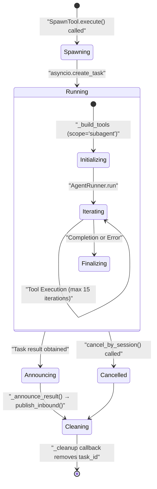

<!-- source: DeepWiki mcp.deepwiki.com · repo HKUDS/nanobot · page 4.5 Subagents · fetched 2026-10-26 -->

# Subagents

<details>
<summary>Relevant source files</summary>

The following files were used as context for generating this wiki page:

- [nanobot/agent/subagent.py](nanobot/agent/subagent.py)
- [nanobot/agent/tools/loader.py](nanobot/agent/tools/loader.py)
- [nanobot/agent/tools/spawn.py](nanobot/agent/tools/spawn.py)
- [tests/agent/test_runner_errors.py](tests/agent/test_runner_errors.py)
- [tests/agent/test_runner_safety.py](tests/agent/test_runner_safety.py)
- [tests/agent/test_runner_tool_execution.py](tests/agent/test_runner_tool_execution.py)
- [tests/agent/test_subagent.py](tests/agent/test_subagent.py)
- [tests/agent/test_subagent_lifecycle.py](tests/agent/test_subagent_lifecycle.py)
- [tests/agent/test_task_cancel.py](tests/agent/test_task_cancel.py)
- [tests/agent/test_tool_loader_entrypoints.py](tests/agent/test_tool_loader_entrypoints.py)
- [tests/agent/test_unified_session.py](tests/agent/test_unified_session.py)
- [tests/agent/tools/test_self_tool_runtime_sync.py](tests/agent/tools/test_self_tool_runtime_sync.py)
- [tests/agent/tools/test_subagent_tools.py](tests/agent/tools/test_subagent_tools.py)
- [tests/providers/test_provider_error_metadata.py](tests/providers/test_provider_error_metadata.py)
- [tests/test_tool_contextvars.py](tests/test_tool_contextvars.py)

</details>


This page covers the background task execution system: `SubagentManager` (the lifecycle manager) and `SpawnTool` (the LLM-facing interface). This is a sub-component of the Agent subsystem; for the overall Agent orchestration see [Agent Loop](4.1), and for the `SpawnTool` API surface see [Built-in Tools](7.1).

---

## Overview

The subagent system lets the main agent delegate long-running or complex tasks to an independent background worker. The main agent calls the `spawn` tool, receives an immediate confirmation, and continues processing other messages. The background worker runs its own LLM-plus-tool loop, then injects the result back into the main agent via the `MessageBus`.

**Key design constraints:**

| Property | Value |
|---|---|
| Max iterations per subagent | 15 (default) [nanobot/agent/subagent.py:140-144]() |
| Max concurrent subagents | 1 (default per agent) [nanobot/agent/subagent.py:145-149]() |
| Tools available | filesystem, exec, web (restricted scope) [nanobot/agent/subagent.py:211-224]() |
| Tools **not** available | `spawn`, `message`, `cron`, `ask_user` [nanobot/agent/subagent.py:38-39]() |
| Result delivery | `InboundMessage` with `sender_id="subagent"` and `channel="system"` [nanobot/agent/subagent.py:341-344]() |
| Max tool result size | Configurable `max_tool_result_chars` [nanobot/agent/subagent.py:137]() |

Sources: [nanobot/agent/subagent.py:134-156](), [nanobot/agent/subagent.py:211-224](), [nanobot/agent/subagent.py:341-344]()

---

## Component Structure

**Diagram: Subagent component relationships**

```mermaid
graph TD
    AgentLoop["AgentLoop (nanobot/agent/loop.py)"]
    SpawnTool["SpawnTool (nanobot/agent/tools/spawn.py)"]
    SubagentManager["SubagentManager (nanobot/agent/subagent.py)"]
    AgentRunner["AgentRunner (nanobot/agent/runner.py)"]
    ToolRegistry["ToolRegistry (nanobot/agent/tools/registry.py)"]
    LLMProvider["LLMProvider (nanobot/providers/base.py)"]
    MessageBus["MessageBus (nanobot/bus/queue.py)"]

    subgraph "Subagent Tools (scope='subagent')"
        ReadFileTool["ReadFileTool (nanobot/agent/tools/filesystem.py)"]
        WriteFileTool["WriteFileTool (nanobot/agent/tools/filesystem.py)"]
        ExecTool["ExecTool (nanobot/agent/tools/shell.py)"]
    end

    AgentLoop -->|"calls"| SpawnTool
    SpawnTool -->|"spawn()"| SubagentManager
    SubagentManager -->|"_run_subagent()"| AgentRunner
    AgentRunner -->|"run()"| ToolRegistry
    AgentRunner -->|"chat_with_retry()"| LLMProvider
    ToolRegistry --> "Subagent Tools (scope='subagent')"
    SubagentManager -->|"_announce_result() → publish_inbound()"| MessageBus
    MessageBus -->|"InboundMessage(sender_id=subagent)"| AgentLoop
```

Sources: [nanobot/agent/subagent.py:150-156](), [nanobot/agent/subagent.py:211-224](), [nanobot/agent/subagent.py:231-274](), [nanobot/agent/subagent.py:276-321](), [nanobot/agent/tools/spawn.py:48-59](), [nanobot/agent/tools/spawn.py:76-107]()

---

## SubagentManager

`SubagentManager` [nanobot/agent/subagent.py:99-164]() is instantiated by the `AgentLoop` [nanobot/agent/loop.py:32]() and manages background `asyncio.Task` lifecycles and real-time status tracking via `SubagentStatus` [nanobot/agent/subagent.py:58-71]().

### Internal Tracking

The manager maintains three dictionaries to track tasks:
- `_running_tasks`: Maps `task_id` to the `asyncio.Task` [nanobot/agent/subagent.py:161]().
- `_task_statuses`: Stores `SubagentStatus` for progress monitoring [nanobot/agent/subagent.py:162]().
- `_session_tasks`: Groups `task_id` by `session_key` [nanobot/agent/subagent.py:163]().

### `spawn()`

[nanobot/agent/subagent.py:231-274]()

Calling `spawn()` performs the following:

1. Generates an 8-character `task_id` via `uuid.uuid4()` [nanobot/agent/subagent.py:245]().
2. Initializes a `SubagentStatus` object [nanobot/agent/subagent.py:249-254]().
3. Creates an `asyncio.Task` wrapping `_run_subagent()` [nanobot/agent/subagent.py:257-272]().
4. Attaches a `_cleanup` done callback [nanobot/agent/subagent.py:269]() that removes the task and status from tracking dictionaries upon completion or cancellation.
5. Returns an immediate confirmation string to the main agent's LLM [nanobot/agent/subagent.py:274]().

### `_run_subagent()`

[nanobot/agent/subagent.py:276-321]()

This background coroutine executes the delegated task:

1. **Tool Setup**: Builds an isolated `ToolRegistry` via `_build_tools` [nanobot/agent/subagent.py:211-224](). It specifically uses `ToolLoader().load(..., scope="subagent")` [nanobot/agent/subagent.py:223]() to ensure only subagent-safe tools are loaded.
2. **Hooking**: Attaches `_SubagentHook` [nanobot/agent/subagent.py:73-98]() to update the `SubagentStatus` (iteration count, usage, tool events) and log tool calls [nanobot/agent/subagent.py:81-87]().
3. **Execution**: Calls `AgentRunner.run()` [nanobot/agent/runner.py:137]() with a limit of `max_iterations` (default 15) [nanobot/agent/subagent.py:293-303]().
4. **Result Handling**: Constructs a detailed report including final content or error state [nanobot/agent/subagent.py:306-316]().
5. **Announcement**: Calls `_announce_result()` to send the outcome back to the main agent's session via the `MessageBus` [nanobot/agent/subagent.py:319-321]().

Sources: [nanobot/agent/subagent.py:73-98](), [nanobot/agent/subagent.py:211-224](), [nanobot/agent/subagent.py:257-272](), [nanobot/agent/subagent.py:276-321]()

---

## SpawnTool

`SpawnTool` [nanobot/agent/tools/spawn.py:48-107]() is the tool registered in the main agent's `ToolRegistry`. It acts as the bridge between the LLM and the `SubagentManager`.

### Context Handling

`SpawnTool` captures the origin metadata from the current `RequestContext` via `current_request_context()` [nanobot/agent/tools/spawn.py:93](). Before execution, it retrieves the active model runtime and session details. This ensures the subagent inherits the parent's environment settings while maintaining isolation [nanobot/agent/tools/spawn.py:94-107]().

### Tool Schema

The tool parameters are defined using `tool_parameters_schema` [nanobot/agent/tools/spawn.py:25-46]():

| Field | Type | Description |
|---|---|---|
| `task` | `str` | The specific task for the subagent to complete |
| `label` | `str` | (Optional) Short label for the task (for display) |
| `temperature` | `float` | (Optional) Sampling temperature for the subagent (0.0 to 2.0) |
| `wait` | `bool` | If true, blocks and returns the subagent result directly [nanobot/agent/tools/spawn.py:37-44]() |

Sources: [nanobot/agent/tools/spawn.py:24-47](), [nanobot/agent/tools/spawn.py:76-107](), [tests/test_tool_contextvars.py:57-112]()

---

## Subagent Tool Access

Subagents use a restricted `ToolRegistry` built by `ToolLoader` with the `subagent` scope [nanobot/agent/subagent.py:223](). This prevents background tasks from spawning further subagents or sending direct messages to users.

| Tool | Source File | Purpose |
|---|---|---|
| `read_file` | [nanobot/agent/tools/filesystem.py]() | Read files from workspace |
| `write_file` | [nanobot/agent/tools/filesystem.py]() | Create/overwrite files |
| `exec` | [nanobot/agent/tools/shell.py]() | Run shell commands |

Note: `SpawnTool` [nanobot/agent/tools/spawn.py]() and `MessageTool` [nanobot/agent/tools/message.py]() are explicitly excluded from the subagent scope via the `subagent` filter in `ToolLoader` [nanobot/agent/subagent.py:223]().

Sources: [nanobot/agent/subagent.py:211-224](), [tests/agent/tools/test_subagent_tools.py:87-112]()

---

## Task Lifecycle

**Diagram: Subagent State Machine**



Sources: [nanobot/agent/subagent.py:211-224](), [nanobot/agent/subagent.py:231-274](), [nanobot/agent/subagent.py:276-321](), [nanobot/agent/subagent.py:323-330]()

---

## Integration with AgentLoop

The main `AgentLoop` [nanobot/agent/loop.py:118]() integrates with `SubagentManager` as follows:

1. **Initialization**: `AgentLoop` instantiates the `SubagentManager` during its setup [nanobot/agent/loop.py:32]().
2. **Tool Registration**: `SpawnTool` is created and provided with the manager instance [nanobot/agent/tools/spawn.py:51-59]().
3. **Concurrency Control**: `SpawnTool` checks the manager's current running count against `max_concurrent_subagents` before allowing a new task [nanobot/agent/tools/spawn.py:85-92]().
4. **Cancellation**: The manager provides `cancel_by_session(session_key)` [nanobot/agent/subagent.py:323-330]() to terminate all background tasks for a specific conversation, which is used by the `/stop` command [tests/agent/test_task_cancel.py:39-41]().
5. **Result Handling**: The subagent result is injected back into the `MessageBus` [nanobot/bus/queue.py:10]() as an `InboundMessage` with `sender_id="subagent"` [nanobot/agent/subagent.py:341-344](), which the `AgentLoop` then processes as a new turn.

Sources: [nanobot/agent/subagent.py:323-347](), [nanobot/agent/tools/spawn.py:51-59](), [nanobot/agent/tools/spawn.py:85-92](), [tests/test_tool_contextvars.py:57-112]()

---

