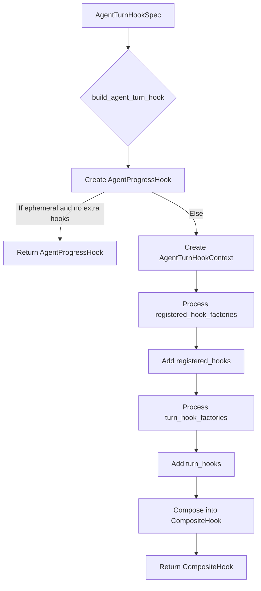

<!-- source: DeepWiki mcp.deepwiki.com · repo HKUDS/nanobot · page 4.7 Hooks & Turn Lifecycle · fetched 2026-10-26 -->

# Hooks & Turn Lifecycle

<details>
<summary>Relevant source files</summary>

The following files were used as context for generating this wiki page:

- [nanobot/agent/hook.py](nanobot/agent/hook.py)
- [nanobot/agent/hooks/file_edit_activity.py](nanobot/agent/hooks/file_edit_activity.py)
- [nanobot/agent/progress_hook.py](nanobot/agent/progress_hook.py)
- [nanobot/agent/tools/apply_patch.py](nanobot/agent/tools/apply_patch.py)
- [nanobot/agent/tools/context.py](nanobot/agent/tools/context.py)
- [nanobot/agent/tools/execution.py](nanobot/agent/tools/execution.py)
- [nanobot/agent/turn_hooks.py](nanobot/agent/turn_hooks.py)
- [nanobot/utils/file_edit_events.py](nanobot/utils/file_edit_events.py)
- [tests/agent/test_runner_progress_deltas.py](tests/agent/test_runner_progress_deltas.py)
- [tests/agent/test_runner_reasoning.py](tests/agent/test_runner_reasoning.py)
- [tests/agent/test_turn_hooks.py](tests/agent/test_turn_hooks.py)
- [tests/tools/test_apply_patch_tool.py](tests/tools/test_apply_patch_tool.py)
- [tests/utils/test_file_edit_events.py](tests/utils/test_file_edit_events.py)

</details>


This page details the Nanobot agent's lifecycle hooks, which provide extension points for observing and influencing the agent's execution flow. It covers the core `AgentHook` interface, the composition of multiple hooks, specific types of hooks like turn hooks, progress hooks, and file-edit activity hooks, and the `RequestContext` for tool execution.

## AgentHook Interface

The `AgentHook` class [nanobot/agent/hook.py:67-68]() defines the minimal lifecycle surface for customizing agent runs. It provides a set of asynchronous methods that are called at various stages of the agent's operation, from before and after an entire run to specific iterations, streaming events, and tool executions.

Key methods of `AgentHook` include:
- `wants_streaming()`: Indicates if the hook requires streaming content [nanobot/agent/hook.py:74-75]().
- `before_run(context: AgentRunHookContext)`: Called once before an agent run starts [nanobot/agent/hook.py:77]().
- `after_run(context: AgentRunHookContext)`: Called once after an agent run completes successfully [nanobot/agent/hook.py:79]().
- `on_error(context: AgentRunHookContext)`: Called if an unhandled exception occurs during the run [nanobot/agent/hook.py:81]().
- `on_finally(context: AgentRunHookContext)`: Always called after `after_run` or `on_error` [nanobot/agent/hook.py:83]().
- `before_iteration(context: AgentHookContext)`: Called before each iteration of the agent loop [nanobot/agent/hook.py:88]().
- `on_stream(context: AgentHookContext, delta: str)`: Called when a new chunk of streamed content is received from the LLM [nanobot/agent/hook.py:90]().
- `on_stream_end(context: AgentHookContext, *, resuming: bool)`: Called when a streaming response ends [nanobot/agent/hook.py:94]().
- `on_provider_tool_event(context: AgentHookContext, event: dict[str, Any])`: Observes lifecycle events for provider-hosted tools [nanobot/agent/hook.py:97-102]().
- `before_execute_tools(context: AgentHookContext)`: Called before any tools are executed in an iteration [nanobot/agent/hook.py:105]().
- `before_execute_tool(...)`: Called before a specific tool is executed [nanobot/agent/hook.py:108-114]().
- `after_execute_tool(...)`: Called after a specific tool completes successfully [nanobot/agent/hook.py:117-125]().
- `on_execute_tool_error(...)`: Called if a specific tool execution fails [nanobot/agent/hook.py:128-135]().
- `emit_reasoning(reasoning_content: str | None)`: Emits chunks of reasoning content [nanobot/agent/hook.py:137]().
- `emit_reasoning_end()`: Marks the end of an in-flight reasoning stream [nanobot/agent/hook.py:140-145]().
- `after_iteration(context: AgentHookContext)`: Called after each iteration of the agent loop [nanobot/agent/hook.py:148]().
- `finalize_content(context: AgentHookContext, content: str | None) -> str | None`: Allows hooks to modify the final content of a message [nanobot/agent/hook.py:151-152]().

The `AgentHookContext` [nanobot/agent/hook.py:17-35]() provides mutable per-iteration state, while `AgentRunHookContext` [nanobot/agent/hook.py:38-50]() provides a snapshot of run-level state.

Sources:
- [nanobot/agent/hook.py:17-154]()

## Hook Composition with CompositeHook

Multiple `AgentHook` instances can be composed using the `CompositeHook` class [nanobot/agent/hook.py:158-160](). This class acts as a fan-out mechanism, delegating calls to an ordered list of contained hooks. It provides error isolation, catching and logging exceptions from individual hooks to prevent a single faulty hook from crashing the agent loop [nanobot/agent/hook.py:161-163]().

```mermaid
graph TD
    subgraph "AgentRunner"
        A[Agent Loop Iteration] --> B{Call Hook Method};
    end

    subgraph "CompositeHook"
        B --> C{Iterate _hooks list};
        C -- For each hook h --> D{Call h.method()};
        D -- On Exception --> E[Log Error];
        D -- No Exception --> F[Continue];
    end

    E --> C;
    F --> C;
    C -- All hooks processed --> G[Return];
```
**Diagram: CompositeHook Execution Flow**

Sources:
- [nanobot/agent/hook.py:158-163]()
- [nanobot/agent/hook.py:175-187]()

## Turn Hooks

Turn hooks are specific `AgentHook` instances that are built for a single agent turn. The `AgentTurnHookSpec` dataclass [nanobot/agent/turn_hooks.py:22-42]() defines the inputs needed to construct the hook chain for a turn, including event sinks, streaming preferences, channel information, and lists of hook factories and direct hook instances.

The `build_agent_turn_hook` function [nanobot/agent/turn_hooks.py:44-97]() assembles the final `AgentHook` chain for a turn. It first creates an `AgentProgressHook` and then incorporates registered hook factories, registered hooks, turn-specific hook factories, and turn-specific hooks. If the turn is ephemeral and `run_extra_hooks_for_ephemeral` is not set, only the `AgentProgressHook` is returned [nanobot/agent/turn_hooks.py:54-55]().

The `AgentTurnHookContext` [nanobot/agent/hook.py:53-65]() provides turn-local inputs to hook factories, such as the `EventSink`, `workspace` path, `channel`, `chat_id`, `message_id`, `session_key`, `metadata`, `ephemeral` status, and `attributes`.


**Diagram: Agent Turn Hook Construction**

Sources:
- [nanobot/agent/turn_hooks.py:22-42]()
- [nanobot/agent/turn_hooks.py:44-97]()
- [nanobot/agent/hook.py:53-65]()
- [tests/agent/test_turn_hooks.py:84-136]()

## Progress Hooks

The `AgentProgressHook` [nanobot/agent/progress_hook.py:22-42]() is a specialized `AgentHook` responsible for translating agent lifecycle events into user-visible progress signals. It publishes `ProgressEvent`, `StreamDeltaEvent`, and `StreamEndEvent` to an `EventSink` [nanobot/agent/progress_hook.py:35-36]().

Key functionalities include:
- **Streaming Content**: If `wants_streaming()` is true, it buffers streamed content and extracts reasoning using `IncrementalThinkExtractor` [nanobot/agent/progress_hook.py:56-64](). It then publishes `StreamDeltaEvent` for incremental content [nanobot/agent/progress_hook.py:69-71]() and `StreamEndEvent` when the stream concludes [nanobot/agent/progress_hook.py:74-78]().
- **Reasoning Emission**: It handles `emit_reasoning` and `emit_reasoning_end` to publish reasoning chunks and signal the end of reasoning streams, allowing UI components to lock reasoning bubbles [nanobot/agent/progress_hook.py:153-166]().
- **Tool Event Reporting**: It processes `on_provider_tool_event` to publish structured tool events (start, end, error) for provider-hosted tools [nanobot/agent/progress_hook.py:89-134](). It also generates tool hints for local tool calls before execution [nanobot/agent/progress_hook.py:136-150]() and publishes tool event finish payloads after iteration [nanobot/agent/progress_hook.py:168-174]().
- **Logging**: It logs agent loop iterations and tool calls, optionally redacting sensitive content based on `_log_content` [nanobot/agent/progress_hook.py:82-87](), [nanobot/agent/progress_hook.py:126-131]().

Sources:
- [nanobot/agent/progress_hook.py:22-42]()
- [nanobot/agent/progress_hook.py:56-78]()
- [nanobot/agent/progress_hook.py:89-150]()
- [nanobot/agent/progress_hook.py:153-174]()
- [tests/agent/test_runner_progress_deltas.py:23-106]()

## File-Edit Activity Hooks

The `FileEditActivityHook` (defined in `nanobot/agent/hooks/file_edit_activity.py`, not fully shown but referenced) is a specialized hook that tracks and reports file modification activities. It leverages `FileEditTracker` [nanobot/utils/file_edit_events.py:40-46]() to capture file snapshots before and after tool executions.

When a tool like `write_file`, `edit_file`, or `apply_patch` [nanobot/utils/file_edit_events.py:12]() is executed, this hook:
1. **Captures `before` snapshots**: Before a file-editing tool executes, it takes a `FileSnapshot` [nanobot/utils/file_edit_events.py:163-179]() of the target file.
2. **Generates `FileEditResult`**: File-editing tools return a `FileEditResult` [nanobot/utils/file_edit_events.py:135-143]() which includes the observation text and `FileDiff` objects for each modified file.
3. **Calculates and Publishes Diffs**: After the tool execution, it calculates the line-level differences (`FileDiff` [nanobot/utils/file_edit_events.py:49-69]()) between the `before` snapshot and the current file state. These diffs are then published as `file_edit_events` within `ProgressEvent` payloads. The diffs can be truncated for large files [tests/utils/test_file_edit_events.py:166-179]().
4. **Handles External Changes**: If a file is modified externally between the `before` snapshot and the tool's execution, the hook recomputes the diff to reflect all changes [tests/utils/test_file_edit_events.py:103-120]().

The `FileDiff` class [nanobot/utils/file_edit_events.py:49-69]() uses `rapidfuzz.distance.Indel.opcodes` to compute the differences between lines [nanobot/utils/file_edit_events.py:62](). It can also generate unified diff format output [nanobot/utils/file_edit_events.py:108-132]().

Sources:
- [nanobot/utils/file_edit_events.py:12]()
- [nanobot/utils/file_edit_events.py:40-46]()
- [nanobot/utils/file_edit_events.py:49-69]()
- [nanobot/utils/file_edit_events.py:108-132]()
- [nanobot/utils/file_edit_events.py:135-143]()
- [nanobot/utils/file_edit_events.py:163-179]()
- [tests/utils/test_file_edit_events.py:103-120]()
- [tests/utils/test_file_edit_events.py:123-164]()
- [tests/utils/test_file_edit_events.py:166-179]()
- [tests/agent/test_runner_progress_deltas.py:172-198]()

## Tool Execution Context Variables

The `nanobot.agent.tools.context` module manages the runtime context for tool construction and execution.
The `RequestContext` dataclass [nanobot/agent/tools/context.py:29-44]() holds immutable per-request context information, such as `channel`, `chat_id`, `message_id`, `session_key`, `workspace`, and `log_content`. This context is bound to a `ContextVar` named `_CURRENT_REQUEST_CONTEXT` [nanobot/agent/tools/context.py:23-26]() using `bind_request_context` [nanobot/agent/tools/context.py:52-53]() and `reset_request_context` [nanobot/agent/tools/context.py:56-57]().

The `request_context` context manager [nanobot/agent/tools/context.py:60-68]() simplifies binding and restoring the context. Tools can access the current context using `current_request_context()` [nanobot/agent/tools/context.py:70-71]().

A crucial aspect is `tool_log_content_allowed()` [nanobot/agent/tools/context.py:74-77](), which determines if tool diagnostics may include content from the current request. This is used to redact sensitive information, especially for ephemeral turns [tests/agent/test_turn_hooks.py:22-51]().

The `ToolContext` dataclass [nanobot/agent/tools/context.py:86-99]() provides a broader set of dependencies for tool initialization, including configuration, managers for subagents and execution sessions, and various services.

```mermaid
graph TD
    A[AgentRunner] --> B{Execute Tool Calls};
    B --> C[RequestContext created];
    C --> D{request_context context manager};
    D -- Binds RequestContext --> E[Tool.execute() called];
    E -- Tool accesses context --> F[current_request_context()];
    F --> G[Tool performs action];
    G -- Context restored --> D;
    D --> H[Tool execution completes];
```
**Diagram: Tool Execution with RequestContext**

Sources:
- [nanobot/agent/tools/context.py:23-44]()
- [nanobot/agent/tools/context.py:52-71]()
- [nanobot/agent/tools/context.py:74-77]()
- [nanobot/agent/tools/context.py:86-99]()
- [tests/agent/test_turn_hooks.py:22-51]()

---

