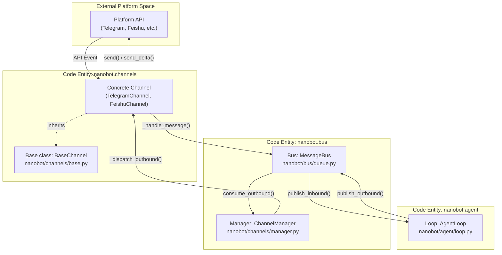
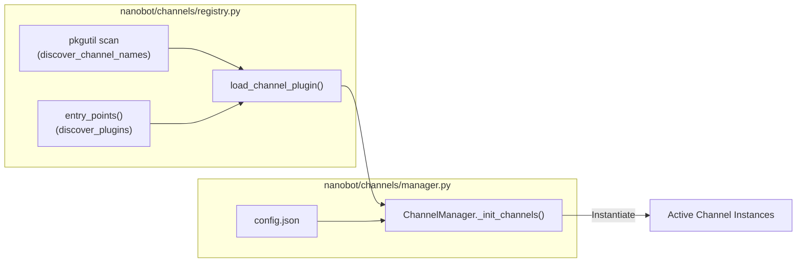

<!-- source: DeepWiki mcp.deepwiki.com · repo HKUDS/nanobot · page 5 Communication Channels · fetched 2026-10-26 -->

# Communication Channels

<details>
<summary>Relevant source files</summary>

The following files were used as context for generating this wiki page:

- [docs/chat-apps.md](docs/chat-apps.md)
- [nanobot/audio/transcription.py](nanobot/audio/transcription.py)
- [nanobot/audio/transcription_registry.py](nanobot/audio/transcription_registry.py)
- [nanobot/channels/base.py](nanobot/channels/base.py)
- [nanobot/channels/manager.py](nanobot/channels/manager.py)
- [nanobot/providers/transcription.py](nanobot/providers/transcription.py)
- [tests/bus/test_outbound_events.py](tests/bus/test_outbound_events.py)
- [tests/channels/test_channel_manager_delta_coalescing.py](tests/channels/test_channel_manager_delta_coalescing.py)
- [tests/channels/test_channel_plugins.py](tests/channels/test_channel_plugins.py)
- [tests/providers/test_stepfun_asr.py](tests/providers/test_stepfun_asr.py)
- [tests/providers/test_transcription.py](tests/providers/test_transcription.py)

</details>


This page provides an overview of nanobot's multi-platform channel system. It covers the supported messaging platforms, the unified transport architecture managed by the `ChannelManager`, and the discovery mechanism for built-in and plugin-based channels.

For detailed implementation patterns and the `BaseChannel` abstraction, see [Channel Architecture](#5.1). For platform-specific integration details, see [Telegram](#5.2), [Feishu](#5.3), [Matrix](#5.4), and [Other Channels](#5.5).

---

## Supported Platforms

Nanobot integrates with multiple messaging platforms through a unified gateway architecture. Each channel implementation translates platform-specific events into a common `InboundMessage` format [nanobot/bus/events.py:11]() and receives `OutboundMessage` events [nanobot/bus/events.py:15]() from the system bus.

| Channel | Connection Type | Authentication | Public IP Required |
|---------|----------------|----------------|-------------------|
| **Telegram** | Long polling / Webhook | Bot token | No (Polling) |
| **Discord** | Gateway WebSocket | Bot token | No |
| **WhatsApp** | neonize-based Bridge | QR code scan | No |
| **Feishu** | WebSocket (long connection) | App ID + Secret / QR | No |
| **Matrix** | Client-Server API | Access token | No |
| **Slack** | Socket mode | Bot + App tokens | No |
| **Email** | IMAP/SMTP | Credentials | No |
| **DingTalk** | Stream mode | App Key + Secret | No |
| **QQ / NapCat** | OneBot v11 WebSocket | App ID + Secret | No |
| **Wecom** | WebSocket (long connection) | Bot ID + Secret | No |
| **Signal** | signal-cli JSON-RPC | Local socket | No |
| **WebUI** | WebSocket | Session-based | No |
| **Linear** | Webhook | OAuth app | Yes (for webhooks) |

**Sources:**
- [nanobot/channels/manager.py:89-137]()
- [nanobot/channels/base.py:21-38]()
- [docs/chat-apps.md:91-110]()

---

## Message Flow Architecture

The `ChannelManager` [nanobot/channels/manager.py:82]() acts as the central coordinator between the `MessageBus` [nanobot/bus/queue.py:26]() and individual platform implementations. It manages the lifecycle of all enabled channels and handles the dispatching of outbound responses with retry logic using an exponential backoff defined in `_SEND_RETRY_DELAYS` (1s, 2s, 4s) [nanobot/channels/manager.py:60]().

### System Data Flow



**Message Flow Sequence:**
1. **Inbound**: A platform event is received by a concrete `BaseChannel` subclass. It performs ACL checks via `is_allowed()` [nanobot/channels/base.py:228-236]() before publishing an `InboundMessage` to the `MessageBus`.
2. **Processing**: The `AgentLoop` processes the message and generates responses.
3. **Outbound**: `ChannelManager` pulls `OutboundMessage` objects from the bus. It identifies the target channel and invokes delivery, which calls the channel's `send()` [nanobot/channels/base.py:92-102]() or `send_delta()` [nanobot/channels/base.py:129-152]() implementation. To reduce latency, the manager performs delta coalescing via `_coalesce_stream_deltas()` [nanobot/channels/manager.py:400-412]() (as tested in [tests/channels/test_channel_manager_delta_coalescing.py:116-163]()).

**Sources:**
- [nanobot/channels/manager.py:79-165]()
- [nanobot/channels/base.py:92-152]()
- [nanobot/channels/base.py:228-236]()
- [tests/channels/test_channel_manager_delta_coalescing.py:112-163]()

---

## Channel Discovery and Registration

Nanobot uses a plugin architecture to load channels. The `ChannelManager` discovers available implementations at runtime using the `nanobot.channels.registry` [nanobot/channels/manager.py:74]().



**Discovery Logic:**
1. **Scanning**: Plugins are loaded via `load_channel_plugin(name)` [nanobot/channels/manager.py:74]().
2. **Filtering**: `ChannelManager._init_channels()` [nanobot/channels/manager.py:150]() iterates through candidate names, checking the `config.channels` section to see if they are enabled [nanobot/channels/manager.py:153-172]().
3. **Activation**: If enabled, the channel class is instantiated via `_build_channel` [nanobot/channels/manager.py:174](). For the `websocket` channel, it receives a `gateway` service bundle built via `build_gateway_services` [nanobot/channels/manager.py:177-192]().

**Sources:**
- [nanobot/channels/manager.py:70-77]()
- [nanobot/channels/manager.py:150-192]()
- [tests/channels/test_channel_plugins.py:149-176]()

---

## Security and Lifecycle

### Access Control and Pairing
Every channel enforces a mandatory permission policy via `is_allowed()` [nanobot/channels/base.py:228-236](). If a sender is not explicitly in the `allow_from` list, the system utilizes the pairing mechanism [nanobot/channels/base.py:243-247]().
- **Unapproved Senders**: Receive a pairing code generated via `generate_code()` [nanobot/pairing/store.py:113-137]() and a formatted reply via `format_pairing_reply()` [nanobot/pairing/store.py:15-16]().
- **Validation**: Senders are validated against the approved list via `is_approved()` [nanobot/pairing/store.py:177-187]().
- **Persistence**: Approved senders and pending codes are stored in `pairing.json` via the `store` module [nanobot/pairing/store.py:3-6]().

### Lifecycle Management
- **Start**: `ChannelManager` manages the activation of channels. Individual channels implement `start()` to begin listening [nanobot/channels/base.py:75-84]().
- **Stop**: Channels are gracefully shut down via `channel.stop()` [nanobot/channels/base.py:87-89]().
- **Restarts**: The manager handles restart notifications by consuming environment markers via `consume_restart_notice_from_env()` [nanobot/channels/manager.py:39](). Restart messages are formatted with elapsed time via `format_restart_completed_message()` [nanobot/channels/manager.py:40]().

**Sources:**
- [nanobot/channels/base.py:228-247]()
- [nanobot/pairing/store.py:3-187]()
- [nanobot/channels/manager.py:37-41]()

---

## Common Features

### Audio Transcription
All channels inheriting from `BaseChannel` gain access to `transcribe_audio()` [nanobot/channels/base.py:48-60](). This utility uses `transcribe_audio_file` [nanobot/audio/transcription.py:199]() to convert voice messages into text using configured transcription providers (e.g., Whisper via OpenAI or Groq) [nanobot/channels/base.py:51-57](). The transcription configuration is resolved by `resolve_transcription_config()` [nanobot/audio/transcription.py:122-147](), which supports both top-level and legacy channel-specific settings, and interpolates environment variables for API keys [nanobot/audio/transcription.py:161-172]().

```mermaid
graph TD
    ChannelImpl["Concrete Channel<br/>(e.g., TelegramChannel)"] -->|calls transcribe_audio()| BaseChannel["BaseChannel<br/>nanobot/channels/base.py"]
    BaseChannel -->|calls transcribe_audio_file()| TranscriptionModule["nanobot.audio.transcription"]
    TranscriptionModule -->|resolves config| EffectiveTranscriptionConfig["EffectiveTranscriptionConfig<br/>nanobot/audio/transcription.py"]
    TranscriptionModule -->|loads adapter| TranscriptionProviderAdapter["TranscriptionProviderAdapter<br/>nanobot/audio/transcription_registry.py"]
    TranscriptionProviderAdapter -->|transcribe()| ProviderImpl["Provider-specific API<br/>(e.g., GroqTranscriptionProvider)"]
    ProviderImpl -->|HTTP Request| ExternalASRService["External ASR Service<br/>(e.g., Groq, OpenAI)"]
```

**Sources:**
- [nanobot/channels/base.py:48-60]()
- [nanobot/audio/transcription.py:122-147]()
- [nanobot/audio/transcription.py:161-172]()
- [nanobot/audio/transcription.py:199]()
- [nanobot/audio/transcription_registry.py:16-28]()
- [tests/providers/test_transcription.py:65-187]()

### Interactive Login
Channels can implement an interactive `login()` method [nanobot/channels/base.py:62-72](). This is used for platforms requiring manual intervention, such as scanning a QR code for WhatsApp or Signal.

### Reasoning and Streaming
Channels support streaming of final content via `send_delta()` [nanobot/channels/base.py:129-152]() and model reasoning via `send_reasoning_delta()` [nanobot/channels/base.py:153-171](). The `BaseChannel` provides a unified `send_reasoning()` [nanobot/channels/base.py:201-226]() implementation that handles both streamed and one-shot reasoning blocks by reusing the streaming pair.

**Sources:**
- [nanobot/channels/base.py:48-226]()
- [nanobot/pairing/store.py:139-174]()
- [tests/bus/test_outbound_events.py:21-50]()

---

