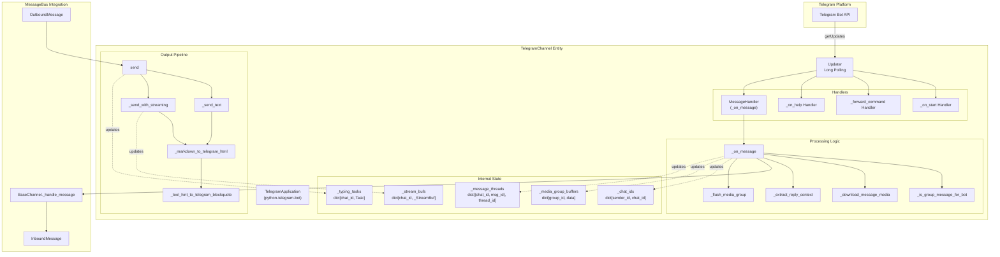
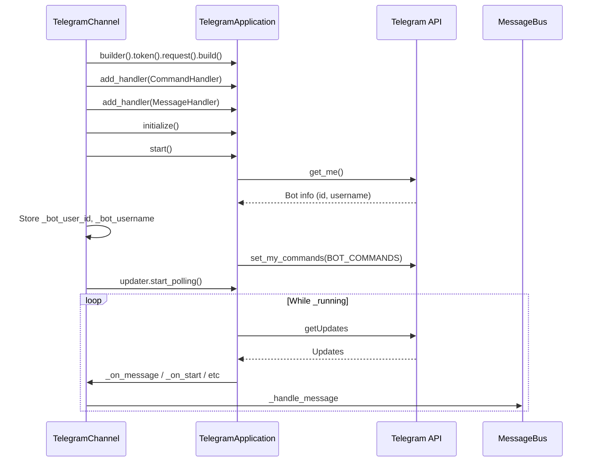

<!-- source: DeepWiki mcp.deepwiki.com · repo HKUDS/nanobot · page 5.2 Telegram · fetched 2026-10-26 -->

# Telegram

<details>
<summary>Relevant source files</summary>

The following files were used as context for generating this wiki page:

- [nanobot/channels/feishu/tests/test_feishu_streaming.py](nanobot/channels/feishu/tests/test_feishu_streaming.py)
- [nanobot/channels/telegram/runtime.py](nanobot/channels/telegram/runtime.py)
- [nanobot/channels/telegram/tests/test_telegram_channel.py](nanobot/channels/telegram/tests/test_telegram_channel.py)
- [webui/src/components/thread/activity/web-url.ts](webui/src/components/thread/activity/web-url.ts)
- [webui/src/tests/web-url.test.ts](webui/src/tests/web-url.test.ts)

</details>


This document covers the Telegram channel implementation for nanobot. For general channel architecture concepts and the `BaseChannel` interface, see [Channel Architecture](). For other channel implementations (Feishu, Matrix, Discord, Slack), see [Other Channels]().

## Purpose and Scope

The Telegram channel (`TelegramChannel`) enables nanobot to communicate with users through the Telegram messaging platform. It uses long polling (no webhook or public IP required) via the `python-telegram-bot` library [nanobot/channels/telegram/runtime.py:1-30](). This implementation handles:

- Bot command registration and slash command forwarding [nanobot/channels/telegram/runtime.py:440-454](), [nanobot/channels/telegram/runtime.py:558-577]()
- Text, photo, voice, audio, and document message processing [nanobot/channels/telegram/runtime.py:878-963]()
- Markdown to Telegram-specific HTML conversion with table support [nanobot/channels/telegram/runtime.py:315-392]()
- Media group buffering and aggregation for albums [nanobot/channels/telegram/runtime.py:965-979]()
- Group chat policies (mention-based or open) [nanobot/channels/telegram/runtime.py:826-851]()
- Topic/thread support for forum chats [nanobot/channels/telegram/runtime.py:702-707]()
- Typing indicators during agent processing [nanobot/channels/telegram/runtime.py:981-1002]()
- Reply context extraction and media-to-text conversion [nanobot/channels/telegram/runtime.py:725-733]()
- Access control via Telegram user ID and username matching [nanobot/channels/telegram/runtime.py:489-506]()

**Sources:** [nanobot/channels/telegram/runtime.py:1-30](), [nanobot/channels/telegram/runtime.py:440-454]()

## Configuration

The `TelegramConfig` class defines the configuration schema [nanobot/channels/telegram/runtime.py:415-428]():

| Field | Type | Default | Description |
|-------|------|---------|-------------|
| `enabled` | `bool` | `False` | Enable/disable Telegram channel |
| `token` | `str` | `""` | Bot API token from BotFather |
| `allow_from` | `list[str]` | `[]` | Allowed user IDs or usernames (empty = all users) |
| `proxy` | `str | None` | `None` | HTTP proxy URL (e.g., `http://127.0.0.1:7890`) |
| `reply_to_message` | `bool` | `False` | Whether to reply to the original message |
| `react_emoji` | `str` | `"👀"` | Emoji used for reactions [nanobot/channels/telegram/runtime.py:423]() |
| `group_policy` | `Literal["open", "mention"]` | `"mention"` | Group message handling policy |
| `connection_pool_size` | `int` | `32` | Size of the HTTP connection pool [nanobot/channels/telegram/runtime.py:425]() |
| `streaming` | `bool` | `True` | Enable typewriter effect for responses |
| `stream_edit_interval`| `float`| `0.6` | Min seconds between message edits [nanobot/channels/telegram/runtime.py:428]() |

**Sources:** [nanobot/channels/telegram/runtime.py:415-428]()

### Group Policies

The `group_policy` field controls how the bot responds in group chats:

- **`"mention"`** (default): Bot only processes messages that @mention the bot or reply to the bot's messages [nanobot/channels/telegram/runtime.py:826-851]()
- **`"open"`**: Bot processes all messages in the group [nanobot/channels/telegram/runtime.py:838]()

Private chats always process all messages regardless of policy [nanobot/channels/telegram/runtime.py:833]().

**Sources:** [nanobot/channels/telegram/runtime.py:423](), [nanobot/channels/telegram/runtime.py:826-851]()

## Architecture Overview

The following diagram bridges the high-level Telegram concepts to the specific code entities in `nanobot/channels/telegram/runtime.py`.

### System Entity Map


**Sources:** [nanobot/channels/telegram/runtime.py:431-1033](), [nanobot/channels/telegram/runtime.py:407-413]()

## Long Polling and Lifecycle

The `TelegramChannel` uses long polling rather than webhooks, making it simple to deploy without requiring a public IP or HTTPS endpoint [nanobot/channels/telegram/runtime.py:432-436]().

### Startup Sequence

1.  **Initialize Application**: Create `Application` with custom `HTTPXRequest` for proxy support and configurable connection pool [nanobot/channels/telegram/runtime.py:454-470]().
2.  **Register Handlers**: Add command handlers and message handler [nanobot/channels/telegram/runtime.py:475-486]().
3.  **Get Bot Info**: Retrieve bot username and ID for mention detection [nanobot/channels/telegram/runtime.py:496-497]().
4.  **Register Commands**: Set bot command menu with `BOT_COMMANDS` [nanobot/channels/telegram/runtime.py:440-452](), [nanobot/channels/telegram/runtime.py:499]().
5.  **Start Polling**: Begin `getUpdates` long polling loop [nanobot/channels/telegram/runtime.py:504]().

### Startup Flow Diagram


**Sources:** [nanobot/channels/telegram/runtime.py:454-516]()

### Proxy Support

When `proxy` is configured in `TelegramConfig`, it is passed to the `HTTPXRequest` constructor [nanobot/channels/telegram/runtime.py:463-470](). This ensures all bot API calls, including the `get_updates` long polling, go through the specified proxy.

**Sources:** [nanobot/channels/telegram/runtime.py:463-470]()

## Inbound Message Processing

### Sender ID Format

Telegram sender IDs use a special format to support ACL matching by either numeric ID or username:
`{user_id}|{username}` (e.g., `12345|alice`) [nanobot/channels/telegram/runtime.py:885-888]().

### Media Download and Transcription

The `_download_message_media` method handles media files [nanobot/channels/telegram/runtime.py:735-787]():

1.  Detect media type (photo, voice, audio, document, video, animation) [nanobot/channels/telegram/runtime.py:739-761]().
2.  Get file via `bot.get_file()` and download to `<media_dir>/telegram/<file_unique_id><ext>` [nanobot/channels/telegram/runtime.py:767-773]().
3.  For voice/audio: transcribe using `BaseChannel.transcribe_audio` [nanobot/channels/telegram/runtime.py:777-779]().
4.  Return `(media_paths, content_parts)` where content_parts includes transcription or file path [nanobot/channels/telegram/runtime.py:787]().

**Sources:** [nanobot/channels/telegram/runtime.py:735-787](), [nanobot/channels/base.py:48-60]()

### Media Groups (Albums)

When users send multiple photos/videos as an album, Telegram assigns them a `media_group_id`. The channel buffers these messages for a short interval, then forwards them as a single aggregated message via `_flush_media_group` [nanobot/channels/telegram/runtime.py:965-979]().

**Sources:** [nanobot/channels/telegram/runtime.py:934-950](), [nanobot/channels/telegram/runtime.py:965-979]()

## Outbound Message Sending

### Markdown to HTML Conversion

Telegram supports a limited subset of HTML. The `_markdown_to_telegram_html` function converts standard markdown to Telegram-compatible HTML [nanobot/channels/telegram/runtime.py:315-392]().

| Markdown | Telegram HTML | Implementation Detail |
|----------|---------------|-----------------------|
| `**bold**` | `<b>bold</b>` | Handled via regex [nanobot/channels/telegram/runtime.py:402-403]() |
| `_italic_` | `<i>italic</i>` | Uses negative lookbehind to avoid underscores in words [nanobot/channels/telegram/runtime.py:406-407]() |
| `~~strike~~` | `<s>strike</s>` | Handled via regex [nanobot/channels/telegram/runtime.py:409-410]() |
| `[link](url)` | `<a href="url">link</a>` | Handled via regex [nanobot/channels/telegram/runtime.py:399-400]() |
| `` `code` `` | `<code>code</code>` | Protected during parsing [nanobot/channels/telegram/runtime.py:383-388]() |
| ` ```code``` ` | `<pre><code>code</code></pre>` | Protected during parsing [nanobot/channels/telegram/runtime.py:354-359]() |
| Table | `<pre><code>...</code></pre>` | Rendered as box-drawing characters via `_render_table_box` [nanobot/channels/telegram/runtime.py:277-313, 361-380]() |
| Tool Hint | `<blockquote expandable>` | Rendered as expandable blockquotes [nanobot/channels/telegram/runtime.py:185-205]() |

**Sources:** [nanobot/channels/telegram/runtime.py:185-413]()

### Streaming and Progressive Editing

If `streaming` is enabled [nanobot/channels/telegram/runtime.py:427](), the `_send_with_streaming` method implements a progressive editing effect using `_StreamBuf` [nanobot/channels/telegram/runtime.py:407-413](), [nanobot/channels/telegram/runtime.py:647-689]():

1.  New text is accumulated in `_StreamBuf` for the specific chat [nanobot/channels/telegram/runtime.py:407-413]().
2.  If no message exists, a new one is sent [nanobot/channels/telegram/runtime.py:658]().
3.  Subsequent updates edit the existing message using `bot.edit_message_text` [nanobot/channels/telegram/runtime.py:668]().
4.  Edits are throttled by `stream_edit_interval` (default 0.6s) to respect Telegram rate limits [nanobot/channels/telegram/runtime.py:676-678]().
5.  Mid-stream edits use `_strip_md_block` to show clean text while the response is still being generated [nanobot/channels/telegram/runtime.py:232-257, 672]().

**Sources:** [nanobot/channels/telegram/runtime.py:407-413](), [nanobot/channels/telegram/runtime.py:647-689]()

### Message Splitting

Telegram has a strict character limit of 4096 characters per message [nanobot/channels/telegram/runtime.py:48](). The implementation uses `_split_telegram_markdown` to break long responses into valid chunks [nanobot/channels/telegram/runtime.py:94-177](). This logic ensures that fenced code blocks are correctly closed in one chunk and reopened in the next to maintain syntax highlighting and readability [nanobot/channels/telegram/runtime.py:168-173]().

**Sources:** [nanobot/channels/telegram/runtime.py:43-177]()

## Threading and Topics

Telegram "Topics" in forum groups are supported by mapping `(chat_id, message_id)` to `message_thread_id` in `_message_threads` [nanobot/channels/telegram/runtime.py:853-861]().

When generating session keys, if a `message_thread_id` is present, the key format is:
`telegram:{chat_id}:topic:{thread_id}` [nanobot/channels/telegram/runtime.py:702-707]().

**Sources:** [nanobot/channels/telegram/runtime.py:702-707](), [nanobot/channels/telegram/runtime.py:853-861]()

## Access Control

The `is_allowed` method performs a multi-stage check [nanobot/channels/telegram/runtime.py:489-506]():
1.  Checks the raw `sender_id` against `allow_from` [nanobot/channels/telegram/runtime.py:490-491]().
2.  Parses the `{user_id}|{username}` format [nanobot/channels/telegram/runtime.py:495-496]().
3.  Returns `True` if either the numeric ID or the username (prefixed with `@` or not) is in the allowlist [nanobot/channels/telegram/runtime.py:499-505]().

**Sources:** [nanobot/channels/telegram/runtime.py:489-506]()

---

