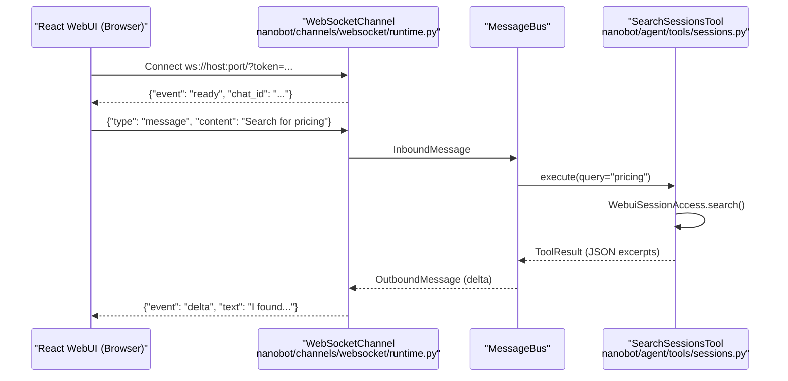

<!-- source: DeepWiki mcp.deepwiki.com · repo HKUDS/nanobot · page 5.5 Other Channels · fetched 2026-10-26 -->

# Other Channels

Relevant source files

The following files were used as context for generating this wiki page:

- [docs/guides/configure-langfuse-observability.md](docs/guides/configure-langfuse-observability.md)
- [docs/guides/discord-ai-agent.md](docs/guides/discord-ai-agent.md)
- [docs/guides/email-ai-agent.md](docs/guides/email-ai-agent.md)
- [docs/guides/mattermost-ai-agent.md](docs/guides/mattermost-ai-agent.md)
- [nanobot/bus/notification_delivery.py](nanobot/bus/notification_delivery.py)
- [nanobot/channels/discord/manifest.py](nanobot/channels/discord/manifest.py)
- [nanobot/channels/discord/runtime.py](nanobot/channels/discord/runtime.py)
- [nanobot/channels/discord/tests/test_discord_channel.py](nanobot/channels/discord/tests/test_discord_channel.py)
- [nanobot/channels/discord/webui/locales/en.json](nanobot/channels/discord/webui/locales/en.json)
- [nanobot/channels/discord/webui/locales/es.json](nanobot/channels/discord/webui/locales/es.json)
- [nanobot/channels/discord/webui/locales/fr.json](nanobot/channels/discord/webui/locales/fr.json)
- [nanobot/channels/discord/webui/locales/id.json](nanobot/channels/discord/webui/locales/id.json)
- [nanobot/channels/discord/webui/locales/ja.json](nanobot/channels/discord/webui/locales/ja.json)
- [nanobot/channels/discord/webui/locales/ko.json](nanobot/channels/discord/webui/locales/ko.json)
- [nanobot/channels/email/manifest.py](nanobot/channels/email/manifest.py)
- [nanobot/channels/email/runtime.py](nanobot/channels/email/runtime.py)
- [nanobot/channels/email/tests/test_authentication_results.py](nanobot/channels/email/tests/test_authentication_results.py)
- [nanobot/channels/email/tests/test_email_channel.py](nanobot/channels/email/tests/test_email_channel.py)
- [nanobot/channels/email/tests/test_validation.py](nanobot/channels/email/tests/test_validation.py)
- [nanobot/channels/email/validation.py](nanobot/channels/email/validation.py)
- [nanobot/channels/email/webui/locales/en.json](nanobot/channels/email/webui/locales/en.json)
- [nanobot/channels/email/webui/locales/es.json](nanobot/channels/email/webui/locales/es.json)
- [nanobot/channels/feishu/connect.py](nanobot/channels/feishu/connect.py)
- [nanobot/channels/feishu/tests/test_connect.py](nanobot/channels/feishu/tests/test_connect.py)
- [nanobot/channels/mattermost/manifest.py](nanobot/channels/mattermost/manifest.py)
- [nanobot/channels/mattermost/runtime.py](nanobot/channels/mattermost/runtime.py)
- [nanobot/channels/mattermost/tests/test_mattermost_channel.py](nanobot/channels/mattermost/tests/test_mattermost_channel.py)
- [nanobot/channels/mochat/runtime.py](nanobot/channels/mochat/runtime.py)
- [nanobot/channels/qq/runtime.py](nanobot/channels/qq/runtime.py)
- [nanobot/channels/qq/tests/conftest.py](nanobot/channels/qq/tests/conftest.py)
- [nanobot/channels/signal/runtime.py](nanobot/channels/signal/runtime.py)
- [nanobot/channels/signal/tests/test_signal_channel.py](nanobot/channels/signal/tests/test_signal_channel.py)
- [nanobot/channels/signal/tests/test_signal_markdown.py](nanobot/channels/signal/tests/test_signal_markdown.py)
- [nanobot/channels/slack/runtime.py](nanobot/channels/slack/runtime.py)
- [nanobot/channels/slack/tests/test_slack_channel.py](nanobot/channels/slack/tests/test_slack_channel.py)
- [nanobot/channels/wecom/manifest.py](nanobot/channels/wecom/manifest.py)
- [nanobot/channels/wecom/runtime.py](nanobot/channels/wecom/runtime.py)
- [nanobot/channels/wecom/tests/test_wecom_channel.py](nanobot/channels/wecom/tests/test_wecom_channel.py)
- [nanobot/channels/weixin/connect.py](nanobot/channels/weixin/connect.py)
- [nanobot/channels/weixin/manifest.py](nanobot/channels/weixin/manifest.py)
- [nanobot/channels/weixin/runtime.py](nanobot/channels/weixin/runtime.py)
- [nanobot/channels/weixin/tests/test_connect.py](nanobot/channels/weixin/tests/test_connect.py)
- [nanobot/channels/weixin/tests/test_weixin_channel.py](nanobot/channels/weixin/tests/test_weixin_channel.py)
- [nanobot/channels/weixin/tests/test_weixin_hardening.py](nanobot/channels/weixin/tests/test_weixin_hardening.py)
- [nanobot/channels/weixin/webui/WeixinConnectFlow.tsx](nanobot/channels/weixin/webui/WeixinConnectFlow.tsx)
- [nanobot/cli/provider.py](nanobot/cli/provider.py)
- [nanobot/events.py](nanobot/events.py)
- [nanobot/providers/oauth_guidance.py](nanobot/providers/oauth_guidance.py)
- [nanobot/utils/helpers.py](nanobot/utils/helpers.py)
- [tests/agent/test_dream_session.py](tests/agent/test_dream_session.py)
- [tests/agent/test_memory_store.py](tests/agent/test_memory_store.py)
- [tests/agent/test_session_atomic.py](tests/agent/test_session_atomic.py)
- [tests/channels/test_channel_manager_compaction_notices.py](tests/channels/test_channel_manager_compaction_notices.py)
- [tests/channels/test_qq_inbound_ssrf.py](tests/channels/test_qq_inbound_ssrf.py)
- [tests/channels/test_qq_reconnect_backoff.py](tests/channels/test_qq_reconnect_backoff.py)
- [tests/session/test_consolidated_offset_clamp.py](tests/session/test_consolidated_offset_clamp.py)
- [tests/session/test_session_fsync.py](tests/session/test_session_fsync.py)
- [tests/utils/test_helpers.py](tests/utils/test_helpers.py)
- [tests/utils/test_strip_think.py](tests/utils/test_strip_think.py)

## Purpose and Scope

This page provides a technical overview of the auxiliary communication channels supported by Nanobot, including Discord, WhatsApp, WeChat (Personal and Work), DingTalk, Slack, Email, QQ, WebSocket, Microsoft Teams, MoChat, Signal, and Mattermost. These channels implement the `BaseChannel` interface [nanobot/channels/base.py:21-30]() and integrate with the core system via the `MessageBus` [nanobot/bus/queue.py:25-25]().

---

## Channel Architecture Overview

Nanobot uses a plugin-based architecture managed by the `ChannelManager` [nanobot/channels/manager.py:76-86](). Each channel translates platform-specific events into standardized `InboundMessage` objects [nanobot/bus/events.py:24-36]() and converts `OutboundMessage` objects [nanobot/bus/events.py:44-59]() into platform-specific API calls.

### Channel Classification and Entity Mapping

The following diagram maps the relationship between external platforms and the specific Python classes implementing their logic within the codebase.

**Channel Entity Map**

```mermaid
graph TD
    subgraph "External_Platforms"
        WAP["WhatsApp (Node.js Bridge)"]
        WXP["Personal WeChat (iLink)"]
        DTP["DingTalk (Stream Mode)"]
        SLP["Slack (Socket Mode)"]
        QQP["QQ (botpy/NapCat)"]
        WCP["WeCom (WebSocket)"]
MTP["MS Teams (Webhook)"]
        SIG["Signal (signal-cli)"]
        MM["Mattermost (WS+REST)"]
        DIS["Discord (discord.py)"]
        EML["Email (IMAP/SMTP)"]
        WSK["WebSocket (WebUI)"]
    end

    subgraph "Nanobot_Code_Entity_Space"
        WhatsAppChannel["WhatsAppChannel<br/>nanobot/channels/whatsapp/runtime.py"]
        WeixinChannel["WeixinChannel<br/>nanobot/channels/weixin/runtime.py"]
        DingTalkChannel["DingTalkChannel<br/>nanobot/channels/dingtalk/runtime.py"]
        SlackChannel["SlackChannel<br/>nanobot/channels/slack/runtime.py"]
        QQChannel["QQChannel<br/>nanobot/channels/qq/runtime.py"]
        WecomChannel["WecomChannel<br/>nanobot/channels/wecom/runtime.py"]
        MattermostChannel["MattermostChannel<br/>nanobot/channels/mattermost/runtime.py"]
        SignalChannel["SignalChannel<br/>nanobot/channels/signal/runtime.py"]
        DiscordChannel["DiscordChannel<br/>nanobot/channels/discord/runtime.py"]
        EmailChannel["EmailChannel<br/>nanobot/channels/email/runtime.py"]
        WebSocketChannel["WebSocketChannel<br/>nanobot/channels/websocket/runtime.py"]
        
        BaseChannel["BaseChannel<br/>nanobot/channels/base.py"]
        MessageBus["MessageBus<br/>nanobot/bus/queue.py"]
        ChannelManager["ChannelManager<br/>nanobot/channels/manager.py"]
    end

    WAP <--> WhatsAppChannel
    WXP <--> WeixinChannel
    DTP <--> DingTalkChannel
    SLP <--> SlackChannel
    QQP <--> QQChannel
    WCP <--> WecomChannel
    MM <--> MattermostChannel
    SIG <--> SignalChannel
    DIS <--> DiscordChannel
    EML <--> EmailChannel
    WSK <--> WebSocketChannel

    WhatsAppChannel -- "inherits" --> BaseChannel
    WeixinChannel -- "inherits" --> BaseChannel
    DingTalkChannel -- "inherits" --> BaseChannel
    SlackChannel -- "inherits" --> BaseChannel
    QQChannel -- "inherits" --> BaseChannel
    WecomChannel -- "inherits" --> BaseChannel
    MattermostChannel -- "inherits" --> BaseChannel
    SignalChannel -- "inherits" --> BaseChannel
    DiscordChannel -- "inherits" --> BaseChannel
    EmailChannel -- "inherits" --> BaseChannel
    WebSocketChannel -- "inherits" --> BaseChannel

    ChannelManager -- "manages" --> BaseChannel
    BaseChannel -- "put/consume" --> MessageBus
```

**Sources:**
- [nanobot/channels/base.py:21-30]()
- [nanobot/channels/manager.py:76-112]()
- [nanobot/channels/weixin/runtime.py:37-37]()
- [nanobot/channels/dingtalk/runtime.py:22-22]()
- [nanobot/channels/mattermost/runtime.py:88-88]()
- [nanobot/channels/websocket/runtime.py:44-44]()
- [nanobot/channels/discord/runtime.py:52-52]()
- [nanobot/channels/email/runtime.py:35-35]()
- [nanobot/channels/qq/runtime.py:179-179]()
- [nanobot/channels/wecom/runtime.py:40-40]()
- [nanobot/channels/signal/runtime.py:34-34]()

---

## Specific Channel Implementations

### Discord
The `DiscordChannel` uses the `discord.py` library [nanobot/channels/discord/runtime.py:1-1](). It extends `discord.Client` via `DiscordBotClient` to handle Discord events [nanobot/channels/discord/runtime.py:73-87]().
- **Message Handling**: `_handle_discord_message` processes incoming messages, including attachments and mentions [nanobot/channels/discord/runtime.py:99-99]().
- **Streaming**: Supports streaming responses by editing messages, with a `TYPING_INTERVAL_S` to indicate activity [nanobot/channels/discord/runtime.py:39-39]().
- **Limits**: Adheres to `MAX_MESSAGE_LEN` (2000 characters) and `MAX_ATTACHMENT_BYTES` (20MB) [nanobot/channels/discord/runtime.py:37-38]().

### Slack
The `SlackChannel` operates in Socket Mode, which allows it to connect to Slack's API over WebSockets, bypassing firewall issues [nanobot/channels/slack/runtime.py:1-1]().
- **SDK Integration**: Uses `slack_sdk.socket_mode.SocketModeClient` and `slack_sdk.web.WebClient` [nanobot/channels/slack/runtime.py:40-41]().
- **Event Handling**: `_handle_socket_mode_event` processes various Slack events, including messages and app mentions [nanobot/channels/slack/runtime.py:140-140]().
- **Streaming**: Supports streaming responses by updating messages using `chat_update` [nanobot/channels/slack/runtime.py:300-300]().

### DingTalk (DingDing)
The `DingTalkChannel` operates in **Stream Mode**, utilizing the `dingtalk-stream` SDK to receive events without requiring a public IP or webhook [nanobot/channels/dingtalk/runtime.py:2-4]().
- **SDK Integration**: Uses `NanobotDingTalkHandler` (inheriting from `CallbackHandler`) to process `ChatbotMessage` objects [nanobot/channels/dingtalk/runtime.py:64-78]().
- **Media**: Downloads images and files using `download_code` via `_download_dingtalk_file` [nanobot/channels/dingtalk/runtime.py:93-117]().

### WeCom (Enterprise WeChat)
The `WecomChannel` uses the `wecom_aibot_sdk` to establish a WebSocket long connection [nanobot/channels/wecom/runtime.py:2-4]().
- **Event Handling**: Registers handlers for `message.text`, `message.image`, and `event.enter_chat` [nanobot/channels/wecom/runtime.py:134-143]().
- **Media Upload**: Implements `_upload_media_ws` to send local files back to WeCom by obtaining an upload URL and performing a multi-part POST [nanobot/channels/wecom/runtime.py:206-207]().

### QQ / NapCat
The `QQChannel` integrates with QQ via the `botpy` SDK, supporting both C2C (chat-to-chat) and group messages [nanobot/channels/qq/runtime.py:1-1](). It can also integrate with NapCat, a OneBot v11 WebSocket bridge, for broader compatibility.
- **SDK Integration**: Uses `botpy.Client` to handle `on_c2c_message_create`, `on_group_at_message_create`, and `on_direct_message_create` events [nanobot/channels/qq/runtime.py:137-144]().
- **Media Handling**: Supports sending images (`QQ_FILE_TYPE_IMAGE`) and general files (`QQ_FILE_TYPE_FILE`) [nanobot/channels/qq/runtime.py:66-67]().
- **Reconnect Logic**: Implements exponential backoff for WebSocket reconnections to handle transient network issues [nanobot/channels/qq/runtime.py:157-171]().

### WhatsApp
The `WhatsAppChannel` typically relies on a Node.js bridge (e.g., using Baileys) to interact with the WhatsApp protocol. Nanobot communicates with this bridge via HTTP.
- **Note**: The provided file contents do not include `nanobot/channels/whatsapp/runtime.py`, so specific implementation details are not available.

### Email
The `EmailChannel` provides inbound communication via IMAP polling and outbound replies via SMTP [nanobot/channels/email/runtime.py:1-1]().
- **Configuration**: `EmailConfig` defines IMAP and SMTP server details, authentication, polling intervals, and attachment handling rules [nanobot/channels/email/runtime.py:35-89]().
- **Security**: Includes options for DKIM and SPF verification to prevent email spoofing [nanobot/channels/email/runtime.py:68-70]().
- **Message Processing**: `_fetch_new_messages` retrieves emails, `_process_email_message` extracts content and attachments, and `_send_email_reply` sends responses [nanobot/channels/email/runtime.py:193-193]().

### WebSocket
The `WebSocketChannel` serves as the backbone for the React-based WebUI, providing bidirectional real-time communication [nanobot/channels/websocket/runtime.py:1-11]().
- **Gateway Services**: The `ChannelManager` builds `GatewayServices` for the WebSocket channel, providing access to `SessionManager` and `WorkspaceScope` [nanobot/channels/websocket/runtime.py:104-115]().
- **Authentication**: Supports `TrustedProxyAuthConfig` for deployments behind reverse proxies, validating headers like `X-Forwarded-For` against `trusted_peer_cidrs` [nanobot/channels/websocket/runtime.py:127-176]().
- **Session Tools**: The WebUI enables specialized tools like `SearchSessionsTool` and `ReadSessionTool` [nanobot/agent/tools/sessions.py:78-151](). These tools use `WebuiSessionAccess` to search and read bounded visible history from persisted conversations [nanobot/webui/session_access.py:101-105]().
- **Turn Management**: Tracks active turns via `_WEBSOCKET_ACTIVE_TURNS` to prevent concurrent execution on the same WebSocket connection [nanobot/session/webui_turns.py:70-84]().

**WebUI Data Flow**

**Sources:**
- [nanobot/channels/websocket/runtime.py:1-162]()
- [nanobot/agent/tools/sessions.py:78-151]()
- [nanobot/webui/session_access.py:101-194]()
- [nanobot/session/webui_turns.py:70-84]()

### MS Teams
The `TeamsChannel` typically integrates via HTTP webhooks for incoming messages and uses the Microsoft Graph API for sending replies.
- **Note**: The provided file contents do not include `nanobot/channels/teams/runtime.py`, so specific implementation details are not available.

### MoChat
MoChat is a specific enterprise communication platform. Integration usually involves a custom API or SDK.
- **Note**: The provided file contents do not include `nanobot/channels/mochat/runtime.py`, so specific implementation details are not available.

### Signal
The `SignalChannel` interfaces with a local `signal-cli` daemon via JSON-RPC [nanobot/channels/signal/runtime.py:1-1]().
- **Configuration**: `SignalConfig` specifies the `signal_cli_path`, `signal_cli_config_path`, and `signal_cli_phone_number` [nanobot/channels/signal/runtime.py:34-44]().
- **Message Handling**: `_handle_signal_message` processes incoming messages, including attachments [nanobot/channels/signal/runtime.py:170-170]().
- **Media**: `_download_attachment` handles downloading attachments from Signal messages [nanobot/channels/signal/runtime.py:200-200]().

### Personal WeChat (Weixin)
The `WeixinChannel` uses the iLink (ilinkai.weixin.qq.com) HTTP long-poll API [nanobot/channels/weixin/runtime.py:1-8](). It manages state (tokens and cursors) in an `account.json` file within the `state_dir` [nanobot/channels/weixin/runtime.py:208-208]().
- **Message Handling**: It sanitizes Markdown for WeChat compatibility, replacing characters like `<` and `>` with full-width variants to prevent rendering issues [nanobot/channels/weixin/runtime.py:137-154]().
- **Authentication**: Supports QR code login via `_fetch_qr_code` and `_poll_qr_state` [nanobot/channels/weixin/connect.py:35-70](). The `WeixinConnectStore` manages this lifecycle [nanobot/channels/weixin/connect.py:9-10]().
- **Splitting**: Long messages are split using `split_weixin_message` to respect the `WEIXIN_MAX_MESSAGE_LEN` (1800 chars) while preserving code block integrity [nanobot/channels/weixin/runtime.py:157-196]().

### Mattermost
The `MattermostChannel` combines a WebSocket connection for real-time events with a REST API for message sending and media uploads [nanobot/channels/mattermost/runtime.py:1-3]().
- **Thread Context**: Can include previous messages in a thread as context for the agent, limited by `thread_context_limit` [nanobot/channels/mattermost/runtime.py:53-54]().
- **Streaming**: Supports token-by-token response updates by editing the same post via `_handle_outbound` [nanobot/channels/mattermost/runtime.py:114-118]().
- **Limits**: Respects `MATTERMOST_MAX_MESSAGE_LEN` (16383 characters) [nanobot/channels/mattermost/runtime.py:17-17]().

### Linear
Linear is a project management tool. Integration would typically involve Linear's API for creating/updating issues or comments.
- **Note**: The provided file contents do not include `nanobot/channels/linear/runtime.py`, so specific implementation details are not available.

---

## Reasoning and Progress Delivery
All channels benefit from standardized delivery of "thinking" states. The `BaseChannel` provides `send_reasoning_delta` and `send_reasoning_end` methods [nanobot/channels/base.py:124-157](). Channels with rich activity surfaces (like WebUI or Mattermost) utilize these to render reasoning in specialized UI components or formatted blocks. The `WebSocketChannel` specifically emits `TurnModelUpdatedEvent` and `ProgressEvent` to the browser [nanobot/bus/outbound_events.py:23-32]().

The `strip_think` utility function [nanobot/utils/helpers.py:170-195]() is crucial for removing internal reasoning blocks (e.g., ``) from messages before they are persisted to history or sent to users, ensuring a clean user experience. This function also handles malformed or partial tags that might leak from LLM outputs [tests/utils/test_strip_think.py:80-128]().

**Sources:**
- [nanobot/channels/base.py:124-157]()
- [nanobot/bus/outbound_events.py:23-32]()
- [nanobot/channels/weixin/runtime.py:34-35]()
- [nanobot/channels/mattermost/runtime.py:114-118]()
- [nanobot/utils/helpers.py:170-195]()
- [tests/utils/test_strip_think.py:80-128]()
- [tests/agent/test_memory_store.py:75-101]()

---

