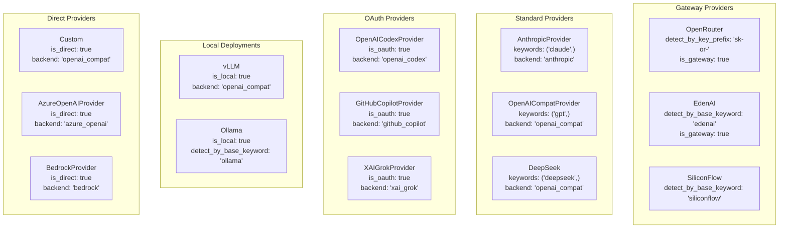
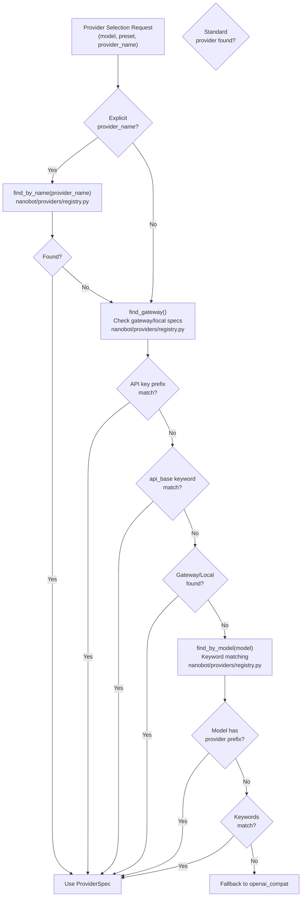

<!-- source: DeepWiki mcp.deepwiki.com · repo HKUDS/nanobot · page 6.1 Provider Selection & Registry · fetched 2026-10-26 -->

# Provider Selection & Registry

<details>
<summary>Relevant source files</summary>

The following files were used as context for generating this wiki page:

- [README.md](README.md)
- [docs/configuration.md](docs/configuration.md)
- [docs/providers.md](docs/providers.md)
- [nanobot/agent/loop.py](nanobot/agent/loop.py)
- [nanobot/agent/model_presets.py](nanobot/agent/model_presets.py)
- [nanobot/agent/model_runtime.py](nanobot/agent/model_runtime.py)
- [nanobot/cli/commands.py](nanobot/cli/commands.py)
- [nanobot/config/schema.py](nanobot/config/schema.py)
- [nanobot/config/watcher.py](nanobot/config/watcher.py)
- [nanobot/providers/factory.py](nanobot/providers/factory.py)
- [nanobot/providers/registry.py](nanobot/providers/registry.py)
- [nanobot/utils/llm_runtime.py](nanobot/utils/llm_runtime.py)
- [nanobot/webui/settings_api.py](nanobot/webui/settings_api.py)
- [tests/agent/test_model_runtime_resolver.py](tests/agent/test_model_runtime_resolver.py)
- [tests/agent/test_self_model_preset.py](tests/agent/test_self_model_preset.py)
- [tests/cli/test_commands.py](tests/cli/test_commands.py)
- [tests/command/test_model_command.py](tests/command/test_model_command.py)
- [tests/config/test_model_presets.py](tests/config/test_model_presets.py)
- [tests/config/test_watcher.py](tests/config/test_watcher.py)
- [tests/webui/test_settings_api.py](tests/webui/test_settings_api.py)

</details>


## Purpose and Scope

This document explains nanobot's provider registry system, which serves as the single source of truth for configuring and detecting the 25+ supported LLM providers. The registry controls provider metadata, detection logic, model name prefixing, environment variable setup, and matching priority. The registry coordinates routing between native implementations (OpenAI, Anthropic, Azure, Bedrock) and OpenAI-compatible backends.

---

## The PROVIDERS Registry

The `PROVIDERS` tuple in [nanobot/providers/registry.py:146-146]() defines all supported LLM providers as an ordered sequence of `ProviderSpec` entries. This registry controls:

- **Provider detection**: How nanobot identifies which provider to use based on API keys, base URLs, or model names.
- **Backend Selection**: Which implementation class (e.g., `AnthropicProvider`, `OpenAICompatProvider`, `AzureOpenAIProvider`) to instantiate [nanobot/providers/factory.py:168-223]().
- **Environment setup**: Which environment variables need to be set for each provider via `env_key` and `env_extras` [nanobot/providers/registry.py:46-58]().
- **Match priority**: Earlier entries win when multiple providers could handle a request. Gateways and local deployments are prioritized to ensure correct routing [nanobot/providers/registry.py:9-11]().

**Key principle**: Order matters — it controls match priority and fallback. Gateways and local deployments are prioritized to ensure correct routing [nanobot/providers/registry.py:9-11]().

```python
# Example from registry [nanobot/providers/registry.py:146-203]
PROVIDERS: tuple[ProviderSpec, ...] = (
    # === Custom (direct OpenAI-compatible endpoint) ===
    ProviderSpec(name="custom", backend="openai_compat", is_direct=True, ...),

    # === Azure OpenAI ===
    ProviderSpec(name="azure_openai", backend="azure_openai", is_direct=True, ...),

    # === Gateways (detected by api_key / api_base, not model name) ===
    ProviderSpec(
        name="openrouter",
        is_gateway=True,
        detect_by_key_prefix="sk-or-",
        detect_by_base_keyword="openrouter",
        ...
    ),
    ...
)
```

**Sources**: [nanobot/providers/registry.py:9-11](), [nanobot/providers/registry.py:46-58](), [nanobot/providers/registry.py:146-203](), [nanobot/providers/factory.py:168-223]()

---

## ProviderSpec Structure

Each provider is defined by a `ProviderSpec` dataclass [nanobot/providers/registry.py:35-137]() containing all metadata needed for detection, configuration, and routing:

### ProviderSpec Field Reference

| Field Category | Field Name | Type | Purpose |
|---|---|---|---|
| **Identity** | `name` | `str` | Config field name (e.g., `"dashscope"`) [nanobot/providers/registry.py:44-44]() |
| | `keywords` | `tuple[str, ...]` | Model-name keywords for matching [nanobot/providers/registry.py:45-45]() |
| | `env_key` | `str` | Env var for API key (e.g., `"DASHSCOPE_API_KEY"`) [nanobot/providers/registry.py:46-46]() |
| | `display_name` | `str` | Shown in `nanobot status` [nanobot/providers/registry.py:47-47]() |
| **Backend** | `backend` | `str` | Implementation to use: `"openai_compat"`, `"anthropic"`, `"azure_openai"`, `"openai_codex"`, `"xai_grok"`, `"github_copilot"`, `"bedrock"` [nanobot/providers/registry.py:52-55]() |
| **Environment** | `env_extras` | `tuple[tuple[str, str], ...]` | Extra env vars supplied by the provider [nanobot/providers/registry.py:58-58]() |
| **Detection** | `is_gateway` | `bool` | Routes any model (OpenRouter, AiHubMix) [nanobot/providers/registry.py:62-62]() |
| | `is_local` | `bool` | Local deployment (vLLM, Ollama) [nanobot/providers/registry.py:63-63]() |
| | `detect_by_key_prefix` | `str` | Match API key prefix (e.g., `"sk-or-"`) [nanobot/providers/registry.py:64-64]() |
| | `detect_by_base_keyword` | `str` | Match substring in `api_base` URL [nanobot/providers/registry.py:65-65]() |
| | `default_api_base` | `str` | OpenAI-compatible base URL for this provider [nanobot/providers/registry.py:66-66]() |
| **Gateway Behavior** | `strip_model_prefix` | `bool` | Strip "provider/" before sending to gateway [nanobot/providers/registry.py:69-69]() |
| **Authentication** | `is_oauth` | `bool` | Uses OAuth instead of API keys [nanobot/providers/registry.py:77-77]() |
| | `is_direct` | `bool` | User supplies everything; skips key validation [nanobot/providers/registry.py:80-80]() |
| **Features** | `supports_prompt_caching` | `bool` | Supports cache_control on content blocks [nanobot/providers/registry.py:86-86]() |
| | `thinking_style` | `str` | Injection style for reasoning toggles (e.g. `"thinking_type"`) [nanobot/providers/registry.py:88-94]() |

**Placeholder support in `env_extras`** [nanobot/providers/registry.py:38-41]():
- `{api_key}` — replaced with the user's API key.
- `{api_base}` — replaced with configured or default base URL.

**Sources**: [nanobot/providers/registry.py:35-137]()

---

## Provider Categories

### Provider Category Diagram

This diagram maps provider types to their metadata configurations in `ProviderSpec`.



**Sources**: [nanobot/providers/registry.py:146-253](), [nanobot/providers/registry.py:35-137]()

---

## Provider Detection Algorithm

The provider selection process uses a multi-stage algorithm implemented across lookup functions in `nanobot/providers/registry.py` and used by the factory in `nanobot/providers/factory.py`.

### Detection Flow Diagram

This diagram maps the logical flow of provider selection to the specific detection functions and entities in the codebase.



**Sources**: [nanobot/providers/registry.py:146-253](), [nanobot/providers/factory.py:76-131]()

### Stage 1: Explicit Provider Name
If `provider` is specified in a `ModelPresetConfig` or `AgentDefaults` within `config.json`, the factory retrieves the spec directly using `find_by_name` [nanobot/providers/factory.py:84-88]().

### Stage 2: Gateway/Local Detection
The system checks for gateway providers (like OpenRouter) or local servers (like Ollama) based on the API key prefix or base URL keyword.

**Detection examples**:
- API key `sk-or-v1-xxx` → OpenRouter (detected by prefix `sk-or-`) [nanobot/providers/registry.py:192-192]().
- Base URL `http://localhost:11434` → Ollama (detected by keyword `ollama`) [nanobot/providers/registry.py:249-249]().

### Stage 3: Model Name Matching
Standard providers are matched by model name keywords. For example, any model name containing `claude` is routed to the `anthropic` provider [nanobot/providers/registry.py:217-217]().

**Sources**: [nanobot/providers/registry.py:146-253](), [nanobot/providers/factory.py:76-131]()

---

## Provider Factory & Failover

The `make_provider` function in [nanobot/providers/factory.py:226-246]() is the entry point for instantiating the provider chain.

### Core Creation Logic
The `_make_provider_core` function handles the specific backend selection [nanobot/providers/factory.py:150-223]():

1.  **Backend Selection**: Based on `setup.backend`, it imports and instantiates the specific provider class (e.g., `OpenAICompatProvider`, `AnthropicProvider`, `AzureOpenAIProvider`) [nanobot/providers/factory.py:168-219]().
2.  **Configuration Injection**: Passes `api_key`, `api_base`, `proxy`, and `extra_headers` from the `ProviderConfig` to the provider instance [nanobot/providers/factory.py:189-196]().
3.  **Generation Settings**: Injects temperature and max tokens from the resolved `ModelPresetConfig` [nanobot/providers/factory.py:221-221]().

### Fallback Handling
If `fallback_models` are defined in the agent configuration, `make_provider` wraps the primary provider in a `FallbackProvider` [nanobot/providers/factory.py:244-244](). This wrapper manages sequential failover to backup models if the primary request fails [nanobot/providers/fallback_provider.py:98-116]().

**Sources**: [nanobot/providers/factory.py:150-244](), [nanobot/providers/fallback_provider.py:98-116]()

---

## Provider-Specific Overrides

### Thinking Styles
Providers use different mechanisms to enable reasoning modes via `thinking_style` [nanobot/providers/registry.py:88-94](). The `OpenAICompatProvider` uses these styles to build the `extra_body` payload [nanobot/providers/openai_compat_provider.py:136-143]():
- `thinking_type`: DeepSeek, VolcEngine [nanobot/providers/openai_compat_provider.py:140-140]().
- `enable_thinking`: DashScope (Qwen) [nanobot/providers/openai_compat_provider.py:141-141]().
- `reasoning_split`: MiniMax [nanobot/providers/openai_compat_provider.py:142-142]().

### Reasoning Control
- `gateway_reasoning_style`: Allows gateways like OpenRouter to control reasoning via `extra_body` [nanobot/providers/openai_compat_provider.py:144-149]().
- `reasoning_effort_remap`: Maps OpenAI-style effort levels (low, medium, high) to provider-specific vocabularies [nanobot/providers/registry.py:106-110]().

**Sources**: [nanobot/providers/registry.py:88-115](), [nanobot/providers/openai_compat_provider.py:136-149]()

---

