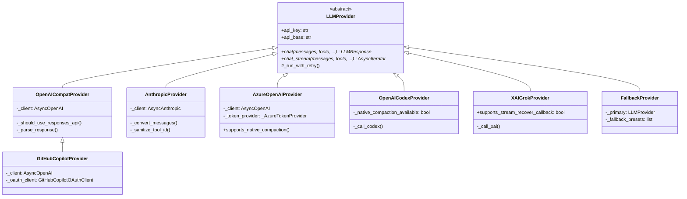
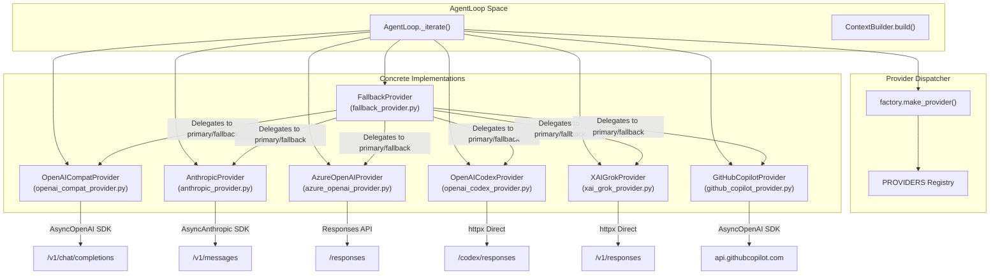

<!-- source: DeepWiki mcp.deepwiki.com · repo HKUDS/nanobot · page 6.2 Provider Implementations · fetched 2026-10-26 -->

# Provider Implementations

Relevant source files

The following files were used as context for generating this wiki page:

- [nanobot/providers/anthropic_provider.py](nanobot/providers/anthropic_provider.py)
- [nanobot/providers/azure_openai_provider.py](nanobot/providers/azure_openai_provider.py)
- [nanobot/providers/base.py](nanobot/providers/base.py)
- [nanobot/providers/fallback_provider.py](nanobot/providers/fallback_provider.py)
- [nanobot/providers/github_copilot_oauth.py](nanobot/providers/github_copilot_oauth.py)
- [nanobot/providers/github_copilot_provider.py](nanobot/providers/github_copilot_provider.py)
- [nanobot/providers/oauth_model_catalog.py](nanobot/providers/oauth_model_catalog.py)
- [nanobot/providers/openai_codex_provider.py](nanobot/providers/openai_codex_provider.py)
- [nanobot/providers/openai_compat_provider.py](nanobot/providers/openai_compat_provider.py)
- [nanobot/providers/openai_responses/converters.py](nanobot/providers/openai_responses/converters.py)
- [nanobot/providers/openai_responses/parsing.py](nanobot/providers/openai_responses/parsing.py)
- [nanobot/providers/openai_responses/state.py](nanobot/providers/openai_responses/state.py)
- [nanobot/providers/xai_grok_provider.py](nanobot/providers/xai_grok_provider.py)
- [nanobot/webui/settings_models.py](nanobot/webui/settings_models.py)
- [tests/agent/test_gemini_thought_signature.py](tests/agent/test_gemini_thought_signature.py)
- [tests/agent/test_runner_fallback.py](tests/agent/test_runner_fallback.py)
- [tests/providers/test_anthropic_merge_consecutive.py](tests/providers/test_anthropic_merge_consecutive.py)
- [tests/providers/test_anthropic_thinking.py](tests/providers/test_anthropic_thinking.py)
- [tests/providers/test_anthropic_tool_result.py](tests/providers/test_anthropic_tool_result.py)
- [tests/providers/test_azure_openai_provider.py](tests/providers/test_azure_openai_provider.py)
- [tests/providers/test_custom_provider.py](tests/providers/test_custom_provider.py)
- [tests/providers/test_enforce_role_alternation.py](tests/providers/test_enforce_role_alternation.py)
- [tests/providers/test_github_copilot_oauth_flow.py](tests/providers/test_github_copilot_oauth_flow.py)
- [tests/providers/test_litellm_kwargs.py](tests/providers/test_litellm_kwargs.py)
- [tests/providers/test_mistral_provider.py](tests/providers/test_mistral_provider.py)
- [tests/providers/test_oauth_model_catalog.py](tests/providers/test_oauth_model_catalog.py)
- [tests/providers/test_openai_codex_provider.py](tests/providers/test_openai_codex_provider.py)
- [tests/providers/test_openai_responses.py](tests/providers/test_openai_responses.py)
- [tests/providers/test_provider_retry.py](tests/providers/test_provider_retry.py)
- [tests/providers/test_responses_circuit_breaker.py](tests/providers/test_responses_circuit_breaker.py)
- [tests/providers/test_xai_grok_provider.py](tests/providers/test_xai_grok_provider.py)
- [tests/webui/test_copilot_device_login.py](tests/webui/test_copilot_device_login.py)
- [webui/src/components/settings/models/useModelSettingsActions.ts](webui/src/components/settings/models/useModelSettingsActions.ts)
- [webui/src/components/settings/useSettingsController.ts](webui/src/components/settings/useSettingsController.ts)

This page documents the concrete LLM provider classes in `nanobot/providers/`. Each implements the `LLMProvider` abstract base class, exposing a unified `chat()` and `chat_stream()` interface to the `AgentLoop`. For details on how `AgentLoop` selects a provider at runtime, see [Provider Selection & Registry (6.1)]().

---

## Base Interface

All providers share the contracts and utility logic defined in `nanobot/providers/base.py` [nanobot/providers/base.py:1-196]().

### Core Data Structures

| Class | Key Fields | Purpose |
|:---|:---|:---|
| `ToolCallRequest` | `id`, `name`, `arguments`, `extra_content` | Represents a tool call issued by the LLM. `extra_content` preserves provider-specific metadata like Gemini thought signatures [nanobot/providers/base.py:70-79](). |
| `LLMResponse` | `content`, `tool_calls`, `finish_reason`, `usage`, `reasoning_content` | The normalized response returned to the agent. `reasoning_content` carries chain-of-thought text from "thinking" models [nanobot/providers/base.py:200-216](). |
| `ProviderConversationState` | `kind`, `provider`, `model`, `version`, `payload`, `pending_messages` | Opaque provider-owned continuation state, potentially containing encrypted reasoning or other private protocol items. `pending_messages` are chat-style messages produced after the most recent provider response [nanobot/providers/base.py:173-196]().

### Shared Logic
The `LLMProvider` base class implements several critical behaviors used by all subclasses:
- **Sanitization**: `_sanitize_empty_content` ensures messages have valid content blocks and strips internal `_meta` fields before they reach the API [nanobot/providers/base.py:241-282]().
- **Role Management**: `_enforce_role_alternation` fixes histories that violate strict User/Assistant interleaving by inserting empty user messages or merging consecutive blocks [nanobot/providers/base.py:534-614]().
- **Reliability**: `_run_with_retry` provides exponential backoff for 429/503 errors and an automatic fallback that retries without images if an LLM rejects multimodal content [nanobot/providers/base.py:384-468]().

**Sources:** [nanobot/providers/base.py:1-196](), [nanobot/providers/base.py:70-79](), [nanobot/providers/base.py:200-216](), [nanobot/providers/base.py:173-196](), [nanobot/providers/base.py:241-282](), [nanobot/providers/base.py:534-614](), [nanobot/providers/base.py:384-468]()

---

## Provider Architecture

The following diagrams illustrate the relationship between the system's abstract interfaces and the concrete implementations that bridge to external API spaces.

Title: "Provider Class Hierarchy and Core Entities"

**Sources:** [nanobot/providers/base.py:193-210](), [nanobot/providers/openai_compat_provider.py:238-251](), [nanobot/providers/anthropic_provider.py:80-109](), [nanobot/providers/azure_openai_provider.py:91-142](), [nanobot/providers/openai_codex_provider.py:43-59](), [nanobot/providers/xai_grok_provider.py:76-90](), [nanobot/providers/github_copilot_provider.py:174-190](), [nanobot/providers/fallback_provider.py:133-160]()

Title: "Request Flow from AgentLoop to Code Entities"

**Sources:** [nanobot/providers/openai_compat_provider.py:270-285](), [nanobot/providers/anthropic_provider.py:109](), [nanobot/providers/azure_openai_provider.py:136-141](), [nanobot/providers/openai_codex_provider.py:38-40](), [nanobot/providers/xai_grok_provider.py:179-181](), [nanobot/providers/github_copilot_provider.py:183-190](), [nanobot/providers/fallback_provider.py:133-160]()

---

## OpenAICompatProvider

This is the most versatile provider, supporting all OpenAI-compatible APIs (OpenRouter, DeepSeek, Moonshot, Qwen, xAI Grok, etc.). It uses the `openai.AsyncOpenAI` client but adds logic for non-standard features [nanobot/providers/openai_compat_provider.py:1-46]().

### Thinking and Reasoning
The provider detects and enables "thinking" modes across different model families:
- **Kimi/MiMo**: Uses the `thinking_type` extra body parameter [nanobot/providers/openai_compat_provider.py:130-135]().
- **Qwen**: Uses the `enable_thinking` parameter [nanobot/providers/openai_compat_provider.py:154-158]().
- **DeepSeek**: Handles the `reasoning_content` field in both synchronous and streaming responses [nanobot/providers/openai_compat_provider.py:87, 439-444]().

### Responses API & Circuit Breaker
For models supporting the newer **Responses API** (like GPT-5 or DeepSeek-V4), the provider can switch from Chat Completions to the Responses interface [nanobot/providers/openai_compat_provider.py:287-300](). It includes a **Circuit Breaker** that tracks failures: if the Responses API fails repeatedly for a specific model, it falls back to standard Chat Completions for a probe interval [nanobot/providers/openai_compat_provider.py:328-356]().

**Sources:** [nanobot/providers/openai_compat_provider.py:1-46](), [nanobot/providers/openai_compat_provider.py:130-135](), [nanobot/providers/openai_compat_provider.py:154-158](), [nanobot/providers/openai_compat_provider.py:87](), [nanobot/providers/openai_compat_provider.py:439-444](), [nanobot/providers/openai_compat_provider.py:287-300](), [nanobot/providers/openai_compat_provider.py:328-356](), `tests/providers/test_responses_circuit_breaker.py`

---

## AnthropicProvider

A direct integration with the `AsyncAnthropic` SDK, optimized for Claude models [nanobot/providers/anthropic_provider.py:80-85]().

- **Format Conversion**: Maps OpenAI roles to Anthropic's message structure. It handles `tool_use` and `tool_result` blocks, ensuring multimodal content (images) in tool outputs is correctly converted to Anthropic's base64 format [nanobot/providers/anthropic_provider.py:185-226, 400-435]().
- **ID Sanitization**: Anthropic enforces a strict regex for tool IDs. `_sanitize_tool_id` coerces IDs from other providers or restored sessions into the allowed charset [nanobot/providers/anthropic_provider.py:65-78]().
- **Extended Thinking**: Supports the Claude 3.7+ `thinking` parameter with `budget_tokens` and `output_config`. It intelligently manages temperature settings, as many Claude thinking models require temperature to be exactly 1.0 or omitted [nanobot/providers/anthropic_provider.py:448-472](), [tests/providers/test_anthropic_thinking.py:37-40]().

**Sources:** [nanobot/providers/anthropic_provider.py:80-85](), [nanobot/providers/anthropic_provider.py:185-226](), [nanobot/providers/anthropic_provider.py:400-435](), [nanobot/providers/anthropic_provider.py:65-78](), [nanobot/providers/anthropic_provider.py:448-472](), `tests/providers/test_anthropic_thinking.py`, `tests/providers/test_anthropic_tool_result.py`

---

## AzureOpenAIProvider

Targets the Azure-hosted **Responses API** [nanobot/providers/azure_openai_provider.py:1-18]().

- **Authentication**: Automatically detects and uses **Microsoft Entra ID (AAD)** via `DefaultAzureCredential` if no API key is provided, acquiring tokens for the `cognitiveservices` scope [nanobot/providers/azure_openai_provider.py:48-79]().
- **Responses Integration**: Reuses shared logic from `nanobot.providers.openai_responses` to handle the SSE-based Responses stream [nanobot/providers/azure_openai_provider.py:35-46]().
- **Native Compaction**: Supports server-side context management (compaction) to handle large conversation histories efficiently [nanobot/providers/azure_openai_provider.py:172-175]().

**Sources:** [nanobot/providers/azure_openai_provider.py:1-18](), [nanobot/providers/azure_openai_provider.py:48-79](), [nanobot/providers/azure_openai_provider.py:35-46](), [nanobot/providers/azure_openai_provider.py:172-175](), `nanobot/providers/openai_responses/state.py`, `tests/providers/test_azure_openai_provider.py`

---

## OpenAICodexProvider

Provides access to OpenAI's internal Responses API through the Codex OAuth flow [nanobot/providers/openai_codex_provider.py:43-59]().

- **OAuth Integration**: Uses `oauth_cli_kit` to manage tokens [nanobot/providers/openai_codex_provider.py:16](), [nanobot/providers/openai_codex_provider.py:133]().
- **Direct Transport**: Bypasses standard SDKs to use `httpx` for direct SSE handling, with TLS context reuse for performance [nanobot/providers/openai_codex_provider.py:64-73](), [tests/providers/test_openai_codex_provider.py:48-83]().
- **Compaction**: Includes an explicit `compaction_trigger` in the input items when the conversation length exceeds the model's threshold, allowing the server to compress history [nanobot/providers/openai_codex_provider.py:170-184]().

**Sources:** [nanobot/providers/openai_codex_provider.py:43-59](), [nanobot/providers/openai_codex_provider.py:16](), [nanobot/providers/openai_codex_provider.py:133](), [nanobot/providers/openai_codex_provider.py:64-73](), [tests/providers/test_openai_codex_provider.py:48-83](), [nanobot/providers/openai_codex_provider.py:170-184](), `tests/providers/test_openai_codex_provider.py`

---

## GitHubCopilotProvider

Integrates with GitHub Copilot Chat APIs, supporting both Enterprise and individual accounts [nanobot/providers/github_copilot_provider.py:174-182]().

- **Token Management**: Exchanges a stored GitHub OAuth token for short-lived Copilot access tokens via `api.github.com/copilot_internal/v2/token` [nanobot/providers/github_copilot_provider.py:25]().
- **Device Flow**: Implements the GitHub device code flow for initial authentication [nanobot/providers/github_copilot_provider.py:74-171]().
- **OpenAI Compatibility**: Inherits from `OpenAICompatProvider`, using the standard `AsyncOpenAI` client pointed at `api.githubcopilot.com` [nanobot/providers/github_copilot_provider.py:174-190]().

**Sources:** [nanobot/providers/github_copilot_provider.py:174-182](), [nanobot/providers/github_copilot_provider.py:25](), [nanobot/providers/github_copilot_provider.py:74-171](), [nanobot/providers/github_copilot_provider.py:174-190]()

---

## xAI Grok Provider

The `XAIGrokProvider` supports both standard API access and subscription-based OAuth access [nanobot/providers/xai_grok_provider.py:35-40]().

- **Hosted X Search**: Integrates with Grok's native web search capabilities. It maps the `web_search_call` output items from the Responses API onto Nanobot's tool progress system [nanobot/providers/openai_responses/parsing.py:92-160]().
- **OAuth Authentication**: When configured with `use_oauth: true`, it uses the `oauth-cli-kit` to authenticate as a user, allowing access to Grok models via the `grok.com` backend [nanobot/providers/xai_grok_provider.py:126-140]().

**Sources:** [nanobot/providers/xai_grok_provider.py:35-40](), [nanobot/providers/openai_responses/parsing.py:92-160](), [nanobot/providers/xai_grok_provider.py:126-140]()

---

## FallbackProvider

The `FallbackProvider` wraps a primary LLM provider and transparently fails over to a list of fallback models if the primary encounters certain errors [nanobot/providers/fallback_provider.py:113-131]().

- **Error Handling**: It specifically handles transient errors like timeouts, connection issues, server errors, and rate limits. It avoids falling back for non-retryable errors such as content filtering or context length issues [nanobot/providers/fallback_provider.py:32-44](), [nanobot/providers/fallback_provider.py:70-75]().
- **Circuit Breaker**: The primary provider is circuit-broken after repeated failures to prevent wasting requests on a known-bad endpoint [nanobot/providers/fallback_provider.py:30-31](), [nanobot/providers/fallback_provider.py:158-160]().
- **Stream Recovery**: Supports stream recovery, allowing the provider to close a current stream segment and continue failover with later deltas in a new segment if a timeout occurs during streaming [nanobot/providers/fallback_provider.py:134]().
- **Observer Pattern**: Allows attaching a `FallbackModelObserver` to be notified when a fallback model is selected [nanobot/providers/fallback_provider.py:173-176]().

**Sources:** [nanobot/providers/fallback_provider.py:113-131](), [nanobot/providers/fallback_provider.py:32-44](), [nanobot/providers/fallback_provider.py:70-75](), [nanobot/providers/fallback_provider.py:30-31](), [nanobot/providers/fallback_provider.py:158-160](), [nanobot/providers/fallback_provider.py:134](), [nanobot/providers/fallback_provider.py:173-176](), `tests/agent/test_runner_fallback.py`

---

## Retries

The `LLMProvider._run_with_retry` method implements a robust retry mechanism for transient errors [nanobot/providers/base.py:384-468]().

- **Exponential Backoff**: Retries are performed with exponential backoff, starting at 1 second and increasing for subsequent attempts [nanobot/providers/base.py:409-410]().
- **Retry-After Headers**: Respects `Retry-After` HTTP headers to determine the wait time before retrying [nanobot/providers/base.py:38-39](), [nanobot/providers/base.py:420-423]().
- **Structured Events**: Emits `RetryStatusEvent` events to an `EventSink` to provide visibility into the retry lifecycle, including `waiting`, `recovered`, and `cleared` states [nanobot/providers/base.py:27-29](), [nanobot/providers/base.py:443-444](), [tests/providers/test_provider_retry.py:78-90]().
- **Max Attempts**: Configurable maximum number of retry attempts (defaulting to 4) [nanobot/providers/base.py:390](), [tests/providers/test_provider_retry.py:95]().

**Sources:** [nanobot/providers/base.py:384-468](), [nanobot/providers/base.py:409-410](), [nanobot/providers/base.py:38-39](), [nanobot/providers/base.py:420-423](), [nanobot/providers/base.py:27-29](), [nanobot/providers/base.py:443-444](), [tests/providers/test_provider_retry.py:78-90](), [nanobot/providers/base.py:390](), [tests/providers/test_provider_retry.py:95]()

---

## OpenAI Responses API Module

The `nanobot/providers/openai_responses/` directory contains shared utilities for providers that use the Responses API (Azure, Codex, and OpenAICompat) [nanobot/providers/openai_responses/converters.py:1-15]().

- **`converters.py`**: Maps Chat Completions messages to the `input_text`, `input_image`, and `function_call` items required by the Responses API [nanobot/providers/openai_responses/converters.py:15-78]().
- **`parsing.py`**: Provides `ResponsesStreamCapture` to accumulate deltas from SSE streams and `consume_sdk_stream` to parse events into `LLMResponse` objects [nanobot/providers/openai_responses/parsing.py:26-50]().
- **`state.py`**: Manages `ProviderConversationState`, tracking the server-side conversation ID to allow turn-based resumption without re-sending the full history [nanobot/providers/openai_responses/state.py:24-46]().

**Sources:** [nanobot/providers/openai_responses/converters.py:1-15](), [nanobot/providers/openai_responses/converters.py:15-78](), [nanobot/providers/openai_responses/parsing.py:26-50](), [nanobot/providers/openai_responses/state.py:24-46]()

---

## LLM Usage Tracking

Nanobot tracks token usage and provider performance in a local SQLite database, enabling the WebUI's token usage heatmap [nanobot/agent/loop.py]().

- **SQLite Schema**: Usage is recorded in the `llm_usage` table, including `model`, `provider`, `prompt_tokens`, `completion_tokens`, and `latency_ms`.
- **Context Governance**: The `ContextGovernor` uses these usage statistics to decide when to trigger memory consolidation or history snipping [nanobot/agent/context_governance.py:14-45](), [tests/agent/test_runner_governance.py:11-22]().

**Sources:** `nanobot/agent/context_governance.py`, `tests/agent/test_runner_governance.py`

---

