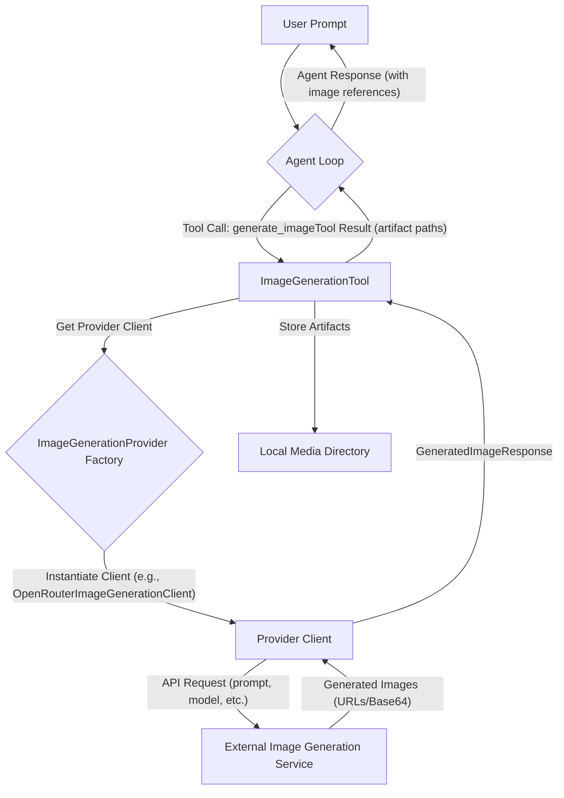

<!-- source: DeepWiki mcp.deepwiki.com · repo HKUDS/nanobot · page 6.3 Image Generation & Multimodal Providers · fetched 2026-10-26 -->

# Image Generation & Multimodal Providers

<details>
<summary>Relevant source files</summary>

The following files were used as context for generating this wiki page:

- [docs/image-generation.md](docs/image-generation.md)
- [nanobot/agent/tools/cli_apps.py](nanobot/agent/tools/cli_apps.py)
- [nanobot/agent/tools/image_generation.py](nanobot/agent/tools/image_generation.py)
- [nanobot/providers/image_generation.py](nanobot/providers/image_generation.py)
- [tests/agent/test_loop_image_generation_media.py](tests/agent/test_loop_image_generation_media.py)
- [tests/providers/test_image_generation.py](tests/providers/test_image_generation.py)
- [tests/providers/test_image_generation_security.py](tests/providers/test_image_generation_security.py)
- [tests/tools/test_image_generation_tool.py](tests/tools/test_image_generation_tool.py)

</details>


This page details nanobot's image generation capabilities, including the provider abstraction, the `generate_image` tool, artifact storage, and security considerations. It covers how nanobot integrates with various image generation services and manages generated content.

## Image Generation Tool

The `generate_image` tool allows the agent to create or edit images. It is disabled by default and must be enabled and configured with a provider and model in the WebUI settings or `config.json`.

The tool's configuration is defined by `ImageGenerationToolConfig` [nanobot/agent/tools/image_generation.py:49-58]().

```python
class ImageGenerationToolConfig(Base):
    """Image generation tool configuration."""
    enabled: bool = False
    provider: str = "openrouter"
    model: str = "openai/gpt-5.4-image-2"
    default_aspect_ratio: str = "1:1"
    default_image_size: str = "1K"
    max_images_per_turn: int = Field(default=4, ge=1, le=8)
    save_dir: str = "generated"
```

The `generate_image` tool accepts several parameters [nanobot/agent/tools/image_generation.py:60-82]():
- `prompt`: A detailed description for image generation or editing.
- `reference_images`: Optional local paths to existing images for iterative edits.
- `aspect_ratio`: Desired output aspect ratio (e.g., "1:1", "16:9").
- `image_size`: Size hint for the output image (e.g., "1K", "1024x1024").
- `count`: Number of images to generate in a single call (1 to 8).

When the agent calls `generate_image`, it passes these parameters to the configured image generation provider [nanobot/agent/tools/image_generation.py:180-182](). The tool then stores the generated images as persistent artifacts and returns their paths to the agent [nanobot/agent/tools/image_generation.py:38-41]().

### Configuration

Image generation is configured under the `tools.imageGeneration` section in `config.json` [docs/image-generation.md:28-34]().

```json
{
  "providers": {
    "openrouter": {
      "apiKey": "${OPENROUTER_API_KEY}"
    }
  },
  "tools": {
    "imageGeneration": {
      "enabled": true,
      "provider": "openrouter",
      "model": "openai/gpt-5.4-image-2"
    }
  }
}
```

Key configuration options include:
- `enabled`: `boolean` - Whether the `generate_image` tool is active.
- `provider`: `string` - The name of the image generation provider to use (e.g., `openrouter`, `openai`, `gemini`).
- `model`: `string` - The specific model name from the chosen provider.
- `defaultAspectRatio`: `string` - Default aspect ratio if not specified in the prompt.
- `defaultImageSize`: `string` - Default size hint if not specified.
- `maxImagesPerTurn`: `number` - Maximum images generated per tool call (1-8).
- `saveDir`: `string` - Relative directory for storing generated images within nanobot's media directory.

Provider-specific settings like `apiKey`, `apiBase`, `extraHeaders`, `extraBody`, and `proxy` are configured under the `providers.<name>` section [docs/image-generation.md:65-74]().

Sources:
- [nanobot/agent/tools/image_generation.py:49-58]()
- [nanobot/agent/tools/image_generation.py:60-82]()
- [nanobot/agent/tools/image_generation.py:38-41]()
- [docs/image-generation.md:28-34]()
- [docs/image-generation.md:65-74]()

## Image Generation Provider Abstraction

nanobot uses an abstraction layer for image generation providers, defined by the `ImageGenerationProvider` abstract base class [nanobot/providers/image_generation.py:200-209](). This allows nanobot to integrate with various services through a unified interface.

```python
@dataclass(frozen=True)
class GeneratedImageResponse:
    """Images and optional text returned by the provider."""

    images: list[str]
    content: str
    raw: dict[str, Any]


class ImageGenerationProvider(ABC):
    """Abstract base class for image generation providers."""

    @abstractmethod
    async def generate(
        self,
        prompt: str,
        model: str,
        reference_images: list[str] | None = None,
        aspect_ratio: str | None = None,
        image_size: str | None = None,
        count: int = 1,
    ) -> GeneratedImageResponse:
        """Generate images based on the prompt and optional parameters."""
        raise NotImplementedError
```

The `get_image_gen_provider` function [nanobot/providers/image_generation.py:33-34]() is responsible for retrieving the appropriate provider class based on the configured provider name.

### Provider Implementations

nanobot supports several image generation providers, each with its own client implementation inheriting from `ImageGenerationProvider`. Examples include:

- **OpenRouterImageGenerationClient**: Integrates with OpenRouter's chat-completions style image response [nanobot/providers/image_generation.py:212-270]().
- **CustomImageGenerationClient**: For services implementing the synchronous OpenAI Images API (`POST /v1/images/generations`) [nanobot/providers/image_generation.py:273-340]().
- **AIHubMixImageGenerationClient**: Supports AIHubMix's unified predictions API [nanobot/providers/image_generation.py:343-401]().
- **MiniMaxImageGenerationClient**: For MiniMax image generation services [nanobot/providers/image_generation.py:404-462]().
- **GeminiImageGenerationClient**: Integrates with Google Gemini's image generation capabilities [nanobot/providers/image_generation.py:465-570]().
- **OllamaImageGenerationClient**: For local or self-hosted Ollama instances [nanobot/providers/image_generation.py:573-631]().
- **StepFunImageGenerationClient**: For StepFun's image generation services [nanobot/providers/image_generation.py:634-692]().
- **ZhipuImageGenerationClient**: For Zhipu AI's image generation [nanobot/providers/image_generation.py:695-753]().
- **ModelScopeImageGenerationClient**: For ModelScope image generation [nanobot/providers/image_generation.py:756-814]().
- **OpenAIImageGenerationClient**: For OpenAI's DALL-E models [nanobot/providers/image_generation.py:817-875]().
- **CodexImageGenerationClient**: For OpenAI Codex image generation (streaming) [nanobot/providers/image_generation.py:878-936]().

Each client handles the specific API requests and response parsing for its respective service.

### Image Generation Flow

The following diagram illustrates the high-level flow of image generation:


**Title: Image Generation Flow**

Sources:
- [nanobot/providers/image_generation.py:200-209]()
- [nanobot/providers/image_generation.py:33-34]()
- [nanobot/providers/image_generation.py:212-270]()
- [nanobot/providers/image_generation.py:273-340]()
- [nanobot/providers/image_generation.py:343-401]()
- [nanobot/providers/image_generation.py:404-462]()
- [nanobot/providers/image_generation.py:465-570]()
- [nanobot/providers/image_generation.py:573-631]()
- [nanobot/providers/image_generation.py:634-692]()
- [nanobot/providers/image_generation.py:695-753]()
- [nanobot/providers/image_generation.py:756-814]()
- [nanobot/providers/image_generation.py:817-875]()
- [nanobot/providers/image_generation.py:878-936]()

## Artifact Storage

Generated images are stored as persistent artifacts in nanobot's local media directory, specifically within the `save_dir` configured for the `imageGeneration` tool [nanobot/agent/tools/image_generation.py:57](). The `store_generated_image_artifact` function [nanobot/utils/artifacts.py:100-120]() handles saving the image data and metadata.

```python
# From nanobot/utils/artifacts.py
async def store_generated_image_artifact(
    image_data_url: str,
    *,
    save_dir: Path,
    model: str,
    prompt: str,
    reference_images: list[str] | None = None,
    aspect_ratio: str | None = None,
    image_size: str | None = None,
) -> dict[str, Any]:
    """Store a generated image as a persistent artifact."""
    # ... (implementation details)
```

The `ImageGenerationTool` resolves and validates paths for `reference_images` to ensure they are within the allowed workspace or nanobot's media directory [nanobot/agent/tools/image_generation.py:150-177](). This prevents unauthorized file access.

The `generated_image_tool_result` function [nanobot/utils/artifacts.py:122]() formats the stored artifact information into a `ToolResult` for the agent.

Sources:
- [nanobot/agent/tools/image_generation.py:57]()
- [nanobot/utils/artifacts.py:100-120]()
- [nanobot/agent/tools/image_generation.py:150-177]()
- [nanobot/utils/artifacts.py:122]()

## Security Checks for Image Downloads

When an image generation provider returns image URLs, nanobot performs security checks before downloading the images. This is crucial to prevent Server-Side Request Forgery (SSRF) and other network-based attacks. The `_download_image_data_url` function [nanobot/providers/image_generation.py:154-159]() is responsible for these downloads.

Key security measures include:
- **URL Resolution and Target Validation**: Before making an HTTP request, nanobot resolves the URL's target and checks if it points to an unsafe or private network address (e.g., loopback, link-local) [nanobot/security/network.py:100-105](). This is done using `resolve_url_target` [nanobot/security/network.py:100-105]().
- **Redirect Revalidation**: If a URL redirects, each redirect target is re-validated for safety [nanobot/providers/image_generation.py:186-192]().
- **Download Size Limit**: A maximum download size (`_IMAGE_DOWNLOAD_MAX_BYTES`) is enforced to prevent resource exhaustion attacks [nanobot/providers/image_generation.py:33]().
- **Proxy Handling**: If an explicit `proxy` is configured for the provider, nanobot delegates DNS resolution to the proxy for external hosts, but still performs local validation for malformed or locally identifiable private targets [nanobot/providers/image_generation.py:167-184](). Process-wide proxy environment variables are not used for these downloads to maintain control.
- **Pinned DNS Transport**: For direct connections (without an explicit proxy), `PinnedDNSAsyncTransport` [nanobot/security/network.py:110-115]() is used to ensure that DNS resolution is performed locally and pinned to prevent DNS rebinding attacks.

The `test_generated_image_download_blocks_unsafe_target` test [tests/providers/test_image_generation_security.py:31-60]() verifies that unsafe URLs are blocked.

```mermaid
graph TD
    A[Image URL from Provider] --> B{Is Proxy Configured?};
    B -- Yes --> C[Validate URL Locally (malformed, private targets)];
    B -- No --> D[Resolve URL Target via PinnedDNSAsyncTransport];
    C -- Valid --> E[Delegate DNS/Request to Proxy];
    D -- Valid --> F[Direct HTTP Request];
    C -- Invalid --> G[ImageGenerationError: Unsafe URL];
    D -- Invalid --> G;
    E -- Response --> H{Check for Redirects};
    F -- Response --> H;
    H -- Redirect --> I[Re-validate Redirected URL];
    H -- No Redirect --> J[Download Image Data];
    I -- Valid --> E;
    I -- Invalid --> G;
    J -- Exceeds Max Bytes --> G[ImageGenerationError: Download Limit];
    J -- Valid --> K[Return Data URL];
```
**Title: Image Download Security Flow**

Sources:
- [nanobot/providers/image_generation.py:154-159]()
- [nanobot/security/network.py:100-105]()
- [nanobot/providers/image_generation.py:186-192]()
- [nanobot/providers/image_generation.py:33]()
- [nanobot/providers/image_generation.py:167-184]()
- [nanobot/security/network.py:110-115]()
- [tests/providers/test_image_generation_security.py:31-60]()

---

