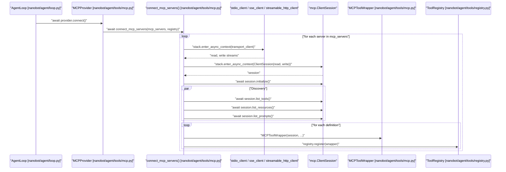
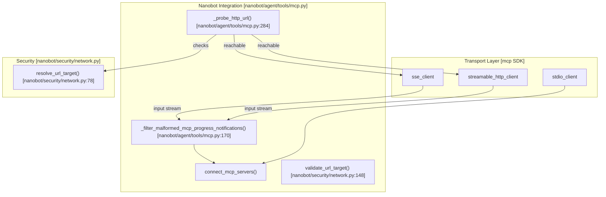
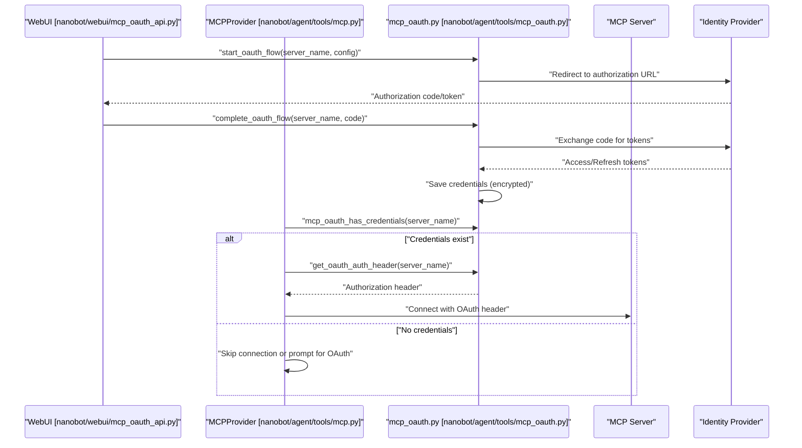

<!-- source: DeepWiki mcp.deepwiki.com · repo HKUDS/nanobot · page 7.2 MCP Integration · fetched 2026-10-26 -->

# MCP Integration

Relevant source files

The following files were used as context for generating this wiki page:

- [nanobot/agent/tools/mcp.py](nanobot/agent/tools/mcp.py)
- [nanobot/agent/tools/mcp_oauth.py](nanobot/agent/tools/mcp_oauth.py)
- [nanobot/agent/tools/web.py](nanobot/agent/tools/web.py)
- [nanobot/security/network.py](nanobot/security/network.py)
- [nanobot/webui/mcp_oauth_api.py](nanobot/webui/mcp_oauth_api.py)
- [nanobot/webui/mcp_presets_api.py](nanobot/webui/mcp_presets_api.py)
- [tests/agent/test_mcp_connection.py](tests/agent/test_mcp_connection.py)
- [tests/agent/test_mcp_reconnect_crash.py](tests/agent/test_mcp_reconnect_crash.py)
- [tests/agent/test_mcp_transient_retry.py](tests/agent/test_mcp_transient_retry.py)
- [tests/security/test_security_network.py](tests/security/test_security_network.py)
- [tests/tools/test_mcp_oauth.py](tests/tools/test_mcp_oauth.py)
- [tests/tools/test_mcp_probe.py](tests/tools/test_mcp_probe.py)
- [tests/tools/test_mcp_tool.py](tests/tools/test_mcp_tool.py)
- [tests/tools/test_web_fetch_security.py](tests/tools/test_web_fetch_security.py)
- [tests/tools/test_web_search_tool.py](tests/tools/test_web_search_tool.py)
- [tests/webui/test_mcp_oauth_api.py](tests/webui/test_mcp_oauth_api.py)
- [tests/webui/test_mcp_presets_api.py](tests/webui/test_mcp_presets_api.py)
- [webui/src/components/settings/system/AppsSettings.tsx](webui/src/components/settings/system/AppsSettings.tsx)
- [webui/src/tests/settings-apps-oauth.test.tsx](webui/src/tests/settings-apps-oauth.test.tsx)

This page covers the Model Context Protocol (MCP) integration in nanobot: how external MCP servers are connected, how their tools, resources, and prompts are discovered and wrapped, and how they are presented to the agent. This is a sub-topic of the broader tools system (see [7.1 Built-in Tools]()).

---

## Overview

nanobot can connect to any number of external MCP (Model Context Protocol) servers and expose their capabilities to the agent transparently. From the agent's perspective, MCP-sourced tools appear in the same `ToolRegistry` as built-in tools and are invoked in exactly the same way. In addition to tools, nanobot supports MCP Resources (as read-only tools) and MCP Prompts (as tools that return template text).

The integration lives primarily in `nanobot/agent/tools/mcp.py` [nanobot/agent/tools/mcp.py:1-20]() and the connection lifecycle is managed by the `MCPProvider` [nanobot/agent/tools/mcp.py:653-661]().

---

## Architecture

The integration follows a wrapper pattern where remote MCP entities are encapsulated in classes that adhere to the nanobot `Tool` interface. The `MCPProvider` class acts as the central manager for these connections.

**Diagram: MCP Connection and Tool Registration Flow**

Sources: [nanobot/agent/tools/mcp.py:683-715](), [nanobot/agent/tools/mcp.py:355-408](), [nanobot/agent/loop.py:133-153]()

---

## Wrapper Implementations

### `MCPToolWrapper`
Wraps a standard MCP tool [nanobot/agent/tools/mcp.py:461-510]().
- **Name:** `mcp_{server_name}_{tool_def.name}` sanitized via `_sanitize_mcp_tool_name` [nanobot/agent/tools/mcp.py:195-198, 471-472]().
- **Execution:** Calls `session.call_tool()` with a configurable `tool_timeout` [nanobot/agent/tools/mcp.py:475, 490-492]().
- **Retry Logic:** Implements a single retry for transient connection errors defined in `_TRANSIENT_EXC_NAMES` (e.g., `ClosedResourceError`, `ConnectionResetError`, `EndOfStream`) [nanobot/agent/tools/mcp.py:41-50, 493-505]().
- **Output:** Aggregates `TextContent` and `ImageContent` into strings [nanobot/agent/tools/mcp.py:512-526]().

### `MCPResourceWrapper`
Wraps an MCP resource URI as a read-only tool [nanobot/agent/tools/mcp.py:529-605]().
- **Name:** `mcp_{server_name}_resource_{resource_def.name}` [nanobot/agent/tools/mcp.py:535]().
- **Read Only:** The `read_only` property is set to `True` [nanobot/agent/tools/mcp.py:562-563]().
- **Execution:** Calls `session.read_resource(uri)` [nanobot/agent/tools/mcp.py:570]().

### `MCPPromptWrapper`
Wraps an MCP prompt template [nanobot/agent/tools/mcp.py:607-640]().
- **Name:** `mcp_{server_name}_prompt_{prompt_def.name}` [nanobot/agent/tools/mcp.py:613]().
- **Execution:** Calls `session.get_prompt()` and returns the generated text [nanobot/agent/tools/mcp.py:635-640]().

Sources: [nanobot/agent/tools/mcp.py:461-640](), [nanobot/agent/tools/base.py:19-20]()

---

## Transport Modes

nanobot supports three MCP transport mechanisms, determined by the `MCPServerConfig` [nanobot/config/schema.py:133-143]().

**Diagram: Transport Selection and Data Flow**

Sources: [nanobot/agent/tools/mcp.py:355-408](), [nanobot/agent/tools/mcp.py:284-315](), [nanobot/security/network.py:78-99]()

### Stdio Transport
Triggered when `cfg.type` is `stdio`. It uses `mcp.StdioServerParameters` to launch a local process [nanobot/agent/tools/mcp.py:364-370](). 
On Windows, shell launchers like `npx` or `bunx` are normalized via `_normalize_windows_stdio_command` [nanobot/agent/tools/mcp.py:253-281]().

### SSE (Server-Sent Events)
Triggered when `cfg.type` is `sse`. nanobot performs a TCP probe via `_probe_http_url` before connecting [nanobot/agent/tools/mcp.py:284-315, 371-379](). It utilizes `sse_client` with custom headers from `cfg.headers` [nanobot/agent/tools/mcp.py:380-389]().

### Streamable HTTP
Triggered when `cfg.type` is `streamableHttp`. It supports standard HTTP and OAuth flows [nanobot/agent/tools/mcp.py:390-396](). It uses a `PinnedDNSAsyncTransport` for security [nanobot/agent/tools/mcp.py:403, 21-27]().

---

## OAuth Integration

MCP servers can be configured to use OAuth for authentication. This is handled by the `mcp_oauth` module [nanobot/agent/tools/mcp_oauth.py:1-20]().

**Diagram: OAuth Flow for MCP Servers**

The `MCPOAuthHandlers` protocol defines the interface for OAuth interactions [nanobot/agent/tools/mcp_oauth.py:30-33](). The `mcp_oauth_has_credentials` function checks if credentials exist for a given server [nanobot/agent/tools/mcp_oauth.py:100-102](). When connecting, `get_oauth_auth_header` provides the necessary `Authorization` header [nanobot/agent/tools/mcp_oauth.py:104-110]().

Sources: [nanobot/agent/tools/mcp_oauth.py:1-20](), [nanobot/agent/tools/mcp_oauth.py:30-33](), [nanobot/agent/tools/mcp_oauth.py:100-102](), [nanobot/agent/tools/mcp_oauth.py:104-110]()

---

## Presets API

The WebUI provides a presets API for managing MCP server configurations. This allows users to easily configure and enable common MCP servers.

The `McpPreset` dataclass defines the structure of a preset, including display information, transport type, and configuration fields [nanobot/webui/mcp_presets_api.py:89-103](). `MCP_PRESETS` [nanobot/webui/mcp_presets_api.py:109-207]() is a tuple of predefined MCP server configurations, such as Browserbase, Playwright, Context7, and Firecrawl.

The `McpPresetField` dataclass describes individual configuration fields for a preset, including where the value should be targeted (environment variable, URL parameter, argument, or header) [nanobot/webui/mcp_presets_api.py:78-85]().

The `WebUISettingsConfig` class in `nanobot/webui/settings_services.py` handles the loading and saving of these configurations, allowing users to enable/disable and configure MCP servers through the WebUI.

Sources: [nanobot/webui/mcp_presets_api.py:89-103](), [nanobot/webui/mcp_presets_api.py:109-207](), [nanobot/webui/mcp_presets_api.py:78-85]()

---

## Tool Filtering and Progress Handling

### Tool Filtering
The `connect_mcp_servers` function implements a filtering mechanism via `cfg.enabled_tools` [nanobot/agent/tools/mcp.py:444-455](). 
- If `enabled_tools` is `["*"]`, all discovered tools are registered.
- Otherwise, a tool is only registered if its original or wrapped name is in the list.

### Progress Notification Filtering
Some MCP servers send malformed progress notifications (missing `progressToken`). nanobot includes a `_MalformedProgressNotificationFilter` to drop these messages before they reach the MCP SDK, preventing session crashes [nanobot/agent/tools/mcp.py:131-173]().

Sources: [nanobot/agent/tools/mcp.py:104-130](), [nanobot/agent/tools/mcp.py:444-455]()

---

## Reconnect Handling

nanobot is designed to gracefully handle transient connection issues and session timeouts with MCP servers.

The `MCPToolWrapper` implements a single retry mechanism for transient errors like `ClosedResourceError` or `ConnectionResetError` [nanobot/agent/tools/mcp.py:493-505](). If a tool call fails due to such an error, it will be retried once. If the retry also fails, the error is reported to the agent. Non-transient errors or `asyncio.CancelledError` do not trigger a retry [tests/agent/test_mcp_transient_retry.py:143-147, 194-205]().

For `streamableHttp` connections, if an MCP server's session times out (e.g., due to inactivity), nanobot will attempt to re-establish the connection and re-register the tools when the next tool call is made. This ensures that the agent can continue to use MCP tools even after temporary disconnections [tests/agent/test_mcp_reconnect_crash.py:168-195]().

Sources: [nanobot/agent/tools/mcp.py:493-505](), [tests/agent/test_mcp_transient_retry.py:143-147, 194-205](), [tests/agent/test_mcp_reconnect_crash.py:168-195]()

---

## Lifecycle Management

### `MCPProvider`
The `MCPProvider` class manages the lifecycle of all MCP connections for an agent [nanobot/agent/tools/mcp.py:653]().
- **Connection:** `connect()` initiates the connection process and handles retries if no servers connect [nanobot/agent/tools/mcp.py:683-715]().
- **Cleanup:** `aclose()` ensures all transport stacks are closed and tools are removed from the registry [nanobot/agent/tools/mcp.py:734-754]().
- **Status:** `runtime_status()` provides the connection state (`connecting`, `connected`, `failed`) for each server [nanobot/agent/tools/mcp.py:724-732]().

### `_OwnedMCPConnection`
To ensure robust cleanup, nanobot uses `_OwnedMCPConnection` [nanobot/agent/tools/mcp.py:88-102](). This ensures that the task that opened a transport is the one responsible for closing it, avoiding cross-task ownership issues during shutdown.

Sources: [nanobot/agent/tools/mcp.py:653-754](), [nanobot/agent/tools/mcp.py:88-102]()

---

## Configuration Reference

MCP servers are configured in `config.json` under `tools.mcp_servers`.

| Field | Type | Description |
|---|---|---|
| `type` | `str` | Transport: `stdio`, `sse`, or `streamableHttp` [nanobot/config/schema.py:135]() |
| `command` | `str` | Command to run for stdio servers [nanobot/config/schema.py:136]() |
| `args` | `list` | Arguments for the command [nanobot/config/schema.py:137]() |
| `url` | `str` | URL for HTTP/SSE servers [nanobot/config/schema.py:139]() |
| `auth` | `str` | Optional authentication type (e.g., `oauth`) [nanobot/config/schema.py:140]() |
| `tool_timeout` | `int` | Timeout in seconds for tool execution (default 30) [nanobot/config/schema.py:142]() |
| `enabled_tools` | `list` | List of allowed tool names or `["*"]` [nanobot/config/schema.py:143]() |

Sources: [nanobot/config/schema.py:133-143]()

---

