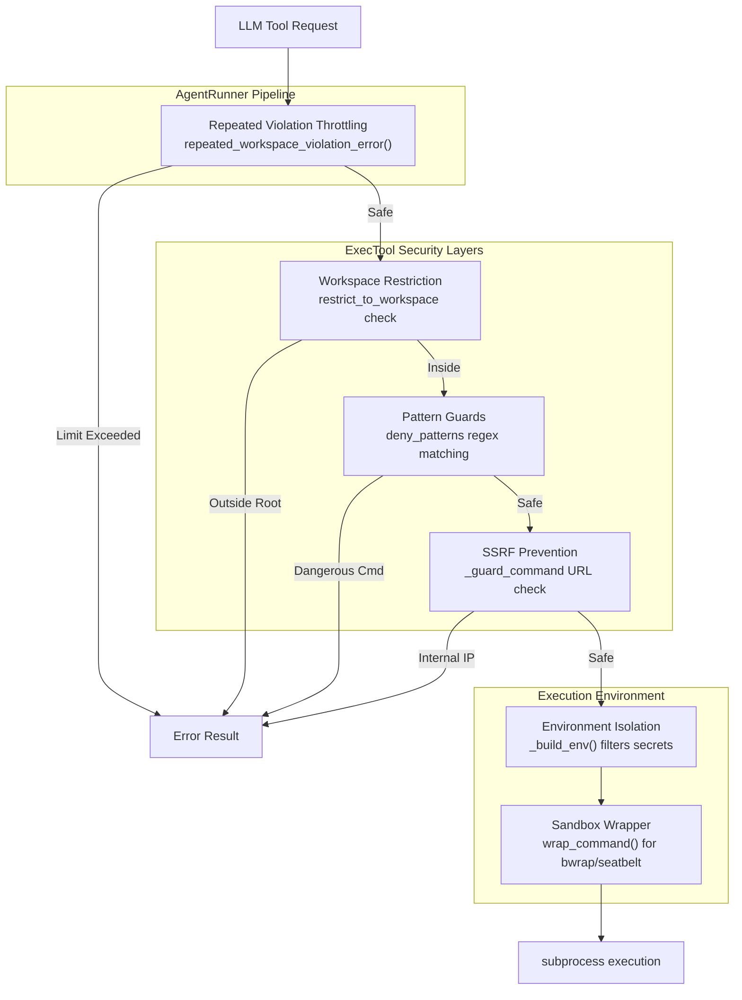
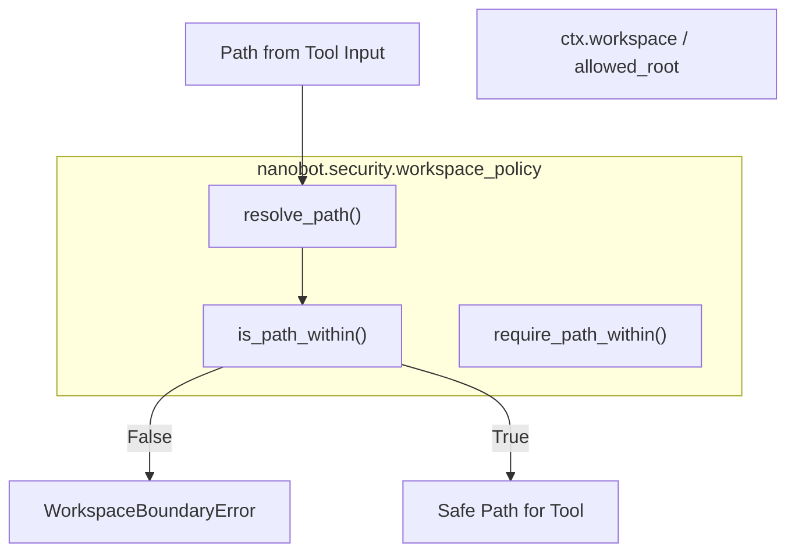
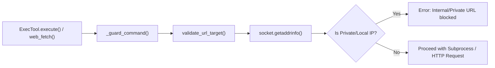

<!-- source: DeepWiki mcp.deepwiki.com · repo HKUDS/nanobot · page 7.3 Security & Sandboxing · fetched 2026-10-26 -->

# Security & Sandboxing

Relevant source files

The following files were used as context for generating this wiki page:

- [SECURITY.md](SECURITY.md)
- [docs/openai-api.md](docs/openai-api.md)
- [nanobot/agent/tools/_windows_job.py](nanobot/agent/tools/_windows_job.py)
- [nanobot/agent/tools/exec_session.py](nanobot/agent/tools/exec_session.py)
- [nanobot/agent/tools/mcp.py](nanobot/agent/tools/mcp.py)
- [nanobot/agent/tools/sandbox.py](nanobot/agent/tools/sandbox.py)
- [nanobot/agent/tools/shell.py](nanobot/agent/tools/shell.py)
- [nanobot/agent/tools/web.py](nanobot/agent/tools/web.py)
- [nanobot/security/network.py](nanobot/security/network.py)
- [nanobot/security/workspace_access.py](nanobot/security/workspace_access.py)
- [tests/agent/test_mcp_connection.py](tests/agent/test_mcp_connection.py)
- [tests/agent/test_mcp_reconnect_crash.py](tests/agent/test_mcp_reconnect_crash.py)
- [tests/agent/test_mcp_transient_retry.py](tests/agent/test_mcp_transient_retry.py)
- [tests/security/test_security_network.py](tests/security/test_security_network.py)
- [tests/tools/test_exec_allow_patterns.py](tests/tools/test_exec_allow_patterns.py)
- [tests/tools/test_exec_env.py](tests/tools/test_exec_env.py)
- [tests/tools/test_exec_platform.py](tests/tools/test_exec_platform.py)
- [tests/tools/test_exec_security.py](tests/tools/test_exec_security.py)
- [tests/tools/test_exec_session_tools.py](tests/tools/test_exec_session_tools.py)
- [tests/tools/test_mcp_probe.py](tests/tools/test_mcp_probe.py)
- [tests/tools/test_mcp_tool.py](tests/tools/test_mcp_tool.py)
- [tests/tools/test_sandbox.py](tests/tools/test_sandbox.py)
- [tests/tools/test_seatbelt_native.py](tests/tools/test_seatbelt_native.py)
- [tests/tools/test_shell_reap.py](tests/tools/test_shell_reap.py)
- [tests/tools/test_tool_loader.py](tests/tools/test_tool_loader.py)
- [tests/tools/test_web_fetch_security.py](tests/tools/test_web_fetch_security.py)
- [tests/tools/test_web_search_tool.py](tests/tools/test_web_search_tool.py)

This document details nanobot's security mechanisms that protect against malicious or accidental damage when executing agent-requested operations. The system implements defense-in-depth with multiple layers: access control at the channel level, workspace sandboxing for file operations, pattern-based command filtering, path traversal prevention, and SSRF protection.

For tool execution mechanics, see [7.1 Built-in Tools](). For MCP server integration details, see [7.2 MCP Integration](). For channel access control configuration, see [5.1 Channel Architecture]().

---

## Security Architecture Overview

Nanobot implements a layered security model where each tool invocation passes through multiple validation stages before execution. The architecture follows a defense-in-depth strategy: if one layer is bypassed, subsequent layers provide backup protection.

### Tool Security Pipeline

The diagram below illustrates the flow of a tool request through the security guards defined in `ExecTool` and the runtime orchestration.

**Diagram: Tool Execution Guard Flow**

Sources: [nanobot/agent/tools/shell.py:167-193](), [nanobot/agent/tools/shell.py:200-248]()

---

## Access Control

### Channel-Level Allowlists

Each channel implements an `allow_from` list (configured as `allowFrom` in JSON) that restricts which users can interact with the agent. This is the first line of defense, preventing unauthorized access before any tools are invoked.

**Default Behavior:**
- **Secure by Default**: An empty `allowFrom` denies all access by default [SECURITY.md:62-63]().
- **Explicit Access**: Set `["*"]` to explicitly allow everyone [SECURITY.md:63-63]().
- **WhatsApp Identification**: Uses full phone numbers with country codes [SECURITY.md:65-65]().

### API Server Security
The OpenAI-compatible API server (`nanobot/api/server.py`) enforces security for network-bound deployments:
- **Authentication**: If the server binds to `0.0.0.0` or `::`, it mandatory requires an `api_key` to be set; otherwise, startup fails to prevent unauthenticated access [SECURITY.md:115-116]().
- **Token Validation**: Requests to `/v1/chat/completions` must include a valid `Authorization: Bearer <key>` header [docs/openai-api.md:100-100]().

Sources: [SECURITY.md:44-67](), [docs/openai-api.md:100-100]()

---

## Workspace Restriction & Sandboxing

The `restrict_to_workspace` flag (enabled via agent configuration) enables strict sandboxing, confining all file and shell operations to the configured workspace directory [nanobot/agent/tools/shell.py:182-182]().

### Workspace Escape Protection
`ExecTool` prevents an LLM from escaping the configured workspace root via the `working_dir` parameter. It resolves absolute paths and ensures they reside within the `ctx.workspace` [nanobot/agent/tools/shell.py:200-248](), [tests/tools/test_exec_security.py:195-200]().

If a violation occurs, a hard policy boundary note `_WORKSPACE_BOUNDARY_NOTE` is appended to the error to discourage the agent from attempting "shell tricks" like symlinks or piping [nanobot/agent/tools/shell.py:85-91]().

**Diagram: Workspace Boundary Guard**

Sources: [nanobot/security/workspace_policy.py:44-52](), [nanobot/security/workspace_policy.py:79-94](), [nanobot/agent/tools/shell.py:85-91]()

### Linux Kernel Isolation (bwrap)

On Linux systems, nanobot supports `bubblewrap` (`bwrap`) for kernel-level isolation. When `sandbox` is set to `"bwrap"` in the `exec` tool configuration, the `wrap_command` function wraps shell commands in a containerized environment [nanobot/agent/tools/shell.py:34-34](), [nanobot/agent/tools/sandbox.py:48-103]().

**Sandbox Configuration (`bwrap`):**
- **Workspace**: Bind-mounted **read-write** [nanobot/agent/tools/sandbox.py:93-93]().
- **Media Directory**: Bind-mounted **read-only** via `get_media_dir` [nanobot/agent/tools/sandbox.py:63-63](), [nanobot/agent/tools/shell.py:41-41]().
- **System Dirs**: `/usr` is required [nanobot/agent/tools/sandbox.py:70-70](), while `/bin`, `/lib`, and `/etc` variants are mounted **read-only** if they exist [nanobot/agent/tools/sandbox.py:71-82]().
- **Sensitive Configs**: The parent directory of the workspace is masked using `tmpfs` to prevent the agent from reading neighboring files [nanobot/agent/tools/sandbox.py:91-91]().

Sources: [nanobot/agent/tools/shell.py:34-34](), [nanobot/agent/tools/sandbox.py:48-103](), [nanobot/agent/tools/sandbox.py:107-125](), [SECURITY.md:80-92]()

### macOS Seatbelt Sandbox

On macOS, nanobot uses `sandbox-exec(1)` (Seatbelt) for process isolation. When `sandbox` is set to `"seatbelt"`, `wrap_command` generates a Seatbelt profile to restrict command execution [nanobot/agent/tools/shell.py:34-34](), [nanobot/agent/tools/sandbox.py:192-201]().

**Sandbox Configuration (`seatbelt`):**
- **Workspace**: Read-write access is granted to the workspace directory [nanobot/agent/tools/sandbox.py:194-194]().
- **Media Directory**: Read-only access is granted to the media directory [nanobot/agent/tools/sandbox.py:194-194]().
- **System Paths**: Essential system paths like `/usr`, `/bin`, `/dev`, and specific `/private/etc` files are allowed for read access [nanobot/agent/tools/sandbox.py:108-131]().
- **Parent Directory**: The workspace's parent directory (where `config.json` might reside) is explicitly denied access [nanobot/agent/tools/sandbox.py:195-196]().
- **Temporary Files**: `TMPDIR` and `HOME` environment variables are set to point to the workspace to ensure scratch space is confined [SECURITY.md:96-97]().
- **Custom Binds**: `sandbox_ro_binds` and `sandbox_rw_binds` allow specifying additional read-only or read-write paths within the sandbox [nanobot/agent/tools/sandbox.py:189-190]().

Sources: [nanobot/agent/tools/shell.py:34-34](), [nanobot/agent/tools/sandbox.py:108-131](), [nanobot/agent/tools/sandbox.py:189-190](), [nanobot/agent/tools/sandbox.py:192-201](), [SECURITY.md:93-99]()

---

## Shell Command Guards

The `ExecTool` implements pattern-based filtering via the `_guard_command` method to block dangerous shell commands.

### Deny and Allow Patterns

Nanobot uses regex-based filtering to validate commands. User-supplied `allow_patterns` take priority: if a command matches an allow pattern, it skips the deny check [tests/tools/test_exec_allow_patterns.py:16-21](). If `allow_patterns` is configured, it acts as a strict whitelist [tests/tools/test_exec_allow_patterns.py:50-58]().

| Pattern | Targets | Rationale |
|---------|---------|-----------|
| `\brm\s+-[rf]{1,2}\b` | Recursive deletion | Prevent accidental wipes [tests/tools/test_exec_allow_patterns.py:8-13]() |
| `>>?.*history\.jsonl` | State Corruption | Protect history persistence (#2989) [tests/tools/test_exec_security.py:179-195]() |
| `\b\.dream_cursor\b` | Cursor state | Protect internal metadata (#2989) [tests/tools/test_exec_security.py:192-194]() |

### Environment Isolation
To prevent credential leakage, `ExecTool._build_env()` creates a clean environment for subprocesses. It explicitly excludes sensitive nanobot environment variables like `OPENAI_API_KEY` or `NANOBOT_TOKEN` [tests/tools/test_exec_platform.py:57-66](). Only keys explicitly listed in `allowed_env_keys` are passed through [nanobot/agent/tools/shell.py:103-103]().

Sources: [nanobot/agent/tools/shell.py:189-191](), [tests/tools/test_exec_platform.py:41-90](), [tests/tools/test_exec_security.py:179-200](), [tests/tools/test_exec_allow_patterns.py:1-60]()

---

## SSRF Prevention

Nanobot protects against Server-Side Request Forgery by inspecting shell commands for internal URLs before execution and validating external fetches.

### Network Security Logic

- **Internal URL Detection**: Hostnames in commands (like `curl` or `wget` targets) are resolved via `socket.getaddrinfo`. If they resolve to private or loopback IP addresses, the command is blocked [nanobot/security/network.py:78-145](), [tests/tools/test_exec_security.py:32-39]().
- **Blocked Ranges**: Defined in `_BLOCKED_NETWORKS`, including `127.0.0.0/8`, `169.254.0.0/16` (Cloud Metadata), and private RFC1918 ranges [nanobot/security/network.py:16-28]().
- **DNS Pinning**: The `PinnedDNSAsyncTransport` prevents DNS rebinding attacks by pinning a validated IP for the duration of a request [nanobot/security/network.py:189-214]().
- **Web Fetch URL Validation**: The `web_fetch` tool uses `_validate_url_safe` and `_resolve_url_safe` to perform SSRF checks before making HTTP requests [nanobot/agent/tools/web.py:113-125](). It also checks for credentials in URLs before forwarding them to third-party services like Jina Reader [nanobot/agent/tools/web.py:168-179]().

**Diagram: SSRF Guard Flow**

Sources: [nanobot/security/network.py:16-107](), [tests/tools/test_exec_security.py:32-73](), [nanobot/security/network.py:189-214](), [nanobot/agent/tools/web.py:113-125](), [nanobot/agent/tools/web.py:168-179]()

---

## MCP Security & Stability

Model Context Protocol (MCP) integration includes safeguards to prevent unreachable servers from crashing the system and to handle transient failures.

### Transient Error Retries
Nanobot implements a single-retry mechanism for MCP tools and resources when encountering transient network errors such as `BrokenPipeError`, `ConnectionResetError`, or `ConnectionRefusedError` [nanobot/agent/tools/mcp.py:41-50](), [nanobot/agent/tools/mcp.py:200-202]().

### Progress Notification Filtering
The system filters out malformed MCP progress notifications (missing `progressToken`) to maintain protocol compliance and prevent downstream processing errors [nanobot/agent/tools/mcp.py:104-111](), [nanobot/agent/tools/mcp.py:131-169]().

### Connection Ownership
MCP connections are managed via `_OwnedMCPConnection`, ensuring that transports are closed from the task that originally opened them, preventing resource leaks during agent shutdown [nanobot/agent/tools/mcp.py:88-102](), [tests/agent/test_mcp_connection.py:120-140]().

Sources: [nanobot/agent/tools/mcp.py:41-50](), [nanobot/agent/tools/mcp.py:88-111](), [nanobot/agent/tools/mcp.py:131-169](), [tests/agent/test_mcp_connection.py:93-140]()

---

## File System Access Safety

The filesystem tools implement several safety boundaries:
- **Size Limits**: `ReadFileTool` rejects files larger than 100 MiB before reading them to memory [tests/tools/test_filesystem_tools.py:102-116]().
- **Output Trimming**: `ReadFileTool` enforces a character budget (`_MAX_CHARS`) to prevent context window overflow [tests/tools/test_filesystem_tools.py:92-100]().
- **Traversal Prevention**: All filesystem tools use `require_path_within` to ensure paths do not resolve outside the workspace root [nanobot/security/workspace_policy.py:79-94]().

Sources: [nanobot/security/workspace_policy.py:79-94](), [tests/tools/test_filesystem_tools.py:92-116]()

---

