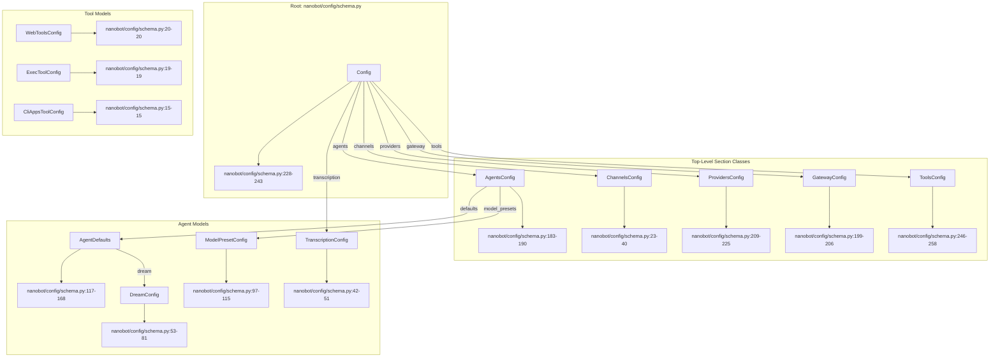
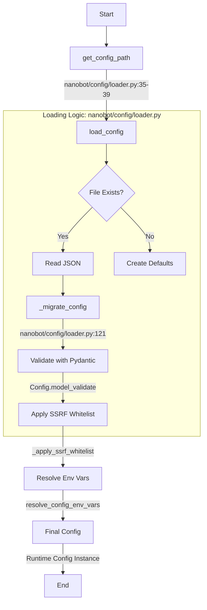

<!-- source: DeepWiki mcp.deepwiki.com · repo HKUDS/nanobot · page 8 Configuration · fetched 2026-10-26 -->

# Configuration

Relevant source files

The following files were used as context for generating this wiki page:

- [README.md](README.md)
- [docs/configuration.md](docs/configuration.md)
- [docs/providers.md](docs/providers.md)
- [nanobot/agent/loop.py](nanobot/agent/loop.py)
- [nanobot/channels/registry.py](nanobot/channels/registry.py)
- [nanobot/cli/commands.py](nanobot/cli/commands.py)
- [nanobot/config/loader.py](nanobot/config/loader.py)
- [nanobot/config/schema.py](nanobot/config/schema.py)
- [nanobot/providers/registry.py](nanobot/providers/registry.py)
- [tests/cli/test_commands.py](tests/cli/test_commands.py)
- [tests/config/test_config_migration.py](tests/config/test_config_migration.py)
- [tests/config/test_dream_config.py](tests/config/test_dream_config.py)
- [tests/config/test_env_interpolation.py](tests/config/test_env_interpolation.py)
- [tests/providers/test_openai_compat_timeout.py](tests/providers/test_openai_compat_timeout.py)
- [tests/providers/test_proxy_env.py](tests/providers/test_proxy_env.py)

This document describes nanobot's configuration system, including the `config.json` structure, Pydantic schema, provider selection logic, and how configuration is loaded and applied throughout the system. Configuration controls all aspects of nanobot behavior: LLM providers, messaging channels, agent parameters, tool settings, and gateway services.

For detailed field-by-field definitions, see [Config Schema Reference](#8.1).
For information on upgrading configurations, see [Config Migration & Backfilling](#8.2).

---

## Configuration File Location

nanobot reads its configuration from `~/.nanobot/config.json` by default [[nanobot/config/loader.py:39]](). This location can be overridden using the `set_config_path` utility, which is used to derive the data directory and support multi-instance architectures [[nanobot/config/loader.py:29-32]]().

The configuration file is typically created or updated during the onboarding process via the `onboard` CLI command [[nanobot/cli/commands.py:114-121]]() or manually via the `save_config` utility [[nanobot/config/loader.py:144-153]]().

---

## Configuration Schema

nanobot uses Pydantic for a strongly-typed configuration schema. The root class is `Config` (inheriting from `BaseSettings`), which aggregates sections for agents, channels, providers, gateway, and tools [[nanobot/config/schema.py:228-243]]().

### Schema Class Hierarchy

This diagram maps configuration sections to their corresponding Pydantic model classes:

**Configuration Entity Mapping**

All configuration models inherit from a `Base` class [[nanobot/config_base.py:11-24]]() that uses an `alias_generator` to support both `camelCase` (standard in JSON) and `snake_case` (standard in Python) [[nanobot/config_base.py:18]]().

**Sources:** [[nanobot/config/schema.py:1-258]](), [[nanobot/config_base.py:1-24]]()

---

## Core Configuration Sections

### Agents Configuration
The `agents` section defines global defaults for the AI's behavior, including the `workspace` path, the default `model` (often set via `modelPreset`), and execution limits like `max_tool_iterations` [[nanobot/config/schema.py:120-131]](). It includes the `dream` configuration for memory consolidation, which can be scheduled via `cron` or `interval_h` [[nanobot/config/schema.py:53-81]]().

### Providers Configuration
The `providers` section stores credentials and endpoints for supported LLM services. The `ProviderSpec` registry defines metadata for providers like `anthropic`, `azure_openai`, and `openrouter` [[nanobot/providers/registry.py:144-182]](). Providers using nanobot's OpenAI-compatible client support advanced fields like `proxy` and `extra_body` for request payload injection [[tests/providers/test_openai_compat_timeout.py:12-24]]() [[docs/providers.md:60-70]]().

### Channels Configuration
The `channels` section manages integrations with chat platforms [[nanobot/config/schema.py:23-40]](). It allows for global toggles like `send_progress`, `send_tool_hints`, and `show_reasoning` [[nanobot/config/schema.py:33-35]](). Available channels are discovered via a plugin mechanism [[nanobot/channels/registry.py:30-44]]().

### Tools Configuration
The `tools` section configures capabilities like web search, shell execution (`exec`), and Model Context Protocol (`mcp_servers`) [[nanobot/config/schema.py:246-258]](). It supports specific configurations for `exec` (shell), `web`, and `image_generation` [[nanobot/config/schema.py:252-254]](). Security settings include `restrict_to_workspace` and the `ssrf_whitelist` [[nanobot/config/schema.py:256-257]]().

---

## Configuration Loading and Overrides

Configuration is loaded via `load_config()`, which performs migration and validation:

**Config Loading & Resolution Flow**

### Environment Variable Resolution
The `resolve_config_env_vars` utility allows configuration values to reference environment variables using the `${VAR}` syntax [[nanobot/config/loader.py:194-204]](). This is essential for keeping secrets out of `config.json` [[docs/configuration.md:72-89]](). Resolution happens recursively for strings, dicts, and lists during the `resolve_env_refs` process [[nanobot/config/loader.py:213]]().

### Runtime Overrides (MyTool)
The agent can check or set its own runtime configuration during a session using `MyTool` [[nanobot/agent/tools/self.py:36-37]](). This allows dynamic adjustment of parameters like `max_iterations` or `model` without modifying the persistent `config.json` file [[nanobot/agent/tools/self.py:128-145]](). Certain fields are restricted to prevent instability [[nanobot/agent/tools/self.py:94-98]]().

**Sources:** [[nanobot/config/loader.py:1-215]](), [[nanobot/config/schema.py:1-258]](), [[nanobot/providers/registry.py:1-192]](), [[nanobot/agent/tools/self.py:1-156]](), [[docs/configuration.md:1-116]](), [[tests/providers/test_openai_compat_timeout.py:12-24]]()

---

