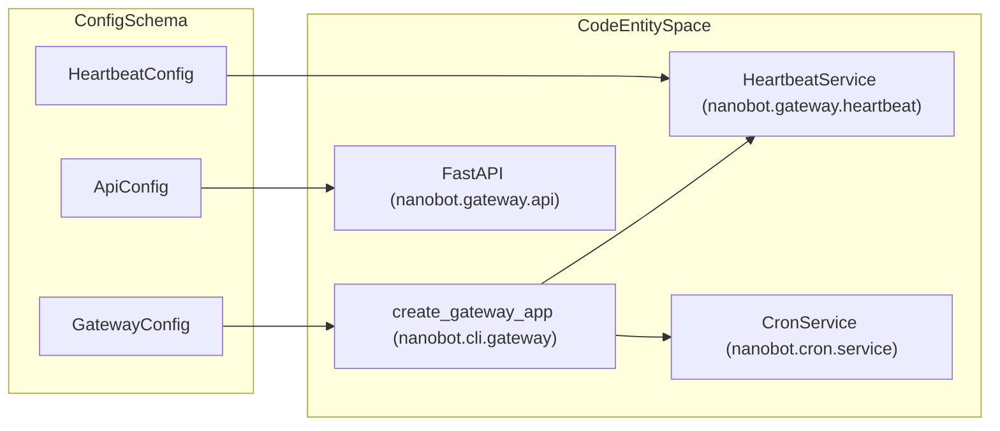

<!-- source: DeepWiki mcp.deepwiki.com · repo HKUDS/nanobot · page 8.1 Config Schema Reference · fetched 2026-10-26 -->

# Config Schema Reference

<details>
<summary>Relevant source files</summary>

The following files were used as context for generating this wiki page:

- [README.md](README.md)
- [docs/configuration.md](docs/configuration.md)
- [docs/providers.md](docs/providers.md)
- [nanobot/agent/loop.py](nanobot/agent/loop.py)
- [nanobot/cli/commands.py](nanobot/cli/commands.py)
- [nanobot/config/schema.py](nanobot/config/schema.py)
- [nanobot/providers/factory.py](nanobot/providers/factory.py)
- [nanobot/providers/registry.py](nanobot/providers/registry.py)
- [nanobot/webui/settings_api.py](nanobot/webui/settings_api.py)
- [tests/agent/test_self_model_preset.py](tests/agent/test_self_model_preset.py)
- [tests/cli/test_commands.py](tests/cli/test_commands.py)
- [tests/command/test_model_command.py](tests/command/test_model_command.py)
- [tests/config/test_model_presets.py](tests/config/test_model_presets.py)
- [tests/webui/test_settings_api.py](tests/webui/test_settings_api.py)

</details>


The `config.json` file is the central authority for nanobot's behavior, defining how the agent interacts with LLM providers, which communication channels are active, and the constraints of its tool execution environment. The configuration is managed via Pydantic models in `nanobot/config/schema.py`, ensuring type safety and supporting both `snake_case` and `camelCase` keys through an alias generator [nanobot/config/schema.py:7-20]().

## Configuration Architecture

The configuration is structured into primary sections: `agents`, `channels`, `providers`, `gateway`, `tools`, and `transcription` [nanobot/config/schema.py:382-390]().

### Data Flow & Validation
The `Config` class [nanobot/config/schema.py:382-390]() serves as the root. When the application starts via `load_config` [nanobot/config/loader.py:42-80](), the JSON is parsed, migrated if necessary (e.g., moving legacy tool keys or cleaning legacy `maxMessages`) [nanobot/config/loader.py:121-122](), and validated against the Pydantic schema.

**Diagram: Configuration to Runtime Mapping**
```mermaid
graph TD
    subgraph "CodeEntitySpace"
        ["config.json"]
        ROOT_SCHEMA["Config (nanobot.config.schema)"]
        AGENT_DEFAULTS["AgentDefaults"]
        CHAN_CONFIG["ChannelsConfig"]
        PROV_CONFIG["ProvidersConfig"]
        TOOL_CONFIG["ToolsConfig"]
        GATEWAY_CONFIG["GatewayConfig"]
        LOADER["load_config (nanobot.config.loader)"]
    end

    subgraph "NaturalLanguageSpace"
        JSON["JSON File on Disk"]
        VALIDATOR["Pydantic Validator"]
        BEHAVIOR["Agent Runtime Behavior"]
    end

    ["config.json"] --> LOADER
    LOADER --> ROOT_SCHEMA
    ROOT_SCHEMA --> AGENT_DEFAULTS
    ROOT_SCHEMA --> CHAN_CONFIG
    ROOT_SCHEMA --> PROV_CONFIG
    ROOT_SCHEMA --> TOOL_CONFIG
    ROOT_SCHEMA --> GATEWAY_CONFIG

    ROOT_SCHEMA -.-> BEHAVIOR
    JSON -.-> ["config.json"]
    VALIDATOR -.-> ROOT_SCHEMA
```
Sources: [nanobot/config/schema.py:23-390](), [nanobot/config/loader.py:42-80]()

---

## 1. Agents Section
Defines core LLM parameters, memory consolidation (Dream), and workspace settings used by the `AgentLoop`.

| Field | Type | Default | Description |
| :--- | :--- | :--- | :--- |
| `workspace` | `str` | `~/.nanobot/workspace` | Path to the agent's working directory [nanobot/config/schema.py:119](). |
| `model_preset` | `str` | `None` | Active named preset; takes precedence over direct fields [nanobot/config/schema.py:120](). |
| `model` | `str` | `anthropic/claude-opus-4-5` | The default model identifier [nanobot/config/schema.py:121](). |
| `provider` | `str` | `auto` | Provider name or `auto` for detection [nanobot/config/schema.py:122-124](). |
| `max_tokens` | `int` | `8192` | Maximum tokens for generation [nanobot/config/schema.py:125](). |
| `context_window_tokens` | `int` | `200,000` | Token limit for context management [nanobot/config/schema.py:126](). |
| `temperature` | `float` | `0.1` | Sampling temperature [nanobot/config/schema.py:128](). |
| `fallback_models` | `list` | `[]` | List of model IDs or inline configs for fallback [nanobot/config/schema.py:129](). |
| `max_tool_iterations` | `int` | `200` | Max tool steps per turn [nanobot/config/schema.py:130](). |
| `max_concurrent_subagents` | `int` | `4` | Maximum number of subagents that can run concurrently [nanobot/config/schema.py:131](). |
| `max_tool_result_chars` | `int` | `16_000` | Maximum characters for tool results [nanobot/config/schema.py:132](). |
| `provider_retry_mode` | `Literal["standard", "persistent"]` | `standard` | Retry mode for providers [nanobot/config/schema.py:133](). |
| `tool_hint_max_length` | `int` | `40` | Max characters for tool hint display [nanobot/config/schema.py:134-139](). |
| `reasoning_effort` | `str` | `None` | `low`/`medium`/`high` for thinking models [nanobot/config/schema.py:141](). |
| `timezone` | `str` | `UTC` | IANA timezone (e.g., `Asia/Shanghai`) [nanobot/config/schema.py:142](). |
| `timezone_mode` | `Literal["auto", "manual"]` | `auto` | Timezone detection mode [nanobot/config/schema.py:143](). |
| `bot_name` | `str` | `nanobot` | Display name shown in CLI/WebUI [nanobot/config/schema.py:144](). |
| `bot_icon` | `str` | `🐈` | Short icon shown next to the bot name [nanobot/config/schema.py:145](). |
| `unified_session` | `bool` | `False` | Share one session across all channels [nanobot/config/schema.py:146](). |
| `disabled_skills` | `list[str]` | `[]` | Skill names to exclude from loading [nanobot/config/schema.py:147](). |
| `session_ttl_minutes` | `int` | `15` | Auto-compact idle threshold (0=disabled) [nanobot/config/schema.py:148-153](). |
| `idle_compact_check_interval_seconds` | `int` | `60` | Minimum interval between scans for idle sessions [nanobot/config/schema.py:154-156](). |
| `dream` | `DreamConfig` | (Object) | Memory consolidation settings [nanobot/config/schema.py:157](). |

### DreamConfig (Background Consolidation)
- `enabled`: Toggle periodic Dream consolidation (Default: True) [nanobot/config/schema.py:58]().
- `interval_h`: Frequency of background processing in hours (Default: 2) [nanobot/config/schema.py:59]().
- `cron`: Legacy cron expression override [nanobot/config/schema.py:60-63]().
- `model_override`: Override model specifically for Dream sessions [nanobot/config/schema.py:64-67]().

Sources: [nanobot/config/schema.py:53-82](), [nanobot/config/schema.py:116-165]()

---

## 2. Providers Section
Configures credentials for LLM services. Each provider uses a `ProviderConfig` object [nanobot/config/schema.py:177-186]().

- `api_key`: Authentication token [nanobot/config/schema.py:180]().
- `api_base`: Custom endpoint URL [nanobot/config/schema.py:181]().
- `proxy`: HTTP/SOCKS5 proxy for specific provider traffic [nanobot/config/schema.py:182]().
- `extra_headers`: Custom HTTP headers [nanobot/config/schema.py:183]().
- `extra_body`: Extra fields merged into request bodies [nanobot/config/schema.py:184]().
- `api_type`: Specific API type for OpenAI (e.g., `responses`) [nanobot/config/schema.py:185]().

### Supported Provider Keys
The `ProvidersConfig` includes over 25 providers such as `openai`, `anthropic`, `azure_openai`, `bedrock`, `openrouter`, `deepseek`, `groq`, `vllm`, `ollama`, `lm_studio`, `gemini`, `mistral`, `stepfun`, `siliconflow`, `volcengine`, `byteplus`, `qianfan`, `huggingface`, and `opencode_zen` [nanobot/config/schema.py:194-222]().

### Model Presets
Users can define named presets in `ModelPresetConfig` [nanobot/config/schema.py:97-115]() to switch between model/parameter sets easily. The `LLMRuntime` class captures these settings for a specific execution turn [nanobot/utils/llm_runtime.py:98]().

| Field | Type | Default | Description |
| :--- | :--- | :--- | :--- |
| `model` | `str` | | The model identifier [nanobot/config/schema.py:100](). |
| `provider` | `str` | `auto` | Provider name (e.g., "anthropic", "openrouter") or "auto" for auto-detection [nanobot/config/schema.py:101](). |
| `max_tokens` | `int` | `8192` | Maximum tokens for generation [nanobot/config/schema.py:102](). |
| `context_window_tokens` | `int` | `200_000` | Token limit for context management [nanobot/config/schema.py:103](). |
| `temperature` | `float` | `0.1` | Sampling temperature [nanobot/config/schema.py:104](). |
| `reasoning_effort` | `str` | `None` | LLM thinking effort (e.g., `low`, `medium`, `high`) [nanobot/config/schema.py:105](). |

Sources: [nanobot/config/schema.py:177-222](), [nanobot/config/schema.py:97-115](), [nanobot/agent/loop.py:98]()

---

## 3. Channels Section
Configures user interfaces. `ChannelsConfig` allows extra fields for plugin-specific settings via `extra="allow"` [nanobot/config/schema.py:31]().

| Field | Type | Default | Description |
| :--- | :--- | :--- | :--- |
| `send_progress` | `bool` | `True` | Stream agent's text progress [nanobot/config/schema.py:33](). |
| `send_tool_hints` | `bool` | `True` | Stream tool calls (e.g. `read_file`) [nanobot/config/schema.py:34](). |
| `show_reasoning` | `bool` | `True` | Surface model reasoning in UI [nanobot/config/schema.py:35](). |
| `extract_document_text` | `bool` | `True` | Deprecated and ignored; documents are read on demand [nanobot/config/schema.py:36](). |
| `send_max_retries` | `int` | `3` | Delivery attempts (0-10) [nanobot/config/schema.py:37](). |
| `transcription_provider` | `str` | `groq` | Deprecated: use top-level `transcription.provider` [nanobot/config/schema.py:38](). |
| `transcription_language` | `str` | `None` | Deprecated: use top-level `transcription.language` [nanobot/config/schema.py:39](). |

### TranscriptionConfig
Cross-channel audio configuration [nanobot/config/schema.py:42-51]():
- `enabled`: Toggle audio transcription (Default: True).
- `provider`: Transcription backend (e.g., `groq`, `openai`).
- `model`: Specific model for transcription.
- `language`: ISO-639 language hint (e.g., "en", "zh").
- `max_duration_sec`: Limit per audio file (Default: 120s).
- `max_upload_mb`: Maximum file size (Default: 25MB).

Sources: [nanobot/config/schema.py:23-51]()

---

## 4. Tools Section
Defines security boundaries and tool capabilities.

### WebToolsConfig
- `enable`: Toggle web tools [nanobot/config/schema.py:375]().
- `search.provider`: `duckduckgo`, `brave`, `tavily`, `searxng`, `jina`, `kagi`, `olostep`, `firecrawl`, `bocha`, `exa` [nanobot/config/schema.py:364]().
- `fetch.provider`: `firecrawl`, `jina`, `olostep`, `direct` [nanobot/config/schema.py:370]().

### ExecToolConfig
- `enable`: Toggle shell execution [nanobot/config/schema.py:247]().
- `timeout`: Execution limit in seconds (Default: 60) [nanobot/config/schema.py:248]().
- `sandbox`: `auto`, `docker`, `none` [nanobot/config/schema.py:250]().
- `allow_patterns`: List of regex patterns for allowed commands [nanobot/config/schema.py:251]().
- `deny_patterns`: List of regex patterns for denied commands [nanobot/config/schema.py:252]().

### FileToolsConfig
- `restrict_to_workspace`: Restricts file operations to the workspace (Default: True) [nanobot/config/schema.py:260]().
- `allow_patterns`: List of regex patterns for allowed file paths [nanobot/config/schema.py:261]().
- `deny_patterns`: List of regex patterns for denied file paths [nanobot/config/schema.py:262]().

### ImageGenerationToolConfig
- `enabled`: Toggle image generation tool (Default: False) [nanobot/config/schema.py:269]().
- `provider`: Image generation provider (e.g., `openai`, `stabilityai`) [nanobot/config/schema.py:270]().
- `model`: Specific model for image generation [nanobot/config/schema.py:271]().
- `size`: Default image size (e.g., `1024x1024`) [nanobot/config/schema.py:272]().
- `quality`: Image quality (e.g., `standard`, `hd`) [nanobot/config/schema.py:273]().
- `style`: Image style (e.g., `vivid`, `natural`) [nanobot/config/schema.py:274]().

### CliAppsToolConfig
- `enabled`: Toggle CLI Apps tool (Default: False) [nanobot/config/schema.py:281]().
- `registry_sources`: List of URLs for CLI app registries [nanobot/config/schema.py:282]().
- `allow_patterns`: List of regex patterns for allowed CLI apps [nanobot/config/schema.py:283]().
- `deny_patterns`: List of regex patterns for denied CLI apps [nanobot/config/schema.py:284]().

### MCP Servers & Security
- `mcp_servers`: Map of names to `MCPServerConfig` (stdio, sse, or http) [nanobot/config/schema.py:330-353]().
- `restrict_to_workspace`: Restricts file/shell tools to the workspace [nanobot/config/schema.py:317]().
- `ssrf_whitelist`: CIDR ranges allowed for web tools [nanobot/config/schema.py:318]().

### MyTool (Self-Awareness)
The `MyTool` allows the agent to inspect and modify its own runtime state. Configuration is managed under `tools.my` [nanobot/config/schema.py:356-360]().

Sources: [nanobot/config/schema.py:240-379]()

---

## 5. Gateway Section
Configures the background server for webhooks and autonomous operation.

| Field | Type | Default | Description |
| :--- | :--- | :--- | :--- |
| `host` | `str` | `127.0.0.1` | Binding address [nanobot/config/schema.py:236](). |
| `port` | `int` | `18790` | Server port [nanobot/config/schema.py:237](). |
| `heartbeat.enabled` | `bool` | `True` | Enable periodic autonomous checks [nanobot/config/schema.py:230](). |
| `heartbeat.interval_s`| `int` | `1800` | Heartbeat frequency in seconds [nanobot/config/schema.py:231](). |
| `api_key` | `str` | `None` | API key for gateway authentication [nanobot/config/schema.py:238](). |

**Diagram: Gateway Runtime Architecture**

Sources: [nanobot/config/schema.py:227-238](), [nanobot/cli/commands.py:56]()

---

## Environment Variable Resolution
Config values can reference environment variables using `${VAR}` syntax [docs/configuration.md:74-76](). This is resolved recursively during loading.

Resolution behavior:
- **Persistence**: Resolved values are kept in memory only. `save_config` preserves the `${VAR}` placeholders on disk.
- **Strictness**: If a referenced variable is not set in the environment, a `ConfigLoadError` is raised during loading.
- **Scope**: Any string value in the configuration, including nested dicts and lists, supports interpolation.

Sources: [docs/configuration.md:72-87](), [nanobot/config/loader.py:129-130]()

---

