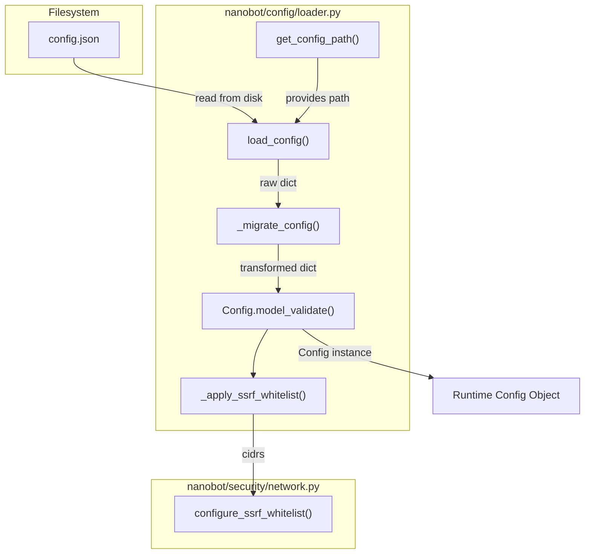
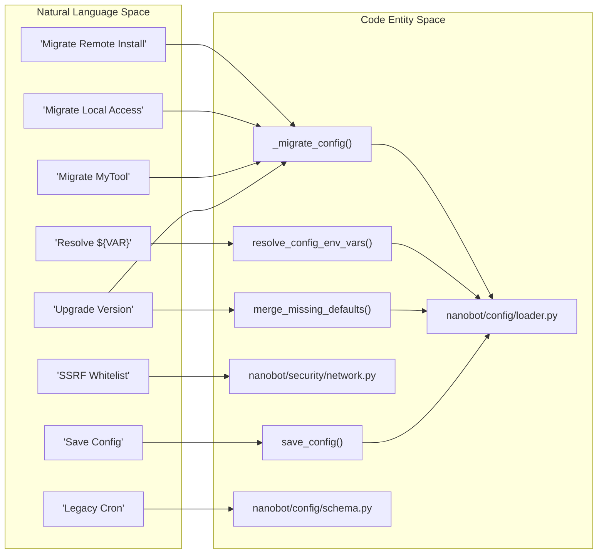
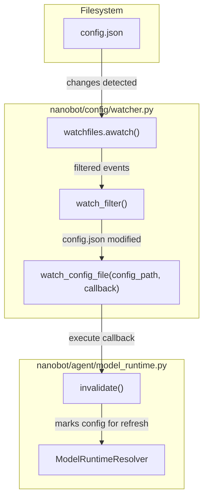

<!-- source: DeepWiki mcp.deepwiki.com · repo HKUDS/nanobot · page 8.2 Config Migration & Backfilling · fetched 2026-10-26 -->

# Config Migration & Backfilling

Relevant source files

The following files were used as context for generating this wiki page:

- [nanobot/agent/model_presets.py](nanobot/agent/model_presets.py)
- [nanobot/agent/model_runtime.py](nanobot/agent/model_runtime.py)
- [nanobot/channels/registry.py](nanobot/channels/registry.py)
- [nanobot/config/loader.py](nanobot/config/loader.py)
- [nanobot/config/watcher.py](nanobot/config/watcher.py)
- [nanobot/utils/llm_runtime.py](nanobot/utils/llm_runtime.py)
- [tests/agent/test_model_runtime_resolver.py](tests/agent/test_model_runtime_resolver.py)
- [tests/config/test_config_migration.py](tests/config/test_config_migration.py)
- [tests/config/test_dream_config.py](tests/config/test_dream_config.py)
- [tests/config/test_env_interpolation.py](tests/config/test_env_interpolation.py)
- [tests/config/test_watcher.py](tests/config/test_watcher.py)
- [tests/providers/test_openai_compat_timeout.py](tests/providers/test_openai_compat_timeout.py)
- [tests/providers/test_proxy_env.py](tests/providers/test_proxy_env.py)

Nanobot includes built-in mechanisms to handle configuration evolution, ensuring that users can upgrade between versions without losing settings or experiencing crashes due to schema changes. This is achieved through proactive migration of legacy fields during loading, environment variable resolution, and recursive backfilling of missing default values.

## Configuration Loading & Migration

When the system loads `config.json`, it passes the raw dictionary through a migration pipeline before validating it against the Pydantic `Config` schema. This allows the codebase to support legacy field locations or renamed keys while maintaining a clean internal API.

### Migration Logic

The `_migrate_config` function in `nanobot/config/loader.py` performs structural transformations on the configuration dictionary [nanobot/config/loader.py:221-269]().

| Migration Task | Source Field | Target Field | Logic |
| :--- | :--- | :--- | :--- |
| **Replay Cap Cleanup** | `agents.defaults.maxMessages` | (Removed) | Removes the legacy `maxMessages` field; replay limits are now derived internally based on context window size [nanobot/config/loader.py:223-238](). |
| **Memory Window Cleanup** | `agents.defaults.memoryWindow` | (Removed) | Removes `memoryWindow` as the system transitioned to token-based windowing [tests/config/test_config_migration.py:20-41](). |
| **Tool Restriction** | `tools.exec.restrictToWorkspace` | `tools.restrictToWorkspace` | Moves the workspace restriction setting from the specific `exec` tool to the global tools configuration [nanobot/config/loader.py:241-244](). |
| **MyTool Refactoring** | `tools.myEnabled` / `tools.mySet` | `tools.my.enable` / `tools.my.allowSet` | Flattens early `MyTool` keys into a nested `my` configuration object for symmetry with other tools [nanobot/config/loader.py:249-258](). |
| **Local Service Access** | `tools.allowLocalPreviewAccess` | `tools.webui_allow_local_service_access` | Migrates a legacy field for local preview access to the new `webui_allow_local_service_access` field [nanobot/config/loader.py:260-263](), [tests/config/test_config_migration.py:157-167](). |
| **Remote Package Install** | `tools.webuiAllowRemotePackageInstall` | `tools.webui_allow_remote_package_install` | Migrates a legacy field for remote package installation to the new `webui_allow_remote_package_install` field [nanobot/config/loader.py:265-268](), [tests/config/test_config_migration.py:178-191](). |

### SSRF Whitelist Application

Immediately after loading and validating the configuration, the system applies the SSRF (Server-Side Request Forgery) whitelist to the network security module. This ensures that any configured CIDR ranges are allowed to bypass internal network blocks [nanobot/config/loader.py:133-134](), [nanobot/config/loader.py:139-143]().

### Data Flow: Config Loading

The following diagram illustrates how a raw JSON file is transformed into a validated and secured `Config` object.

**Config Loading and Migration Flow**

Sources: [nanobot/config/loader.py:42-136](), [nanobot/config/loader.py:221-269]()

## Environment Variable Resolution

Nanobot supports dynamic configuration through environment variables using the `${VAR}` syntax. The `resolve_config_env_vars` function creates a copy of the configuration with all such references replaced by their actual system values [nanobot/config/loader.py:196-206]().

*   **Recursive Resolution**: The system recursively scans strings within dictionaries and lists using `_resolve_env_vars` [nanobot/config/loader.py:213-218]().
*   **Regex Matching**: It uses the pattern `\$\{([A-Za-z_][A-Za-z0-9_]*)\}` to identify variable placeholders [nanobot/config/loader.py:193-193]().
*   **Strictness**: If a configuration field references an environment variable that is not set in `os.environ`, the system raises a `ConfigLoadError` with `kind="missing_env"` [nanobot/config/loader.py:207-212]().
*   **Persistence**: The `save_config` function preserves the original template strings (e.g., `${MY_TOKEN}`) on disk by serializing the raw `Config` object before resolution [nanobot/config/loader.py:146-174](), [tests/config/test_env_interpolation.py:93-108]().

Sources: [nanobot/config/loader.py:191-218](), [tests/config/test_env_interpolation.py:16-52]()

## Recursive Backfilling

During the `onboard` process, Nanobot often encounters existing configurations that may be missing fields introduced in newer versions (e.g., a new communication channel or a new provider setting). The system performs a recursive merge to ensure stability.

### Implementation Logic

The function `merge_missing_defaults` handles the recursive merging of existing user settings with the system's latest defaults [nanobot/config/loader.py:177-190]().

1.  **Preservation**: If a key exists in the user's file, its value is strictly preserved [nanobot/config/loader.py:185-189]().
2.  **Backfilling**: If a key is present in the new version's defaults but missing from the user's file, it is added. For example, missing `msgFormat` in a channel configuration is backfilled during `onboard` [tests/config/test_config_migration.py:20-61]().
3.  **Deep Merging**: The logic drills into nested dictionaries to add new fields without overwriting established sub-objects [nanobot/config/loader.py:189-189]().
4.  **Dream Config Persistence**: Special handling exists for the legacy `cron` field in `DreamConfig`. Even if it is not the primary scheduling mechanism anymore, `save_config` preserves it if it was present to avoid breaking user schedules [tests/config/test_env_interpolation.py:109-129](), [tests/config/test_dream_config.py:32-39]().

### Logic Entity Association

The following diagram bridges high-level configuration concepts with specific code entities responsible for migration and resolution.

**Config Management Entity Association**

Sources: [nanobot/config/loader.py:29-40](), [nanobot/config/loader.py:177-206](), [nanobot/config/loader.py:221-269]()

## Configuration Watcher

Nanobot includes a configuration watcher that monitors changes to the `config.json` file and triggers a refresh of the runtime configuration. This allows for dynamic updates to settings without requiring a full restart of the agent.

### Implementation Details

The `watch_config_file` function in `nanobot/config/watcher.py` uses the `watchfiles` library to monitor the configuration file [nanobot/config/watcher.py:8-23]().

*   **File Filtering**: The watcher is specifically configured to only react to changes in the `config.json` file itself, ignoring other files in the directory [nanobot/config/watcher.py:23]().
*   **Atomic Writes**: It handles atomic file replacements, which are common when saving configurations to prevent data corruption during writes [nanobot/config/watcher.py:23]().
*   **Callback Mechanism**: When a change is detected, a provided callback function is executed, typically to invalidate and reload the configuration in the `ModelRuntimeResolver` [nanobot/config/watcher.py:23]().

### Data Flow: Config Watcher

The following diagram illustrates the flow of the configuration watcher.

**Config Watcher Flow**

Sources: [nanobot/config/watcher.py:8-23](), [nanobot/agent/model_runtime.py:84-87]()

## Upgrade Workflow Summary

To upgrade an existing installation and migrate the configuration, the system follows a structured lifecycle:

1.  **Path Resolution**: The system determines the configuration location via `get_config_path()`. By default, this is `~/.nanobot/config.json` [nanobot/config/loader.py:35-39]().
2.  **Migration**: On load, `_migrate_config()` updates legacy keys (like refactoring `MyTool` settings) to match the current schema [nanobot/config/loader.py:122-122](), [nanobot/config/loader.py:221-269]().
3.  **Validation**: Pydantic's `model_validate` ensures the resulting dictionary conforms to the `Config` class definition [nanobot/config/loader.py:124-124]().
4.  **Security Init**: The SSRF whitelist is applied to global network state [nanobot/config/loader.py:139-143]().
5.  **Persistence**: When settings are updated, `save_config()` writes the data back to disk. It uses `by_alias=True` to ensure that internal Python names are converted back to JSON-standard camelCase aliases [nanobot/config/loader.py:157-157]().

### Configuration Save/Load Cycle

| Operation | Function | Key Behavior |
| :--- | :--- | :--- |
| **Path Determination** | `get_config_path` | Returns `_current_config_path` if set, otherwise defaults to `~/.nanobot/config.json` [nanobot/config/loader.py:35-39](). |
| **Load & Migrate** | `load_config` | Reads JSON, applies `_migrate_config`, and validates via Pydantic [nanobot/config/loader.py:42-136](). |
| **Variable Expansion** | `resolve_config_env_vars` | Resolves `${VAR}` references using `os.environ` [nanobot/config/loader.py:196-206](). |
| **Save** | `save_config` | Serializes the `Config` model to JSON, preserving env-var templates and specific OAuth provider settings [nanobot/config/loader.py:146-174](). |

Sources: [nanobot/config/loader.py:1-269](), [tests/config/test_config_migration.py:20-67]()

---

