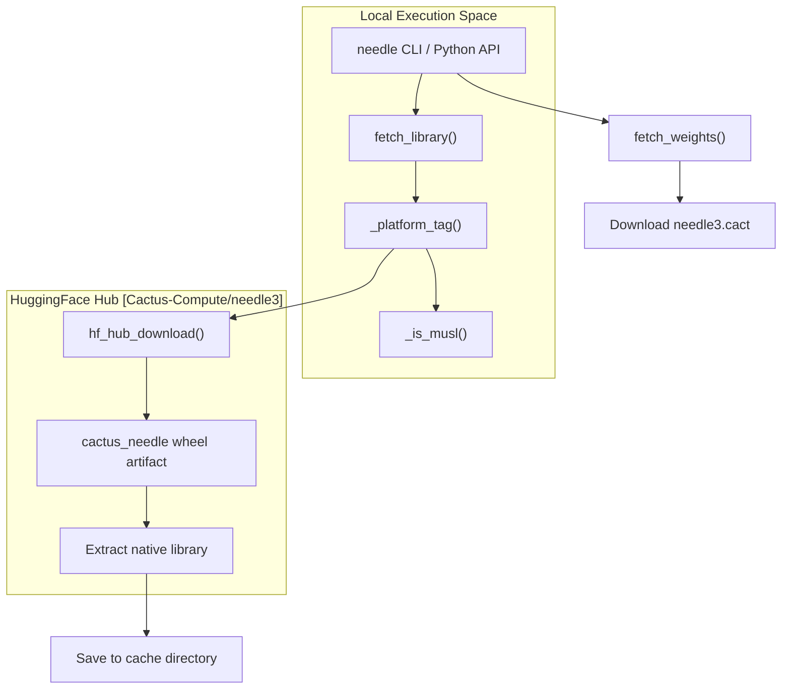
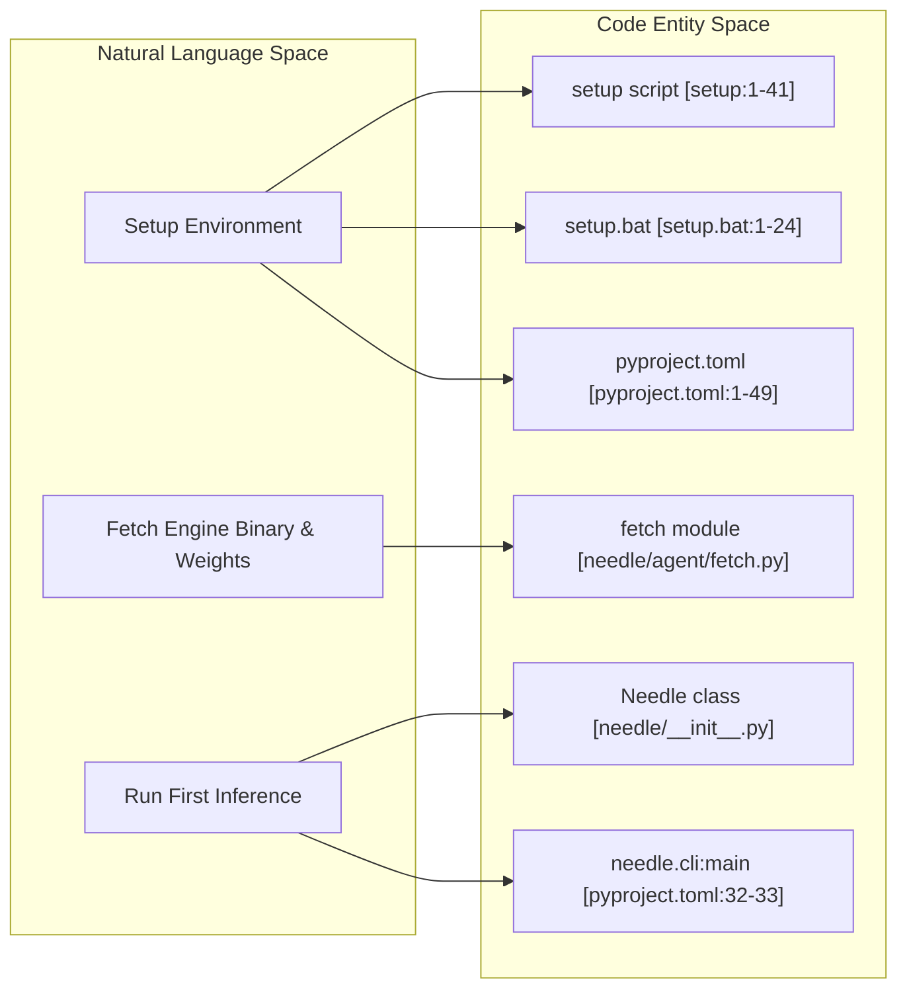

<!-- source: DeepWiki mcp.deepwiki.com · repo cactus-compute/needle · page 1.1 Getting Started · fetched 2026-10-26 -->

# Getting Started

<details>
<summary>Relevant source files</summary>

The following files were used as context for generating this wiki page:

- [.gitignore](.gitignore)
- [pyproject.toml](pyproject.toml)
- [requirements-train.txt](requirements-train.txt)
- [requirements.txt](requirements.txt)
- [setup](setup)
- [setup.bat](setup.bat)

</details>


## Purpose and Scope

This page provides a comprehensive guide for setting up the `cactus-needle` development environment, configuring hardware backends and optional extras (`train`, `gpu`, `metal`, `mic`, `compare`, `whistle`), executing setup via automated shell and batch scripts, fetching native engine binaries and base weights, and performing initial inference runs through both the Python API and CLI.

Sources: [pyproject.toml:1-48](), [setup:1-41](), [setup.bat:1-24]()

---

## Environment Setup and Installation Scripts

Needle targets **Python >= 3.9** [pyproject.toml:5-5](). The project provides automated initialization scripts (`setup` for Unix/macOS [setup:1-41]() and `setup.bat` for Windows [setup.bat:1-24]()) that establish virtual environments (`.venv`), leverage `uv` when available for high-speed package resolution [setup:22-26](), and configure accelerator support.

### 1. Repository Initialization & Automated Setup
Clone the repository and execute the appropriate platform setup script to initialize the virtual environment and install core packages:

```bash
git clone https://github.com/cactus-compute/needle
cd needle
# On Linux / macOS:
chmod +x setup
./setup

# On Windows:
setup.bat
```

### 2. Setup Script Implementation Details
* **Python Interpreter Selection**: Scans for compatible interpreters (`python3.12` down to `python3.9`) ensuring version compliance [setup:7-13](), [setup.bat:5-11]().
* **Package Manager Routing**: Detects `uv` in the command path; if present, binds package installation to `uv pip install` and virtual environment creation to `uv venv` [setup:22-26]().
* **Editable Install with Extras**: Creates `.venv`, activates it, and installs the package in editable mode with training and whistle extras (`.[train,whistle]`) [setup:34-34](), [setup.bat:22-22]().
* **GPU Auto-Detection**: Probes for `nvidia-smi` on Unix systems; if an NVIDIA GPU is present, it automatically installs the `gpu` optional extras (`jax[cuda12]`) [setup:36-39]().
* **CLI Validation**: Executes `needle --help` to verify entrypoint registration [setup:41-41](), [setup.bat:24-24]().

Sources: [setup:1-41](), [setup.bat:1-24]()

---

## Dependency Management and Optional Extras

Package metadata and optional dependency sets are declared in `pyproject.toml`. Core runtime dependencies are minimal (`huggingface_hub`) [pyproject.toml:8-10](), while optional extras configure training, hardware acceleration, audio processing, and testing [pyproject.toml:12-30]().

| Extra Name | Target Packages | Purpose |
| :--- | :--- | :--- |
| **`train`** | `numpy`, `jax`, `jaxlib`, `flax>=0.10.2`, `optax`, `safetensors`, `sentencepiece` [pyproject.toml:13-21]() | Gradient calculation, tokenizer management, and LoRA fine-tuning. |
| **`gpu`** | `jax[cuda12]` [pyproject.toml:22-22]() | NVIDIA CUDA hardware acceleration support via JAX. |
| **`metal`** | `jax==0.4.38`, `jaxlib==0.4.38`, `jax-metal` [pyproject.toml:23-27]() | Apple Silicon hardware acceleration via Metal. |
| **`mic`** | `numpy`, `soxr`, `sounddevice` [pyproject.toml:28-28]() | Live microphone input handling for Whistle speech-to-text. |
| **`compare`** | `openai-whisper`, `moonshine-voice` [pyproject.toml:29-29]() | Benchmarking and comparison against alternative speech models. |
| **`test`** | `pytest`, `pydantic` [pyproject.toml:30-30]() | Unit testing and structured schema validation. |

Sources: [pyproject.toml:1-48](), [requirements.txt:1-2](), [requirements-train.txt:1-10]()

---

## Engine Binary and Asset Management

Needle decouples model logic from runtime execution by utilizing a native C-engine binary (`libneedle.so`, `libneedle.dylib`, or `libneedle.dll`) managed via asset utilities in `needle/agent/fetch.py`.

### Platform Detection and Asset Fetching Data Flow
When initiating an agent or running CLI commands, asset retrieval identifies the host architecture (including `musl` vs `glibc` detection on Linux) and downloads matching wheel artifacts or `.cact` container weights from the Hugging Face Hub.

**Figure 1: Binary and Weight Acquisition Flow**

Sources: [setup:1-41](), [pyproject.toml:1-48]()

---

## First Inference via Python API and CLI

Once the environment and native engine libraries are fetched, you can execute inference using either the command line interface or the programmatic Python API.

### CLI Execution
The `needle` CLI entry point [pyproject.toml:32-33]() supports downloading assets and running prompt generations:

```bash
# Fetch generation binaries and base weights
needle fetch

# Execute an inference prompt
needle run --prompt "Summarize quantum computing in one sentence."
```

### Python API Execution
The `Needle` agent class binds to the native engine via `ctypes` FFI and manages tool definitions, schema generation, and completion loops.

```python
from needle import Needle, tool

@tool
def calculate_area(length: float, width: float) -> float:
    """Calculates the area of a rectangle."""
    return length * width

agent = Needle(tools=[calculate_area])
response = agent.complete("What is the area of a 5 by 12 rectangle?")
print(response)
```

**Figure 2: Natural Language to Code Entity Mapping for Getting Started**

Sources: [pyproject.toml:32-33](), [setup:1-41](), [setup.bat:1-24]()

---

## Troubleshooting

| Symptom | Root Cause | Resolution |
| :--- | :--- | :--- |
| `Python < 3.9` Error | The system default `python` points to an outdated version. | Ensure `python3.12`, `python3.11`, `python3.10`, or `python3.9` is installed and accessible in your `PATH` [setup:7-13](), [setup.bat:5-11](). |
| Missing Native Engine (`libneedle`) | The engine binary has not been fetched or cached for the current platform. | Run `needle fetch` or set the environment variable `NEEDLE_LIB_PATH` to point directly to your compiled library. |
| JAX Accelerator Mismatch | Missing hardware libraries during tensor operations. | Reinstall using the appropriate optional dependency extra: `pip install -e .[gpu]` or `pip install -e .[metal]` [pyproject.toml:22-27](), [setup:36-39](). |

Sources: [setup:7-13](), [setup.bat:5-11](), [setup:36-39](), [pyproject.toml:22-27]()

---

