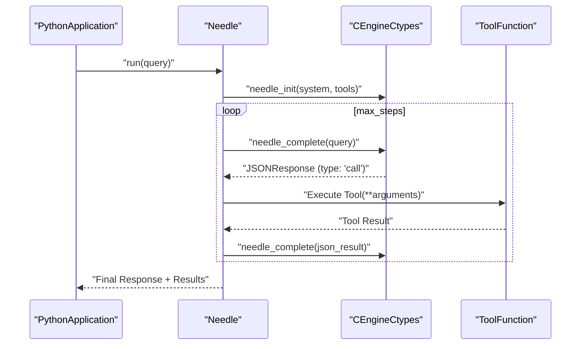

<!-- source: DeepWiki mcp.deepwiki.com · repo cactus-compute/needle · page 2 Python API · fetched 2026-10-26 -->

# Python API

<details>
<summary>Relevant source files</summary>

The following files were used as context for generating this wiki page:

- [llms.txt](llms.txt)
- [needle/__init__.py](needle/__init__.py)

</details>


The Needle Python API provides a high-level interface for building agentic workflows using on-device models [llms.txt:3-3](). The package (`cactus-needle`) is designed to remain lightweight, lazily importing heavy training dependencies like JAX only when required, while routing inference and grammar constraints through a compact C++ engine [llms.txt:13-14]().

The primary public surface area consists of the `Needle` agent class for managing conversation state, the `@tool` decorator alongside `Field` constraints for schema definition, the `extract()` function for one-shot data recovery, and prebuilt environments for evaluation and tool use [needle/__init__.py:11-18]().

## Core Subsystems and Child Pages

The Python API delegates specialized tasks to several internal modules and subsystems. Because this is a parent page, high-level summaries are provided below; for detailed breakdowns, consult the respective child pages:

*   **Needle Agent Class**: Manages conversation state, prompt formatting, the agentic loop via `run()`, step-by-step control via `complete()`, and ctypes FFI binding (`needle_init`, `needle_complete`, `needle_embed`, `needle_reset`, `needle_load`). For details, see [Needle Agent Class](#2.1).
*   **Tool Schema Generation**: Converts Python functions, docstrings, Pydantic models, or raw JSON schemas into constrained grammar definitions using `@tool`, `Field` constraints, and automatic type mapping. For details, see [Tool Schema Generation](#2.2).
*   **Grounding, Confidence and Extraction**: Performs structured data extraction via `extract()`, validating returned values against input text using the temporal grounding and number path subsystems, alongside calibrated confidence gating. For details, see [Grounding, Confidence and Extraction](#2.3).
*   **Prebuilt Environments**: Provides ready-to-use domain toolsets (`smart_home`, `media_player`, `productivity`, `wearable`, `kitchen_appliance`, `data_capture`) complete with acceptance harnesses. For details, see [Prebuilt Environments](#2.4).
*   **Engine Binary and Asset Management**: Handles platform tag detection, musl identification, engine library fetching, and base weights caching via `needle/agent/fetch.py`. For details, see [Engine Binary and Asset Management](#2.5).
*   **Fine-Tune Worker Subprocess**: Manages the `FineTuneWorker` subprocess protocol using length-prefixed JSON messages to route completions through loaded LoRA weights without blocking the main event loop. For details, see [Fine-Tune Worker Subprocess](#2.6).

Sources: [needle/__init__.py:11-18](), [llms.txt:13-28]()

## Natural Language Space to Code Entity Space

The following diagram bridges natural language inputs and environment facts to the codebase entities that process them through grammar-constrained engine interfaces.

**Natural Language to Code Mapping**
```mermaid
graph TD
    subgraph "NaturalLanguageSpace"
        UserQuery[""Set the heater to 22C""]
        SystemFacts[""date: 2026-07-21; device: phone""]
    end

    subgraph "CodeEntitySpace"
        Agent[""Needle""]
        ToolDec[""tool""]
        Constraint[""Field(ge=15, le=30)""]
        ExtractFn[""extract()""]
        
        Agent -->|"complete()"| EngineInterface[""needle_complete (ctypes)""]
        ToolDec -->|"build_schema()"| JSONSchema[""JSON Schema""]
    end

    subgraph "EngineSpace"
        Grammar[""Byte-level Grammar""]
        Model[""SAN Model""]
    end

    UserQuery --> Agent
    SystemFacts --> Agent
    JSONSchema --> Grammar
    Grammar -->|"Constrains"| Model
    Model -->|"Returns"| ToolCall[""{"temperature": 22}""]
    ToolCall --> Agent
```
Sources: [needle/__init__.py:11-15](), [needle/__init__.py:187-191](), [llms.txt:3-3]()

## Agent Execution Lifecycle

When using the `Needle` agent, queries pass through an agentic loop where the engine generates tool calls, the Python runtime executes them, and results are fed back into the conversation state.

**Agent Execution Flow**

Sources: [needle/__init__.py:164-184](), [llms.txt:23-24]()

## API Feature Overview

| Component | Target / Role | File Source |
| :--- | :--- | :--- |
| **`Needle`** | Main agent class managing toolsets, system facts, and generation dispatch | [needle/__init__.py:187-191]() |
| **`tool`** | Decorator translating Python functions and docstrings into tool schemas | [needle/__init__.py:11-11]() |
| **`Field`** | Fine-grained parameter constraint specifier (bounds, patterns, enums) | [needle/__init__.py:11-11]() |
| **`extract`** | One-shot structured extraction helper returning Pydantic models or dicts | [needle/__init__.py:17-18]() |
| **`FineTuneWorker`** | Subprocess worker protocol for executing LoRA-tuned completions | [needle/__init__.py:13-13]() |

Sources: [needle/__init__.py:11-18](), [needle/__init__.py:187-191]()

---

