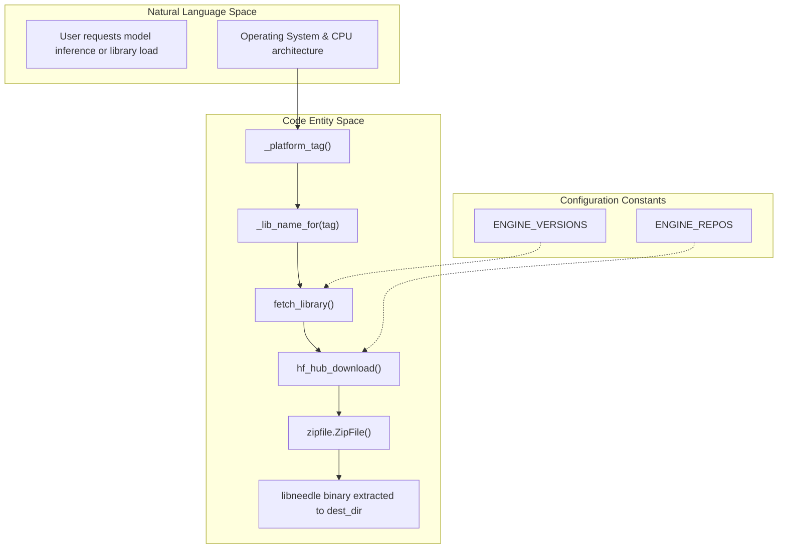
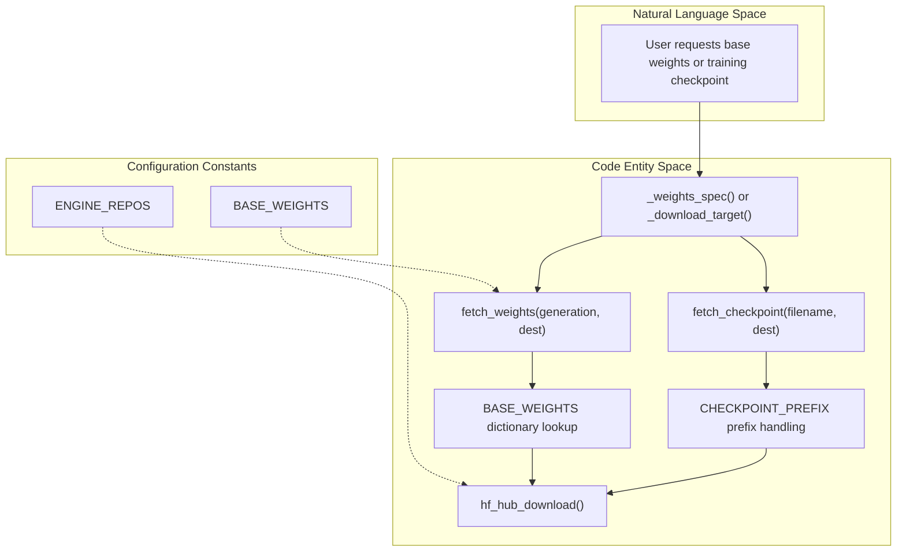

<!-- source: DeepWiki mcp.deepwiki.com · repo cactus-compute/needle · page 2.5 Engine Binary and Asset Management · fetched 2026-10-26 -->

# Engine Binary and Asset Management

<details>
<summary>Relevant source files</summary>

The following files were used as context for generating this wiki page:

- [needle/agent/fetch.py](needle/agent/fetch.py)
- [tests/test_fetch.py](tests/test_fetch.py)

</details>


The Needle framework utilizes a high-performance C-engine for inference across both Generation 2, Generation 3 architectures, and the Whistle speech model. To ensure portability across diverse hardware architectures (CPU, GPU, Mobile, and Edge), the project employs a dynamic binary fetching and asset management mechanism implemented in `needle/agent/fetch.py`. This system handles the discovery, downloading, and extraction of platform-specific shared libraries (`.so`, `.dylib`, `.dll`), base model weights (`.cact`), training checkpoints (`.safetensors`), and standalone binaries from Hugging Face.

Sources: [needle/agent/fetch.py:1-44]()

## Platform and Library Identification

Needle identifies the host environment using a combination of `sys.platform` and `platform.machine()` to generate a platform tag compatible with Python wheel naming conventions.

*   **`_platform_tag()`**: Determines the specific architecture and OS string. It handles logic for `macosx` (arm64/x86_64), `win` (amd64/arm64), and `linux`. For Linux, it distinguishes between standard `manylinux2014` and `musl` environments via `_is_musl()` [needle/agent/fetch.py:104-114]().
*   **`_is_musl()`**: Detects if the system uses the musl libc (common in Alpine Linux) by inspecting `/proc/self/maps` and checking for dynamic linker paths [needle/agent/fetch.py:76-102]().
*   **`_lib_name()` / `_lib_name_for(tag)`**: Returns the appropriate file extension for the engine library based on the detected platform: `.dylib` for macOS, `.dll` for Windows, and `.so` for others [needle/agent/fetch.py:46-60]().

### Supported Platforms
The `PLATFORMS` tuple defines target environments supported by the engine, ranging from standard desktop operating systems to mobile (Android/iOS), RISC-V, and WebAssembly [needle/agent/fetch.py:39-43]().

```python
PLATFORMS = ("macos-arm64", "linux-x86_64", "linux-arm64", "linux-armv7",
             "linux-riscv64", "linux-mipsel", "windows-x86_64", "windows-arm64",
             "android-arm64", "android-armv7", "android-riscv64",
             "ios-arm64", "ios-sim-arm64", "tvos-arm64", "watchos-arm64", "wasm",
             "wasm-component")
```

Sources: [needle/agent/fetch.py:39-114]()

## Generations and Whistle Repositories

Needle manages multiple asset types across different Hugging Face repositories depending on the generation requested or whether a standalone model like Whistle is targeted [needle/agent/fetch.py:9-26]().

*   **`ENGINE_REPOS`**: Maps generation versions and component names (such as `2`, `3`, and `WHISTLE`) to their respective Hugging Face repositories (`Cactus-Compute/needle2`, `Cactus-Compute/needle3`, and `Cactus-Compute/whistle`) [needle/agent/fetch.py:9-13]().
*   **`ENGINE_VERSIONS`**: Defines pinned release versions for each generation and component [needle/agent/fetch.py:14-18]().
*   **`WEIGHTS_ONLY`**: Designates components that do not have their own separate C-engine binary but run on the shared engine (e.g., `whistle`) [needle/agent/fetch.py:25-26]().

Sources: [needle/agent/fetch.py:9-26]()

## Binary and Asset Retrieval Functions

Needle provides programmatic helpers to fetch binaries, base weights, and checkpoints from Hugging Face Hub [needle/agent/fetch.py:132-199]().

### Library Fetching (`fetch_library`)
The `fetch_library()` function downloads a specific version of the engine packaged within a Python wheel. It constructs the wheel filename using the engine version and platform tag, downloads it via `hf_hub_download`, extracts the binary using `zipfile.ZipFile`, and saves it to the designated directory [needle/agent/fetch.py:126-128](), [tests/test_fetch.py:151-165]().

### Base Weights and Checkpoints (`fetch_weights`, `fetch_checkpoint`)
*   **`fetch_weights()`**: Downloads the base `.cact` archive for a given generation (e.g., `needle2.cact`, `needle3.cact`, or `whistle.cact`) into the local cache directory.
*   **`fetch_checkpoint()`**: Downloads a training checkpoint (such as `.safetensors` files) for fine-tuning or building, checking both the root and the `checkpoints/` prefix folder in the remote repository [tests/test_fetch.py:67-83]().

### Standalone Platform Bundling (`download_platform`)
For non-Python environments or CLI deployment, `download_platform()` retrieves all files associated with a specific platform folder from the model repository and copies them to the destination directory [needle/agent/fetch.py:182-199]().

Sources: [needle/agent/fetch.py:132-199](), [tests/test_fetch.py:47-83]()

## Cache Layout and Environment Overrides

Needle maintains a structured local cache directory under the user home directory:

```text
~/.cache/cactus-needle/
├── v2/
│   └── 2.0.4/
│       ├── libneedle.dylib (or .so / .dll)
│       └── needle2.cact
├── v3/
│   └── 3.2.0/
│       ├── libneedle.so
│       └── needle3.cact
└── whistle/
    └── 2.0.0/
        └── whistle.cact
```

### Environment Overrides
Runtime loading logic respects explicit environment variable overrides to bypass or customize library paths:
*   `NEEDLE_LIB_PATH`: Overrides the library path for generic or v2 engines [tests/test_fetch.py:5-12]().
*   `NEEDLE3_LIB_PATH`: Generation 3 specific override [tests/test_fetch.py:14-32]().

Sources: [tests/test_fetch.py:5-32]()

## Data Flow: Platform Detection to Binary Load

The following diagram bridges natural language intent to code entities during binary resolution and fetching.

**Diagram: Binary Resolution and Fetch Logic**


Sources: [needle/agent/fetch.py:46-114](), [needle/agent/fetch.py:182-199]()

## Data Flow: Asset Routing and Model Fetching

The following diagram illustrates how asset specifications map to repository configurations and retrieval functions.

**Diagram: Asset Retrieval Routing**


Sources: [needle/agent/fetch.py:9-24](), [tests/test_fetch.py:34-83]()

---

