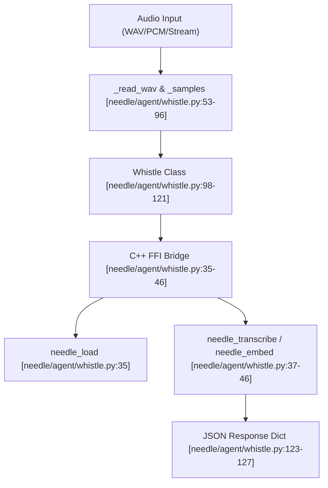
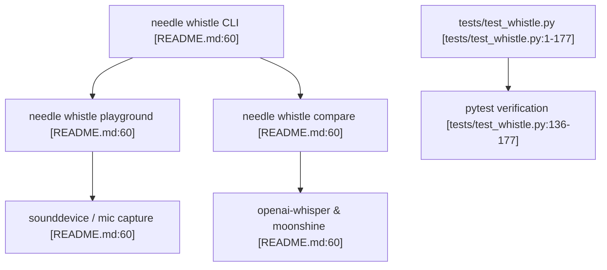

<!-- source: DeepWiki mcp.deepwiki.com · repo cactus-compute/needle · page 3 Whistle Speech-to-Text · fetched 2026-10-26 -->

# Whistle Speech-to-Text

Relevant source files

The following files were used as context for generating this wiki page:

- [README.md](README.md)
- [needle/agent/whistle.py](needle/agent/whistle.py)
- [tests/test_whistle.py](tests/test_whistle.py)

## Purpose and Scope

Whistle is a lightweight 16.9 MB speech-to-text model designed for efficient local execution [README.md:47-51](). It supports audio transcription in English, German, French, Spanish, Italian, Dutch, and Polish [needle/agent/whistle.py:15](). Crucially, Whistle shares the exact same `.cact` weight container format, memory mapping conventions, and C++ FFI engine runtime as Needle [README.md:51](). This integration allows systems to process audio input directly into tool executions within a single unified runtime [README.md:8, README.md:72]().

This page serves as a parent overview. For in-depth API specifications, see [Whistle API: transcribe, stream, Whistle](#3.1). For command-line tooling, extras configuration, and benchmark verification, see [Whistle CLI and Benchmarks](#3.2).

Sources: [README.md:47-72](), [needle/agent/whistle.py:14-15]()

---

## Architecture and Engine Integration

Whistle leverages the same foundational C++ runtime (`needle_load`, `needle_transcribe`, and `needle_embed`) as Needle [needle/agent/whistle.py:35-46](). Audio streams or files are decoded into 16 kHz mono float arrays via helper functions (`_read_wav`, `_samples`) and passed across the FFI boundary [needle/agent/whistle.py:53-96]().

Sources: [needle/agent/whistle.py:35-127]()

---

## 3.1 Whistle API

The Python API exposes Whistle via the `Whistle` class and module-level conveniences like `needle.transcribe()` and `needle.stream()` [README.md:56-60](). The backend handles automatic WAV resampling via `soxr`, buffer sizing, and weight resolution [needle/agent/whistle.py:21-75]().

Features include:
- Single-pass transcription with confidence scores and timestamps [needle/agent/whistle.py:128-137]().
- Real-time chunked streaming via generator patterns [needle/agent/whistle.py:139-156]().
- Keyword biasing and language enforcement [needle/agent/whistle.py:135]().
- Audio embedding extraction (`embed()`) for local vector search [README.md:7(), needle/agent/whistle.py:158-163]().

For complete implementation details, parameters, and buffer management, see [Whistle API: transcribe, stream, Whistle](#3.1).

Sources: [README.md:56-60](), [needle/agent/whistle.py:21-163]()

---

## 3.2 Whistle CLI and Benchmarks

Whistle includes standalone CLI subcommands for interactive playground use (`needle whistle playground`) and baseline comparisons against models like Whisper and Moonshine (`needle whistle compare`) [README.md:60](). 

To support live audio capture and performance evaluations, optional dependencies (`sounddevice`, `soxr`, `openai-whisper`, `moonshine`) can be installed via package extras [README.md:60](). Comprehensive test coverage is maintained in `tests/test_whistle.py` [tests/test_whistle.py:1-177]().

Sources: [README.md:60](), [tests/test_whistle.py:1-177]()

For complete setup instructions and benchmark configurations, see [Whistle CLI and Benchmarks](#3.2).

---

