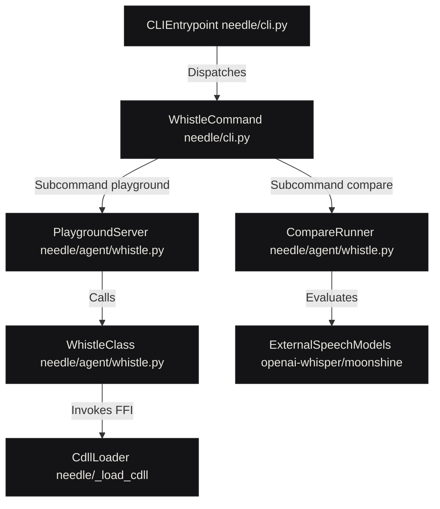
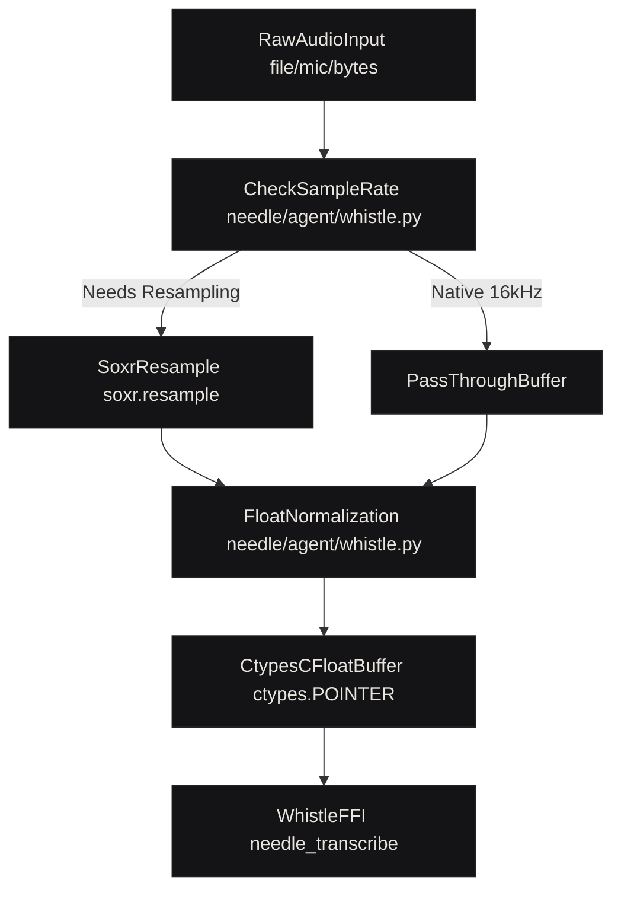

<!-- source: DeepWiki mcp.deepwiki.com · repo cactus-compute/needle · page 3.2 Whistle CLI and Benchmarks · fetched 2026-10-26 -->

# Whistle CLI and Benchmarks

<details>
<summary>Relevant source files</summary>

The following files were used as context for generating this wiki page:

- [assets/deploy.svg](assets/deploy.svg)
- [assets/whistle-benchmarks.svg](assets/whistle-benchmarks.svg)
- [assets/whistle.svg](assets/whistle.svg)
- [needle/agent/whistle.py](needle/agent/whistle.py)
- [needle/cli.py](needle/cli.py)
- [tests/test_whistle.py](tests/test_whistle.py)

</details>


This page details the command-line interface subcommands, optional integration extras, benchmark visualizations, and test coverage for the Whistle speech-to-text subsystem within the `cactus-needle` codebase. Whistle shares the core `.cact` container layout and execution engine with Needle text models while providing specialized speech transcription and embedding capabilities [needle/agent/whistle.py:98-103]().

---

## 1. Whistle CLI Subcommands (`playground` and `compare`)

The `needle whistle` command group exposes interactive utilities for testing speech recognition and comparing outputs against external speech-to-text providers [needle/cli.py:17-18](). It provides two primary subcommands:
- `playground`: Launches an interactive session (or local web service) allowing users to record from a microphone or test audio files against the loaded Whistle model.
- `compare`: Evaluates Whistle performance against external libraries such as OpenAI Whisper or Moonshine using benchmark audio assets.

The following diagram maps the natural language command concepts to their corresponding execution modules and entry points within the codebase.


*Figure 1: Whistle CLI routing from CLI invocation to execution components.*

Sources: `[needle/cli.py:17-18](), [needle/agent/whistle.py:98-103]()`

---

## 2. Microphone and Comparison Extras

Whistle relies on optional python packages to handle raw audio input devices and high-fidelity waveform resampling. These are bundled under optional dependency extras in `pyproject.toml` (specifically `[mic]` and `[compare]`).

### Resampling and Audio Ingestion
Audio ingestion is handled by `_read_wav()` and `_samples()` in `needle/agent/whistle.py` [needle/agent/whistle.py:53-96](). When input files do not match Whistle's native sample rate (`16000` Hz), the library dynamically imports `numpy` and `soxr` to perform high-quality sample-rate conversion [needle/agent/whistle.py:67-75](). If `soxr` is missing when non-16kHz audio is processed, a `RuntimeError` instructs the user to install the appropriate extra:

```python
raise RuntimeError(f"resampling {rate} Hz audio to {SAMPLE_RATE} Hz needs soxr: pip install cactus-needle[mic]")
```
[needle/agent/whistle.py:73-73]()

The following diagram details the audio processing pipeline from raw files or live microphone buffers to float vectors passed through the C-types foreign function interface.


*Figure 2: Audio ingestion and preprocessing pipeline.*

Sources: `[needle/agent/whistle.py:53-96]()`

---

## 3. Benchmark Assets and Performance

Whistle's accuracy, model footprint, and inference speed are evaluated against alternative edge models like Whisper (tiny/base) and Moonshine tiny v2. These evaluations are serialized into visual artifacts such as `assets/whistle-benchmarks.svg` and `assets/whistle.svg` [assets/whistle-benchmarks.svg:1-6]().

The asset pipeline visualizes metrics across three axes:
1. **Word Error Rate (WER)** on standardized evaluation corpora.
2. **Model Storage Size** (megabytes required on disk for weights and engine runtime).
3. **Real-Time Factor (RTF)** or tokens-per-second decoding throughput.

Sources: `[assets/whistle-benchmarks.svg:1-6](), [assets/whistle.svg:1-6]()`

---

## 4. Test Coverage (`tests/test_whistle.py`)

The Whistle test suite (`tests/test_whistle.py`) validates audio manipulation utilities, weight routing, model loading behavior, and edge-case error handling [tests/test_whistle.py:1-177]().

### Key Test Cases
- **`test_speech_weights_come_from_their_own_repo`**: Verifies that Whistle weights are fetched independently from the core Needle text weights using the `fetch.WHISTLE` identifier pointing to `Cactus-Compute/whistle` [tests/test_whistle.py:33-55]().
- **`test_wav_files_become_16k_mono_floats`**: Parameterizes tests across multiple sample rates (`16000`, `8000`, `44100`, etc.), channels, and bit-widths to ensure WAV files correctly normalize to 16 kHz mono float arrays in $[-1, 1]$ [tests/test_whistle.py:108-121]().
- **`test_samples_accept_lists_arrays_and_float32_bytes`**: Ensures input audio normalization handles Python lists, `array.array` instances, raw float32 byte buffers, and numpy arrays seamlessly [tests/test_whistle.py:123-134]().
- **`test_embed_and_the_30_second_limit`**: Asserts that `Whistle.embed()` correctly extracts frame embeddings and that audio sequences exceeding 30 seconds raise a `RuntimeError` matching `"30 s"` [tests/test_whistle.py:164-172]().

Sources: `[tests/test_whistle.py:1-177]()`

---

