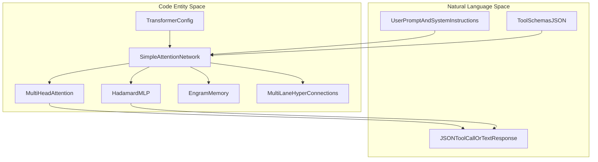
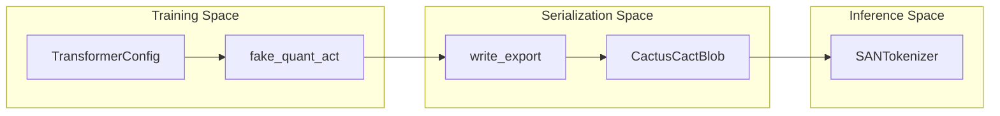

<!-- source: DeepWiki mcp.deepwiki.com · repo cactus-compute/needle · page 4 Model Architecture · fetched 2026-10-26 -->

# Model Architecture

Relevant source files

The following files were used as context for generating this wiki page:

- [needle/model/__init__.py](needle/model/__init__.py)
- [needle/model/architecture.py](needle/model/architecture.py)
- [needle/model/export.py](needle/model/export.py)
- [needle/model/quantize.py](needle/model/quantize.py)
- [needle/model/tokenizer.py](needle/model/tokenizer.py)

The purpose of this page is to provide a high-level overview of the Simple Attention Network (SAN) design, its configuration, and its major supporting subsystems. For deep technical details, refer to the child pages covering architecture, inference, quantization/export, tokenizer, and checkpoints.

## System Overview

The following diagram illustrates the relationship between natural language inputs and the core code entities defined in the model implementation.

### Natural Language to Code Entity Mapping

**Sources:** [needle/model/architecture.py:41-81]()

---

## Core Architecture Components

### SAN Architecture
The `SimpleAttentionNetwork` utilizes `ZCRMSNorm` for zero-centered root mean square normalization [needle/model/architecture.py:28-37](). The configuration class `TransformerConfig` controls structural parameters including attention heads, hidden dimensions, layer depths, and quantization bits [needle/model/architecture.py:41-81](). It incorporates Grouped Query Attention (GQA) with rotary positional embeddings, Hadamard MLPs, Engram key-value memory, and multi-lane hyper-connections (`mhc_lanes`) routed via Sinkhorn iteration.

For details, see [SAN Architecture](#4.1).

**Sources:** [needle/model/architecture.py:28-81]()

### Inference and Generation
Inference execution relies on `load_checkpoint` routines and JIT-compiled decoding loops managed via `generate()` [needle/model/run.py:1-50]() (see [Inference and Generation](#4.2)). Buffers maintain fixed-size contexts for efficient tool usage and token generation.

For details, see [Inference and Generation](#4.2).

**Sources:** [needle/model/run.py:1-50]()

---

## Data Serialization and Precision

The model converts training parameters into deployment formats via dedicated quantization and export pipelines.

### Training to Deployment Pipeline

**Sources:** [needle/model/export.py:1-94](), [needle/model/quantize.py:17-34]()

### Quantization and .cact Export
Model compression is performed using Cactus Quants (CQ) and Lloyd-Max codebooks via `cq_quantize` and `fake_quant` [needle/model/quantize.py:17-30](). The export process generates a layer-major `.cact` binary containing a fixed header, tensor directory, and weights [needle/model/export.py:1-51]().

For details, see [Quantization and .cact Export](#4.3).

**Sources:** [needle/model/quantize.py:17-59](), [needle/model/export.py:1-94]()

### Tokenizer and Special Tokens
Text tokenization is managed by `SANTokenizer`, wrapping a SentencePiece processor to handle special vocabulary tokens, chat markers, and tool boundaries (`<tools>`, `<tool_call>`, etc.) [needle/model/tokenizer.py:28-92](). `get_tokenizer()` handles automatic asset retrieval [needle/model/tokenizer.py:113-130]().

For details, see [Tokenizer and Special Tokens](#4.4).

**Sources:** [needle/model/tokenizer.py:28-130]()

### Checkpoint Formats
Checkpoints support serialization through pickle and safetensors formats, parameter tree flattening and unflattening utilities, and adapter read/write operations for LoRA components [needle/model/checkpoints.py:1-50]().

For details, see [Checkpoint Formats](#4.5).

**Sources:** [needle/model/checkpoints.py:1-50]()

---

## Architecture Design Summary

| Feature | Implementation | Code Symbol / Module |
| :--- | :--- | :--- |
| **Normalization** | Zero-Centered RMSNorm | `ZCRMSNorm` [needle/model/architecture.py:28-37]() |
| **Configuration** | Dataclass Spec | `TransformerConfig` [needle/model/architecture.py:41-81]() |
| **Quantization** | Lloyd-Max / CQ-STE | `cq_quantize`, `fake_quant` [needle/model/quantize.py:17-30]() |
| **Export Format** | Layer-Major Binary | `write_export` [needle/model/export.py:1-51]() |
| **Tokenization** | SentencePiece Wrapper | `SANTokenizer` [needle/model/tokenizer.py:43-92]() |

**Sources:** [needle/model/architecture.py:28-81](), [needle/model/quantize.py:17-30](), [needle/model/export.py:1-51](), [needle/model/tokenizer.py:43-92]()

---

