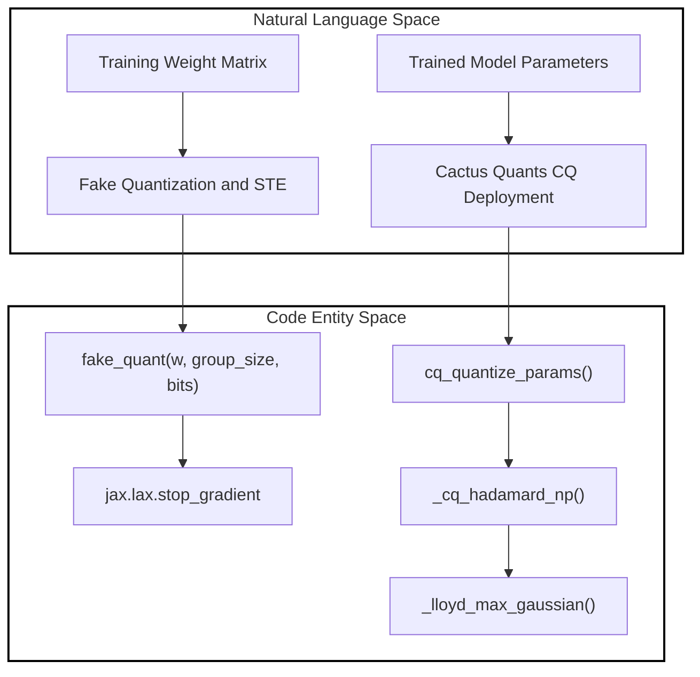
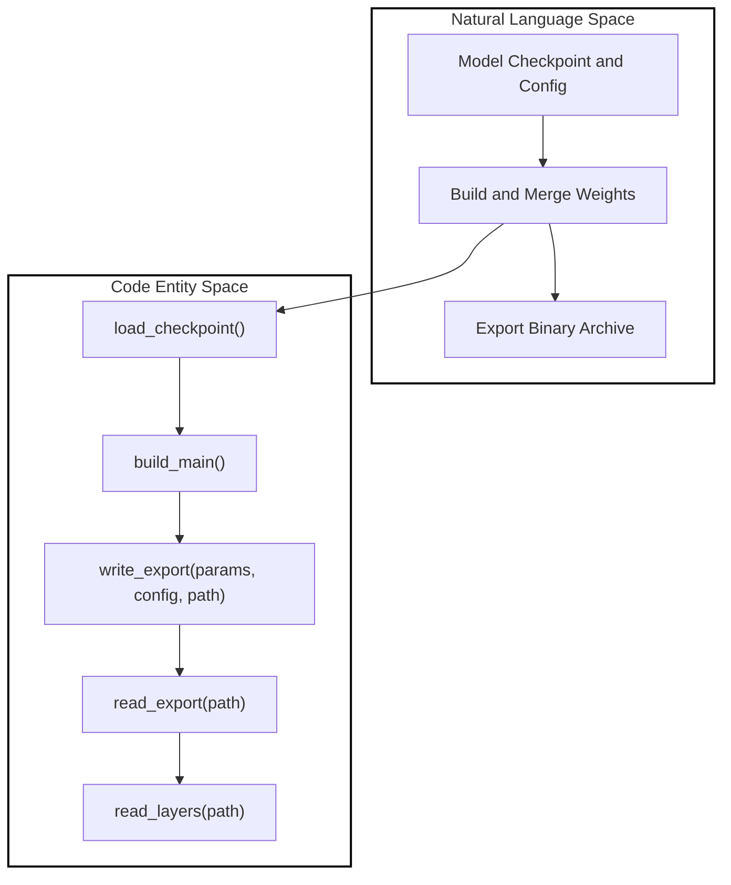

<!-- source: DeepWiki mcp.deepwiki.com · repo cactus-compute/needle · page 4.3 Quantization and .cact Export · fetched 2026-10-26 -->

# Quantization and .cact Export

Relevant source files

The following files were used as context for generating this wiki page:

- [needle/model/architecture.py](needle/model/architecture.py)
- [needle/model/export.py](needle/model/export.py)
- [needle/model/quantize.py](needle/model/quantize.py)
- [needle/model/tokenizer.py](needle/model/tokenizer.py)
- [tests/test_build.py](tests/test_build.py)

## Purpose and Scope
This page details the quantization and serialization infrastructure implemented in `needle/model/quantize.py` and `needle/model/export.py`, along with the structural ladder slicing logic in `needle/model/architecture.py` [needle/model/architecture.py:1-192](), [needle/model/quantize.py:1-235](), [needle/model/export.py:1-140](). It covers Quantization-Aware Training (QAT) via Straight-Through Estimators (STE), Cactus Quants (CQ) Lloyd-Max codebook quantization, deployment configuration, and the custom `.cact` binary file format optimized for zero-copy memory-mapped inference.

---

## Quantization Methodologies

Needle employs fake quantization during training to build numerical robustness against low-bit representations, and Cactus Quants (CQ) for deployment quantization.

### Fake Quantization and STE
During training, `fake_quant()` simulates quantization noise while allowing gradient flow using the Straight-Through Estimator (STE) [needle/model/quantize.py:17-30](). 

1.  **Grouping**: Weights are split into blocks of size 128 (`group_size`) along the reduction axis [needle/model/quantize.py:17-21]().
2.  $\text{absmax}$ **Scaling**: Each group is scaled by its absolute maximum value divided by the bit-range maximum `qmax` [needle/model/quantize.py:23-25]().
3.  **STE Identity**: The operation uses `w + jax.lax.stop_gradient(q - w)` so the forward pass executes quantized values while the backward pass bypasses the rounding step [needle/model/quantize.py:29-29]().

Activations use `fake_quant_act()` targeting `ACT_BITS` (default 8) [needle/model/quantize.py:32-34](), and KV-caches use `cq_fake_quant_kv` or `a8_fake_quant_kv` via `maybe_quant_kv()` [needle/model/quantize.py:36-60]().

### Cactus Quants (CQ) and Lloyd-Max Codebooks
For deployment, `cq_quantize()` maps weights using optimal **Lloyd-Max** Gaussian codebooks combined with **Normalized Walsh-Hadamard Transforms** [needle/model/quantize.py:78-136]().

*   **Codebooks**: `_lloyd_max_gaussian()` precomputes centroids for standard bit-widths (2, 3, 4 bits) [needle/model/quantize.py:78-94](). Ternary quantization (1.58 bits) uses analytic centroids `{-1.224, 0, 1.224}` [needle/model/quantize.py:96-97]().
*   **Hadamard Rotation**: Groups are projected via `_cq_hadamard_np()` before quantization to distribute outliers [needle/model/quantize.py:107-112](), [needle/model/quantize.py:128-129]().
*   **Deployment Configuration**: `configure_deploy()` updates global bit-width settings (`ACT_BITS`, `KV_BITS`, `_KV_GROUP`) and clears JAX compilation caches when modified [needle/model/quantize.py:68-75]().

Sources: [needle/model/quantize.py:17-30](), [needle/model/quantize.py:68-75](), [needle/model/quantize.py:78-94](), [needle/model/quantize.py:122-136]()

---

## The .cact Binary Format and Serialization

The `.cact` container stores architecture metadata, shared codebooks, a nameless tensor directory, layer-major tensors, probe heads, and an appended SentencePiece tokenizer [needle/model/export.py:1-93]().

### Binary Layout Structure
*   **Header**: Fixed 120 bytes containing 48 `u32` architecture parameters and `rope_theta` as an `f32` [needle/model/export.py:19-26](), [needle/model/export.py:111-112]().
*   **Codebooks**: Concatenated unit-sphere Lloyd-Max centroids (`cb2`, `cb3`, `cb4`) indexed by bit-width [needle/model/export.py:31-33]().
*   **Directory**: `num_tensors` records (`REC_SIZE` bytes each) describing tensor `dtype`, `shape`, byte `offset`, `nbytes`, `group_size`, and `bits` [needle/model/export.py:39-43]().
*   **Tensors**: Layer-major ordered blobs (Embedding → Layer blocks → mHC lanes → Engram sites → Final Norm → Probe Heads) [needle/model/export.py:44-59](). Matmul weights are pre-transposed to `[out, in]` [needle/model/export.py:7-9]().
*   **Tokenizer Attachment**: An appended SentencePiece BPE binary dump containing piece scores, types, and UTF-8 surface strings [needle/model/export.py:84-92]().

Sources: [needle/model/export.py:1-93](), [needle/model/run.py:1-50](), [tests/test_build.py:14-29]()

---

## Ladder Slicing

`needle/model/architecture.py` implements ladder slicing to enable deterministic nested subnetworks of varying depths from a single trained model [needle/model/architecture.py:131-192]().

*   `_ladder_layer_order(num_layers)`: Computes a bisection permutation order of depth where endpoints are preserved and interior blocks are inserted at maximal gaps [needle/model/architecture.py:131-149]().
*   `ladder_layer_indices(spec, depth)`: Returns stable, nested original-layer indices for a specific rung depth [needle/model/architecture.py:167-179]().
*   `ladder_config(config, depth)`: Slices a `TransformerConfig` down to `depth` layers while preserving global and engram layer mappings [needle/model/architecture.py:182-192]().

Sources: [needle/model/architecture.py:131-192]()

---

