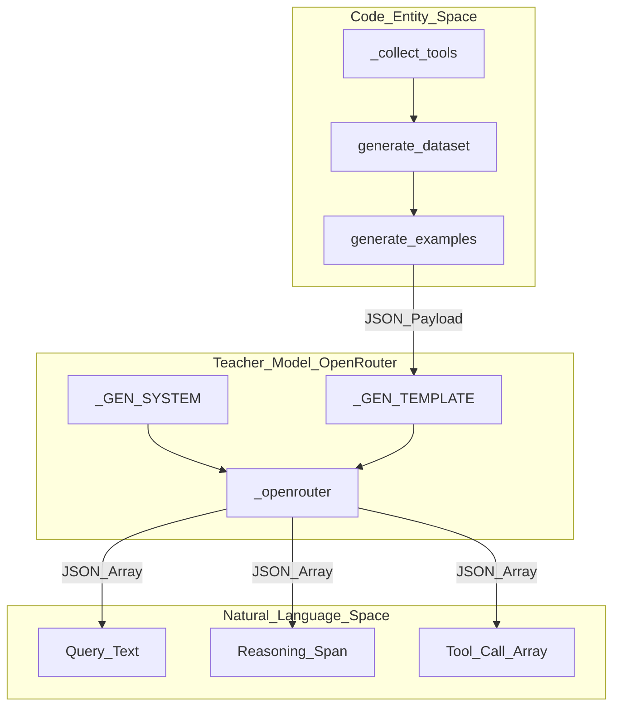
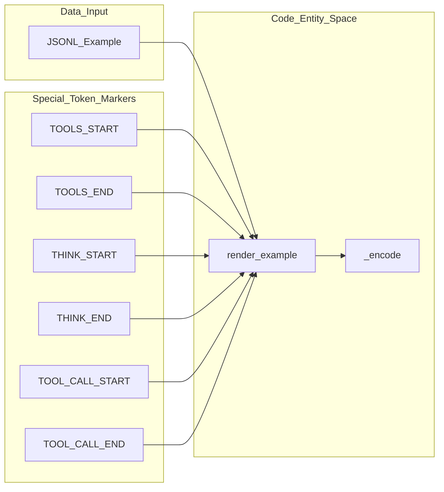

<!-- source: DeepWiki mcp.deepwiki.com · repo cactus-compute/needle · page 5.2 Synthetic Data Generation · fetched 2026-10-26 -->

# Synthetic Data Generation

Relevant source files

The following files were used as context for generating this wiki page:

- [needle/model/finetune.py](needle/model/finetune.py)
- [tests/test_render.py](tests/test_render.py)

This page details the synthetic data generation pipeline (`needle/model/finetune.py`), which produces high-quality training examples for tool-calling and information extraction models via the OpenRouter API.

---

### Overview and Data Flow

The synthetic data generation subsystem is designed to bootstrap or expand fine-tuning datasets for the Simple Attention Network (SAN) architecture. By feeding tool and extraction schemas to a teacher model (`deepseek/deepseek-flash-latest`), the pipeline synthesizes diverse user queries, internal reasoning paths, and target tool calls.

**Data Flow Architecture:**
1. **Schema Collection**: Tool schemas or record fields are provided directly or extracted from an existing `.jsonl` dataset via `_collect_tools()` [needle/model/finetune.py:154-162]().
2. **Batch Generation**: `generate_dataset()` orchestrates concurrent requests using a `ThreadPoolExecutor` [needle/model/finetune.py:106-115]().
3. **Teacher Completion**: `_openrouter()` submits payloads containing `_GEN_SYSTEM` instructions and `_GEN_TEMPLATE` formatting rules to OpenRouter [needle/model/finetune.py:38-73]().
4. **Parsing and Deduplication**: Responses are parsed by `_parse_array()` and filtered through `_dedup_key()` to eliminate redundant samples [needle/model/finetune.py:76-104]().
5. **Refusal Injection**: The generator explicitly requests off-topic inputs where no schema applies, teaching the model to decline invalid requests [needle/model/finetune.py:58-59]().

Sources: `[needle/model/finetune.py:38-162]()`

---

### Synthesis Bridge: Schemas to Training Pairs

The following diagram bridges code-defined schema entities to natural language training samples generated by the teacher model.

**Synthesis Bridge: Tool Schemas to Training Pairs**

Sources: `[needle/model/finetune.py:38-98]()`, `[needle/model/finetune.py:106-151]()`

---

### Prompt Construction and Teacher API

The core interaction with the teacher LLM relies on specific prompt templates and HTTP client wrappers defined in `needle/model/finetune.py`.

*   **`_GEN_SYSTEM`**: Defines the teacher model's persona as a specialized training data generator for tool-calling and extraction models [needle/model/finetune.py:38-42]().
*   **`_GEN_TEMPLATE`**: Formats the available schemas, specifies the requested sample count (`n`), and mandates the exact JSON structure (`query`, `reasoning`, `answers`) [needle/model/finetune.py:44-60](). It also instructs the model to include refusal examples where `answers` is empty (`[]`) [needle/model/finetune.py:58-59]().
*   **`_openrouter()`**: Sends an HTTP `POST` request to `OPENROUTER_URL` with authorization headers, handling timeouts and extracting the message content [needle/model/finetune.py:33-73]().

Sources: `[needle/model/finetune.py:33-73]()`

---

### Parallel Workers and Deduplication

To maximize generation throughput and handle scale efficiently, `generate_dataset()` employs a thread pool and strict deduplication strategies.

*   **Thread Pool Execution**: A `ThreadPoolExecutor` maintains up to `workers` concurrent API requests, dynamically submitting new batches until `num_samples` is satisfied [needle/model/finetune.py:106-151]().
*   **Deduplication (`_dedup_key`)**: Incoming examples are normalized using a composite key consisting of the stripped, lowercased query string and the sorted JSON string representation of the answers [needle/model/finetune.py:101-104]().
*   **Error Resilience**: Failed API requests or malformed JSON responses caught by `_parse_array()` are counted (`failed`) without crashing the entire batch loop [needle/model/finetune.py:76-84](), [needle/model/finetune.py:138-140]().

Sources: `[needle/model/finetune.py:76-151]()`

---

### Dataset Augmentation

Existing datasets can be expanded using `augment_jsonl()` [needle/model/finetune.py:165-173](). This function reads an existing JSONL file, extracts all unique tool definitions using `_collect_tools()` [needle/model/finetune.py:154-162](), and invokes `generate_dataset()` to generate new synthetic samples based on the discovered tool set [needle/model/finetune.py:165-173]().

Sources: `[needle/model/finetune.py:154-173]()`

---

### Prompt Rendering and Special Tokens

Before training, generated examples are formatted into token sequences using specific special token markers.

**Prompt Formatting Bridge**

Sources: `[tests/test_render.py:13-75]()`, `[needle/model/finetune.py:18-22]()`

*   `render_example()` wraps tool definitions inside `TOOLS_START` and `TOOLS_END`, formats the user query, appends reasoning steps inside `THINK_START` and `THINK_END`, and wraps final outputs in `TOOL_CALL_START` and `TOOL_CALL_END` [tests/test_render.py:13-40]().
*   If reasoning is empty or omitted, the thinking block is skipped entirely [tests/test_render.py:43-54]().

Sources: `[tests/test_render.py:1-122]()`

---

