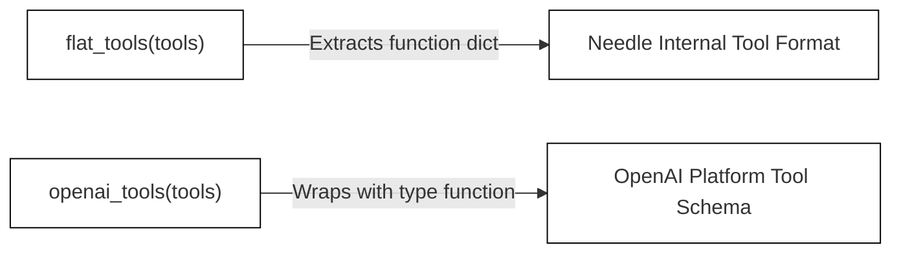

<!-- source: DeepWiki mcp.deepwiki.com · repo cactus-compute/needle · page 5.4 Cactus Platform Client (Hosted Fine-Tuning) · fetched 2026-10-26 -->

# Cactus Platform Client (Hosted Fine-Tuning)

<details>
<summary>Relevant source files</summary>

The following files were used as context for generating this wiki page:

- [needle/cli.py](needle/cli.py)
- [needle/platform.py](needle/platform.py)
- [tests/test_platform.py](tests/test_platform.py)

</details>


## Purpose and Scope

The Cactus Platform Client (`needle/platform.py`) provides a robust Python interface and command-line integration for interacting with the hosted Cactus Compute platform APIs at `cactuscompute.com/v1` [needle/platform.py:1-12](). It manages authenticated requests, structured error handling with stable error codes, automatic retries with backoff for rate limits, secure signed-link redirects for model and dataset downloads, tool definition format translations, and orchestration of hosted fine-tuning jobs, file uploads, and billing inquiries.

Sources: [needle/platform.py:1-12]()

---

## Authentication and `PlatformError` Mechanics

The client authenticates requests using bearer tokens supplied via the `NEEDLE_API_KEY` environment variable or explicitly passed to the `Platform` constructor [needle/platform.py:62-72](). If authentication fails (HTTP 401), the error message automatically points the user to the console API keys dashboard URL (`https://cactuscompute.com/dashboard/api-keys`) [needle/platform.py:13,99-100]().

API errors are encapsulated by the `PlatformError` exception class [needle/platform.py:19-35](). It captures structured fields returned by the backend:

```python
class PlatformError(RuntimeError):
    def __init__(self, code, message, status=0, param=None, url=None, retry_after=0): ...
```
- `code`: Stable string error code (e.g., `"rate_limited"`, `"unauthorized"`, `"quota_exceeded"`) [needle/platform.py:19-27]().
- `status`: HTTP status code [needle/platform.py:23]().
- `param`: Associated invalid request parameter, if any [needle/platform.py:24]().
- `url`: Deep link to documentation or user dashboard context [needle/platform.py:25]().
- `retry_after`: Seconds to wait before retrying (extracted from `Retry-After` headers) [needle/platform.py:26]().

HTTP 429 (`rate_limited`) responses trigger automatic retries up to the configured `retries` limit, observing the `Retry-After` header interval [needle/platform.py:90-105]().

```mermaid
graph TD
    A["Platform._send"] --> B{"HTTP Response Status"}
    B -->|200 / 201| C["Return Status, Headers, Payload"]
    B -->|3xx Redirect| D["Return Redirect Code & Payload"]
    B -->|429 Rate Limited| E["Check attempt < retries & sleep(Retry-After)"]
    E --> A
    B -->|401 Unauthorized| F["Format PlatformError with KEYS_URL"]
    B -->|Other HTTP Error| G["Raise PlatformError(code, message, status, param, url)"]

    subclass ["Code Entity Space"]
    style A fill:none,stroke:#000,stroke-width:1px
    style C fill:none,stroke:#000,stroke-width:1px
    style F fill:none,stroke:#000,stroke-width:1px
    style G fill:none,stroke:#000,stroke-width:1px
```

Sources: [needle/platform.py:12-35](), [needle/platform.py:62-108](), [tests/test_platform.py:28-44]()

---

## Tool Format Conversions

Needle models and the Cactus Platform API accept two different representations for tool schemas: the flat tool format used internally by `needle.Needle(tools=...)` and the OpenAI-compatible wrapped format [needle/platform.py:50-60]().

- `flat_tools(tools)`: Strips outer OpenAI function wrappers to expose raw function specifications [needle/platform.py:50-54]().
- `openai_tools(tools)`: Wraps flat tool definitions into OpenAI's `{"type": "function", "function": t}` payload structure required by hosted endpoints [needle/platform.py:56-60]().



Sources: [needle/platform.py:50-60]()

---

## Core Platform Client Operations

The `Platform` class exposes methods corresponding to all hosted backend resources:

| Method | HTTP Verb & Path | Description |
| :--- | :--- | :--- |
| `self.plans()` | `GET /plans` | Retrieve subscription tiers and platform plans [needle/platform.py:131-132]() |
| `self.billing()` | `GET /billing` | Fetch current usage, account limits, and plan details [needle/platform.py:134-135]() |
| `self.tool_schemas(description)` | `POST /tool_schemas` | Synthesize tool definitions from a natural language description [needle/platform.py:137-138]() |
| `self.files(search, limit)` | `GET /files` | List uploaded training or evaluation datasets [needle/platform.py:140-141]() |
| `self.file(file_id)` | `GET /files/{id}` | Inspect a specific file metadata record [needle/platform.py:143-144]() |
| `self.delete_file(file_id)` | `DELETE /files/{id}` | Delete a stored file from the platform [needle/platform.py:146-147]() |

Sources: [needle/platform.py:62-147]()

---

## File Upload Pipeline and Hosted Job Lifecycle

Uploading training datasets (`.jsonl`) follows a strict three-step protocol managed by `Platform.upload()` [needle/platform.py:149-156]().

```mermaid
graph TD
    A["Platform.upload(path)"] -->|1. POST /files reservation| B["Receive Upload URL & File ID"]
    B -->|2. PUT binary content directly| C["Upload raw octet-stream (auth=False)"]
    C -->|3. POST /files/{id}/complete| D["Finalize file record"]
    D --> E["Return file record"]

    subclass ["Code Entity Space"]
    style A fill:none,stroke:#000,stroke-width:1px
    style B fill:none,stroke:#000,stroke-width:1px
    style C fill:none,stroke:#000,stroke-width:1px
    style D fill:none,stroke:#000,stroke-width:1px
    style E fill:none,stroke:#000,stroke-width:1px
```

Hosted fine-tuning jobs are submitted via `finetune()` and monitored using `wait()`, which polls job status until reaching a terminal state (`succeeded`, `failed`, `cancelled`) [needle/platform.py:16-17](). Once completed, model artifacts and variants can be downloaded via signed redirects handled securely by `_signed_link()` and `_fetch_to()` [needle/platform.py:117-130]().

Sources: [needle/platform.py:16-17](), [needle/platform.py:117-166](), [tests/test_platform.py:126-148]()

---

## CLI Verb Integration

The command-line interface provides access to platform operations under the `needle platform` subcommand group [needle/cli.py:13](). It bridges user commands directly to `Platform` client methods for data generation, fine-tuning job submission, model downloads, and billing inspections.

Sources: [needle/cli.py:1-20]()

---

## Testing Suite (`tests/test_platform.py`)

The platform client is extensively tested using a local threaded HTTP test server (`FakePlatform`) that simulates successful workflows, rate limits, 401 unauthorized errors, and multi-step file uploads without hitting external endpoints [tests/test_platform.py:1-111]().

Key test cases include:
- `test_missing_key_points_at_the_console`: Validates that unauthenticated requests correctly raise `PlatformError` with instructions to set `NEEDLE_API_KEY` and point to the dashboard URL [tests/test_platform.py:113-124]().
- `test_finetune_uploads_submits_waits_and_downloads`: Simulates the complete round-trip of file reservation, binary chunk upload, job submission, status polling, and model completion [tests/test_platform.py:126-148]().

Sources: [tests/test_platform.py:1-148]()

---

