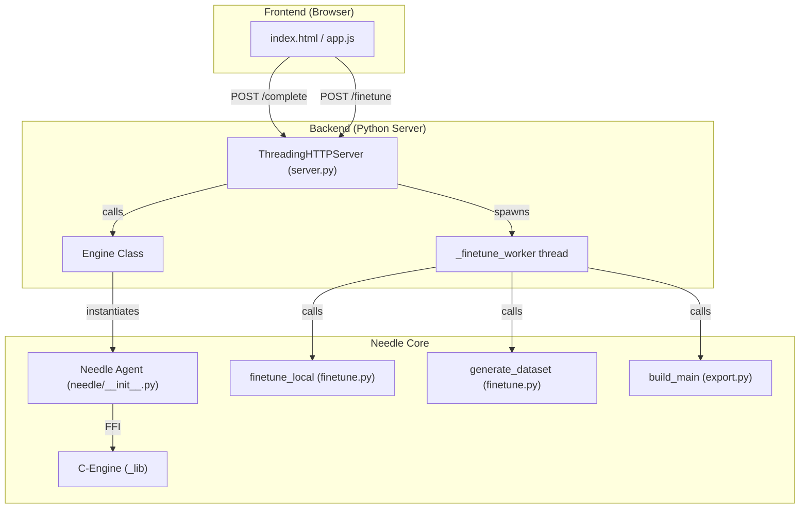
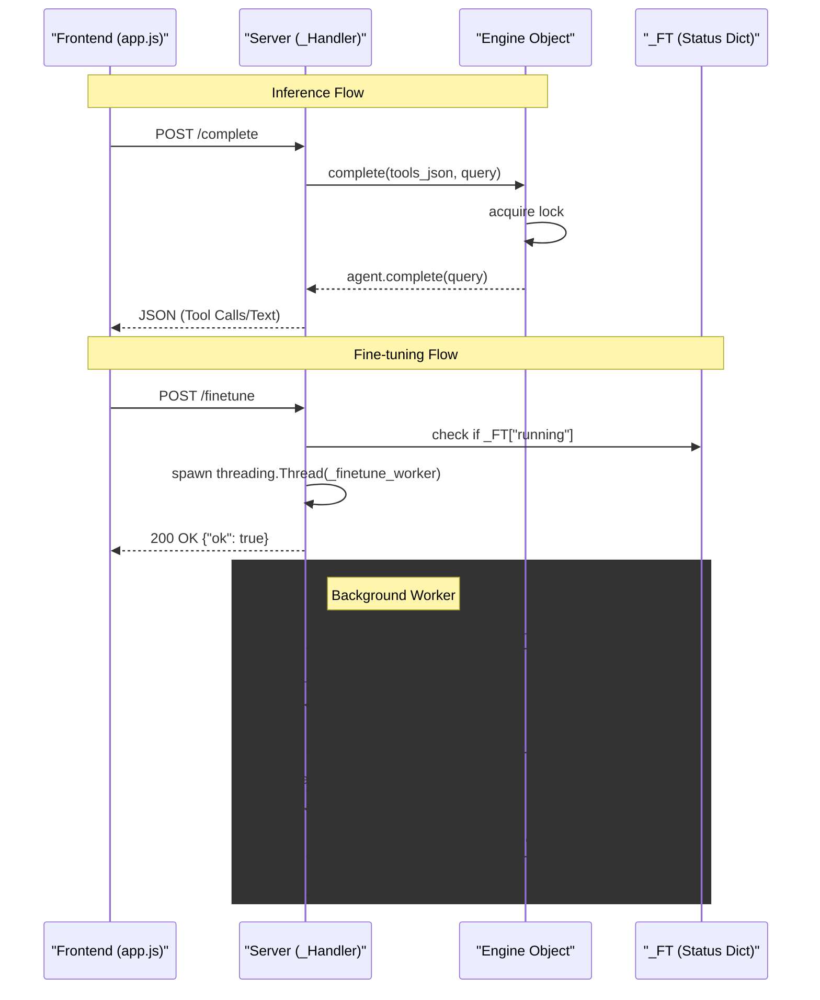

<!-- source: DeepWiki mcp.deepwiki.com · repo cactus-compute/needle · page 6 Playground Web UI · fetched 2026-10-26 -->

# Playground Web UI

Relevant source files

The following files were used as context for generating this wiki page:

- [needle/playground/server.py](needle/playground/server.py)
- [tests/test_playground.py](tests/test_playground.py)

The **Playground Web UI** provides a browser-based interface for interacting with Needle models, facilitating real-time inference, model management, and an automated fine-tuning workflow for new tool definitions. It serves as the primary high-level entry point for users to test the model's tool-calling capabilities and customize it for specific domains.

The system is composed of a Python-based backend server and a static HTML/JavaScript frontend.

## System Architecture

The playground is structured as a client-server application where the backend manages the C-engine state and heavy computation (inference and training), while the frontend provides a reactive interface for user input and status visualization.

### Component Relationship
The following diagram illustrates the interaction between the UI components and the core Needle subsystems:

**Playground Component Map**

**Sources:** [needle/playground/server.py:17-55](), [needle/playground/server.py:66-97](), [needle/playground/server.py:133-171]()

### Logic Flow and Code Entities
This diagram maps the natural language actions of the UI to the specific code entities in the server implementation.

**Inference and Fine-tuning Request Flow**

**Sources:** [needle/playground/server.py:30-38](), [needle/playground/server.py:57-64](), [needle/playground/server.py:66-97](), [needle/playground/server.py:135-140]()

---

## Key Functionalities

### 1. Model Inference and Generation
The playground allows users to submit natural language queries alongside a JSON list of tool definitions. The backend uses the `Engine` class [needle/playground/server.py:17-23]() to manage the `Needle` agent instance.
*   **Agent Management**: The `Engine.complete` method [needle/playground/server.py:30-38]() lazily instantiates the `Needle` agent when tools change or the model is first run.
*   **State Reset**: To ensure fresh conversation context, `_lib().needle_reset()` is called via `Engine.reset` [needle/playground/server.py:40-46]() or when a new query is sent with the same toolset.

### 2. Automated Fine-Tuning Workflow
The Playground provides a one-click fine-tuning pipeline. When a user provides tool definitions and an OpenRouter API key, the server orchestrates a background process in `_finetune_worker` [needle/playground/server.py:66-97]():
1.  **Data Generation**: Uses `generate_dataset` [needle/playground/server.py:72-74]() to synthesize tool-calling examples via an external LLM (OpenRouter).
2.  **Training**: Invokes `finetune_local` [needle/playground/server.py:82-85]() to perform LoRA fine-tuning on the generated dataset.
3.  **Building**: Merges the LoRA adapter into a deployable `.cact` binary using `build_main` [needle/playground/server.py:87-90]().
4.  **Hot Loading**: Once complete, the `Engine` automatically calls `load_weights` [needle/playground/server.py:47-54]() to swap the active model for the newly tuned version.

### 3. Static Asset Serving
The server uses a `ThreadingHTTPServer` with a custom `_Handler` [needle/playground/server.py:98-100]() to serve the frontend.
*   **Static Files**: Serves `index.html`, `app.js`, and `style.css` from the local directory [needle/playground/server.py:8-13](). These files are packaged as static assets via project setup and distribution configuration.
*   **Downloads**: Provides access to generated weights and datasets via the `/download/` endpoint, pulling from the system's temporary directory `_DOWNLOADS` [needle/playground/server.py:14](), [needle/playground/server.py:122-128]().

---

## Detailed Documentation

The Playground Web UI documentation is split into the following child pages:

### [Server Backend](#6.1)
Documents `needle/playground/server.py`, including the `Engine` class logic for weight locking, the `ThreadingHTTPServer` endpoint definitions (`/complete`, `/load-weights`, `/finetune`), and the background `_finetune_worker` pipeline.
For details, see [Server Backend](#6.1).

### [Frontend (Static UI)](#6.2)
Describes the static web frontend in `needle/playground/`. This includes the `index.html` structure, the `app.js` client-side logic for managing presets and polling fine-tuning progress, and the CSS theming.
For details, see [Frontend (Static UI)](#6.2).

**Sources:** [needle/playground/server.py:1-171](), [tests/test_playground.py:1-84]()

---

