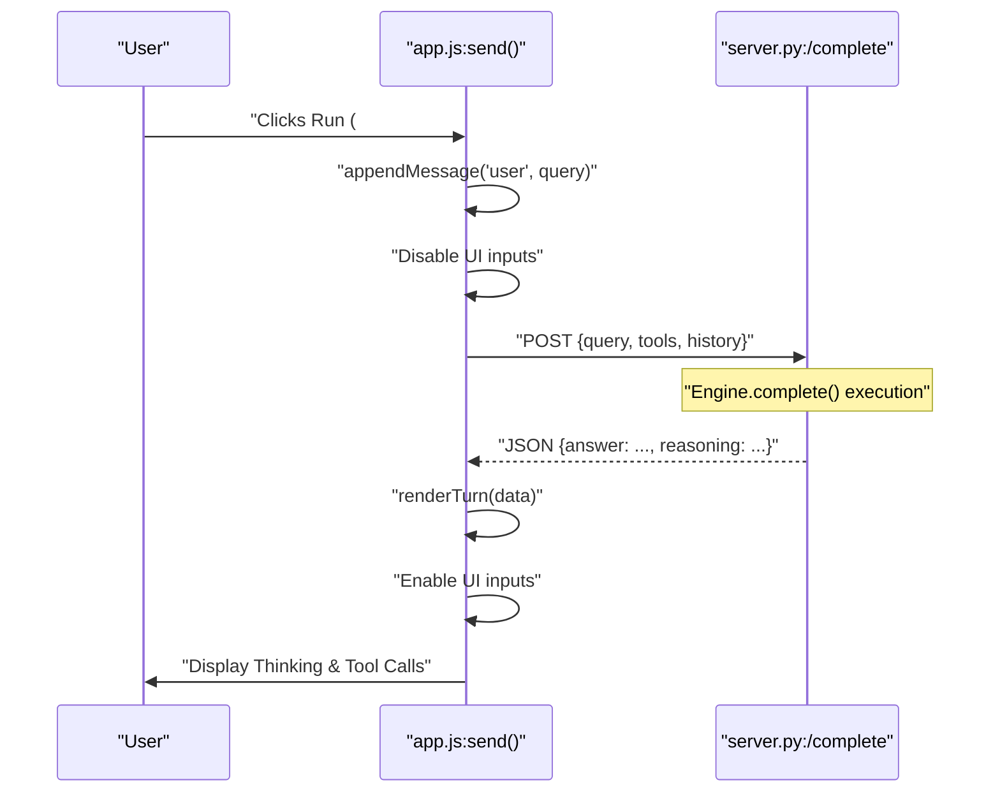
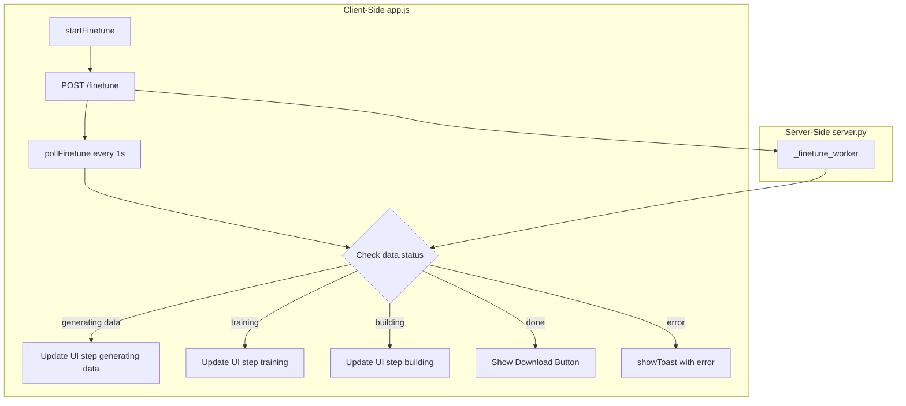

<!-- source: DeepWiki mcp.deepwiki.com · repo cactus-compute/needle · page 6.2 Frontend (Static UI) · fetched 2026-10-26 -->

# Frontend (Static UI)

Relevant source files

The following files were used as context for generating this wiki page:

- [MANIFEST.in](MANIFEST.in)
- [needle/playground/__init__.py](needle/playground/__init__.py)
- [needle/playground/app.js](needle/playground/app.js)
- [needle/playground/index.html](needle/playground/index.html)
- [needle/playground/style.css](needle/playground/style.css)

The Needle Playground frontend is a single-page application (SPA) built with standard web technologies (HTML5, CSS3, and vanilla JavaScript). It provides a graphical interface for interacting with the Needle inference engine and orchestrating the fine-tuning pipeline. The frontend is served statically by the backend server from the `needle/playground/` directory [MANIFEST.in:3]().

### Core Architecture

The frontend follows a traditional separation of concerns:
*   **Structure**: Defined in `needle/playground/index.html` using semantic HTML5 elements [needle/playground/index.html:1-111]().
*   **Styling**: Handled in `needle/playground/style.css` using CSS variables for theming and a dark-mode first design [needle/playground/style.css:1-36]().
*   **Logic**: Contained in `needle/playground/app.js`, managing state, asynchronous API calls, presets, and DOM manipulation [needle/playground/app.js:1-331]().

#### UI Component Layout
The interface is divided into a collapsible sidebar for configuration and a main area for chat-based query execution.

| Component | Code ID | Purpose |
| :--- | :--- | :--- |
| **Presets** | `div#presets` | Container for pre-defined tool/query examples like "home", "robot", and "email" [needle/playground/index.html:35](). |
| **Tools Editor** | `textarea#tools` | JSON editor for defining tool schemas [needle/playground/index.html:45](). |
| **Query Input** | `input#query` | Text field for user natural language prompts [needle/playground/index.html:61](). |
| **Conversation View** | `div#conversation` | Scrollable area for chat history and tool call visualization [needle/playground/index.html:69](). |
| **Finetune Modal** | `div#modalOverlay`| Overlay for OpenRouter API key entry and status tracking [needle/playground/index.html:76-103](). |
| **Model Loader** | `input#modelFile` | File input for uploading `.cact` binary models [needle/playground/index.html:57](). |

Sources:
* `MANIFEST.in:3`
* `needle/playground/index.html:31-74`
* `needle/playground/style.css:1-16`
* `needle/playground/app.js:1-20`

---

### Data Flow and Interaction

The frontend communicates with the backend server via RESTful endpoints. The primary interactions include model loading, inference generation, and fine-tuning orchestration.

#### Inference Sequence
When a user clicks "Run" (`#sendBtn`), the `send()` function captures the tool definitions and the query, then invokes the `/complete` endpoint [needle/playground/app.js:139-165]().

Title: "Client-to-Server Inference Flow"

Sources:
* `needle/playground/app.js:139-195`
* `needle/playground/index.html:62`

#### Model Management
Users can load new model weights dynamically. The `loadModelFile` function handles `multipart/form-data` uploads of `.cact` files to the `/load-model` endpoint [needle/playground/app.js:107-123](). Upon success, the UI updates the `#modelName` span to reflect the active filename [needle/playground/app.js:125](). The backend processes this by writing the uploaded file to a temporary directory and calling the underlying engine load routines [needle/playground/app.js:107-125]().

Sources:
* `needle/playground/app.js:107-125`

---

### Fine-Tuning Workflow

The fine-tuning interface manages a multi-stage asynchronous process: synthetic data generation, LoRA training, and `.cact` export.

#### State Management and Polling
Because fine-tuning is a long-running process, the frontend uses a polling mechanism via `setInterval` within `pollFinetune()` to track progress through the `/finetune/status` endpoint [needle/playground/app.js:283-305](). The backend maintains the fine-tuning state, including `running`, `step`, `log`, `checkpoint`, and `error` flags [needle/playground/app.js:283-305]().

Title: "Fine-Tuning State Machine and Polling"

Key functions in this workflow:
*   `openFinetuneModal()`: Prepares the modal and ensures tool JSON is valid [needle/playground/app.js:237-243]().
*   `startFinetune()`: Submits the OpenRouter API key and sample count to the backend via a POST request to `/finetune` [needle/playground/app.js:256-277](). The backend then spawns a background worker thread to handle the actual fine-tuning process [needle/playground/app.js:256-277]().
*   `_updateFtSteps(status)`: Updates the CSS classes (`active`, `done`) of modal steps based on backend feedback [needle/playground/app.js:315-331]().

Sources:
* `needle/playground/app.js:237-331`
* `needle/playground/index.html:92-96`

---

### Styling, Theming and Packaging

The UI utilizes a "Geist" font stack and a strict dark-mode color palette defined via CSS variables [needle/playground/style.css:1-16](). 

#### Layout and Interactivity
*   **Sidebar Resizing**: A `#resizeHandle` allows users to adjust the width of the tools editor [needle/playground/index.html:49](). The implementation in `app.js` manages mouse events to update the `aside` width dynamically [needle/playground/app.js:65-92]().
*   **Conversation Rendering**: The `renderTurn()` function creates complex DOM structures for model responses, including `
` blocks for "Thinking" processes and specialized styling for tool calls [needle/playground/app.js:197-235]().
*   **Toast Notifications**: A transient notification system (`showToast`, `dismissToast`) provides feedback for failed API calls or invalid inputs [needle/playground/app.js:24-33]().

#### Packaging via MANIFEST.in
To ensure the static UI files (`index.html`, `app.js`, `style.css`) are included when distributing the package via PyPI or source builds, they are explicitly referenced in the root `MANIFEST.in` configuration [MANIFEST.in:3]().

Sources:
* `needle/playground/style.css:1-16`
* `needle/playground/index.html:49`
* `needle/playground/app.js:24-92`
* `needle/playground/app.js:197-235`
* `MANIFEST.in:3`

---

