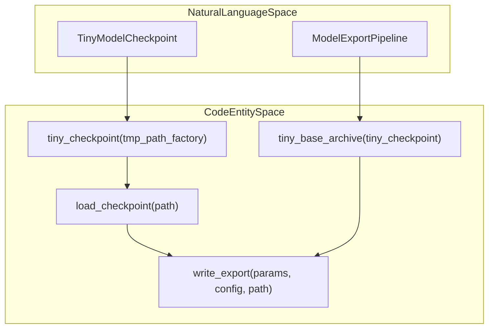
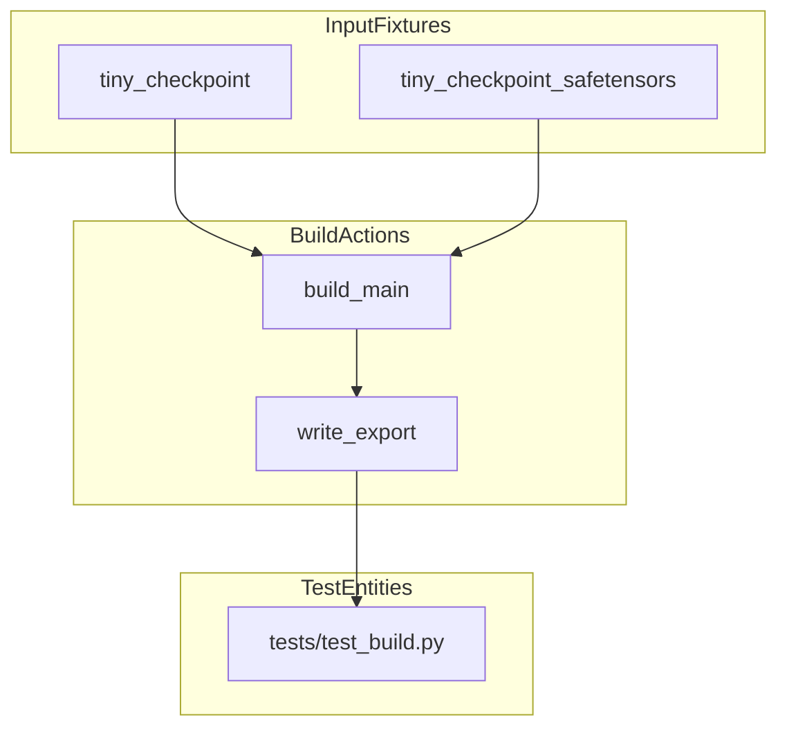

<!-- source: DeepWiki mcp.deepwiki.com · repo cactus-compute/needle · page 7 Testing, Packaging and Release · fetched 2026-10-26 -->

# Testing, Packaging and Release

Relevant source files

The following files were used as context for generating this wiki page:

- [pyproject.toml](pyproject.toml)
- [tests/conftest.py](tests/conftest.py)

This page provides a high-level overview of the quality infrastructure for the `cactus-needle` project, covering its testing strategy, packaging configuration, and continuous integration (CI) release workflows [pyproject.toml:1-48](). The goal is to ensure the reliability, maintainability, and distributability of the Needle codebase.

The project employs a comprehensive test suite, configured using `pytest` [pyproject.toml:46-48](), to validate various components from isolated units to end-to-end system interactions. Packaging is managed via `pyproject.toml` and `setuptools` [pyproject.toml:1-44](), defining dependencies, optional features, and included data files. Release automation is handled through GitHub Actions workflows, which build, test, and publish artifacts.

Sources: [pyproject.toml:1-48]()

## Test Infrastructure and Fixtures

Testing Needle requires handling two heavy dependencies: the C++ inference engine and large model checkpoints. The suite uses the following mechanisms in `tests/conftest.py` to manage these:

*   **Engine Detection**: The `requires_engine` decorator skips tests if the compiled C++ library (e.g., `.so`, `.dylib`, or `.dll`) is not found in the package directory or the local cache [tests/conftest.py:6-39](). This ensures that tests requiring the native engine are only run when it's available.
*   **Tiny Model Fixture**: To avoid downloading production weights, `tiny_checkpoint` generates a minimal `SimpleAttentionNetwork` with a small configuration and saves it as a temporary `.safetensors` file [tests/conftest.py:41-61](). A `tiny_base_archive` fixture creates a corresponding `.cact` export using `write_export` [tests/conftest.py:69-78]().
*   **Slow Test Gating**: Computationally expensive tests, such as LoRA training or full model builds, are marked with `@pytest.mark.slow` [pyproject.toml:46-48]() to allow developers to exclude them during rapid iteration.

Sources: [tests/conftest.py:6-78](), [pyproject.toml:46-48]()

## Test Suite Structure

The codebase categorizes tests based on the subsystem they validate, ranging from isolated unit tests to integration and packaging verifications.

### System-to-Code Mapping: Build and Export Validation

The build and test pipeline relies on shared fixtures and helper modules to verify export formats and executable packaging.

Sources: [tests/conftest.py:41-78](), [pyproject.toml:46-48]()

### Build and Export Test Flow

Sources: [tests/conftest.py:41-78](), [pyproject.toml:46-48]()

## Packaging Configuration

The `pyproject.toml` file [pyproject.toml:1-48]() defines the project's metadata, dependencies, and packaging instructions. It specifies the project name (`cactus-needle`), version (`3.1.0`), description, and Python compatibility (`>=3.9`) [pyproject.toml:1-6]().

*   **Dependencies and Optional Dependencies**: Core dependencies include `huggingface_hub`, while optional groups like `train`, `gpu`, `metal`, `mic`, `compare`, and `test` are defined under `[project.optional-dependencies]` [pyproject.toml:8-30]().
*   **Entry Points**: The `needle` CLI command is exposed via `[project.scripts]` [pyproject.toml:32-33](), pointing to `needle.cli:main`.
*   **Package Data**: Static assets required by `needle.model` and `needle.playground` are included using `[tool.setuptools.package-data]` [pyproject.toml:38-40]().

Sources: [pyproject.toml:1-48]()

## Child Pages and Detailed Documentation

For specific details on test implementations, packaging configurations, and release workflows, see the following child pages:

*   **Unit Tests (#7.1)**: Covers `test_tools.py`, `test_render.py`, `test_fetch.py`, `test_weights.py`, `test_lora.py`, `test_grounding.py`, `test_worker.py`, `test_environments.py`, `test_whistle.py`, `test_platform.py`, along with conftest fixtures and `pytest.mark.slow`.
*   **Integration and End-to-End Tests (#7.2)**: Covers `test_inference.py`, `test_run.py`, `test_generate.py`, `test_finetune.py`, `test_build.py`, including `requires_engine` gating, tiny-model fixtures, export round-trips, and platform bundling.
*   **Packaging, CI and Release Workflows (#7.3)**: Details `pyproject.toml` packaging and extras, setup/setup.bat scripts, requirements files, `MANIFEST.in`, `test_packaging.py`, `.github/workflows` release configurations, `test_release.py`, and telemetry opt-out.

Sources: [pyproject.toml:1-48](), [tests/conftest.py:1-126]()

---

