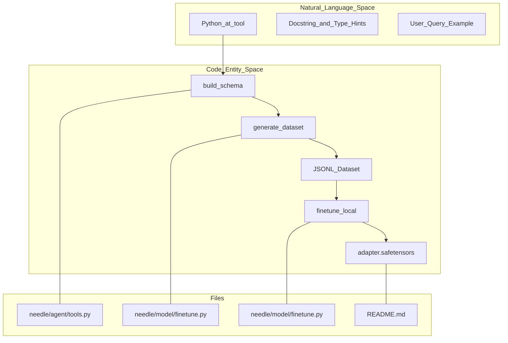
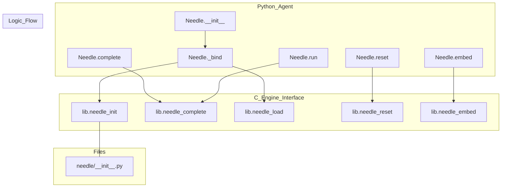

<!-- source: DeepWiki mcp.deepwiki.com · repo cactus-compute/needle · page 8 Glossary · fetched 2026-10-26 -->

# Glossary

Relevant source files

The following files were used as context for generating this wiki page:

- [README.md](README.md)
- [llms.txt](llms.txt)
- [needle/__init__.py](needle/__init__.py)
- [needle/platform.py](needle/platform.py)
- [tests/test_platform.py](tests/test_platform.py)

This page provides definitions for codebase-specific terms, architectural concepts, and domain-specific abbreviations used in the Needle project.

## Purpose and Scope
This glossary serves as a technical reference for engineers onboarding to the Needle codebase. It bridges the gap between natural language descriptions and the specific implementation details found in the JAX/Flax and C-engine code.

Sources: [README.md:1-12](), [needle/__init__.py:1-45]()

## Core Architectural Terms

### Simple Attention Network (SAN)
The dense small-model recipe used by Needle. Its primary characteristics include a Monarch Hadamard MLP in place of the FFN, GQA attention with causal conv taps, engram n-gram memory read by gather, and multi-lane hyper-connections [README.md:11](). The architecture is defined in `needle/model/architecture.py`.

Sources: [README.md:11](), [needle/model/architecture.py:1-80]()

### .cact Format
A custom binary format for deploying Needle weights. It is optimized for C++ inference engines using a single-mega-kernel approach [needle/model/export.py:1-3](). It uses Cactus Quants quantization and stores tensors in layer-major order [needle/model/export.py:5-10](). The format includes a fixed header with architecture geometry, a nameless tensor directory, and aligned tensor blobs [needle/model/export.py:14-16]().

Sources: [README.md:84](), [needle/model/export.py:1-20]()

### ZCRMSNorm (Zero-Centered RMSNorm)
A variation of RMSNorm where the scale parameter is initialized to zero, ensuring the layer acts as an identity transform at initialization. Defined in `needle/model/architecture.py`.

Sources: [needle/model/architecture.py:28-37]()

### Engram Key-Value Memory
A mechanism that uses n-gram hashing to gather rows from learned tables, providing external memory [README.md:11](). The `TransformerConfig` defines parameters like `engram_orders`, `engram_heads`, `engram_slots`, and `engram_layers`.

Sources: [README.md:11](), [needle/model/architecture.py:61-65]()

### Multi-Lane Hyper-Connections (mHC)
A residual architecture variant where the hidden state is split into multiple lanes, processed, and then routed using doubly-stochastic normalization computed by Sinkhorn iteration [README.md:11](). Configured by `mhc_lanes` in `TransformerConfig`.

Sources: [README.md:11](), [needle/model/architecture.py:72]()

### Monarch Hadamard MLP
A replacement for the traditional Feed-Forward Network (FFN) that uses the orthonormal Walsh-Hadamard Transform (WHT). It is a fixed matrix applied in $O(n \log n)$ time with no weights to read [README.md:11]().

Sources: [README.md:11](), [needle/model/architecture.py:40-60]()

### Ladder Rung
Needle 3 is a "Laddered Simple Attention Network" where every depth from 2 to 20 layers is a deployable model [README.md:11](). A ladder rung refers to a specific subnetwork depth. The `ladder_layer_indices` function determines which original layers are included for a given depth, and `ladder_config` creates a configuration for a specific ladder depth.

Sources: [README.md:11](), [needle/model/architecture.py:167-193]()

---

## Data and Tokenization Terms

### Special Tokens
Needle uses specific markers to delimit chat turns, reasoning, and tool-calling structures. Defined in `needle/model/tokenizer.py`.

| Token Constant | Purpose |
| :--- | :--- |
| `IM_START` / `IM_END` | Delimits chat messages |
| `THINK_START` / `THINK_END` | Delimits reasoning/thought blocks |
| `TOOLS_START` / `TOOLS_END` | Delimits the tool definition block |
| `TOOL_CALL_START` / `TOOL_CALL_END` | Delimits the model's generated tool call |
| `TOOL_RESULT_START` / `TOOL_RESULT_END` | Delimits the result returned by a tool |
| `CONTEXT_START` / `CONTEXT_END` | Delimits context information |
| `EXTRACT_START` / `EXTRACT_END` | Delimits extraction tasks |
| `SCHEMA_START` / `SCHEMA_END` | Delimits schema definitions |

Sources: [needle/model/tokenizer.py:16-34]()

### SANTokenizer
A wrapper around SentencePiece BPE that manages the vocabulary and special tokens [needle/model/tokenizer.py:43-48](). It handles encoding and decoding text to and from token IDs [needle/model/tokenizer.py:77-82]().

Sources: [needle/model/tokenizer.py:43-82]()

---

## Inference and Training Concepts

### Cactus Quants (CQ)
A Lloyd-Max codebook quantization scheme used to compress weights to low bit-widths [needle/model/export.py:5-6](). It uses a shared unit-sphere codebook concatenated in the header [needle/model/export.py:25-27](). Implemented via `cq_quantize` [needle/model/quantize.py:122-135]() and codebook generation `_lloyd_max_gaussian` [needle/model/quantize.py:78-93]().

Sources: [needle/model/export.py:5-27](), [needle/model/quantize.py:78-135]()

### LoRA (Low-Rank Adaptation)
The fine-tuning method used to adapt the frozen base model to new tool schemas. It targets specific projections: `q_proj`, `k_proj`, `v_proj`, `gate_proj`, and `out_proj`.

Sources: [README.md:66](), [tests/test_lora.py:1-50]()

### Byte-Level Grammar
A constraint system compiled from tool schemas that restricts the model's output to valid JSON matching the expected structure [README.md:11]().

Sources: [README.md:11](), [llms.txt:3-4]()

### Grounding
The process of validating that extracted values or tool arguments are directly supported by or derivable from the input text. The `validation.ungrounded` field indicates ungrounded elements [llms.txt:108-109](). Unvetted ungrounded calls are refused by `Needle.run()`.

Sources: [llms.txt:108-109](), [tests/test_grounding.py:1-30]()

### Suppressed Calls
Tool calls that the engine withheld because their confidence was below a threshold or a grounding gate fired. These calls are stored in the `suppressed_calls` field of the response.

Sources: [llms.txt:106-107]()

### Generation
Refers to the version of the Needle model architecture (e.g., Needle 2 or Needle 3). Selected via the `generation` parameter in `Needle.__init__` [needle/__init__.py:132](). `.cact` files include a format tag mapping to their generation [needle/__init__.py:27-30]().

Sources: [needle/__init__.py:27-30](), [needle/__init__.py:132-190]()

### Platform Tag
A string identifier for a specific hardware/OS combination (e.g., `macos-arm64`, `linux-arm64`). Used by `needle build` and fetch routines to download the correct prebuilt engine binary.

Sources: [README.md:74-75](), [needle/agent/fetch.py:1-50]()

### Whistle
The speech-to-text model that shares Needle's `.cact` container, quantization scheme, and C++ engine [README.md:8](). Implemented in `needle/agent/whistle.py` via the `Whistle` class and helper functions `transcribe()` and `stream()`.

Sources: [README.md:8](), [needle/agent/whistle.py:1-80](), [needle/__init__.py:14]()

### PlatformError
A custom exception class (`PlatformError`) defined in `needle/platform.py:19-27`() raised by the Cactus Platform client upon receiving API or network error responses.

Sources: [needle/platform.py:19-35]()

---

## System Mapping Diagrams

### Training Data Flow: From Tool Schema to Adapter
This diagram maps natural language tool definitions and queries to code entities in the fine-tuning pipeline.

Title: Fine-Tuning Pipeline Entity Mapping

Sources: [needle/agent/tools.py:11](), [needle/model/finetune.py:277](), [README.md:66]()

### Inference Flow: C-Engine Bridge
This diagram connects the Python `Needle` agent methods to the low-level C FFI bindings loaded via `ctypes`.

Title: Python to C-Engine Mapping

Sources: [needle/__init__.py:106-119](), [needle/__init__.py:162-177](), [needle/__init__.py:200-221]()

---

## Abbreviations Summary

| Abbreviation | Full Term | Context |
| :--- | :--- | :--- |
| **CQ** | Cactus Quants | Lloyd-Max codebook quantization [needle/model/quantize.py:134](). |
| **GQA** | Grouped-Query Attention | Efficiency-optimized attention [needle/model/architecture.py:44](). |
| **mHC** | Multi-lane Hyper-Connections | Routing architecture for residuals [needle/model/architecture.py:72](). |
| **QAT** | Quantization-Aware Training | Training with `fake_quant` to simulate inference [needle/model/quantize.py:28-29](). |
| **RoPE** | Rotary Positional Embedding | Positional encoding in attention [needle/model/architecture.py:58](). |
| **STE** | Straight-Through Estimator | Used in `fake_quant` to pass gradients [needle/model/quantize.py:29](). |

Sources: [needle/model/architecture.py:44-72](), [needle/model/quantize.py:28-134]()