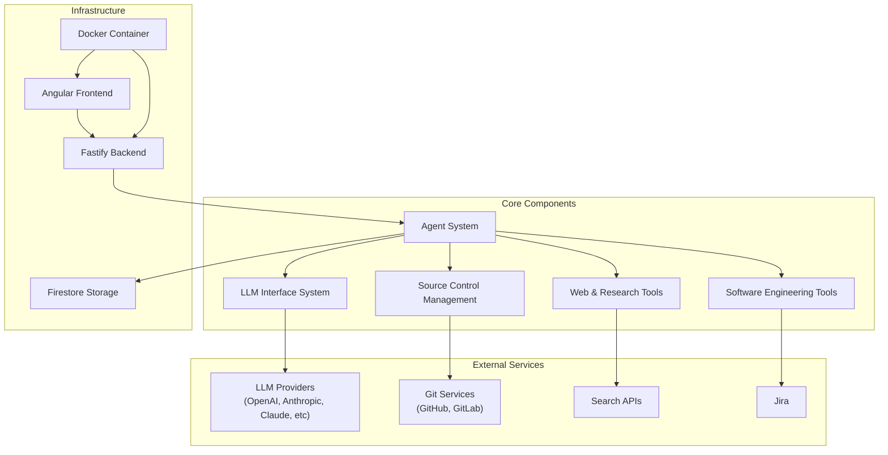
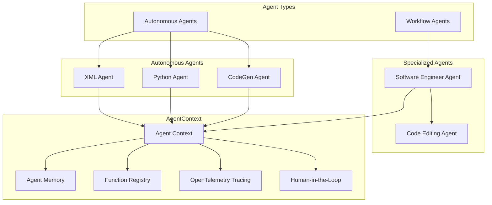
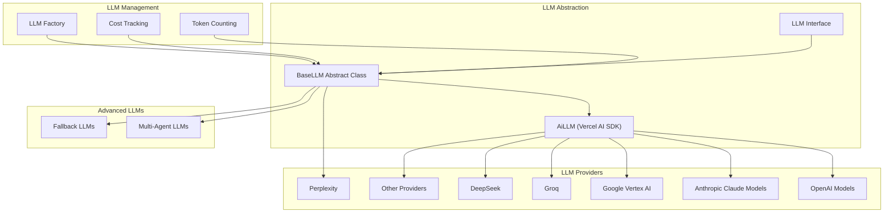
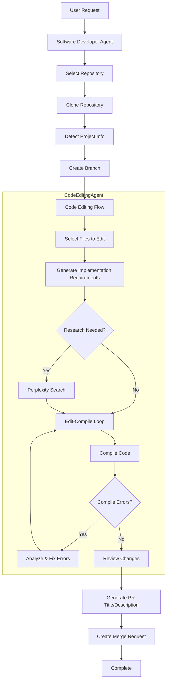
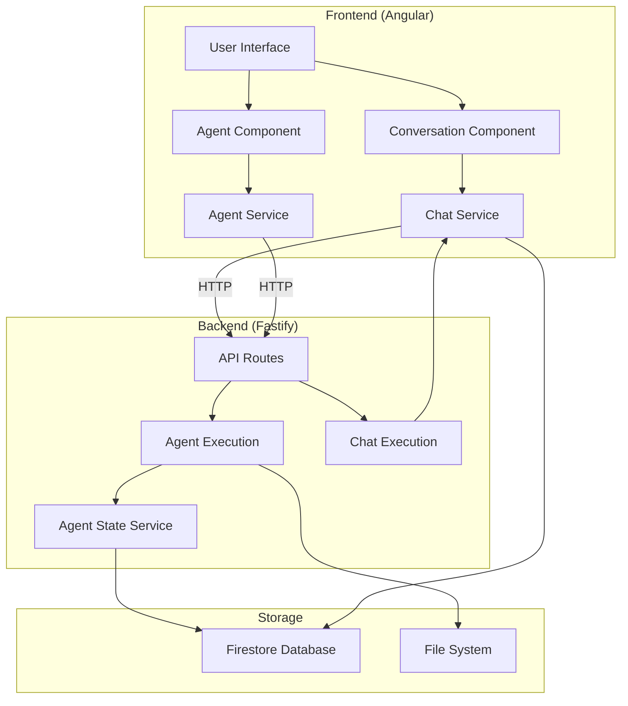

<!-- source: DeepWiki mcp.deepwiki.com · repo TrafficGuard/typedai · page 1 Overview · fetched 2026-10-26 -->

# Overview

<details>
<summary>Relevant source files</summary>

The following files were used as context for generating this wiki page:

- [README.md](README.md)
- [docs/docs/autonomous-agents.md](docs/docs/autonomous-agents.md)
- [docs/docs/examples.md](docs/docs/examples.md)
- [docs/docs/index.md](docs/docs/index.md)
- [docs/docs/roadmap.md](docs/docs/roadmap.md)
- [docs/docs/setup.md](docs/docs/setup.md)
- [docs/docs/software-engineer.md](docs/docs/software-engineer.md)
- [docs/mkdocs.yml](docs/mkdocs.yml)
- [frontend/package-lock.json](frontend/package-lock.json)
- [frontend/package.json](frontend/package.json)
- [package-lock.json](package-lock.json)
- [package.json](package.json)
- [variables/local.env.example](variables/local.env.example)

</details>


TypedAI is a comprehensive TypeScript-first platform designed for building and running autonomous AI agents and LLM-based workflows. It provides a flexible framework for developing AI agents that can perform complex tasks, with particular strength in software engineering workflows. This page provides a high-level overview of the platform's architecture, core components, and functionality.

For detailed information about getting started with TypedAI, see [Getting Started](#2). For information on specific agent implementations, see [Agent System](#3).

## System Architecture

TypedAI is organized into several interconnected components that work together to provide its capabilities. The platform is built with TypeScript/Node.js and follows a modular design that enables flexibility in deployment and usage.

### Core System Architecture



Sources:
- [README.md:1-192]()
- [package.json:1-177]()
- [docs/docs/index.md:1-192]()

The platform consists of several key components:

1. **Agent System**: The core of the platform, providing autonomous and workflow-based AI agents.
2. **LLM Interface System**: Abstracts away LLM provider details, supporting multiple services like OpenAI, Anthropic, and others.
3. **Software Engineering Tools**: Specialized tools for code editing, source control, and software development tasks.
4. **Web & Research Tools**: Tools that enable agents to perform web research and interact with online services.
5. **Infrastructure**: Components that support deployment and storage, including Docker containers, Firestore database, and Angular/Fastify for the frontend and backend.

## Key Features

TypedAI offers a wide range of capabilities:

- Autonomous AI agents with memory, planning, and human-in-the-loop functionality
- Software developer agents that can write and modify code
- Pull request code review agent
- AI chat interface
- Slack chatbot
- Multi-agent implementations for extended reasoning
- Functional tool integrations with various services
- OpenTelemetry-based observability
- Python ecosystem integration

Sources:
- [README.md:23-47]()
- [docs/docs/index.md:17-37]()

## Agent Types and Execution Flow

TypedAI implements different types of agents to handle various use cases:



Sources:
- [docs/docs/autonomous-agents.md:1-61]()
- [docs/docs/software-engineer.md:1-105]()

The agent system includes two main types:

1. **Autonomous Agents**: Dynamic agents that reason through tasks:
   - **XML Agent**: Returns function calls in a custom XML format
   - **Python Agent**: Generates and executes Python code in a WebAssembly sandbox
   - **CodeGen Agent**: Specialized for code generation tasks

2. **Workflow Agents**: Follow predefined patterns with LLMs determining conditional paths:
   - **Software Engineer Agent**: Orchestrates software development workflows
   - **Code Editing Agent**: Handles code modification tasks

All agents share a common context structure that includes memory, function registry, tracing, and human-in-the-loop capabilities.

## LLM Integration

TypedAI employs a flexible architecture to abstract away provider-specific details while offering advanced capabilities:



Sources:
- [package.json:54-91]()
- [docs/docs/index.md:32-34]()

The LLM integration system supports:

- Multiple LLM providers including OpenAI, Anthropic, Google Vertex AI, Groq, DeepSeek, and more
- Abstract interfaces for consistent function calls across providers
- Advanced patterns like multi-agent reasoning and fallback strategies
- Cost tracking and token counting

TypedAI leverages the Vercel AI SDK for many provider integrations while adding tracing and cost tracking capabilities.

## Software Engineering Workflow

One of TypedAI's key strengths is its software engineering capabilities:



Sources:
- [docs/docs/software-engineer.md:1-105]()

The Software Engineering workflow includes:

1. **Project Selection**: Finding and selecting the appropriate repository
2. **Code Editing**: Selecting files, generating requirements, and implementing changes
3. **Testing & Debugging**: Compiling, analyzing errors, and fixing issues
4. **Integration**: Creating merge/pull requests for code changes

TypedAI's Code Editing Agent integrates with Aider for efficient diff editing and provides advanced capabilities like auto-detection of project initialization, compile, test, and lint commands.

## Backend and Frontend Integration

TypedAI uses a modern web architecture:



Sources:
- [frontend/package.json:1-86]()
- [package.json:67-75]()

The system uses:

1. **Frontend**: Angular-based web interface for interacting with agents and chats
2. **Backend**: Fastify server for handling API requests and agent execution
3. **Storage**: Firestore for persistence and file system for local operations

The frontend communicates with the backend through HTTP APIs, while the backend manages agent execution and persists state to Firestore. Server-sent events enable real-time updates for agent progress.

## Deployment Options

TypedAI offers flexible deployment options:

| Deployment Type | Description | Authentication | Storage |
|---|---|---|---|
| Local Development | Run directly from repository | Single user | In-memory or Firestore |
| Docker Container | Provided Dockerfile | Single user | In-memory or Firestore |
| Cloud Run | Scale-to-zero deployment | Multi-user SSO (Google Cloud IAP) | Firestore |
| Enterprise | Multi-user deployment | SSO integration | Firestore |

Sources:
- [docs/docs/setup.md:1-113]()
- [variables/local.env.example:1-67]()

The platform supports both local development with in-memory storage and production deployments with multi-user authentication, making it suitable for individual developers and enterprise teams.

## Key Technology Stack

TypedAI is built on a modern technology stack:

| Component | Technologies |
|---|---|
| Core Framework | Node.js with TypeScript |
| Frontend | Angular 18 with Material Design |
| Backend | Fastify |
| LLM Integration | Multiple providers via abstraction layers |
| Containerization | Docker |
| Storage | Google Firestore / In-memory |
| Monitoring | OpenTelemetry for tracing |
| Source Control | Integration with GitHub and GitLab |
| Development Tools | Code editing capabilities via Aider |

Sources:
- [package.json:54-135]()
- [frontend/package.json:25-53]()

## CLI Interface

TypedAI provides a powerful command-line interface for running agents and workflows:

```
npm run agent    # Run autonomous agent
npm run swe      # Run software engineer agent
npm run code     # Run code editing agent
npm run research # Run research agent
npm run easy     # Run simple LLM text generation
```

Sources:
- [package.json:10-32]()

## Comparison with Other Frameworks

TypedAI offers an alternative to frameworks like LangChain, emphasizing direct code flow over complex abstractions:

| TypedAI | LangChain |
|---|---|
| Direct control flow with async/await | Chain-based abstractions |
| Static typing with TypeScript | More complex type handling |
| Automated function schema generation | Manual schema definition |
| Debugging with standard tools | Custom debugging tools |

Sources:
- [README.md:124-185]()
- [docs/docs/index.md:91-152]()

TypedAI's approach allows for simpler code with standard TypeScript control flow, making it easier to debug and maintain.

## Function Calling

A key feature of TypedAI is automated LLM function schema generation using decorators:

```typescript
@funcClass(__filename)
export class Jira {
    /**
     * Gets the description of a JIRA issue
     * @param {string} issueId - the issue id (e.g. XYZ-123)
     * @returns {Promise<string>} the issue description
     */
    @func()
    async getJiraDescription(issueId: string): Promise<string> {
        // Implementation
    }
}
```

Sources:
- [README.md:186-219]()
- [docs/docs/index.md:165-186]()

This approach avoids schema duplication and leverages TypeScript's type system for function definitions.

---

