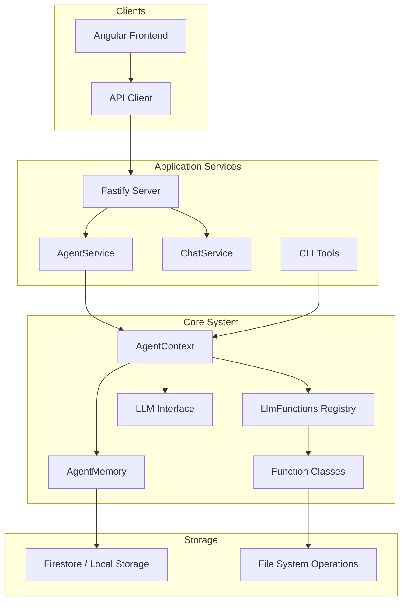
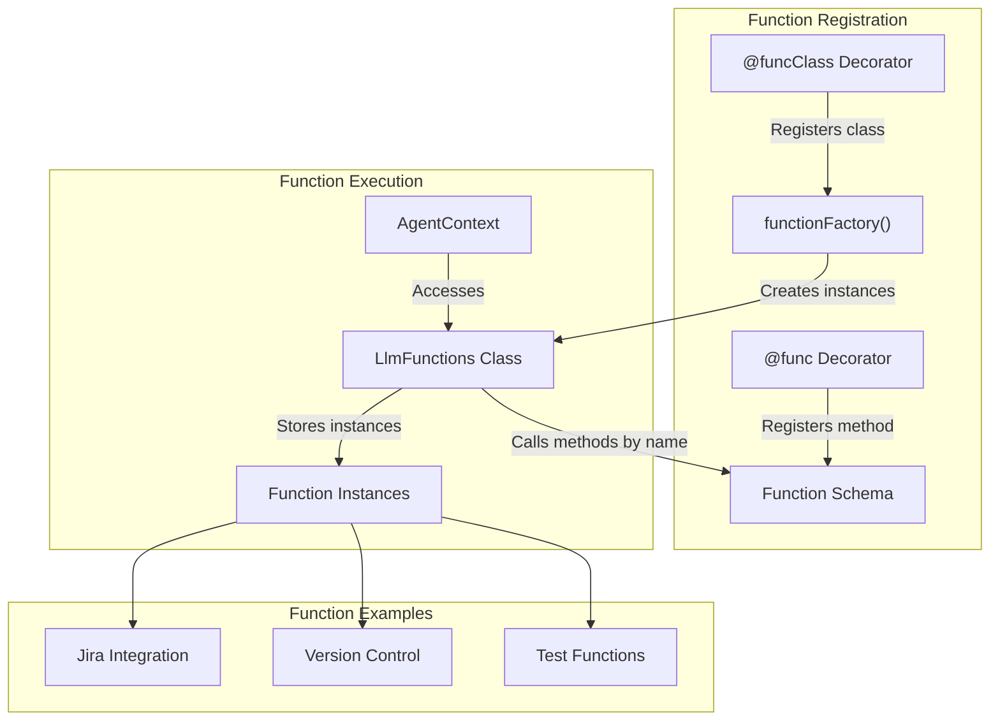
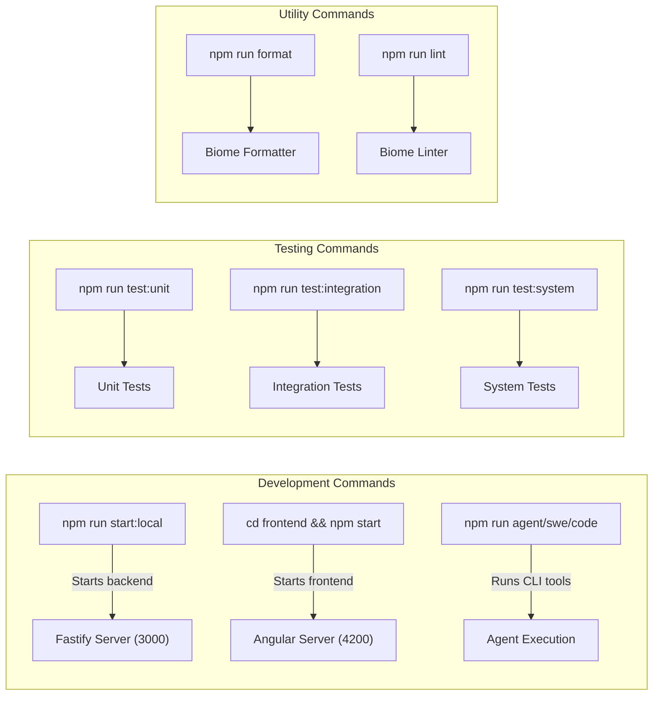
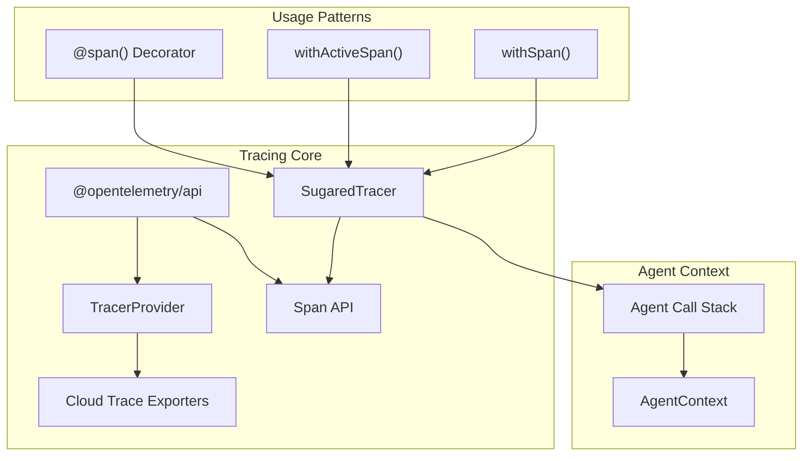

<!-- source: DeepWiki mcp.deepwiki.com · repo TrafficGuard/typedai · page 10 Development Guide · fetched 2026-10-26 -->

# Development Guide

<details>
<summary>Relevant source files</summary>

The following files were used as context for generating this wiki page:

- [.github/workflows/ci.yml](.github/workflows/ci.yml)
- [.github/workflows/integration_tests.yml](.github/workflows/integration_tests.yml)
- [frontend/package-lock.json](frontend/package-lock.json)
- [frontend/package.json](frontend/package.json)
- [package-lock.json](package-lock.json)
- [package.json](package.json)
- [src/agent/LlmFunctions.ts](src/agent/LlmFunctions.ts)
- [src/functions/jira.ts](src/functions/jira.ts)
- [src/functions/scm/versionControlSystem.ts](src/functions/scm/versionControlSystem.ts)
- [src/functions/testFunctions.ts](src/functions/testFunctions.ts)
- [src/o11y/trace.ts](src/o11y/trace.ts)
- [variables/local.env.example](variables/local.env.example)

</details>


This guide provides technical information for developers who are contributing to or extending the TypedAI platform. It covers development environment setup, project architecture, workflow processes, and extension patterns.

For information on using TypedAI as an end user, see [Overview](#1). For API reference documentation, see [API & Backend](#9).

Sources: [package.json:2-6]()

## Environment Setup

### Prerequisites

- Node.js v20.6.0 or higher (specified in [package.json:7-9]())
- npm for package management
- Git for source control

### Installation

1. Clone the repository:
```bash
git clone https://github.com/TrafficGuard/typedai.git
cd typedai
```

2. Install backend dependencies:
```bash
npm install
```

3. Install frontend dependencies:
```bash
cd frontend
npm install
```

### Environment Configuration

Copy the example environment file to create your local configuration:
```bash
cp variables/local.env.example variables/local.env
```

Essential configuration parameters include:
- `LOG_LEVEL` and `LOG_PRETTY` for logging configuration
- API keys for LLM providers (OpenAI, Anthropic, Claude, etc.)
- Credentials for external services (GitHub, GitLab, JIRA)
- OpenTelemetry tracing configuration

Sources: [variables/local.env.example:1-67](), [package.json:7-67]()

## Project Architecture

### Core System Components



The TypedAI platform is built around these key components:
- **AgentContext**: Central execution context for agents that manages state and operations
- **LlmFunctions Registry**: Collection of functional capabilities available to agents
- **LLM Interface**: Abstraction layer for communicating with AI models
- **Fastify Server**: Backend API server with routes for agent and chat operations
- **Angular Frontend**: Web UI for interacting with agents and visualizing results

Sources: [package.json:54-91](), [frontend/package.json:25-52]()

### Function Registry System



The function system connects LLMs to real-world capabilities:
- `LlmFunctions` ([src/agent/LlmFunctions.ts]()) - Registry that manages function instances
- `@funcClass` and `@func` decorators - Define function metadata for LLM consumption
- Function schemas - Define parameter types and descriptions for LLM understanding

When an agent needs to perform an action, it:
1. Selects a function from the registry
2. Passes parameters to that function
3. Receives the result for further processing

Sources: [src/agent/LlmFunctions.ts:1-117](), [src/functions/jira.ts:1-539](), [src/functions/scm/versionControlSystem.ts:1-52](), [src/functions/testFunctions.ts:1-52]()

## Development Workflow

### Running the Application

TypedAI provides multiple entry points depending on your development focus:



Key commands include:
- `npm run start:local` - Start the backend server
- `cd frontend && npm start` - Start the frontend development server
- `npm run agent` - Run the general agent CLI
- `npm run swe` - Run the software engineer agent
- `npm run code` - Run the code editing tool

All available CLI commands are defined in [package.json:10-50]().

Sources: [package.json:10-50](), [frontend/package.json:8-23]()

### Testing

Tests are organized by type and can be run with the following commands:

```bash
# Unit tests
npm run test:unit

# Integration tests
npm run test:integration

# System tests
npm run test:system

# Run all tests (unit + integration)
npm test
```

The project uses:
- **Mocha** as the test runner
- **Chai** for assertions
- **Sinon** for mocking

Unit tests are located alongside source files with a `.test.ts` extension.

Sources: [package.json:36-45]()

### CI/CD Process

The CI/CD pipeline uses GitHub Actions with workflows defined in:

| Workflow | Purpose | Trigger |
|----------|---------|---------|
| CI | Linting and unit tests | Pull requests, pushes to main |
| Integration Tests | End-to-end tests | Pull request approval |

The CI workflow runs:
1. Backend linting checks (`npm run lint:ci`)
2. Backend unit tests (`npm run test:ci`)
3. Frontend tests (`cd frontend && npm run test:ci`)

Integration tests run only after a PR is approved and ready to merge.

Sources: [.github/workflows/ci.yml:1-56](), [.github/workflows/integration_tests.yml:1-52]()

## Extending TypedAI

### Adding New Functions

Functions provide capabilities to agents. To add a new function:

1. Create a new TypeScript class with the `@funcClass` decorator
2. Add methods with the `@func` decorator 
3. Register your function class with an agent's function registry

Example function class pattern:

```typescript
import { func, funcClass } from '#functionSchema/functionDecorators';

@funcClass(__filename)
export class MyFunction {
  /**
   * Function description (visible to the LLM)
   * @param param1 Description of parameter (visible to the LLM)
   * @returns Description of return value
   */
  @func()
  async myFunction(param1: string): Promise<string> {
    // Implementation
    return result;
  }
}
```

Reference implementation: [src/functions/jira.ts:19-162]()

Sources: [src/functions/jira.ts:1-539](), [src/functions/testFunctions.ts:1-52]()

### Creating Custom Agents

To create a custom agent:

1. Configure the agent's context with appropriate functions
2. Set up the agent's memory store
3. Initialize the agent with the desired LLM model

Example agent setup:

```typescript
import { AgentContext } from '#agent/agentContextTypes';
import { LlmFunctions } from '#agent/LlmFunctions';
import { MyFunction } from './myFunction';

// Create function registry
const functions = new LlmFunctions();
functions.addFunctionClass(MyFunction);

// Create agent context
const context = new AgentContext({
  functions,
  // Other configuration
});

// Run the agent
await context.agent.run("Your task instruction");
```

Sources: [src/agent/LlmFunctions.ts:12-75]()

### Integrating with External Services

TypedAI provides integration patterns for external services:

1. **Version Control Systems**: The `VersionControlSystem` interface ([src/functions/scm/versionControlSystem.ts]()) defines methods for interacting with source control. Implementations exist for Git, GitHub, and GitLab.

2. **JIRA Integration**: The `Jira` class ([src/functions/jira.ts]()) provides methods for creating issues and retrieving information from JIRA.

3. **LLM Providers**: The LLM system abstracts provider-specific details, allowing easy integration with different AI models.

Sources: [src/functions/scm/versionControlSystem.ts:1-52](), [src/functions/jira.ts:1-539]()

## Observability and Tracing

TypedAI uses OpenTelemetry for distributed tracing:



Tracing can be used in your code through:

1. The `@span()` decorator for class methods ([src/o11y/trace.ts:138-162]()):
```typescript
@span({
  // Attribute extractors
  userId: 0, // Extract from first parameter
  custom: (arg1, arg2) => `${arg1}-${arg2}` // Custom extractor
})
async myFunction(userId: string, data: any) {
  // Function is automatically traced
}
```

2. The `withActiveSpan()` function for ad-hoc tracing ([src/o11y/trace.ts:71-85]()):
```typescript
await withActiveSpan('operation-name', async (span) => {
  span.setAttribute('key', 'value');
  // Work to be traced
});
```

For more details on the observability system, see [Observability & Tracing](#10.1).

Sources: [src/o11y/trace.ts:1-185]()

## Contributing Guidelines

### Code Style and Quality

The project uses:
- TypeScript for type safety
- Biome for linting and formatting
- Conventional commit format for commit messages

Run these commands to ensure code quality:
```bash
npm run format  # Format code using Biome
npm run lint    # Check and fix linting issues
```

Sources: [package.json:46-48]()

### Pull Request Process

1. Create a branch for your changes
2. Make your changes and add tests
3. Ensure tests pass locally: `npm test`
4. Submit a pull request
5. Address review feedback
6. Once approved, the PR will run integration tests before merging

All PRs are validated with:
- Linting: `npm run lint:ci`
- Unit tests: `npm run test:ci`
- Integration tests: `npm run test:integration` (on approval)

For more details on testing practices, see [Testing & CI](#10.2).

Sources: [.github/workflows/ci.yml:1-56](), [.github/workflows/integration_tests.yml:1-52]()

---

