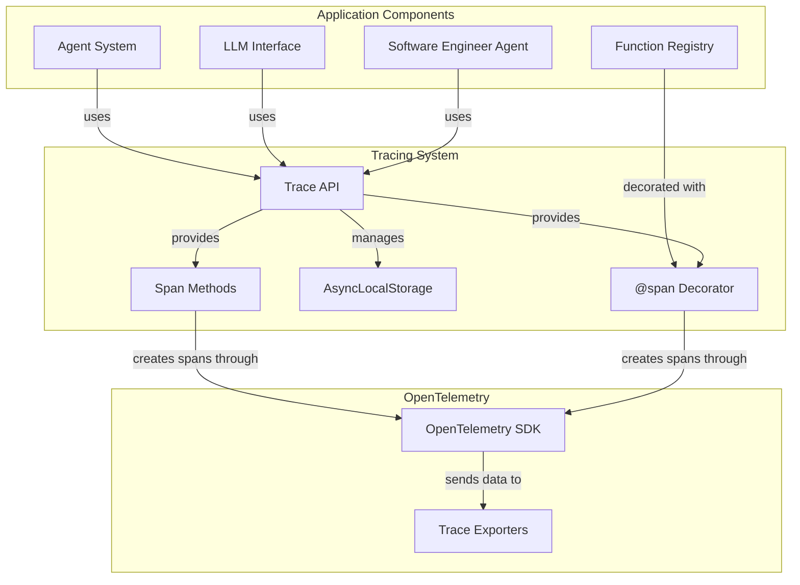
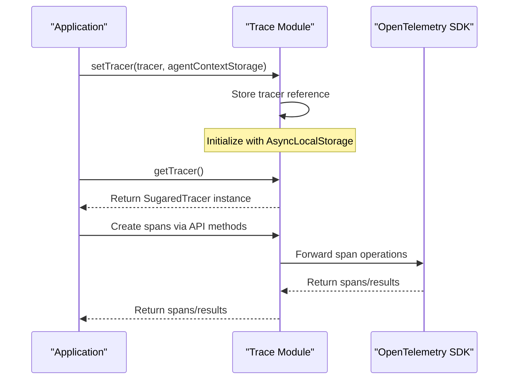
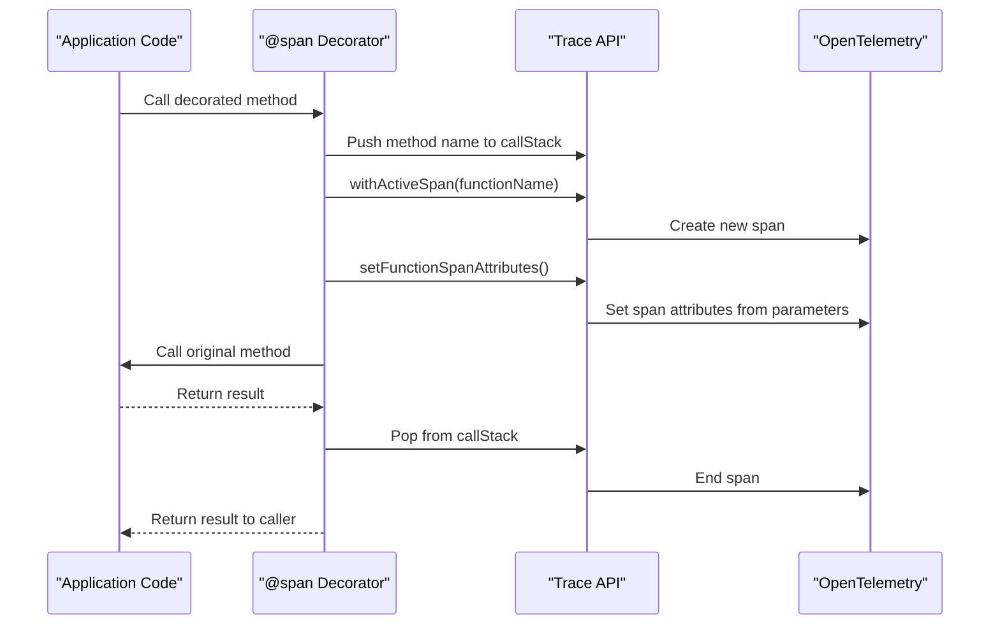
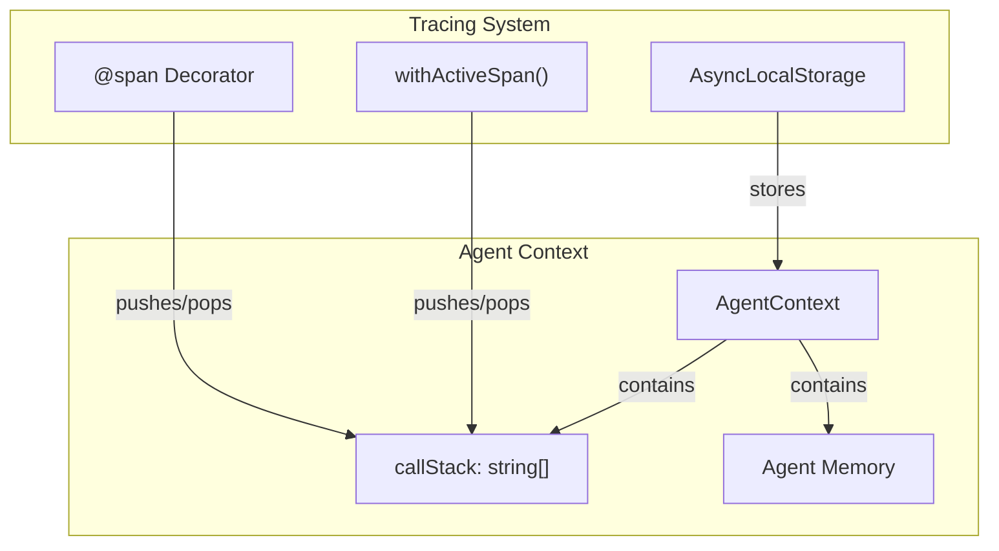
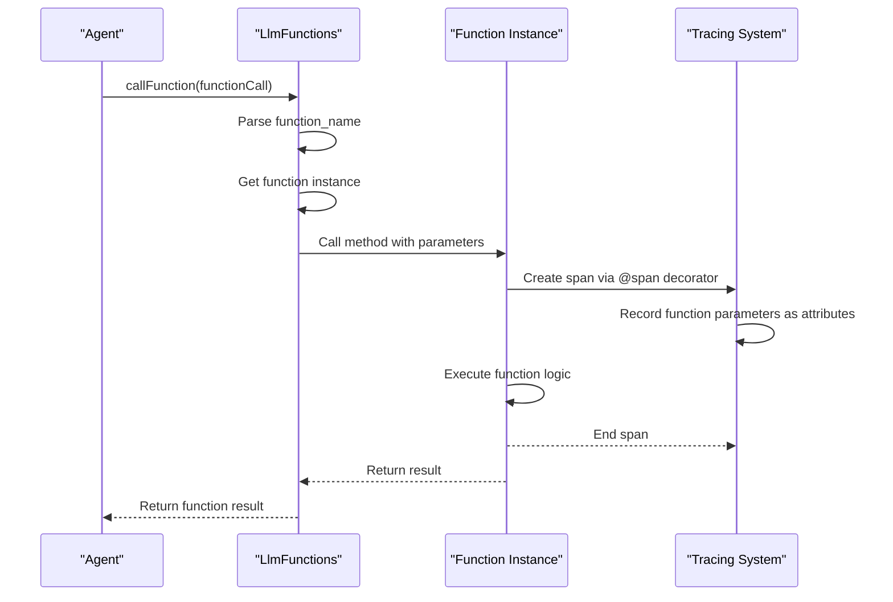

<!-- source: DeepWiki mcp.deepwiki.com · repo TrafficGuard/typedai · page 10.1 Observability & Tracing · fetched 2026-10-26 -->

# Observability & Tracing

<details>
<summary>Relevant source files</summary>

The following files were used as context for generating this wiki page:

- [src/agent/LlmFunctions.ts](src/agent/LlmFunctions.ts)
- [src/functions/jira.ts](src/functions/jira.ts)
- [src/functions/scm/versionControlSystem.ts](src/functions/scm/versionControlSystem.ts)
- [src/functions/testFunctions.ts](src/functions/testFunctions.ts)
- [src/o11y/trace.ts](src/o11y/trace.ts)

</details>


## Purpose and Scope

This document describes the observability framework in TypedAI, focusing on the distributed tracing capabilities built using OpenTelemetry. The tracing system enables visibility into agent execution flows, function calls, LLM interactions, and overall system performance. It provides developers and operators with tools to monitor, debug, and analyze the behavior of AI agents in the platform.

For information about testing framework and continuous integration setup, see [Testing & CI](#10.2).

## Tracing Architecture Overview

TypedAI implements a comprehensive tracing system centered around OpenTelemetry that tracks the execution flow across the entire agent ecosystem. The architecture consists of several key components that work together to create a complete observability solution.



Sources: [src/o11y/trace.ts:1-185]()

## Core Tracing Components

The tracing system is primarily implemented in the `trace.ts` file, which provides a set of functions and decorators for creating and managing trace spans.

### Tracer Management

The module uses a singleton pattern to manage the OpenTelemetry tracer:



Sources: [src/o11y/trace.ts:37-46]()

### Span Creation Methods

The API provides several methods for creating and managing spans:

| Method | Purpose | Usage |
|--------|---------|-------|
| `startSpan()` | Creates an independent span | For simple operations, must manually end the span |
| `withSpan()` | Creates a span for a synchronous function | Automatically ends the span when function completes |
| `withActiveSpan()` | Creates a span for async functions | Maintains context across async boundaries |
| `@span` decorator | Automatically traces class methods | Declarative method for adding tracing to classes |

Additionally, the module includes fallback implementations (dummy tracer) for when tracing is disabled, ensuring that code using tracing doesn't fail in environments where OpenTelemetry is not configured.

Sources: [src/o11y/trace.ts:55-97]()

## Span Decorator in Detail

The `@span` decorator is a powerful feature that automatically adds tracing to class methods with minimal code changes.

```typescript
@span({
    // Extract attributes from method parameters
    attributeName: parameterIndex,
    // Or compute attributes dynamically
    computedAttribute: (...args) => computeValue(args)
})
```

The decorator handles both synchronous and asynchronous methods, automatically creating spans, extracting attributes, and integrating with the agent context.

Sources: [src/o11y/trace.ts:138-162](), [src/o11y/trace.ts:164-184]()

Here's how the decorator interacts with the method it decorates:



Sources: [src/o11y/trace.ts:144-161]()

## Integration with Agent Context

A key feature of the tracing system is its integration with the agent execution context. The system uses `AsyncLocalStorage` to maintain context across asynchronous operations.



When a traced operation begins, the function name is pushed onto the agent's call stack, creating a breadcrumb trail of execution. When the operation completes, the function name is popped from the stack.

Sources: [src/o11y/trace.ts:71-85](), [src/o11y/trace.ts:144-161]()

## Function Execution Tracing

The tracing system works closely with the function execution system to track function calls made by agents.



The `LlmFunctions` class manages function instances and handles function calls from agents. When a function decorated with `@span` is called, it automatically creates a trace span for that function call.

Sources: [src/agent/LlmFunctions.ts:12-117]()

## Practical Usage

### Basic Span Creation

```typescript
import { startSpan, withActiveSpan } from '#o11y/trace';

// For one-off operations:
const span = startSpan('operation-name');
try {
  // Perform work
  span.setAttribute('key', 'value');
} finally {
  span.end();
}

// For async operations:
await withActiveSpan('complex-operation', async (span) => {
  span.setAttribute('parameter', value);
  // Perform async work
  return result;
});
```

### Class Method Tracing

```typescript
import { span } from '#o11y/trace';

export class Service {
  @span({
    // Extract the first parameter as an attribute named 'id'
    id: 0,
    // Compute an attribute from multiple parameters
    complexity: (id, payload) => calculateComplexity(payload)
  })
  async processItem(id: string, payload: object): Promise<Result> {
    // Method implementation
  }
}
```

### Real-world Example: Jira Integration

The TypedAI codebase uses method tracing in various subsystems. For example, the Jira integration uses the `@func()` decorator (which can be enhanced with tracing) for its API methods:

```typescript
@funcClass(__filename)
export class Jira {
  @func()
  @cacheRetry({ retries: 1, backOffMs: 1000 })
  async createIssue(
    projectKey: string,
    title: string,
    description: string,
    reporterEmail: string,
    relatedContentForIssueTypeDetection?: string,
  ): Promise<{ key: string; url: string }> {
    // Implementation
  }
}
```

Sources: [src/functions/jira.ts:20-144]()

## Best Practices

1. **Span Naming**:
   - Use descriptive, consistent names for spans
   - Include the operation type and target (e.g., `fetch-user-data`)

2. **Attribute Management**:
   - Add relevant attributes that help with debugging and analysis
   - Avoid adding sensitive information or very large values as attributes
   - Use the appropriate attribute types (string, number, boolean)

3. **Error Handling**:
   - Record exceptions in spans using `span.recordException(error)`
   - Ensure spans are properly ended in all code paths including error scenarios

4. **Performance Considerations**:
   - Be mindful of the overhead added by extensive tracing
   - Consider using sampling for high-volume operations

5. **Context Propagation**:
   - Use `withActiveSpan()` for asynchronous operations to maintain context
   - Ensure agent context is properly propagated across module boundaries

## Conclusion

The observability and tracing system in TypedAI provides comprehensive visibility into the execution of AI agents and their interactions with various subsystems. By leveraging OpenTelemetry, the platform enables consistent tracing across all components, from LLM calls to function execution.

The tracing system's integration with agent context and function registry makes it particularly powerful for monitoring and debugging complex agent workflows, allowing developers to understand exactly how agents are executing their tasks and where issues might be occurring.

---

