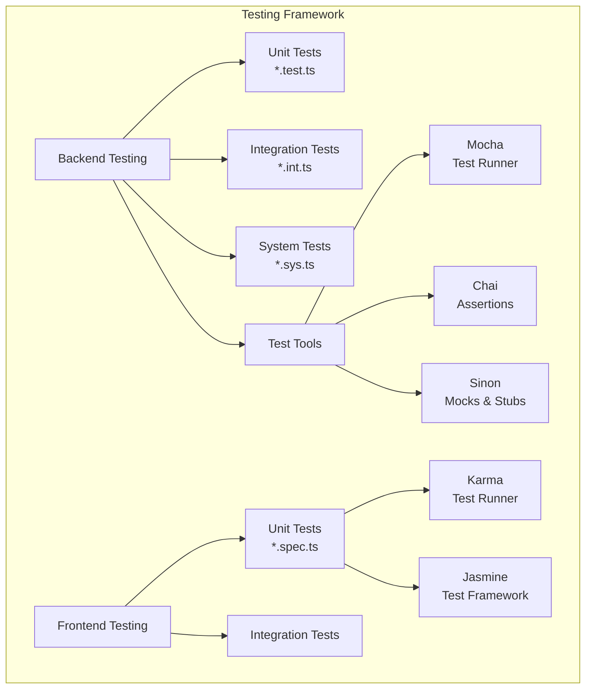
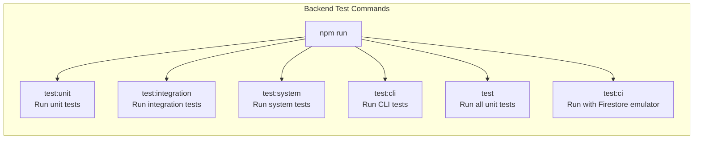
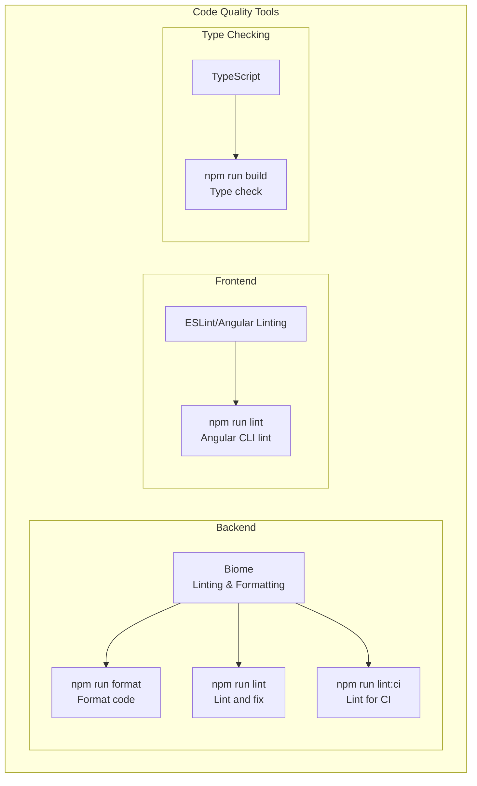
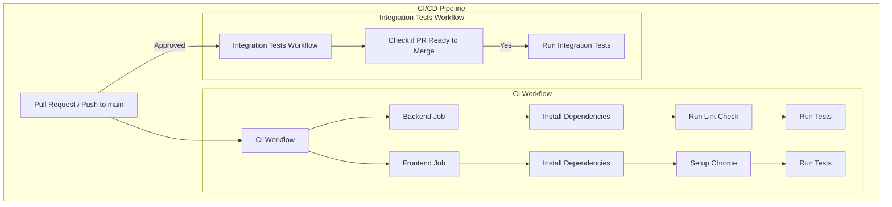
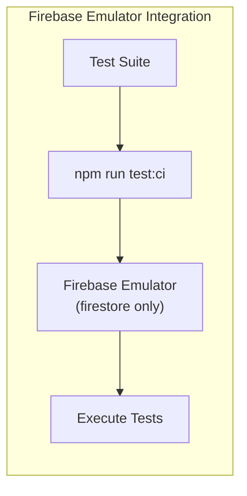

<!-- source: DeepWiki mcp.deepwiki.com · repo TrafficGuard/typedai · page 10.2 Testing & CI · fetched 2026-10-26 -->

# Testing & CI

Relevant source files

The following files were used as context for generating this wiki page:

- [.github/workflows/ci.yml](.github/workflows/ci.yml)
- [.github/workflows/integration_tests.yml](.github/workflows/integration_tests.yml)
- [frontend/package-lock.json](frontend/package-lock.json)
- [frontend/package.json](frontend/package.json)
- [package-lock.json](package-lock.json)
- [package.json](package.json)
- [variables/local.env.example](variables/local.env.example)

This page documents the testing framework and continuous integration setup in the TypedAI platform. It covers how tests are organized, how to run them locally, and how the CI pipeline is configured.

## Test Framework Architecture

TypedAI implements a multi-level testing strategy with different approaches for the backend and frontend codebases.

Sources: [package.json:39-45](), [frontend/package.json:20-21]()

## Backend Testing Setup

The backend utilizes Mocha as the test runner with Chai for assertions. Tests are organized into separate categories based on their scope and purpose.

### Test Categories

| Category | File Pattern | Purpose | Timeout |
|----------|--------------|---------|---------|
| Unit Tests | `*.test.ts` or `*.test.js` | Test individual components in isolation | 10 seconds |
| Integration Tests | `*.int.ts` or `*.int.js` | Test interactions between components | No timeout |
| System Tests | `*.sys.ts` | End-to-end functionality tests | No timeout |
| CLI Tests | `src/cli/**/*.test.ts` | Test command-line interface functions | 10 seconds |

Sources: [package.json:39-46]()

### Running Backend Tests

Sources: [package.json:39-46]()

### Test Environment Configuration

Tests use a dedicated environment configuration from `variables/test.env`, which includes settings for:

- Database connections (Firestore emulator)
- OpenTelemetry tracing configuration
- API keys and authentication settings
- Service endpoints

Sources: [package.json:41-44](), [variables/local.env.example:18-22]()

## Frontend Testing Setup

The Angular frontend uses Karma as the test runner with Jasmine as the testing framework.

### Running Frontend Tests

| Command | Purpose |
|---------|---------|
| `npm test` | Run tests in watch mode during development |
| `npm run test:ci` | Run tests once in headless Chrome for CI |

Sources: [frontend/package.json:20-21]()

## Code Quality Tools

TypedAI uses several tools to ensure code quality beyond functional tests.

Sources: [package.json:46-48](), [frontend/package.json:23]()

## Continuous Integration Pipeline

TypedAI uses GitHub Actions for continuous integration, with workflows defined in the `.github/workflows` directory.

Sources: [.github/workflows/ci.yml:1-56](), [.github/workflows/integration_tests.yml:1-52]()

### Main CI Workflow

The primary CI workflow runs on pull requests and pushes to the main branch:

1. **Backend Job**:
   - Node.js 20.x environment
   - Installs dependencies with `npm ci`
   - Installs platform-specific Biome linter
   - Runs lint checks with `npm run lint:ci`
   - Runs tests with `npm run test:ci`

2. **Frontend Job**:
   - Node.js 20.x environment
   - Installs frontend dependencies
   - Sets up Chrome browser
   - Runs tests with `npm run test:ci`

Sources: [.github/workflows/ci.yml:9-56]()

### Integration Tests Workflow

A separate workflow runs when a pull request is approved:

1. Checks if the PR is ready to merge
2. If ready, runs backend integration tests with `npm run test:integration`
3. Frontend integration tests are currently commented out in the workflow

Sources: [.github/workflows/integration_tests.yml:8-52]()

## Test File Organization

Tests are located alongside the code they test, following these conventions:

- Unit tests: `[filename].test.ts`
- Integration tests: `[filename].int.ts`
- System tests: `[filename].sys.ts`

This organization makes it easy to find tests related to specific components and encourages developers to write tests as they implement features.

Sources: [package.json:41-44]()

## Firebase Emulator Integration

For tests that interact with Firestore, the TypedAI testing environment uses the Firebase emulator:

The Firebase emulator provides a local, in-memory implementation of Firestore for testing, eliminating the need to connect to actual cloud services during test runs.

Sources: [package.json:40](), [variables/local.env.example:16]()

## Best Practices for Testing in TypedAI

1. **Write focused unit tests** for individual functions and components
2. **Use integration tests** for database operations and API interactions
3. **Mock external dependencies** using Sinon
4. **Follow naming conventions** for test files to ensure they're picked up by the correct test runners
5. **Run tests locally** before pushing changes
6. **Check CI results** after opening pull requests

Sources: [package.json:39-46](), [.github/workflows/ci.yml:1-56]()