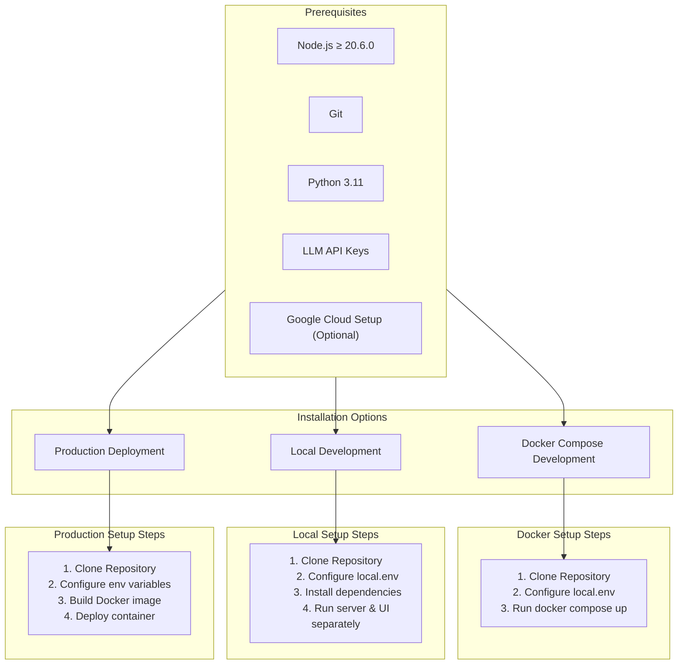
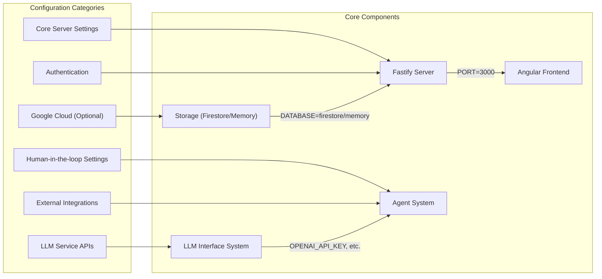
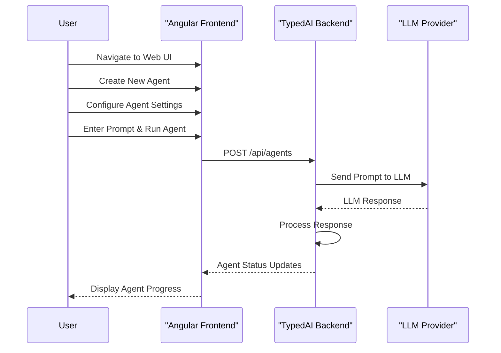

<!-- source: DeepWiki mcp.deepwiki.com · repo TrafficGuard/typedai · page 2 Getting Started · fetched 2026-10-26 -->

# Getting Started

<details>
<summary>Relevant source files</summary>

The following files were used as context for generating this wiki page:

- [Dockerfile](Dockerfile)
- [Dockerfile.dev](Dockerfile.dev)
- [README.md](README.md)
- [bin/aider](bin/aider)
- [docker-compose.yml](docker-compose.yml)
- [docs/docs/autonomous-agents.md](docs/docs/autonomous-agents.md)
- [docs/docs/environment-variables.md](docs/docs/environment-variables.md)
- [docs/docs/examples.md](docs/docs/examples.md)
- [docs/docs/index.md](docs/docs/index.md)
- [docs/docs/roadmap.md](docs/docs/roadmap.md)
- [docs/docs/setup.md](docs/docs/setup.md)
- [docs/docs/software-engineer.md](docs/docs/software-engineer.md)
- [docs/mkdocs.yml](docs/mkdocs.yml)
- [frontend/package-lock.json](frontend/package-lock.json)
- [frontend/package.json](frontend/package.json)
- [package-lock.json](package-lock.json)
- [package.json](package.json)
- [src/initTiktokenizer.ts](src/initTiktokenizer.ts)
- [src/modules/firestore/firestoreLlmCallService.ts](src/modules/firestore/firestoreLlmCallService.ts)
- [variables/local.env.example](variables/local.env.example)

</details>


This page provides a comprehensive guide to setting up and running the TypedAI platform. It covers installation options, configuration requirements, and running your first agent. For more in-depth information about agents and their capabilities, see [Agent System](#3).

## Overview

TypedAI is a platform for developing and running autonomous AI agents, LLM-based workflows, and chatbots. Before diving into its extensive capabilities, you'll need to set up the environment and understand the basic system components.

### System Requirements

- Node.js ≥ 20.6.0
- Git (for repository management)
- Python 3.11 (for aider-chat and other Python dependencies)
- Internet access (for API calls to LLM providers)

Sources: [package.json:7-9](), [Dockerfile:2-14]()

## Installation Options

There are three primary ways to set up TypedAI:



Sources: [README.md:72-79](), [Dockerfile:1-48](), [Dockerfile.dev:1-50](), [docker-compose.yml:1-21]()

### Docker Compose (Recommended for Development)

This option provides a complete environment with both backend and frontend components:

1. Clone the repository:
   ```bash
   git clone https://github.com/TrafficGuard/typedai.git
   cd typedai
   ```

2. Create your configuration file:
   ```bash
   cd variables
   cp local.env.example local.env
   ```

3. Edit `local.env` to add your configuration (see Configuration section below)

4. Start the development container:
   ```bash
   docker compose up --build
   ```

Sources: [docker-compose.yml:1-21](), [docs/docs/setup.md:1-9](), [docs/docs/setup.md:72-76]()

### Local Development Setup

For development directly on your host machine:

1. Clone the repository:
   ```bash
   git clone https://github.com/TrafficGuard/typedai.git
   cd typedai
   ```

2. Configure your environment:
   ```bash
   cd variables
   cp local.env.example local.env
   ```

3. Run the configuration script:
   ```bash
   source ./bin/configure
   ```

4. Start the server:
   ```bash
   npm run start:local
   ```

5. In a separate terminal, start the UI:
   ```bash
   cd frontend
   npm run start:local
   ```

The UI will be available at http://localhost:4200

Sources: [docs/docs/setup.md:79-105](), [package.json:10-49](), [frontend/package.json:8-23]()

### Production Deployment

TypedAI provides a production Dockerfile for deployment:

1. Configure environment variables according to your deployment environment
2. Build the Docker image:
   ```bash
   docker build -t typedai .
   ```
3. Run the container:
   ```bash
   docker run -p 8080:8080 -e NODE_ENV=production typedai
   ```

Sources: [Dockerfile:1-48]()

## Configuration

TypedAI uses environment variables for configuration. These can be set in the `variables/local.env` file or directly as environment variables.

### Essential Configuration



Sources: [variables/local.env.example:1-67](), [docs/docs/environment-variables.md:1-198]()

Here are the minimum required settings to get started:

| Setting | Description | Default |
|---------|-------------|---------|
| `DATABASE` | Storage type (`firestore` or `memory`) | `firestore` |
| `AUTH` | Authentication mode | `single_user` |
| `SINGLE_USER_EMAIL` | User email for single-user mode | (required) |
| At least one LLM API key | e.g., `OPENAI_API_KEY`, `ANTHROPIC_API_KEY` | (required) |

For a quick start without Google Cloud:
- Set `DATABASE=memory` 
- Set `TRACE_AGENT_ENABLED=false`

Sources: [variables/local.env.example:1-67](), [docs/docs/setup.md:61-66]()

### LLM API Keys

TypedAI supports multiple LLM providers. Configure at least one of these in your environment:

| Provider | Environment Variable | Link to obtain key |
|----------|---------------------|-------------------|
| Anthropic | `ANTHROPIC_API_KEY` | https://console.anthropic.com/settings/keys |
| OpenAI | `OPENAI_API_KEY` | https://platform.openai.com/api-keys |
| Groq | `GROQ_API_KEY` | https://console.groq.com/keys |
| Together.ai | `TOGETHERAI_API_KEY` | https://api.together.ai/settings/api-keys |
| Fireworks | `FIREWORKS_API_KEY` | https://fireworks.ai/api-keys |
| DeepSeek | `DEEPSEEK_API_KEY` | https://platform.deepseek.com/api_keys |

Sources: [variables/local.env.example:30-41](), [docs/docs/setup.md:21-31]()

### Google Cloud Configuration (Recommended)

For persistent storage and additional features:

1. Install the [gcloud](https://cloud.google.com/sdk/docs/install) command line tool
2. Create a Google Cloud project
3. Update `GCLOUD_PROJECT` and `GCLOUD_REGION` variables in your `local.env`
4. Run the setup script:
   ```bash
   ./bin/gcp_setup
   ```
5. Authenticate with Google Cloud:
   ```bash
   gcloud auth application-default login
   ```

Sources: [docs/docs/setup.md:38-52](), [variables/local.env.example:11-16]()

## Running Your First Agent

TypedAI offers multiple ways to run agents: through the CLI, the web UI, or programmatically.

### Using the CLI

The TypedAI CLI provides various commands for running different types of agents:

```bash
# Run a generic agent
npm run agent -- --name "My First Agent" --prompt "Research the latest AI trends and summarize them"

# Run a software engineering agent
npm run swe -- --name "Feature Implementation" --prompt "Add a search feature to a React application"

# Run a Python agent
npm run py -- --name "Data Analysis" --prompt "Analyze this CSV file and create visualizations"
```

Sources: [package.json:13-31]()

### Using the Web UI

Once you have the system running:

1. Navigate to http://localhost:4200 (or your configured UI URL)
2. Login with your configured credentials
3. Click "New Agent" to create an agent
4. Choose the agent type, configure functions, and enter your prompt
5. Click "Run Agent" to start the agent



Sources: [README.md:83-94](), [docs/docs/index.md:50-56]()

## Human-in-the-Loop Controls

TypedAI incorporates human-in-the-loop controls to manage agent behavior:

| Setting | Description | Default |
|---------|-------------|---------|
| `HIL_BUDGET` | Budget threshold in USD | 1.0 |
| `HIL_COUNT` | Maximum iterations before human intervention | 5 |

When an agent reaches these thresholds or encounters an error, it will pause and request human feedback before continuing.

Sources: [variables/local.env.example:25-28](), [docs/docs/autonomous-agents.md:44-60]()

## Next Steps

After setting up TypedAI and running your first agent, explore these topics:

- [Agent System](#3) - Learn about different agent types and their capabilities
- [LLM Integration](#4) - Understand how TypedAI interfaces with various LLM providers
- [Software Engineering Tools](#5) - Explore the code editing and source control capabilities
- [CLI Interface](#7) - Discover all the CLI commands and options
- [Web UI](#8) - Learn about the web interface features

Sources: [README.md:17-37]()

---

