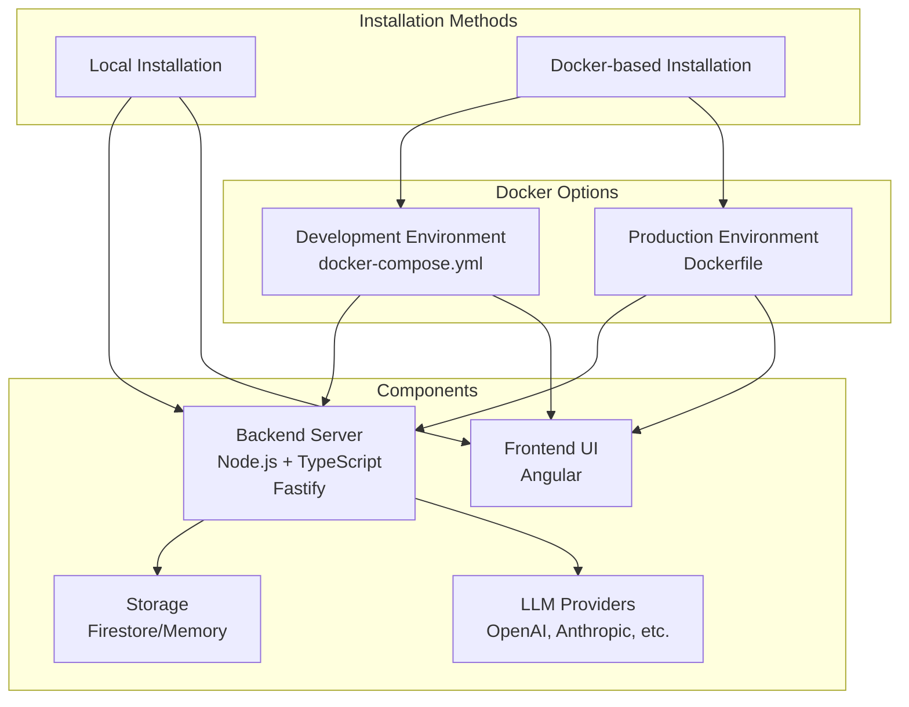
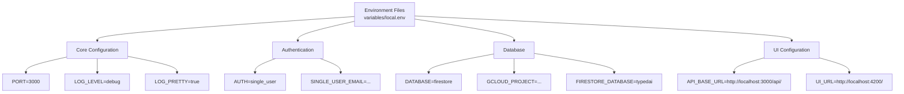
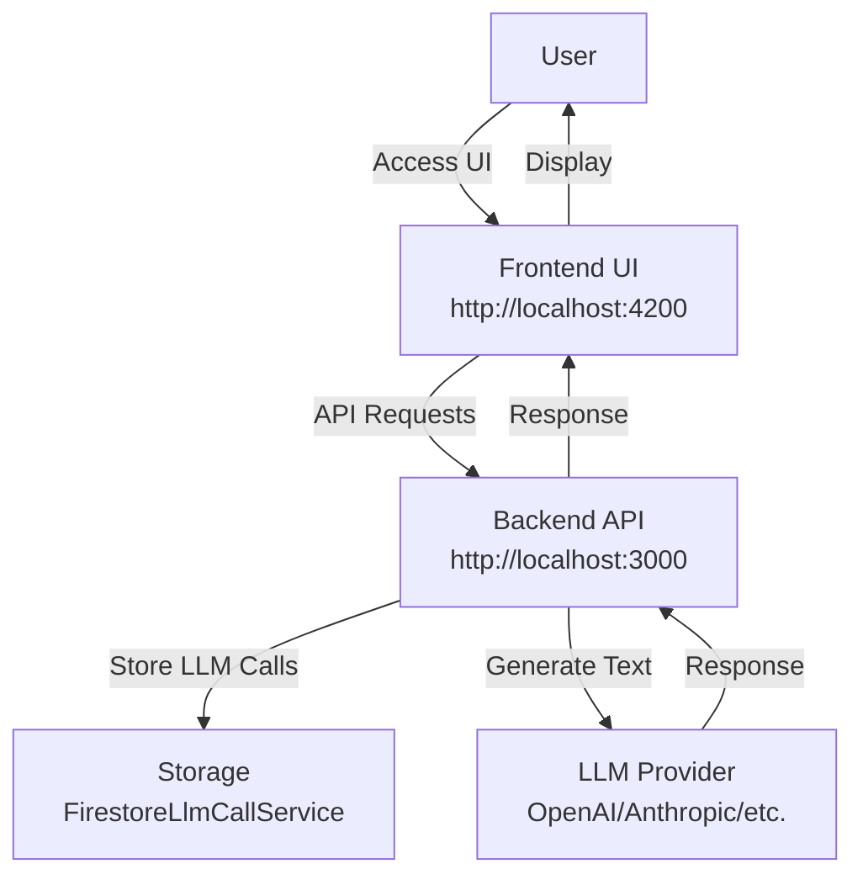

<!-- source: DeepWiki mcp.deepwiki.com · repo TrafficGuard/typedai · page 2.1 Installation & Setup · fetched 2026-10-26 -->

# Installation & Setup

<details>
<summary>Relevant source files</summary>

The following files were used as context for generating this wiki page:

- [Dockerfile](Dockerfile)
- [Dockerfile.dev](Dockerfile.dev)
- [bin/aider](bin/aider)
- [docker-compose.yml](docker-compose.yml)
- [docs/docs/environment-variables.md](docs/docs/environment-variables.md)
- [frontend/package-lock.json](frontend/package-lock.json)
- [frontend/package.json](frontend/package.json)
- [frontend/scripts/env.js](frontend/scripts/env.js)
- [frontend/src/app/mock-api/common/navigation/data.ts](frontend/src/app/mock-api/common/navigation/data.ts)
- [frontend/src/app/modules/chat/conversation/clipboard-button.component.ts](frontend/src/app/modules/chat/conversation/clipboard-button.component.ts)
- [frontend/src/app/modules/chat/conversation/conversation.component.html](frontend/src/app/modules/chat/conversation/conversation.component.html)
- [frontend/src/environments/environment.prod.ts](frontend/src/environments/environment.prod.ts)
- [frontend/src/environments/environment.ts](frontend/src/environments/environment.ts)
- [package-lock.json](package-lock.json)
- [package.json](package.json)
- [src/initTiktokenizer.ts](src/initTiktokenizer.ts)
- [src/modules/firestore/firestoreLlmCallService.ts](src/modules/firestore/firestoreLlmCallService.ts)
- [variables/local.env.example](variables/local.env.example)

</details>


This guide provides detailed instructions for installing and configuring the TypedAI platform. It covers system requirements, installation options, environment configuration, and initial startup procedures. For information about using the platform after installation, see [Getting Started](#2).

## System Requirements

TypedAI requires the following minimum system requirements:

- **Node.js**: Version 20.6.0 or higher
- **Python**: Version 3.11 (for aider-chat integration)
- **Operating System**: Linux, macOS, or Windows (via Docker)
- **Recommended Hardware**:
  - 4GB RAM minimum, 8GB+ recommended
  - 10GB free disk space
  - Modern multi-core CPU

Sources: [package.json:7-9](), [Dockerfile:2]()

## Installation Options

TypedAI offers two primary installation methods:

1. **Local Installation**: Direct installation on your system
2. **Docker-based Installation**: Containerized setup for development or production

### Installation Architecture



Sources: [Dockerfile](), [Dockerfile.dev](), [docker-compose.yml]()

### Local Installation

Follow these steps to install TypedAI locally:

1. **Clone the repository**:
   ```bash
   git clone https://github.com/TrafficGuard/typedai.git
   cd typedai
   ```

2. **Install dependencies**:
   ```bash
   npm ci
   ```

3. **Initialize the tokenizer model**:
   ```bash
   npm run initTiktokenizer
   ```

4. **Generate function schemas**:
   ```bash
   npm run functionSchemas
   ```

5. **Configure environment variables**:
   ```bash
   cp variables/local.env.example variables/local.env
   # Edit variables/local.env with your preferred editor
   ```

6. **Install frontend dependencies**:
   ```bash
   cd frontend
   npm ci
   cd ..
   ```

Sources: [package.json:11-49](), [src/initTiktokenizer.ts]()

### Docker-based Installation

#### Development Environment

The development environment uses Docker Compose for easy setup:

1. **Clone the repository**:
   ```bash
   git clone https://github.com/TrafficGuard/typedai.git
   cd typedai
   ```

2. **Configure environment variables**:
   ```bash
   cp variables/local.env.example variables/local.env
   # Edit variables/local.env with your preferred editor
   ```

3. **Start the Docker Compose environment**:
   ```bash
   docker compose up --build
   ```

This will create a container named `typedai-dev` with the application running in development mode.

Sources: [docker-compose.yml](), [Dockerfile.dev]()

#### Production Environment

For production deployment:

1. **Build the Docker image**:
   ```bash
   docker build -t typedai:latest .
   ```

2. **Run the container with environment variables**:
   ```bash
   docker run -p 8080:8080 --env-file ./variables/prod.env typedai:latest
   ```

Sources: [Dockerfile]()

## Environment Configuration

TypedAI requires configuration through environment variables. These can be set in a `.env` file or provided directly to the application.

### Core Configuration



Essential environment variables:

| Variable | Description | Default | Required |
|----------|-------------|---------|----------|
| `PORT` | Backend server port | `3000` | No |
| `DATABASE` | Storage backend type | `firestore` | No |
| `AUTH` | Authentication method | `single_user` | No |
| `SINGLE_USER_EMAIL` | Email for single-user mode | - | Yes (if AUTH=single_user) |
| `API_BASE_URL` | Backend API URL | `http://localhost:3000/api/` | Yes |
| `UI_URL` | Frontend URL | `http://localhost:4200/` | Yes |
| `GCLOUD_PROJECT` | Google Cloud project ID | - | Yes (if DATABASE=firestore) |
| `FIRESTORE_DATABASE` | Firestore database name | `typedai` | No |

Sources: [variables/local.env.example:1-23]()

### LLM Provider Configuration

Configure at least one LLM provider API key to use the platform. TypedAI supports multiple LLM providers:

| Provider | Environment Variable | Required |
|----------|-------------|----------|
| Anthropic | `ANTHROPIC_API_KEY` | No |
| OpenAI | `OPENAI_API_KEY` | No |
| Groq | `GROQ_API_KEY` | No |
| Together AI | `TOGETHERAI_API_KEY` | No |
| Fireworks | `FIREWORKS_API_KEY` | No |
| DeepSeek | `DEEPSEEK_API_KEY` | No |
| Cerebras | `CEREBRAS_API_KEY` | No |
| Deep Infra | `DEEPINFRA_API_KEY` | No |
| Nebius | `NEBIUS_API_KEY` | No |
| SambaNova | `SAMBANOVA_API_KEY` | No |

At least one provider API key must be configured for the system to function properly.

Sources: [variables/local.env.example:30-42](), [package.json:54-91]()

### Integration Configuration

TypedAI can integrate with various external services:

#### Source Control Management

| Integration | Environment Variables | Description |
|-------------|----------------------|-------------|
| GitLab | `GITLAB_TOKEN`, `GITLAB_HOST`, `GITLAB_GROUPS` | GitLab integration for repository access |
| GitHub | `GITHUB_TOKEN`, `GITHUB_ORG`, `GITHUB_USER` | GitHub integration for repository access |

#### Project Management

| Integration | Environment Variables | Description |
|-------------|----------------------|-------------|
| Jira | `JIRA_BASE_URL`, `JIRA_EMAIL`, `JIRA_API_TOKEN` | Jira integration for issue tracking |

#### Web Search and Research

| Integration | Environment Variables | Description |
|-------------|----------------------|-------------|
| Perplexity | `PERPLEXITY_KEY` | Perplexity AI search integration |
| Google Search | `GOOGLE_CUSTOM_SEARCH_ENGINE_ID`, `GOOGLE_CUSTOM_SEARCH_KEY` | Google Custom Search integration |
| SERP API | `SERP_API_KEY` | SERP API for search results |

Sources: [variables/local.env.example:44-66]()

## Frontend Configuration

The Angular frontend requires environment configuration:

1. **Environment Variables**: The frontend reads environment variables from the same `.env` file used by the backend. The script `frontend/scripts/env.js` generates the appropriate environment configuration.

2. **Starting the Frontend**:
   - Local development: `cd frontend && npm run start:local`
   - Inside Docker: The frontend is automatically started at port 4200

The frontend environment configuration includes:

| Variable | Source Environment Variable | Description |
|----------|----------------------------|-------------|
| `apiBaseUrl` | `API_BASE_URL` | Backend API URL |
| `gcpProject` | `GCLOUD_PROJECT` | Google Cloud project ID |
| `firestoreDb` | `FIRESTORE_DATABASE` | Firestore database name |
| `auth` | `AUTH` | Authentication method |
| `modules` | `MODULES` | Enabled UI modules |

The frontend supports configuring which modules are displayed in the UI via the `MODULES` environment variable. Available modules include:

- `chat` - Chat interface
- `agents` - Agent management 
- `workflows` - Workflow management
- `codeReview` - Code review functionality

Sources: [frontend/scripts/env.js](), [frontend/src/environments/environment.ts](), [frontend/src/environments/environment.prod.ts](), [frontend/src/app/mock-api/common/navigation/data.ts:54-63]()

## Starting the System

### Development Mode

To start the TypedAI platform in development mode:

1. **Backend**:
   ```bash
   npm run start:local
   ```

2. **Frontend** (in a separate terminal):
   ```bash
   cd frontend
   npm run start:local
   ```

The backend will be available at http://localhost:3000 and the frontend at http://localhost:4200.

### Docker Development Mode

```bash
docker compose up
```

Both frontend and backend will be accessible from the host machine (frontend on port 4200, backend on port 3000).

### Production Mode

```bash
npm run build
npm run start
```

Or using Docker:

```bash
docker run -p 8080:8080 --env-file ./variables/prod.env typedai:latest
```

In production mode, the server serves both the API and the static frontend files on the same port (default: 8080).

Sources: [package.json:32-38](), [frontend/package.json:8-23](), [Dockerfile:45-48]()

## Verification

After installation, verify the system is working correctly:

1. **Backend Health Check**: Navigate to http://localhost:3000/health (or the configured port) to verify the backend is running.

2. **Frontend Access**: Open http://localhost:4200 in your browser and verify the login page appears.

3. **LLM Connection Test**: Create a simple chat conversation to test connectivity to the configured LLM providers.

4. **Storage Verification**: If using Firestore, check that data is being properly saved by examining LLM calls in the Firestore database.



Sources: [src/modules/firestore/firestoreLlmCallService.ts](), [frontend/src/app/modules/chat/conversation/conversation.component.html]()

## Troubleshooting

### Common Issues

1. **Node.js Version**: Ensure you're using Node.js 20.6.0 or higher.
   ```bash
   node --version
   ```

2. **Environment Variables**: Check that all required environment variables are properly set.

3. **API Keys**: Verify that at least one LLM provider API key is correctly configured.

4. **Firestore Access**: If using Firestore, ensure the service account has proper permissions and the project ID is correct.

5. **Port Conflicts**: If ports 3000 or 4200 are already in use, modify the `PORT` environment variable and Angular configuration.

### Docker Issues

1. **Container Access**: For development with Docker, ensure ports 3000 and 4200 are not blocked by firewalls.

2. **Volume Mounting**: Verify that the Docker volumes are correctly mounted.

3. **Node Modules**: In some cases, you may need to rebuild node modules by removing the volume mounts for node_modules:
   ```bash
   docker compose down
   docker compose up --build
   ```

### Logs and Debugging

- Check the application logs for any errors
- Set `LOG_LEVEL=debug` and `LOG_PRETTY=true` for more detailed logging
- For tracing, set `TRACE_AGENT_ENABLED=true` to enable OpenTelemetry tracing

Sources: [variables/local.env.example:1-23](), [Dockerfile:45-48](), [Dockerfile.dev:47-49]()

---

