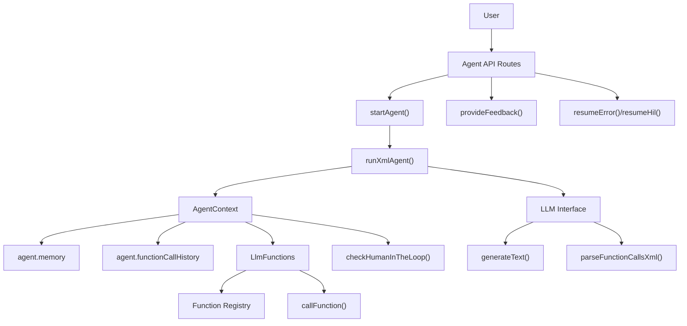
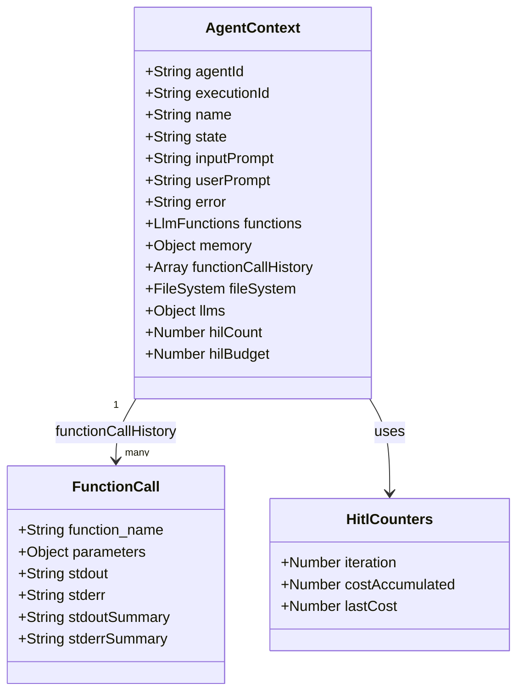
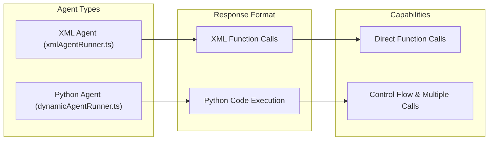
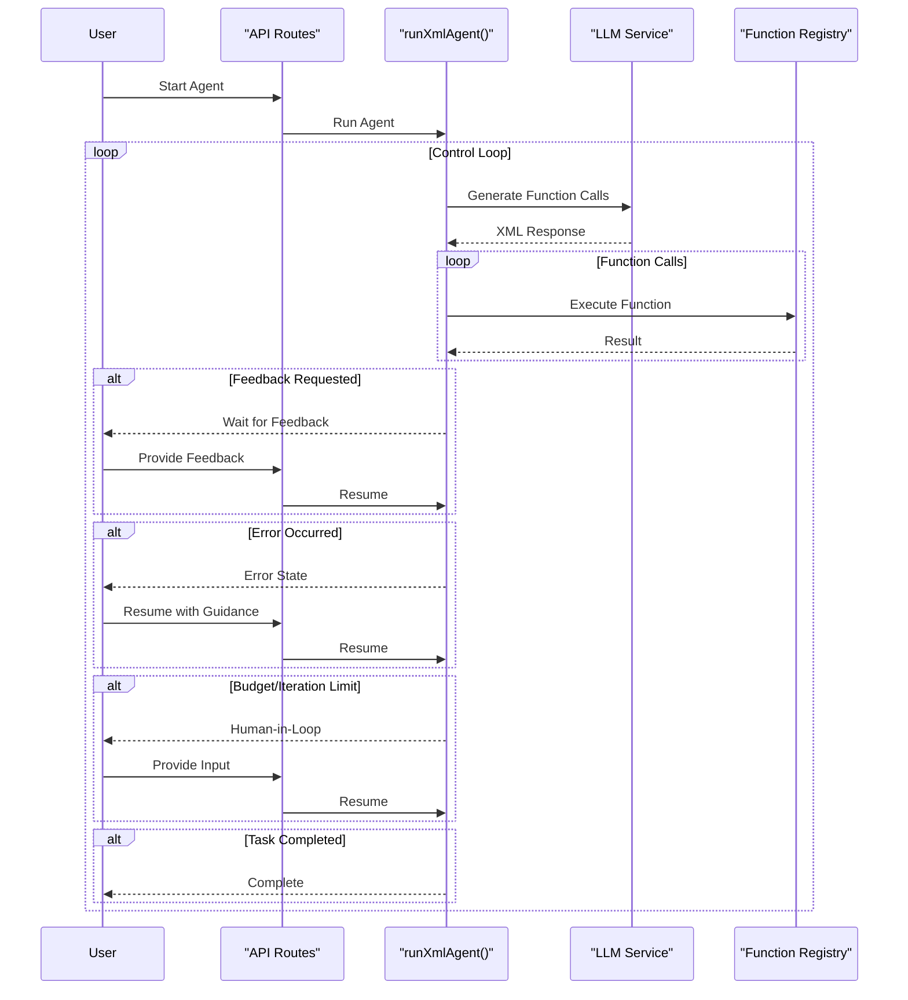

<!-- source: DeepWiki mcp.deepwiki.com · repo TrafficGuard/typedai · page 3 Agent System · fetched 2026-10-26 -->

# Agent System

<details>
<summary>Relevant source files</summary>

The following files were used as context for generating this wiki page:

- [README.md](README.md)
- [docs/docs/autonomous-agents.md](docs/docs/autonomous-agents.md)
- [docs/docs/examples.md](docs/docs/examples.md)
- [docs/docs/index.md](docs/docs/index.md)
- [docs/docs/roadmap.md](docs/docs/roadmap.md)
- [docs/docs/setup.md](docs/docs/setup.md)
- [docs/docs/software-engineer.md](docs/docs/software-engineer.md)
- [docs/mkdocs.yml](docs/mkdocs.yml)
- [src/agent/agentContext.test.ts](src/agent/agentContext.test.ts)
- [src/agent/agentFunctions.ts](src/agent/agentFunctions.ts)
- [src/agent/xmlAgentRunner.ts](src/agent/xmlAgentRunner.ts)
- [src/routes/agent/agent-execution-routes.ts](src/routes/agent/agent-execution-routes.ts)

</details>


The Agent System is the core infrastructure that powers TypedAI's autonomous AI agents. This page explains the architecture, execution model, and key components that allow agents to plan, execute functions, and maintain state. For information about specific agent implementations like human-in-the-loop mechanisms, see [Agent Context & Memory](#3.1) and [Agent Types](#3.2).

## Architecture Overview

The Agent System provides a framework for different types of agents to operate with consistent state management, memory persistence, and function execution patterns. It follows a control loop architecture where agents repeatedly plan actions, execute functions, and evaluate results until completing their tasks or requiring human intervention.

**Agent System Architecture**


Sources: [src/agent/xmlAgentRunner.ts](), [README.md:39-48]()

## Agent Context

At the foundation of the Agent System is the `AgentContext` interface, which maintains all state and information needed for an agent's execution:

**Agent Context Structure**


Key components of the agent context:

- **Identity**: `agentId`, `executionId`, and `name` uniquely identify each agent instance
- **State**: The `state` field tracks execution status (agent, functions, completed, error, feedback, hil)
- **Prompts**: `inputPrompt` and `userPrompt` contain the current and initial instructions
- **Functions**: `functions` (LlmFunctions instance) manages callable functions
- **Memory**: `memory` provides persistent storage across execution cycles
- **History**: `functionCallHistory` records all function calls and results
- **FileSystem**: File operations interface with configurable working directory
- **LLMs**: Different LLM interfaces for varying task complexity levels
- **HIL Settings**: `hilCount` and `hilBudget` control when human intervention is required

The agent context is serializable for persistence across executions using `serializeContext()` and `deserializeAgentContext()` functions.

Sources: [src/agent/agentContext.test.ts](), [src/agent/agentContextTypes.ts]()

## Agent Types

TypedAI supports multiple agent implementations with different execution models and capabilities:

**Agent Types Comparison**


### XML Agent

The XML Agent (`runXmlAgent()`) uses an XML-based format for function calling:
- Implemented in [src/agent/xmlAgentRunner.ts]()
- Generates function calls in XML format using the format defined in [src/agent/xml-agent-system-prompt]()
- Executes functions sequentially with no conditional logic between calls
- Uses `parseFunctionCallsXml()` to extract function calls from LLM responses
- Works with a wide range of LLMs as it requires only basic text generation

### Python/Dynamic Agent

The Dynamic Agent uses executable Python code for more complex logic:
- Generates Python code that is executed in a sandboxed environment
- Allows conditional logic, loops, and multiple interdependent function calls
- More efficient for complex tasks requiring programmatic control flow
- Generally requires more capable LLMs to generate correct Python code

Sources: [docs/docs/autonomous-agents.md:10-26](), [src/agent/xmlAgentRunner.ts]()

## Execution Flow

The agent execution follows a control loop pattern, where the agent iteratively generates and executes function calls until the task is completed or intervention is needed:

**Agent Execution Flow**


Key steps in the execution flow:

1. **Initialization**: Agent context is created with initial state, functions, and LLM instances
2. **Control Loop Entry**: The agent enters its main execution loop
3. **Prompt Construction**: The system builds prompts incorporating memory, function history, and current state
4. **Function Generation**: The LLM generates function calls based on the context
5. **Function Execution**: Each function is executed and results are captured
6. **State Updates**: Function results are added to history and state is updated
7. **Condition Checks**: 
   - If `Agent_completed` is called, the agent completes successfully
   - If `AgentFeedback_requestFeedback` is called, the agent pauses for user input
   - If a function error occurs, the agent may retry or enter error state
   - If budget/iteration limits are reached, human-in-the-loop is triggered
8. **Loop Continuation**: If no terminal conditions are met, the loop continues

Sources: [src/agent/xmlAgentRunner.ts:60-227](), [docs/docs/autonomous-agents.md:10-26]()

## Function Calling System

Agents interact with the system and external resources through a function registry:

### Function Registration

Functions are registered with the agent through the `LlmFunctions` class:

```typescript
// Adding functions to an agent
agent.functions = new LlmFunctions(FileSystem, Perplexity, CodeEditingAgent);
```

Functions are implemented as TypeScript classes with methods decorated using the `@func` decorator:

```typescript
@funcClass(__filename)
export class Agent {
    @func()
    async completed(note: string): Promise<void> {
        await this.saveMemory('Agent_competed_note', note);
    }
}
```

### Built-in Functions

Every agent has access to these built-in functions:

| Function | Purpose |
|----------|---------|
| `Agent_completed` | Signal task completion with final results |
| `Agent_saveMemory` | Store data in the agent's memory |
| `Agent_deleteMemory` | Remove items from memory |
| `Agent_getMemory` | Retrieve previously stored memory items |
| `AgentFeedback_requestFeedback` | Request human input during execution |

### Function Execution

When a function is called:
1. The agent finds the function in its registry
2. Parameters are validated and passed to the function
3. Results are captured (stdout) or errors are logged (stderr)
4. Function call is added to history for context in future iterations
5. For long outputs, a summary is generated to keep context manageable

Sources: [src/agent/agentFunctions.ts](), [src/agent/xmlAgentRunner.ts:150-196]()

## Memory Management

Agents have persistent memory that allows them to store and retrieve information across execution cycles:

```typescript
// Memory usage example
// Agent storing a search result
await agent.saveMemory("search_result", "Python was created by Guido van Rossum");

// Agent retrieving the stored information later
const result = await agent.getMemory("search_result");
```

The memory system provides:
- Persistent key-value storage across execution cycles
- Ability to accumulate information during complex tasks
- Context maintenance when generating new function calls
- State preservation when agents are paused and resumed

Memory is included in the agent prompt as part of the context, allowing the LLM to reference previously stored information when deciding on the next actions.

Sources: [src/agent/agentFunctions.ts:16-67](), [src/agent/agentPromptUtils.ts]()

## Human-in-the-Loop

The Human-in-the-Loop (HIL) system allows for user intervention during agent execution:

```typescript
// HIL counters structure
let hitlCounters: HitlCounters = { 
    iteration: 0, 
    costAccumulated: 0, 
    lastCost: 0 
};
```

HIL is triggered in several scenarios:
- **Budget Limits**: When the accumulated cost exceeds `hilBudget`
- **Iteration Limits**: After `hilCount` iterations of the control loop
- **Feedback Requests**: When the agent explicitly calls `AgentFeedback_requestFeedback`
- **Function Errors**: When multiple function calls return errors

When HIL is triggered, the agent:
1. Sets its state to `feedback`, `error`, or `hil`
2. Saves its current context
3. Awaits user input through the API
4. Resumes execution with the provided feedback

Sources: [src/agent/xmlAgentRunner.ts:45-54](), [src/agent/xmlAgentRunner.ts:80](), [docs/docs/autonomous-agents.md:44-62]()

## Agent API Integration

The Agent System exposes several API endpoints for controlling agents:

| API Endpoint | Function | Purpose |
|--------------|----------|---------|
| `/api/agent/v1/force-stop` | `forceStopAgent` | Immediately terminate an agent |
| `/api/agent/v1/feedback` | `provideFeedback` | Provide feedback to a waiting agent |
| `/api/agent/v1/resume-error` | `resumeError` | Resume an agent that encountered an error |
| `/api/agent/v1/resume-hil` | `resumeHil` | Resume after human-in-the-loop intervention |
| `/api/agent/v1/resume-completed` | `resumeCompleted` | Continue a completed agent with new instructions |
| `/api/agent/v1/cancel` | `cancelAgent` | Gracefully cancel an agent execution |
| `/api/agent/v1/update-functions` | Custom handler | Update the functions available to an agent |

These APIs enable seamless integration with:
- The TypedAI web interface
- CLI tools for agent management
- External systems through HTTP requests
- Notification systems (e.g., Slack) for HIL events

Sources: [src/routes/agent/agent-execution-routes.ts]()

## Agent Persistence

Agents maintain persistent state between executions through a serialization mechanism:

1. The `AgentStateService` handles saving and loading agents from storage
2. `serializeContext()` converts an agent context to a serializable object
3. `deserializeAgentContext()` reconstructs an agent from a serialized state
4. State is stored in Firestore or in-memory depending on configuration

The persistence system enables:
- Resuming agents after system restarts
- Human-in-the-loop interactions across sessions
- Async workflows where agents can be paused and resumed later
- Multi-user environments where different users can interact with agents

Sources: [src/agent/agentContext.test.ts:40-67](), [src/routes/agent/agent-execution-routes.ts]()

## Practical Applications

The Agent System powers various capabilities in TypedAI:

1. **Autonomous Research Agents**: Investigate topics using web search and process findings
2. **Software Engineering Agents**: Modify code, create implementations, and generate PRs
3. **Code Review Agents**: Analyze code changes and provide feedback
4. **Workflow Automation**: Execute complex multi-step processes with decision points
5. **Interactive Assistants**: Chat and perform actions based on user instructions

The flexibility of the agent system allows for new agent types to be developed by composing different function sets and specialized prompts.

Sources: [README.md:19-48](), [docs/docs/software-engineer.md]()

---

