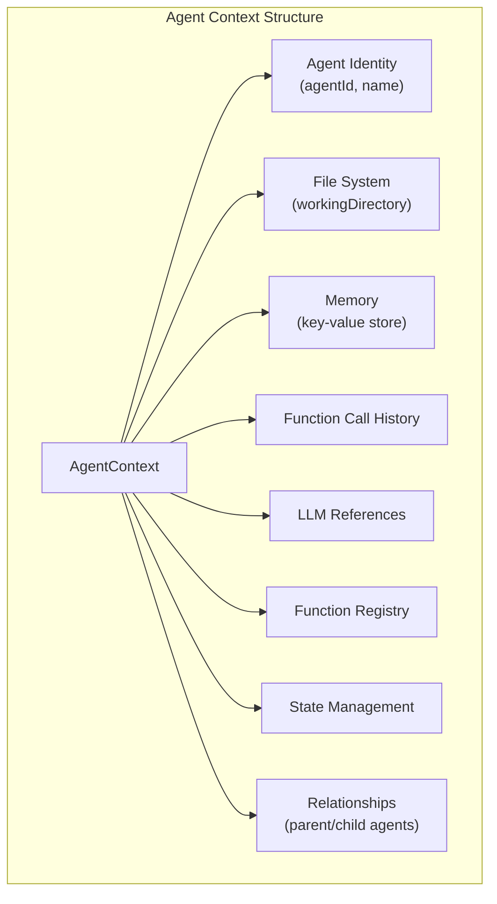
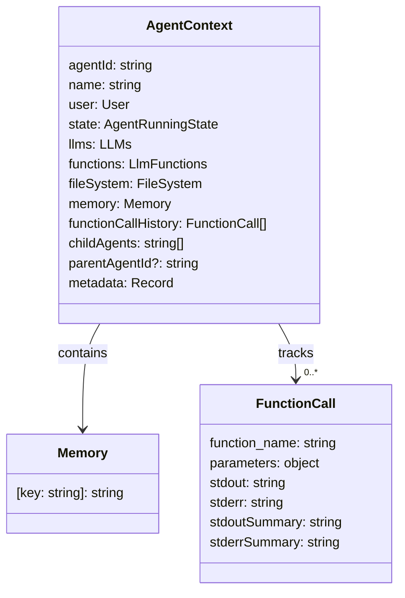
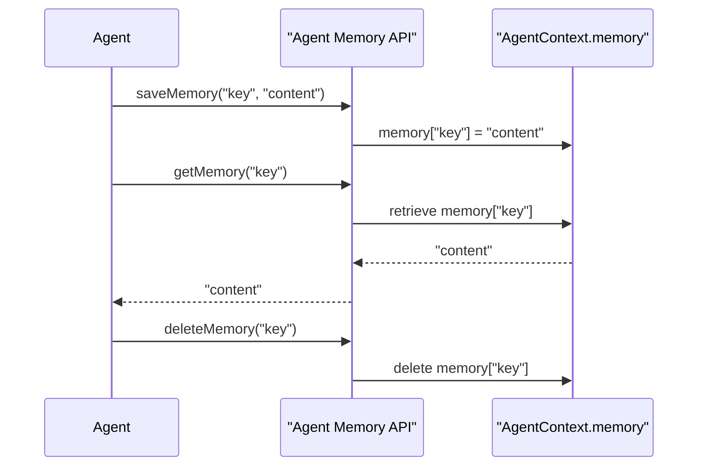
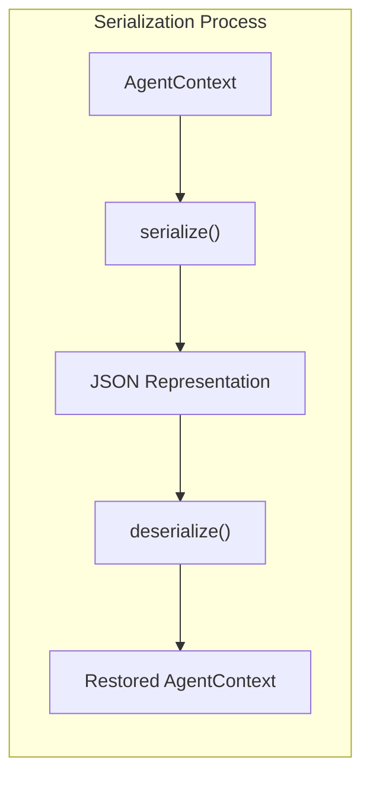
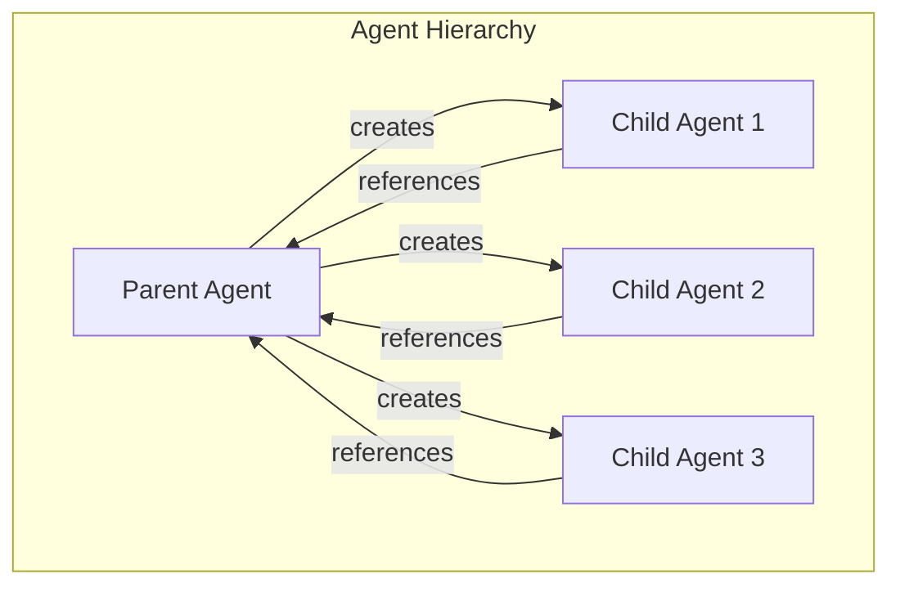
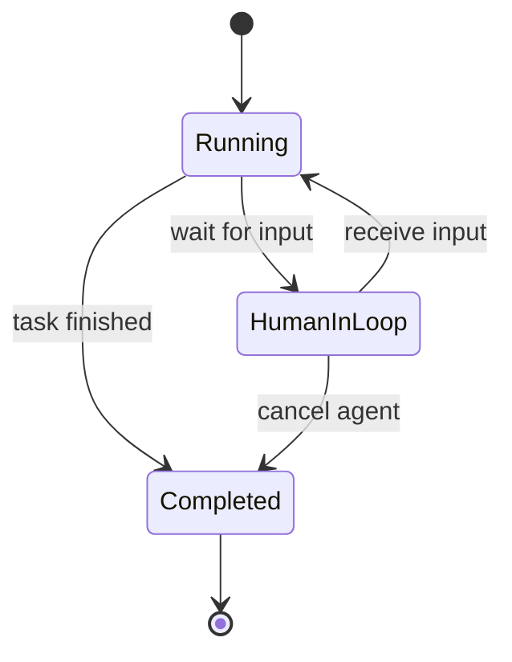

<!-- source: DeepWiki mcp.deepwiki.com · repo TrafficGuard/typedai · page 3.1 Agent Context & Memory · fetched 2026-10-26 -->

# Agent Context & Memory

<details>
<summary>Relevant source files</summary>

The following files were used as context for generating this wiki page:

- [src/agent/agentContext.test.ts](src/agent/agentContext.test.ts)
- [src/agent/agentFunctions.ts](src/agent/agentFunctions.ts)
- [src/agent/agentStateService/agentStateService.int.ts](src/agent/agentStateService/agentStateService.int.ts)
- [src/agent/agentStateService/agentStateService.ts](src/agent/agentStateService/agentStateService.ts)
- [src/routes/agent/agent-details-routes.ts](src/routes/agent/agent-details-routes.ts)

</details>


This document explains the agent context and memory systems in TypedAI, which provide state management and persistence for autonomous agents. The agent context serves as the comprehensive execution environment for agents, while the memory system offers a structured way for agents to store and retrieve information during their operation.

For information on different agent implementations, see [Agent Types](#3.2).

## Overview

The Agent Context & Memory system serves as the foundation for agent state management in TypedAI. It provides:

1. A comprehensive execution environment for agents
2. Persistent memory for storing and retrieving information
3. Function execution history tracking
4. Serialization for persistence and recovery
5. Parent-child agent relationship management



Sources: [src/agent/agentContext.test.ts:15-66](), [src/agent/agentStateService/agentStateService.ts:1-22]()

## Agent Context Structure

The `AgentContext` object serves as the execution environment and state container for each agent. It encapsulates all the information required for an agent to perform its tasks, including:



Sources: [src/agent/agentContext.test.ts:39-52](), [src/agent/agentStateService/agentStateService.int.ts:23-37]()

### Key Components

1. **Identity** - Unique identifiers including `agentId` and `name`
2. **State** - Current execution state (running, completed, human-in-loop)
3. **Resources** - Access to LLMs and available functions
4. **File System** - Virtual file system with working directory
5. **Memory** - Key-value store for retaining information
6. **Function Call History** - Record of executed functions and their results
7. **Relationships** - References to parent or child agents
8. **Metadata** - Additional contextual information

## Agent Memory System

The memory system provides agents with the ability to store and retrieve information through a simple key-value store. This allows agents to maintain state across interactions and build context throughout their execution.



Sources: [src/agent/agentFunctions.ts:16-67]()

### Memory Operations

The `Agent` class provides the following methods for memory management:

| Method | Description | Parameters |
|--------|-------------|------------|
| `saveMemory` | Stores content in memory | `key`: Identifier, `content`: Data to store |
| `getMemory` | Retrieves content from memory | `key`: Identifier of data to retrieve |
| `deleteMemory` | Removes content from memory | `key`: Identifier of data to remove |
| `completed` | Marks agent as complete with final note | `note`: Final agent output |

Example usage:
```typescript
// Store information
await agent.saveMemory("research_results", "The analysis indicates...");

// Retrieve information
const results = await agent.getMemory("research_results");

// Remove information
await agent.deleteMemory("outdated_data");
```

Sources: [src/agent/agentFunctions.ts:22-66]()

## Serialization and Persistence

The AgentContext can be serialized for storage and deserialized when needed, enabling persistence across sessions and recovery from failures.



Sources: [src/agent/agentContext.test.ts:20-67]()

The serialization process:
1. Converts the agent context to a JSON-compatible format
2. Preserves all key properties (memory, functions, LLMs, etc.)
3. Handles function references appropriately
4. Allows reconstruction of the original context

When deserializing:
1. The function registry is used to reattach function implementations
2. LLM providers are reconnected
3. State is fully restored to continue execution

Sources: [src/agent/agentContext.test.ts:53-66]()

## Agent State Service

The `AgentStateService` interface provides methods for persisting and retrieving agent contexts:

| Method | Purpose |
|--------|---------|
| `save` | Persists an agent context |
| `updateState` | Updates an agent's running state |
| `load` | Retrieves an agent context by ID |
| `list` | Lists all agent contexts |
| `listRunning` | Lists non-completed agent contexts |
| `clear` | Removes all agent contexts |
| `delete` | Deletes specified agent contexts |
| `updateFunctions` | Updates an agent's available functions |

Sources: [src/agent/agentStateService/agentStateService.ts:3-22]()

## Agent Relationships

TypedAI supports hierarchical agent relationships, allowing parent agents to spawn child agents for delegated tasks.



Sources: [src/agent/agentStateService/agentStateService.int.ts:21-107]()

### Parent-Child Relationships

1. **Parent Agents**:
   - Maintain a list of child agent IDs in the `childAgents` array
   - Can create and manage multiple child agents

2. **Child Agents**:
   - Reference their parent through the `parentAgentId` property
   - Are automatically added to their parent's child list when saved

Sources: [src/agent/agentStateService/agentStateService.int.ts:23-54]()

## Human-in-the-Loop Interaction

The agent context supports human-in-the-loop (HIL) interactions, where agents can pause execution to request human input before continuing.



The agent context's `state` property can have the following values:
- `'running'`: Agent is actively executing
- `'hil'`: Agent is waiting for human input
- `'completed'`: Agent has finished execution

Sources: [src/routes/agent/agent-details-routes.ts:27-31]()

## API Integration

The Agent Context & Memory system is exposed through REST API endpoints:

| Endpoint | Method | Purpose |
|----------|--------|---------|
| `/api/agent/v1/list` | GET | List all agents |
| `/api/agent/v1/list/humanInLoop` | GET | List agents waiting for human input |
| `/api/agent/v1/details/:agentId` | GET | Get detailed agent context |
| `/api/agent/v1/delete` | POST | Delete specified agents |
| `/api/agent/v1/listen/:agentId` | GET | Subscribe to agent updates (SSE) |

The API uses Server-Sent Events (SSE) to provide real-time updates on agent progress and state changes.

Sources: [src/routes/agent/agent-details-routes.ts:11-109]()

## Best Practices for Using Agent Memory

1. **Structured Keys**:
   - Use descriptive, consistent naming patterns for memory keys
   - Keep keys under 30 characters and use alphanumeric characters with underscores

2. **Content Organization**:
   - Store focused, single-purpose content in each memory entry
   - For complex data, consider using JSON strings with appropriate parsing

3. **Memory Management**:
   - Clean up temporary memory entries when no longer needed
   - Use the `completed` method to properly signal task completion

4. **Parent-Child Communication**:
   - Use memory to share information between parent and child agents
   - Establish conventions for memory keys shared across agent hierarchies

Sources: [src/agent/agentFunctions.ts:28-53]()

## Summary

The Agent Context & Memory system provides a robust foundation for maintaining agent state and enabling persistence in TypedAI. It gives agents the ability to:

1. Store and retrieve information throughout their execution lifecycle
2. Track function execution history
3. Maintain file system state
4. Participate in hierarchical agent relationships
5. Support human-in-the-loop interaction
6. Persist state across sessions

This system is fundamental to enabling complex, multi-step agent workflows that can be interrupted, resumed, and audited.

---

