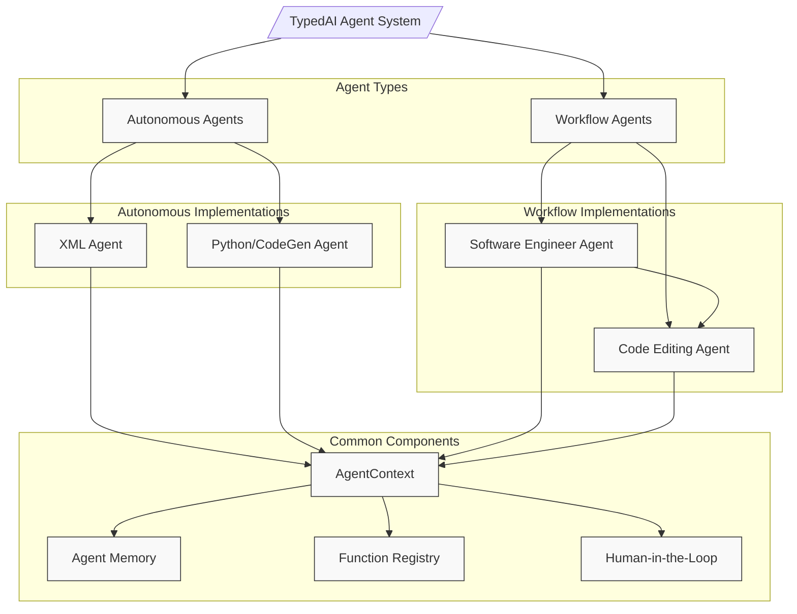
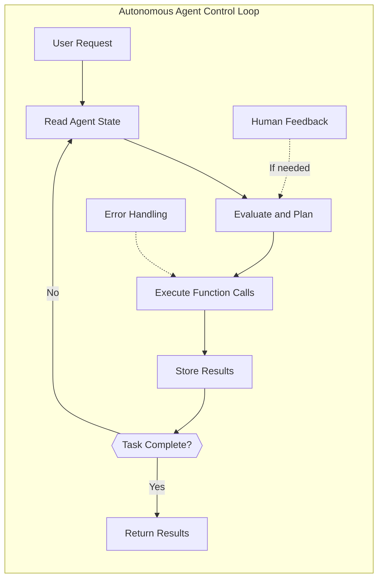
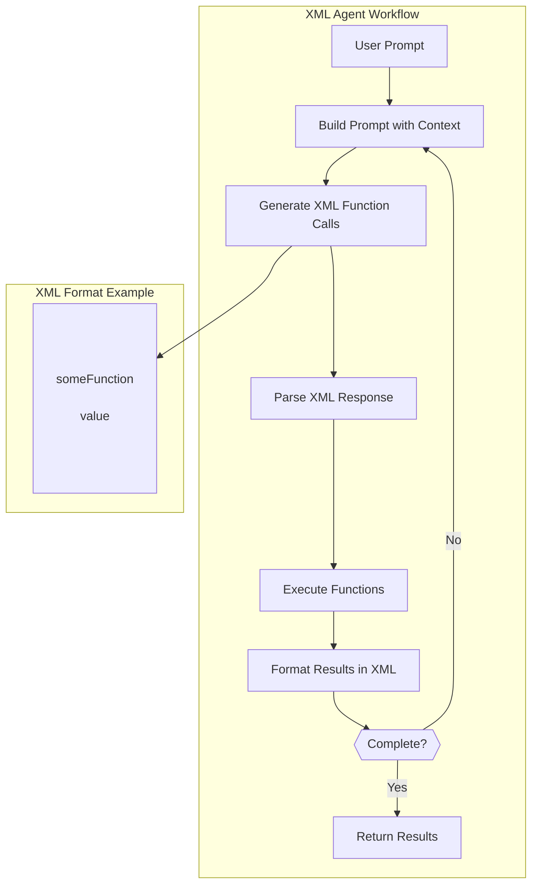
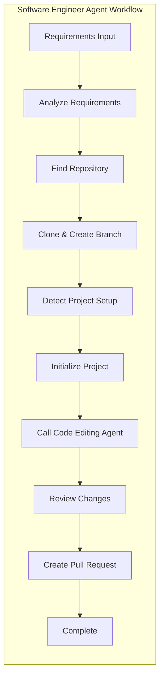
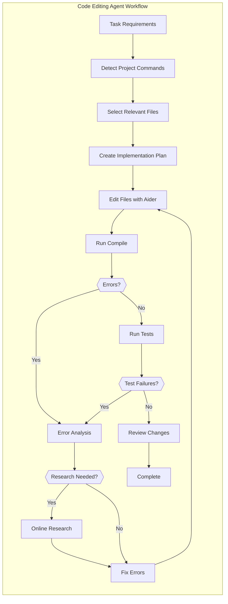
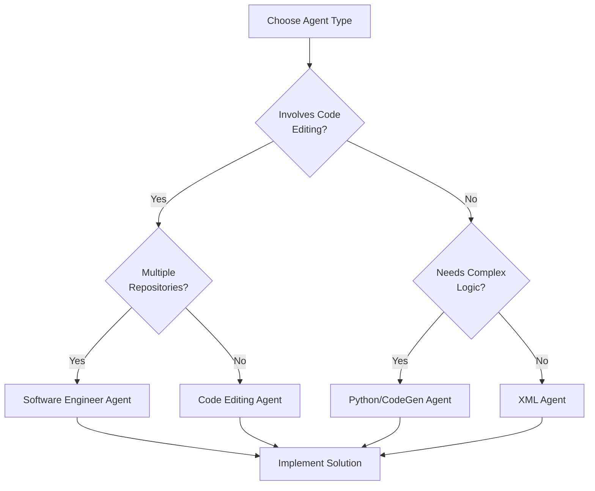

<!-- source: DeepWiki mcp.deepwiki.com · repo TrafficGuard/typedai · page 3.2 Agent Types · fetched 2026-10-26 -->

# Agent Types

<details>
<summary>Relevant source files</summary>

The following files were used as context for generating this wiki page:

- [README.md](README.md)
- [docs/docs/autonomous-agents.md](docs/docs/autonomous-agents.md)
- [docs/docs/examples.md](docs/docs/examples.md)
- [docs/docs/index.md](docs/docs/index.md)
- [docs/docs/roadmap.md](docs/docs/roadmap.md)
- [docs/docs/setup.md](docs/docs/setup.md)
- [docs/docs/software-engineer.md](docs/docs/software-engineer.md)
- [docs/mkdocs.yml](docs/mkdocs.yml)
- [src/agent/xmlAgentRunner.ts](src/agent/xmlAgentRunner.ts)
- [src/cli/agent.ts](src/cli/agent.ts)
- [src/cli/code.ts](src/cli/code.ts)
- [src/cli/research.ts](src/cli/research.ts)
- [src/cli/swe.ts](src/cli/swe.ts)
- [src/cli/util.ts](src/cli/util.ts)
- [src/functionRegistry.ts](src/functionRegistry.ts)
- [src/routes/agent/agent-execution-routes.ts](src/routes/agent/agent-execution-routes.ts)

</details>


This document details the different agent implementations available in TypedAI and explains their unique characteristics, capabilities, and ideal use cases. TypedAI provides several agent types that serve different purposes within the platform's architecture. For information about how agents manage state and memory, see [Agent Context & Memory](#3.1).

## Agent Type Overview

TypedAI implements a flexible agent architecture that offers two primary categories of agents:

1. **Autonomous Agents** - Designed for general-purpose task completion with dynamic reasoning
   - XML Agent
   - Python/CodeGen Agent

2. **Workflow Agents** - Tailored for specific domains with more structured execution patterns
   - Software Engineer Agent
   - Code Editing Agent



Sources: [README.md:24-47](). [docs/docs/autonomous-agents.md:10-26](). [docs/docs/index.md:19-29]().

## Autonomous Agents

Autonomous agents are general-purpose agents designed to solve a wide range of tasks through dynamic reasoning, planning, and execution. They use a control loop architecture that iteratively plans and executes functions to achieve the desired goal.

### Common Features of Autonomous Agents

- Reasoning/planning inspired by Google's Self-Discover paper and other research
- Memory and function call history for managing complex workflows
- Iterative planning with hierarchical task decomposition
- Human-in-the-loop capability for budget control, error handling, and decision making
- Configurable settings for cost management



Sources: [docs/docs/autonomous-agents.md:1-9](). [src/agent/xmlAgentRunner.ts:61-223]().

### XML Agent

The XML Agent is an autonomous agent implementation that uses a specialized XML format for function calling and response parsing. It's designed to work with any sufficiently capable LLM by structuring the interaction in a standardized XML format.

#### How it works:

1. The agent constructs a prompt that includes:
   - The current function call history
   - Agent memory contents
   - The user's original request
   - Current file/tool state information

2. The prompt is sent to the LLM which returns an XML-formatted response containing function calls to execute.

3. The agent parses the XML response using `parseFunctionCallsXml` and executes the requested functions.

4. Results are formatted and added to the prompt for the next iteration.

5. This cycle continues until the agent reaches a conclusion or encounters an error.



Sources: [src/agent/xmlAgentRunner.ts:24-227](). [docs/docs/autonomous-agents.md:17-18]().

### Python/CodeGen Agent

The Python/CodeGen Agent (also referred to as the "dynamic agent") executes Python code generated by the LLM in a WebAssembly sandbox. This approach allows for more complex operations including conditional logic, loops, and multiple function calls in a single step.

#### How it works:

1. The agent receives a prompt and constructs a context including memory, function history, and available tools.

2. The LLM generates Python code that will execute the necessary steps to fulfill the request.

3. This code is executed in a secure WebAssembly sandbox with function calls bound to the global scope.

4. The agent can perform multiple operations, validate results, and make conditional decisions in a single iteration.

#### Advantages:

- More efficient execution with multiple function calls per LLM request
- Ability to implement conditional logic and validation
- Reduced round-trips to the LLM, resulting in lower costs and faster execution

```mermaid
flowchart TB
    subgraph "Python/CodeGen Agent Workflow"
        direction TB
        UserPrompt["User Prompt"] --> BuildContext["Build Agent Context"]
        BuildContext --> GeneratePythonCode["Generate Python Code"]
        GeneratePythonCode --> ExecuteInSandbox["Execute in WASM Sandbox"]
        ExecuteInSandbox --> ProcessResults["Process Results"]
        ProcessResults --> CheckCompletion{{"Complete?"}}
        CheckCompletion --> |"No"| BuildContext
        CheckCompletion --> |"Yes"| ReturnResults["Return Results"]
    end
    
    subgraph "Python Code Example"
        direction TB
        PythonCode["```python
        # Check if file exists
        if FileSystem.fileExists('config.json'):
            config = FileSystem.readFile('config.json')
            parsed = json.loads(config)
            
            # Conditionally update config
            if 'version' in parsed:
                parsed['version'] += 1
                FileSystem.writeFile('config.json', json.dumps(parsed))
            else:
                requestFeedback('Config missing version')
        else:
            # Create new config
            FileSystem.writeFile('config.json', '{"version": 1}')
        ```"]
    end
    
    GeneratePythonCode --> PythonCode
```

Sources: [docs/docs/autonomous-agents.md:15-26](). [cli/agent.ts:46-48]().

### Comparison of Autonomous Agents

| Feature | XML Agent | Python/CodeGen Agent |
|---------|-----------|----------------------|
| **Execution Model** | Single function call per iteration | Multiple function calls in one iteration |
| **Logic Capability** | Limited to LLM planning | Full Python logic with conditionals and loops |
| **Implementation** | XML parsing and formatting | Python code execution in WebAssembly |
| **Efficiency** | More LLM calls for complex tasks | Fewer LLM calls for complex tasks |
| **Flexibility** | Works with any capable LLM | Works with LLMs that can generate valid Python |
| **Use Case** | General purpose tasks | Complex workflows with conditional logic |

Sources: [docs/docs/autonomous-agents.md:14-26](). [src/agent/xmlAgentRunner.ts:20-227]().

## Workflow Agents

Workflow agents follow predefined patterns optimized for specific domains. Unlike autonomous agents that dynamically determine each step, workflow agents have a more structured flow with LLMs determining conditional paths within that structure.

### Software Engineer Agent

The Software Engineer Agent specializes in implementing software development tasks from requirements to completed pull requests. It orchestrates the entire development process across multiple repositories.

#### Key Features:

- Repository discovery and selection from SCM systems (GitLab, GitHub)
- Project initialization and branch creation
- Requirements analysis and implementation planning
- Code modification via the Code Editing Agent
- Pull/merge request creation



Sources: [docs/docs/software-engineer.md:49-65](). [src/cli/swe.ts:33-38]().

### Code Editing Agent

The Code Editing Agent handles the task of modifying code in local repositories. It can be used independently or as part of the Software Engineer Agent's workflow.

#### Key Features:

- Automatic detection of project commands (init/compile/test/lint)
- Intelligent file selection for editing
- Implementation planning based on requirements
- Edit-compile-lint-test cycle
- Advanced error handling with online research capabilities
- Language-specific tooling support



Sources: [docs/docs/software-engineer.md:9-46](). [src/cli/code.ts:33-37]().

## Agent Selection Guide

Choosing the right agent type depends on the task requirements and complexity. The following table provides guidance on when to use each agent type:

| Use Case | Recommended Agent Type | Reasoning |
|----------|------------------------|-----------|
| General-purpose tasks | XML Agent | Simple, robust implementation for diverse tasks |
| Complex workflows with logic | Python/CodeGen Agent | More efficient with conditional logic and multiple function calls |
| Software development workflow | Software Engineer Agent | End-to-end implementation from requirements to PR |
| Local code editing | Code Editing Agent | Specialized for modifying existing codebases |
| Research and information gathering | XML Agent | Good for sequential research steps without complex logic |



Sources: [README.md:24-36](). [docs/docs/autonomous-agents.md:14-26](). [docs/docs/software-engineer.md:5-8](). [cli/agent.ts:46-48]().

## Implementation and Command Line Usage

Each agent type can be invoked through different command line scripts in the TypedAI platform:

### Invoking Autonomous Agents

To run an autonomous agent:

```bash
# Run XML agent (default)
npm run agent "Your task description here"

# Run Python/CodeGen agent
npm run agent -- --type=codegen "Your task description here"
```

Sources: [src/cli/agent.ts:40-52]().

### Invoking Workflow Agents

To run workflow agents:

```bash
# Run Software Engineer Agent
npm run swe "Implement feature X in repository Y"

# Run Code Editing Agent
npm run code "Modify files to implement feature X"
```

Sources: [src/cli/code.ts:21-37](). [src/cli/swe.ts:25-38]().

## Conclusion

TypedAI offers a flexible framework with different agent types optimized for various use cases. Autonomous agents (XML and Python/CodeGen) provide general-purpose problem-solving with different execution models, while workflow agents (Software Engineer and Code Editing) offer specialized capabilities for software development tasks.

All agent types share common infrastructure components, including agent context, memory, function registry, and human-in-the-loop capabilities, providing a consistent foundation while serving different use cases.

---

