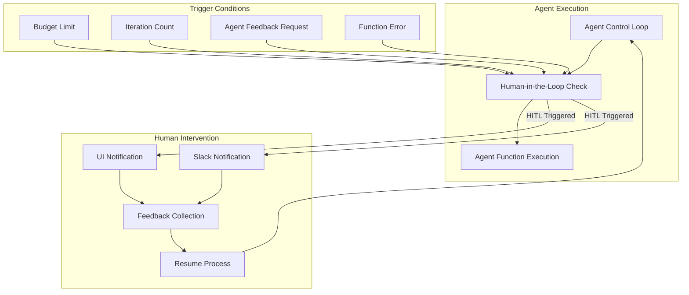
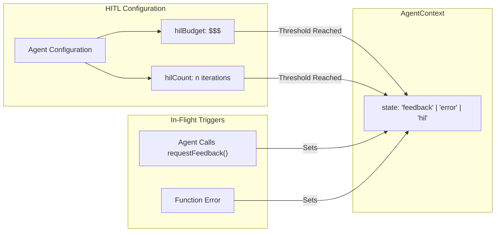

<!-- source: DeepWiki mcp.deepwiki.com · repo TrafficGuard/typedai · page 3.3 Human-in-the-Loop · fetched 2026-10-26 -->

# Human-in-the-Loop

<details>
<summary>Relevant source files</summary>

The following files were used as context for generating this wiki page:

- [README.md](README.md)
- [docs/docs/agent-concepts.md](docs/docs/agent-concepts.md)
- [docs/docs/autonomous-agents.md](docs/docs/autonomous-agents.md)
- [docs/docs/examples.md](docs/docs/examples.md)
- [docs/docs/index.md](docs/docs/index.md)
- [docs/docs/roadmap.md](docs/docs/roadmap.md)
- [docs/docs/setup.md](docs/docs/setup.md)
- [docs/docs/software-engineer.md](docs/docs/software-engineer.md)
- [docs/mkdocs.yml](docs/mkdocs.yml)
- [src/agent/xmlAgentRunner.ts](src/agent/xmlAgentRunner.ts)
- [src/routes/agent/agent-execution-routes.ts](src/routes/agent/agent-execution-routes.ts)
- [src/routes/agent/agent-start-route.ts](src/routes/agent/agent-start-route.ts)

</details>


## Purpose and Scope

This document describes the Human-in-the-Loop (HITL) system in TypedAI, which enables controlled human supervision and intervention during agent execution. The HITL system provides mechanisms for pausing agent execution, notifying users, collecting human feedback, and resuming execution based on that feedback. For information about the broader Agent system architecture, see [Agent System](#3).

## Overview

Human-in-the-Loop functionality in TypedAI serves as a critical component in the agent execution framework, ensuring that autonomous agents operate safely, cost-effectively, and with appropriate guidance when needed.



Sources:
- [src/agent/xmlAgentRunner.ts:44-54]()
- [src/agent/xmlAgentRunner.ts:80]()
- [docs/docs/autonomous-agents.md:44-60]()

## Trigger Mechanisms

The HITL system can be triggered through multiple mechanisms:

### 1. Cost-Based Triggers

The system can be configured to pause agent execution after a certain budget threshold has been reached. This is primarily used to control costs when using expensive frontier LLM models.

### 2. Iteration-Based Triggers

Agents can be configured to request human intervention after a specific number of control loop iterations. This helps maintain agent focus and prevent infinite loops.

### 3. Agent-Initiated Feedback Requests

Agents can explicitly request human feedback by calling the `AgentFeedback_requestFeedback` function. This typically occurs when the agent:
- Needs clarification on requirements
- Requires a decision to proceed
- Encounters an ambiguous situation
- Wants to confirm approach before proceeding with significant actions

### 4. Error Handling

When function calls fail during agent execution, the HITL system can engage to allow humans to provide guidance on how to resolve the error.



Sources:
- [src/agent/xmlAgentRunner.ts:44-53]()
- [src/agent/xmlAgentRunner.ts:174-180]()
- [src/routes/agent/agent-start-route.ts:51-56]()

## Implementation Details

### Configuration

HITL settings are configured when starting an agent:

1. **Budget-based configuration** (`hilBudget`): Maximum dollar amount the agent can spend before requesting human input
2. **Count-based configuration** (`hilCount`): Maximum number of iterations before requesting human input

If neither is specified, a default budget of $2 is applied as a safety measure.

### Human-in-the-Loop Checkpoint

Before each agent iteration, the system calls `checkHumanInTheLoop()` which:

1. Increments the iteration counter
2. Accumulates the cost of LLM calls
3. Evaluates if threshold conditions are met
4. If triggered, sets the agent state to 'hil' and saves the state

### Agent State Management

The agent context has several state values related to HITL:

- `agent.state = 'feedback'`: When the agent explicitly requests feedback
- `agent.state = 'error'`: When a function call fails
- `agent.state = 'hil'`: When budget/count thresholds are reached

These states pause agent execution until human intervention occurs.

```mermaid
stateDiagram-v2
    [*] --> "agent"
    "agent" --> "functions": Generate function calls
    "functions" --> "agent": Function calls complete
    
    "functions" --> "error": Function call error
    "agent" --> "feedback": Agent requests feedback
    "agent" --> "hil": Budget/count threshold reached
    
    "error" --> "agent": Human provides error guidance
    "feedback" --> "agent": Human provides feedback
    "hil" --> "agent": Human provides guidance
    
    "agent" --> "completed": Task complete
    "completed" --> [*]
```

Sources:
- [src/agent/xmlAgentRunner.ts:80]()
- [src/agent/xmlAgentRunner.ts:174-180]()
- [src/agent/xmlAgentRunner.ts:185-196]()

## Notification Methods

When HITL is triggered, several notification mechanisms can be employed:

1. **Web UI**: The agent state changes in the UI, showing a feedback input form
2. **Slack Notifications**: If Slack integration is configured, notifications are sent to a designated channel
3. **Console**: For CLI execution, the console will require an `Enter` keypress to continue

## API Routes

The system provides several API routes for human-in-the-loop interactions:

### Providing Feedback

```
POST /api/agent/v1/feedback
```
This route is used when an agent has explicitly requested feedback via the `AgentFeedback_requestFeedback` function.

### Resuming from Error

```
POST /api/agent/v1/resume-error
```
This route is used when an agent is in the error state due to a function call failure.

### Resuming from HIL

```
POST /api/agent/v1/resume-hil
```
This route is used when an agent is paused due to reaching budget or iteration thresholds.

Sources:
- [src/routes/agent/agent-execution-routes.ts:36-60]()
- [src/routes/agent/agent-execution-routes.ts:62-82]()
- [src/routes/agent/agent-execution-routes.ts:84-104]()

## UI Integration

The TypedAI web interface provides a dedicated panel for human-in-the-loop interactions:


The UI allows users to:
1. View the reason for the HITL trigger
2. See the agent's current state and request
3. Provide feedback or guidance via a text input
4. Resume the agent's execution

Sources:
- [docs/docs/index.md:70-72]()
- [README.md:104-105]()

## Examples

### Budget Control Example

When an agent reaches its configured budget limit:

1. The agent state changes to 'hil'
2. Execution pauses, awaiting human input
3. The human can review costs incurred so far
4. The human provides feedback, potentially adjusting the plan
5. The agent resumes execution with the new guidance

### Agent-Requested Feedback Example

When an agent explicitly requests feedback:

1. The agent calls `AgentFeedback_requestFeedback` with a specific question
2. The agent state changes to 'feedback'
3. The human receives the question via UI/Slack notification
4. The human provides a response
5. The agent incorporates the feedback and continues execution

## Best Practices

1. **Set Appropriate Thresholds**: Configure budget and iteration thresholds based on the complexity of the task
2. **Provide Clear Guidance**: When responding to HITL requests, be specific and actionable
3. **Monitor Execution**: Even with HITL enabled, regularly check agent progress
4. **Use Notifications**: Configure Slack notifications for timely responses to HITL requests
5. **Review Error States**: For agents in error state, provide guidance on alternative approaches

Sources:
- [docs/docs/autonomous-agents.md:44-60]()

---

