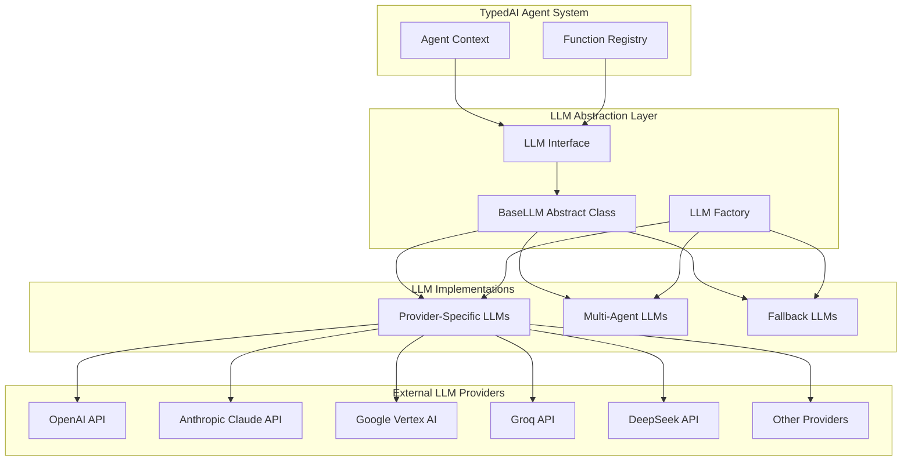
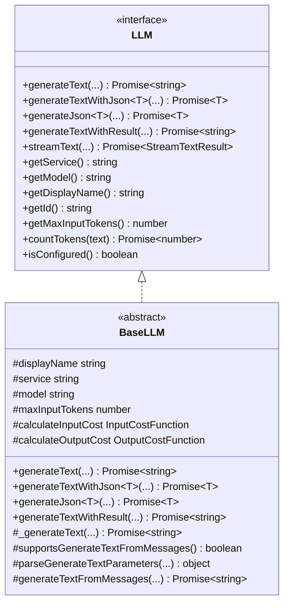
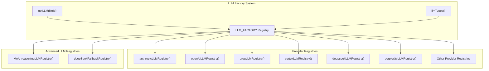
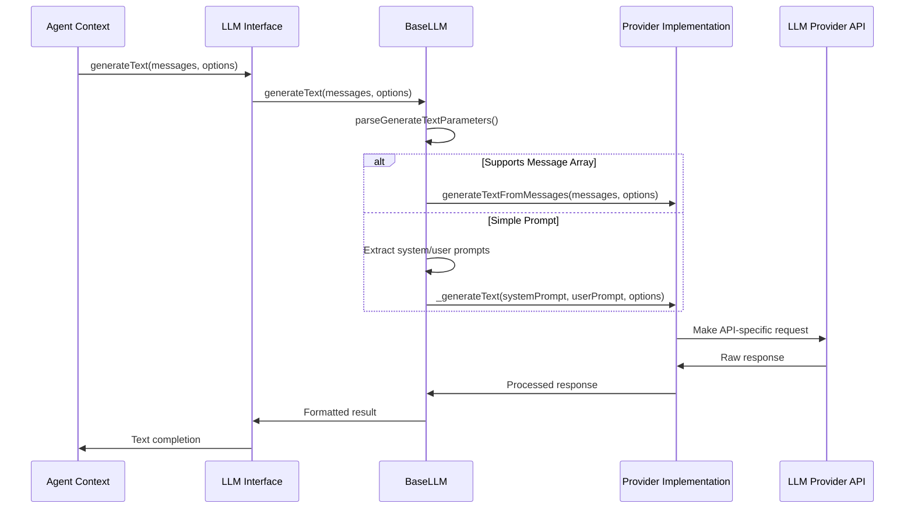
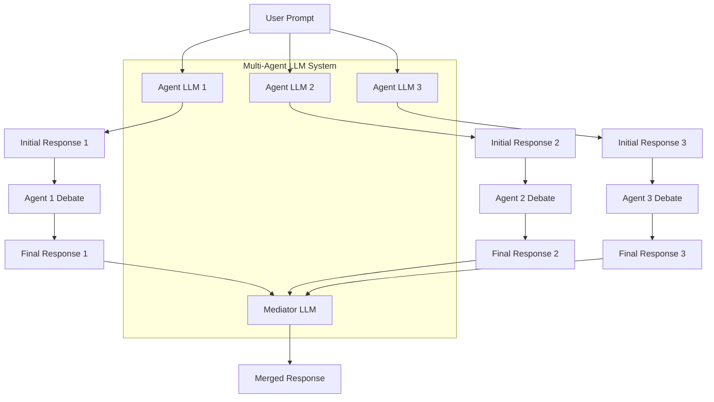
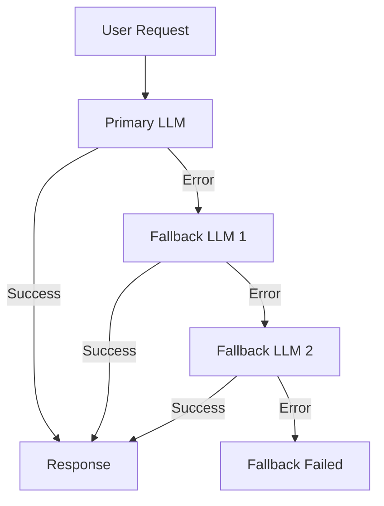
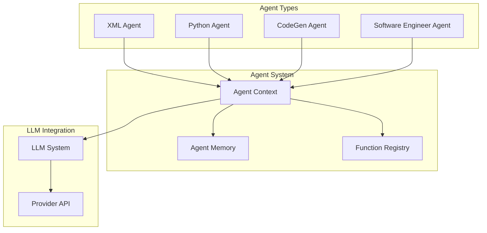

<!-- source: DeepWiki mcp.deepwiki.com · repo TrafficGuard/typedai · page 4 LLM Integration · fetched 2026-10-26 -->

# LLM Integration

<details>
<summary>Relevant source files</summary>

The following files were used as context for generating this wiki page:

- [frontend/package-lock.json](frontend/package-lock.json)
- [frontend/package.json](frontend/package.json)
- [package-lock.json](package-lock.json)
- [package.json](package.json)
- [src/llm/base-llm.ts](src/llm/base-llm.ts)
- [src/llm/llm.ts](src/llm/llm.ts)
- [src/llm/llmFactory.ts](src/llm/llmFactory.ts)
- [src/llm/multi-agent/blueberry.ts](src/llm/multi-agent/blueberry.ts)
- [src/llm/multi-agent/reasoning-debate.ts](src/llm/multi-agent/reasoning-debate.ts)
- [variables/local.env.example](variables/local.env.example)

</details>


This page provides an overview of TypedAI's Large Language Model (LLM) integration system, which serves as a unified abstraction layer over multiple LLM providers. The LLM system enables consistent interaction with various AI models through a standardized interface while handling provider-specific implementation details.

For information about implementing specific providers, see [LLM Interface & Abstraction](#4.1). For details on the supported models from each provider, see [Supported LLM Providers](#4.2).

## Architecture Overview

TypedAI's LLM integration is designed with a layered architecture that abstracts away provider-specific implementations behind a common interface. This allows the rest of the application to interact with any LLM through a consistent API regardless of the underlying provider.



Sources: [src/llm/llm.ts](), [src/llm/base-llm.ts](), [src/llm/llmFactory.ts]()

## Core Components

### LLM Interface

The foundation of the LLM integration system is the `LLM` interface, which defines a standard contract that all LLM implementations must fulfill. This interface provides methods for text generation, JSON handling, and token management.



The `LLM` interface [src/llm/llm.ts:155-227]() supports multiple overloaded methods to handle different input patterns:
- Simple prompting with just a user message
- System and user message combinations
- Full message arrays with complex conversation history

Key capabilities include:
- **Text generation**: Standard text completions 
- **JSON generation**: Structured outputs following a schema
- **Result extraction**: Extracting specific tagged portions from responses
- **Streaming**: Real-time streaming of responses
- **Token counting**: Model-specific token counting
- **Provider metadata**: Information about the LLM service and model

Sources: [src/llm/llm.ts]()

### BaseLLM Implementation

The `BaseLLM` abstract class [src/llm/base-llm.ts:19-200]() provides a foundation for all LLM implementations with common functionality:

- Parameter parsing and normalization
- Message handling and formatting
- Response extraction and parsing
- Cost tracking

This class handles the complex logic of converting between different input formats (string prompts vs. message arrays) so that provider implementations can focus on their specific API requirements.

Sources: [src/llm/base-llm.ts]()

## LLM Factory System

The `LLM_FACTORY` registry [src/llm/llmFactory.ts:25-45]() serves as a central repository of all available LLM implementations. It maps service:model identifiers to factory functions that create LLM instances.



The factory provides several key functions:
- `getLLM(llmId)`: Creates an LLM instance from an identifier (e.g., "openai:gpt-4")
- `llmTypes()`: Lists all available LLM types with their identifiers and display names
- `deserializeLLMs(obj)`: Converts serialized LLM configurations back to LLM instances

This system makes it easy to add new providers by simply creating a registry function that returns LLM implementations mapped to their identifiers.

Sources: [src/llm/llmFactory.ts]()

## Supported LLM Providers

TypedAI integrates with a wide range of LLM providers through its abstraction layer. The `package.json` dependencies [package.json:55-93]() indicate the integrated services:

| Provider | Integration | Models |
|----------|-------------|--------|
| OpenAI | @ai-sdk/openai | GPT-4, GPT-4o, GPT-3.5 Turbo |
| Anthropic | @ai-sdk/anthropic, @anthropic-ai/sdk | Claude 3 (Opus, Sonnet, Haiku) |
| Google | @ai-sdk/google-vertex | Gemini models |
| Groq | @ai-sdk/groq | LLama, Mixtral |
| DeepSeek | @ai-sdk/deepseek | DeepSeek models |
| Together AI | @ai-sdk/togetherai | Various models |
| Cerebras | @ai-sdk/cerebras | Cerebras models |
| Perplexity | Custom implementation | Perplexity models |
| Others | Various SDKs | XAI, Nebius, SambaNova |

Each provider is implemented as an extension of the `BaseLLM` class, with provider-specific logic for API communication, token counting, and response formatting.

Sources: [package.json](), [src/llm/llmFactory.ts]()

## Request Flow

When a text generation request is made through the TypedAI system, it follows a specific path through the LLM abstraction layer:



This abstraction allows the system to handle different provider APIs uniformly while maintaining the specific requirements of each LLM service.

Sources: [src/llm/base-llm.ts:78-91](), [src/llm/llm.ts:156-159]()

## Advanced LLM Patterns

### Multi-Agent Implementations

TypedAI implements advanced multi-agent patterns that coordinate multiple LLMs for improved reasoning capabilities:



The `ReasonerDebateLLM` class [src/llm/multi-agent/reasoning-debate.ts:65-184]() implements a multi-agent debate pattern where:
1. Multiple LLMs generate initial responses
2. LLMs review each other's responses in sparse communication topology
3. A mediator LLM evaluates and combines the best elements into a final response

This approach can produce higher quality results by combining the strengths of different models and enabling a form of self-critique.

Sources: [src/llm/multi-agent/reasoning-debate.ts](), [src/llm/multi-agent/blueberry.ts]()

### Fallback Strategies

TypedAI implements fallback strategies for reliability, where if a primary LLM fails, the system can automatically try alternative models:



This ensures the system remains operational even when specific providers experience downtime or rate limiting issues.

Sources: [src/llm/llmFactory.ts:41]()

## Configuration

LLM providers are configured using environment variables defined in the application's environment files:

```
ANTHROPIC_API_KEY=
OPENAI_API_KEY=
GROQ_API_KEY=
TOGETHERAI_API_KEY=
FIREWORKS_API_KEY=
DEEPSEEK_API_KEY=
DEEPINFRA_API_KEY=
CEREBRAS_API_KEY=
XAI_API_KEY=
NEBIUS_API_KEY=
SAMBANOVA_API_KEY=
PERPLEXITY_KEY=
```

Each provider implementation includes an `isConfigured()` method that checks if the necessary API keys are available before attempting to use the service.

Sources: [variables/local.env.example:30-42](), [src/llm/base-llm.ts:182-185]()

## Usage in the Agent System

The LLM integration is a core component of TypedAI's agent system, providing the intelligence behind various agent types:



Each agent uses the LLM interface to generate responses, make decisions, and process information based on its specific purpose and implementation.

Sources: [src/llm/llm.ts](), [src/llm/base-llm.ts]()

## Summary

The LLM Integration system provides a flexible, extensible foundation for TypedAI's intelligent agents. Key features include:

1. **Unified Interface**: A consistent API for interacting with any LLM provider
2. **Provider Abstraction**: Provider-specific implementations hidden behind common interfaces
3. **Factory Pattern**: Centralized creation and management of LLM instances
4. **Advanced Patterns**: Support for multi-agent reasoning and fallback strategies
5. **Cost Tracking**: Built-in mechanisms for tracking token usage and costs
6. **Extensibility**: Easy addition of new LLM providers

This architecture allows TypedAI to leverage the strengths of different LLM providers while maintaining a consistent development experience.

---

