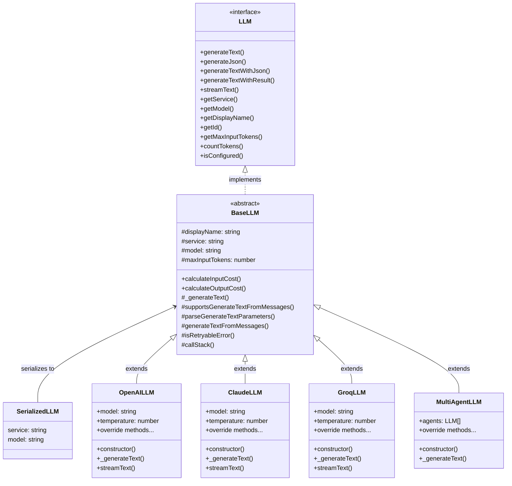
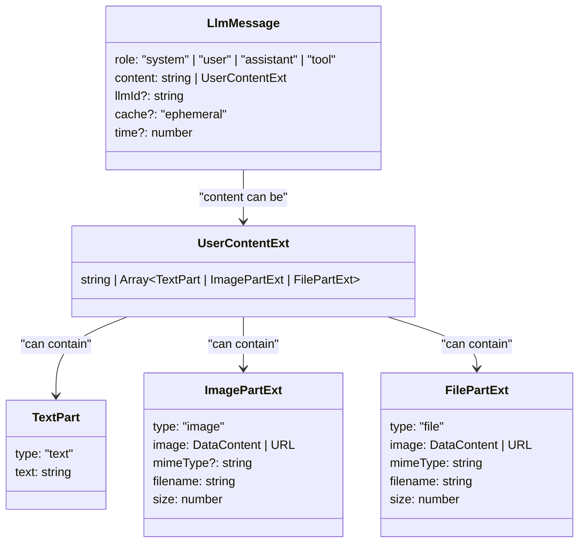
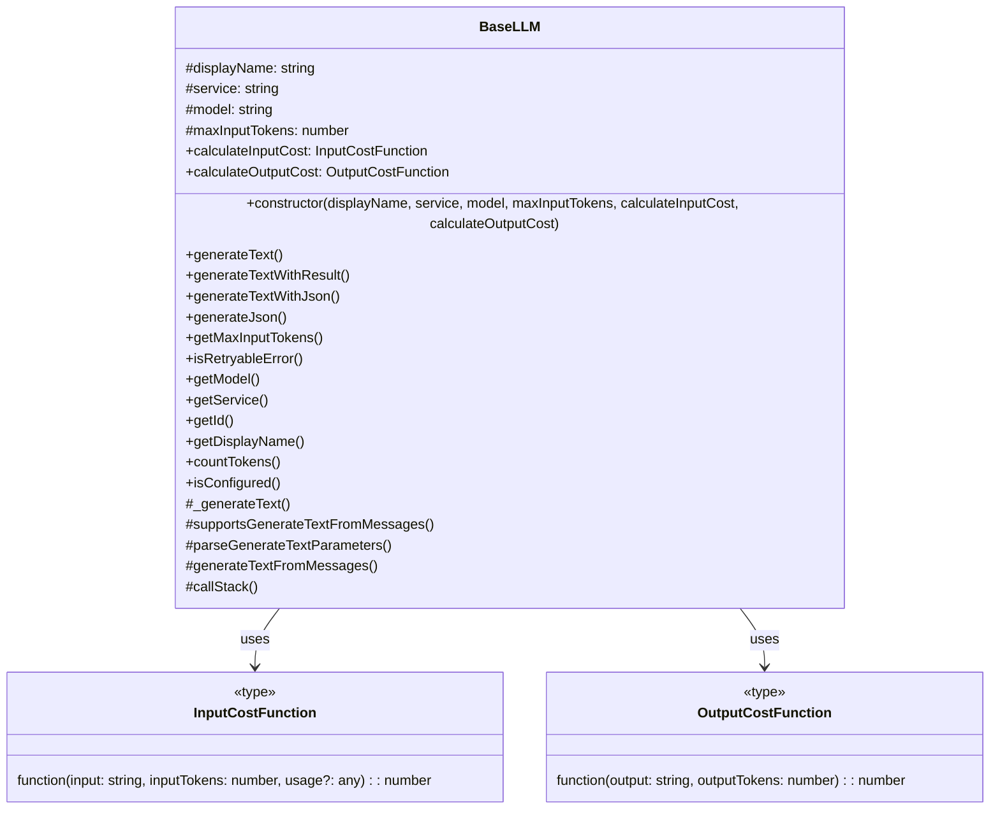
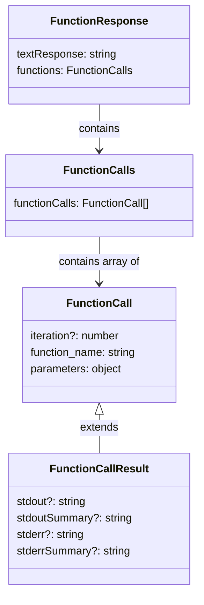

<!-- source: DeepWiki mcp.deepwiki.com · repo TrafficGuard/typedai · page 4.1 LLM Interface & Abstraction · fetched 2026-10-26 -->

# LLM Interface & Abstraction

<details>
<summary>Relevant source files</summary>

The following files were used as context for generating this wiki page:

- [src/llm/base-llm.ts](src/llm/base-llm.ts)
- [src/llm/llm.ts](src/llm/llm.ts)

</details>


## Purpose and Scope

This document details the LLM (Large Language Model) interface and abstraction layer in TypedAI. It explains the core interfaces, base classes, and how to implement new LLM providers. This abstraction layer enables the platform to work with multiple LLM providers through a consistent API, isolating provider-specific details from the rest of the system.

For information about specific supported LLM providers, see [Supported LLM Providers](#4.2). For advanced multi-agent LLM implementations, see [Multi-Agent LLM Implementations](#4.3).

## Architecture Overview

The LLM abstraction layer is designed to provide a uniform interface for interacting with various language model providers while handling the complexities of different APIs and implementations.

### LLM Abstraction Layer Structure



Sources: [src/llm/llm.ts:155-227](), [src/llm/base-llm.ts:19-200]()

### Integration with Other Components

```mermaid
flowchart TD
    subgraph "Agent System"
        AgentContext["AgentContext"]
        XMLAgent["XMLAgent"]
        PythonAgent["PythonAgent"]
        WorkflowAgent["WorkflowAgent"]
    end
    
    subgraph "LLM Abstraction Layer"
        LLMInterface["LLM Interface"]
        BaseLLM["BaseLLM Abstract Class"]
        LLMProviders["LLM Provider Implementations"]
    end
    
    subgraph "External LLM Services"
        OpenAI["OpenAI"]
        Claude["Claude/Anthropic"]
        VertexAI["Google Vertex AI"]
        Groq["Groq"]
        Others["Other Providers"]
    end
    
    AgentContext --> LLMInterface : "uses"
    XMLAgent --> LLMInterface : "uses"
    PythonAgent --> LLMInterface : "uses"
    WorkflowAgent --> LLMInterface : "uses"
    
    LLMInterface --> BaseLLM : "defines contract"
    BaseLLM --> LLMProviders : "extended by"
    
    LLMProviders --> OpenAI : "connects to"
    LLMProviders --> Claude : "connects to"
    LLMProviders --> VertexAI : "connects to"
    LLMProviders --> Groq : "connects to"
    LLMProviders --> Others : "connects to"
```

Sources: [src/llm/llm.ts:155-227](), [src/llm/base-llm.ts:19-200]()

## LLM Interface

The core of the abstraction layer is the `LLM` interface defined in [src/llm/llm.ts:155-227](). This interface establishes the contract that all LLM implementations must fulfill, providing a standard set of methods for text generation, JSON generation, and utility functions.

### Core Methods

| Method | Description | Return Type |
|--------|-------------|-------------|
| `generateText()` | Generates text from various input formats | `Promise<string>` |
| `generateTextWithJson()` | Generates a response ending with a JSON object (allowing reasoning before the JSON) | `Promise<T>` |
| `generateJson()` | Generates a response that only returns a JSON object | `Promise<T>` |
| `generateTextWithResult()` | Generates a response with a `<result></result>` element | `Promise<string>` |
| `streamText()` | Streams text from the LLM with chunk callbacks | `Promise<StreamTextResult>` |
| `getService()` | Returns the service provider name | `string` |
| `getModel()` | Returns the model identifier | `string` |
| `getDisplayName()` | Returns the UI display name | `string` |
| `getId()` | Returns the LLM identifier in the format `service:model` | `string` |
| `getMaxInputTokens()` | Returns the maximum number of input tokens | `number` |
| `countTokens()` | Counts the number of tokens in a text string | `Promise<number>` |
| `isConfigured()` | Checks if the LLM is properly configured | `boolean` |

Sources: [src/llm/llm.ts:155-227]()

### Message Format

The interface uses a standardized message format based on the OpenAI chat completion model, with extensions for TypedAI-specific functionality:



Sources: [src/llm/llm.ts:102-121]()

### Generation Options

The interface defines options for controlling the text generation process:

```typescript
export interface GenerateOptions {
    temperature?: number;           // Controls randomness (0-2)
    topP?: number;                  // Token selection probability threshold
    topK?: number;                  // Only sample from top K options
    presencePenalty?: number;       // Penalize repetition of information (-1 to 1)
    frequencyPenalty?: number;      // Penalize word/phrase repetition (-1 to 1)
    stopSequences?: string[];       // Sequences that stop generation
    maxRetries?: number;            // Maximum number of retries
}

export interface GenerateTextOptions extends GenerateOptions {
    type?: 'text' | 'json';         // Expected response type
    id?: string;                    // Identifier for tracing
    thinking?: 'low' | 'medium' | 'high'; // Thinking depth for supported models
}
```

Sources: [src/llm/llm.ts:5-54]()

## BaseLLM Abstract Class

The `BaseLLM` abstract class provides a foundation for implementing the `LLM` interface, handling common functionality so that specific providers only need to implement certain core methods. It's defined in [src/llm/base-llm.ts:19-200]().

### Key Responsibilities

1. Parameter parsing and standardization
2. Default implementations of interface methods
3. Extraction of JSON and result tags from responses
4. Cost tracking and calculation
5. Error handling and retries

### Class Structure



Sources: [src/llm/base-llm.ts:12-14](), [src/llm/base-llm.ts:19-200]()

### Methods to Override

When implementing a specific LLM provider, the following methods must be overridden:

| Method | Purpose |
|--------|---------|
| `_generateText()` | Core text generation implementation |
| `generateTextFromMessages()` | Process multiple messages (if supported) |
| `streamText()` | Handle streaming responses |
| `countTokens()` | Implement provider-specific token counting |
| `isRetryableError()` | Identify errors that should trigger retries |
| `isConfigured()` | Check if provider configuration is valid |

Sources: [src/llm/base-llm.ts:29-186]()

### Cost Tracking

The `BaseLLM` class includes support for tracking the cost of LLM API calls:

```typescript
export type InputCostFunction = (input: string, inputTokens: number, usage?: any) => number;
export type OutputCostFunction = (output: string, outputTokens: number) => number;

export function perMilTokens(dollarsPerMillionTokens: number): InputCostFunction {
    return (_, tokens) => (tokens * dollarsPerMillionTokens) / 1_000_000;
}
```

These functions calculate costs based on the number of tokens processed, using provider-specific pricing.

Sources: [src/llm/base-llm.ts:12-17]()

## Implementing a New LLM Provider

To implement a new LLM provider, you need to create a class that extends `BaseLLM` and implements the required methods.

### Implementation Steps

1. Create a new class that extends `BaseLLM`
2. Implement the required methods, particularly `_generateText()` and `streamText()`
3. Define token counting and cost calculation functions
4. Register the new provider with the LLM factory system

### Implementation Example Template

```typescript
import { BaseLLM } from './base-llm';
import { GenerateTextOptions, LlmMessage } from './llm';

export class NewProviderLLM extends BaseLLM {
    constructor(model: string, private apiKey: string) {
        // Define display name, service name, model name, max input tokens,
        // and cost calculation functions
        super(
            `NewProvider ${model}`,  // displayName
            'newprovider',           // service
            model,                   // model
            32000,                   // maxInputTokens
            perMilTokens(0.0005),    // calculateInputCost
            perMilTokens(0.0015)     // calculateOutputCost
        );
    }
    
    protected async _generateText(
        systemPrompt: string | undefined, 
        userPrompt: string, 
        opts?: GenerateTextOptions
    ): Promise<string> {
        // Implement provider-specific API call
        // Return generated text
    }
    
    protected async streamText(
        messages: LlmMessage[], 
        onChunk: ({ string }) => void, 
        opts?: GenerateTextOptions
    ): Promise<StreamTextResult<any, any>> {
        // Implement streaming functionality
    }
    
    isConfigured(): boolean {
        return !!this.apiKey;
    }
}
```

Sources: [src/llm/base-llm.ts:19-200]()

## Response Parsing

The LLM abstraction layer provides utilities for extracting structured data from LLM responses:

### JSON Extraction

The `generateJson` and `generateTextWithJson` methods extract JSON from responses. The LLM may return JSON in various formats:

1. Raw JSON object
2. JSON wrapped in `<json></json>` tags
3. JSON in markdown code blocks (```json ... ```)

### Result Tag Extraction

The `generateTextWithResult` method extracts content from within `<result></result>` tags, allowing the LLM to show its work before providing a final answer.

### Function Call Parsing

The system can also parse function calls from responses:



Sources: [src/llm/llm.ts:229-258]()

## LLM Messages and Helpers

The interface provides helper functions for creating standardized messages:

```typescript
// Create a system message
function system(text: string, cache = false): LlmMessage

// Create a user message
function user(text: string, cache = false): LlmMessage

// Create an assistant message (for response prefilling)
function assistant(text: string): LlmMessage
```

These helpers ensure consistent message formatting across the system.

Sources: [src/llm/llm.ts:127-153]()

## Integration with Agent System

The LLM abstraction layer is designed to be used by the Agent System. The `BaseLLM` class includes a `callStack` method that integrates with the `AgentContext` to provide better tracing and context awareness.

```typescript
protected callStack(agent?: AgentContext): string {
    if (!agent) return '';
    const arr: string[] = agent.callStack;
    if (!arr || arr.length === 0) return '';
    if (arr.length === 1) return arr[0];
    // Remove duplicates from when we call multiple in parallel
    let i = arr.length - 1;
    while (i > 0 && arr[i] === arr[i - 1]) {
        i--;
    }
    return arr.slice(0, i + 1).join(' > ');
}
```

This provides context information that can be included in prompts to the LLM.

Sources: [src/llm/base-llm.ts:187-199]()

## Summary

The LLM Interface & Abstraction layer is a core component of TypedAI that provides:

1. A unified interface for interacting with various LLM providers
2. Abstract base implementation that handles common functionality
3. Standardized message formats and generation options
4. Utilities for extracting structured data from responses
5. Cost tracking and token counting mechanisms
6. Integration points with the Agent System

This abstraction enables the rest of the TypedAI system to work with different LLM providers interchangeably, isolating provider-specific implementation details and providing a consistent API for text and JSON generation.

---

