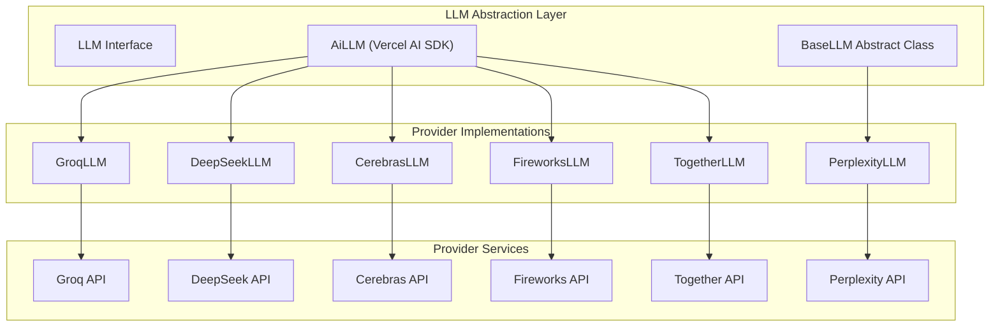
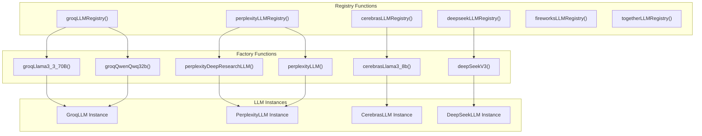

<!-- source: DeepWiki mcp.deepwiki.com · repo TrafficGuard/typedai · page 4.2 Supported LLM Providers · fetched 2026-10-26 -->

# Supported LLM Providers

<details>
<summary>Relevant source files</summary>

The following files were used as context for generating this wiki page:

- [src/functions/scm/github.int.ts](src/functions/scm/github.int.ts)
- [src/functions/web/perplexity.ts](src/functions/web/perplexity.ts)
- [src/llm/services/cerebras.ts](src/llm/services/cerebras.ts)
- [src/llm/services/deepseek.ts](src/llm/services/deepseek.ts)
- [src/llm/services/fireworks.ts](src/llm/services/fireworks.ts)
- [src/llm/services/groq.ts](src/llm/services/groq.ts)
- [src/llm/services/llm.int.ts](src/llm/services/llm.int.ts)
- [src/llm/services/perplexity-llm.ts](src/llm/services/perplexity-llm.ts)
- [src/llm/services/together.ts](src/llm/services/together.ts)
- [src/modules/firestore/firestoreUserService.ts](src/modules/firestore/firestoreUserService.ts)
- [src/swe/aiderCodeEditor.ts](src/swe/aiderCodeEditor.ts)
- [src/user/userService/userContext.ts](src/user/userService/userContext.ts)

</details>


This document details the various Large Language Model (LLM) providers supported by TypedAI's abstraction layer. It covers the specific models available from each provider, their capabilities, cost structures, and configuration requirements. For information about the underlying LLM abstraction architecture, see [LLM Interface & Abstraction](#4.1).

## Architecture Overview

TypedAI implements a provider-agnostic approach to LLM integration, allowing agents to interact with multiple LLM providers through a consistent interface. Each provider is implemented as a specialized class that handles authentication, request formatting, response processing, and cost tracking.



Sources: [src/llm/services/ai-llm.ts](), [src/llm/base-llm.ts](), [src/llm/llm.ts]()

## Provider Registry System

Each LLM provider defines a registry function that maps model identifiers to factory functions. These functions create properly configured instances of the respective LLM class with the appropriate model parameters, token limits, and cost calculations.



Sources: [src/llm/services/groq.ts:9-15](), [src/llm/services/perplexity-llm.ts:25-31](), [src/llm/services/cerebras.ts:10-15](), [src/llm/services/deepseek.ts:9-14]()

## Supported Providers and Models

### OpenAI

OpenAI provides some of the most widely used LLMs, including the GPT series models. These models support text generation, vision-language processing, and function calling capabilities.

| Model | Context Length | Input Cost (per M tokens) | Output Cost (per M tokens) |
|-------|-----------------|----------------------------|----------------------------|
| GPT-4o | 128,000 | $10.00 | $30.00 |
| GPT-4o mini | 128,000 | $2.50 | $7.50 |
| GPT-4 Turbo | 128,000 | $10.00 | $30.00 |
| GPT-3.5 Turbo | 16,000 | $0.50 | $1.50 |

Sources: [src/swe/aiderCodeEditor.ts:65-71]()

### Anthropic Claude

Anthropic's Claude models offer strong reasoning capabilities and long context windows. They support both text and image inputs, with particular strengths in document understanding.

| Model | Context Length | Input Cost (per M tokens) | Output Cost (per M tokens) |
|-------|-----------------|----------------------------|----------------------------|
| Claude 3.7 Sonnet | 200,000 | $3.00 | $15.00 |
| Claude 3.5 Sonnet | 200,000 | $3.00 | $15.00 |
| Claude 3 Opus | 200,000 | $15.00 | $75.00 |
| Claude 3 Sonnet | 200,000 | $3.00 | $15.00 |
| Claude 3 Haiku | 200,000 | $0.25 | $1.25 |

Sources: [src/swe/aiderCodeEditor.ts:55-59]()

### Google Vertex AI (Gemini)

Google's Gemini models are available through the Vertex AI service. They support multimodal inputs including text, images, and PDFs.

| Model | Context Length | Features |
|-------|---------------|----------|
| Gemini 2.0 Flash | 1,000,000 | Fast, general-purpose |
| Gemini 2.0 Flash Lite | 1,000,000 | Cost-effective variant |
| Gemini 2.0 Experimental | 1,000,000 | Advanced capabilities |
| Gemini 2.0 Flash Thinking | 1,000,000 | Chain-of-thought reasoning |

Sources: [src/llm/services/llm.int.ts:232-245]()

### Perplexity

Perplexity models specialize in web-based research and citation generation. They're particularly useful for agent tasks requiring up-to-date information from the web.

| Model | Context Length | Input Cost (per M tokens) | Output Cost (per M tokens) | Search Cost |
|-------|---------------|----------------------------|----------------------------|------------|
| Sonar | 127,000 | $1.00 | $1.00 | $5 per 1000 searches |
| Sonar Reasoning Pro | 127,000 | $2.00 | $8.00 | $5 per 1000 searches |
| Sonar Deep Research | 60,000 | $2.00 | $8.00 | $5 per 1000 searches |

The `Perplexity` class also provides a specialized `research` function that connects to Perplexity's web search capabilities.

```typescript
async research(researchQuery: string, saveToMemory: boolean): Promise<string>
```

Sources: [src/llm/services/perplexity-llm.ts:16-61](), [src/functions/web/perplexity.ts:14-41]()

### Groq

Groq provides high-performance inference for various open models, particularly Llama and Qwen models.

| Model | Context Length | Input Cost (per M tokens) | Output Cost (per M tokens) |
|-------|---------------|----------------------------|----------------------------|
| Llama-3.3-70b-versatile | 131,072 | $0.59 | $0.79 |
| DeepSeek-R1-Distill-Llama-70b | 128,000 | $0.59 | $0.79 |
| Qwen-QWQ-32b | 128,000 | $0.29 | $0.39 |
| Qwen-32b-R1-Distill | 128,000 | $0.59 | $0.79 |

Sources: [src/llm/services/groq.ts:17-51]()

### DeepSeek

DeepSeek provides models optimized for reasoning and general-purpose tasks.

| Model | Context Length | Input Cost (per M tokens) | Output Cost (per M tokens) |
|-------|---------------|----------------------------|----------------------------|
| DeepSeek Chat (v3) | 64,000 | $0.14 | $0.28 |
| DeepSeek Reasoner (R1) | 64,000 | $0.55 | $2.19 |

Sources: [src/llm/services/deepseek.ts:16-22]()

### Cerebras

Cerebras offers efficient inference for various open models including Llama models.

| Model | Context Length | Input Cost (per M tokens) | Output Cost (per M tokens) |
|-------|---------------|----------------------------|----------------------------|
| Llama 3.1 8b | 8,192 | $0.10 | $0.10 |
| Llama 3.3 70b | 8,192 | $0.85 | $1.20 |

Sources: [src/llm/services/cerebras.ts:17-22]()

### Fireworks

Fireworks provides high-performance inference for a variety of models including Llama and DeepSeek.

| Model | Context Length | Input Cost (per M tokens) | Output Cost (per M tokens) |
|-------|---------------|----------------------------|----------------------------|
| Llama-3.3-70b-instruct | 131,072 | $0.90 | $0.90 |
| Llama-3.3-405b-instruct | 131,072 | $3.00 | $3.00 |
| DeepSeek v3 | 131,072 | $0.90 | $0.90 |
| DeepSeek R1 | 160,000 | $3.00 | $8.00 |

Sources: [src/llm/services/fireworks.ts:40-54]()

### Together AI

Together AI provides access to various open and proprietary models.

| Model | Context Length | Input Cost (per M tokens) | Output Cost (per M tokens) |
|-------|---------------|----------------------------|----------------------------|
| Llama-3-70b-chat-hf | 8,000 | $0.90 | $0.90 |
| DeepSeek-R1 | 64,000 | $3.00 | $7.00 |
| DeepSeek-R1-Distill-Llama-70B | 128,000 | $2.00 | $2.00 |

Sources: [src/llm/services/together.ts:18-28]()

### Other Providers

The system also supports additional providers as shown in the integration tests:

- SambaNova (Llama 3.3 70b, DeepSeek R1)
- Ollama (Phi 3) - for local development
- Deepinfra (Qwen 2.5 Coder 32B, QwQ 32B)
- Nebius (DeepSeek R1)

Sources: [src/llm/services/llm.int.ts:186-201]()

## API Key Configuration

LLM providers require API keys for authentication. TypedAI supports two configuration methods:

1. **User-specific configuration** through the user profile
2. **Environment variables** for system-wide defaults

### User Configuration

API keys are stored in the user's profile under the `llmConfig` property:

```json
{
  "llmConfig": {
    "openaiKey": "sk-...",
    "anthropicKey": "sk-ant-...",
    "groqKey": "gsk_...",
    "deepseekKey": "...",
    "fireworksKey": "...",
    "togetheraiKey": "...",
    "cerebrasKey": "..."
  }
}
```

The system uses the `currentUser()` function to access the user's configuration:

```typescript
protected apiKey(): string {
  return currentUser().llmConfig.groqKey || process.env.GROQ_API_KEY;
}
```

Sources: [src/user/userService/userContext.ts:24-36](), [src/llm/services/groq.ts:61-63]()

### Environment Variables

For environment-wide configuration, these environment variables are supported:

| Provider | Environment Variable |
|----------|---------------------|
| OpenAI | `OPENAI_API_KEY` |
| Anthropic | `ANTHROPIC_API_KEY` |
| Groq | `GROQ_API_KEY` |
| DeepSeek | `DEEPSEEK_API_KEY` |
| Fireworks | `FIREWORKS_API_KEY` |
| Together | `TOGETHERAI_API_KEY` |
| Cerebras | `CEREBRAS_API_KEY` |
| Perplexity | `PERPLEXITY_KEY` |
| Google Vertex AI | `GCLOUD_PROJECT` and `GCLOUD_CLAUDE_REGION` |

Sources: [src/modules/firestore/firestoreUserService.ts:191-203](), [src/llm/services/perplexity-llm.ts:83-86]()

## Using LLMs in TypedAI

### Direct Usage

LLMs can be accessed directly using factory functions:

```typescript
// For web research
const report = await perplexityDeepResearchLLM().generateText(researchQuery);

// For code editing tasks
const llm = Claude3_7_Sonnet_Vertex();
```

Sources: [src/functions/web/perplexity.ts:25](), [src/swe/aiderCodeEditor.ts:51-54]()

### Best Practices for Model Selection

- Use more powerful models (Claude 3.7 Sonnet, GPT-4o) for complex reasoning
- Use efficient models (Claude 3 Haiku, GPT-3.5 Turbo) for simple text generation
- Use specialized models (Perplexity) for web research tasks
- Consider context window size for large input/output requirements
- Balance cost and performance based on task requirements

## Multimodal Capabilities

Several providers support multimodal inputs, allowing agents to process both text and images:

| Provider | Text | Images | PDF Files |
|----------|------|--------|-----------|
| OpenAI GPT-4o | ✓ | ✓ | ✓ |
| Anthropic Claude | ✓ | ✓ | ✓ |
| Google Gemini | ✓ | ✓ | ✓ |
| Perplexity | ✓ | ✗ | ✗ |

Sources: [src/llm/services/llm.int.ts:42-60](), [src/llm/services/perplexity-llm.ts:100-122]()

## Cost Tracking

TypedAI automatically tracks the cost of LLM operations. Each provider implementation includes cost-tracking logic based on the specific pricing model:

```typescript
const cost = Number((promptTokens * this.costPerPromptToken + 
                     completionTokens * this.costPerCompletionToken + 
                     searchCost + thinkingCost).toFixed(6));
addCost(cost);
```

This tracking enables budget monitoring and cost optimization across different providers and models.

Sources: [src/llm/services/perplexity-llm.ts:164-165]()

## Conclusion

TypedAI's LLM abstraction layer provides a flexible way to interact with multiple providers through a unified interface. By supporting a wide range of providers and models, the system allows users to select the most appropriate LLM for their specific needs, considering factors such as capabilities, context size, and cost.

For more information on implementing custom LLM providers or using advanced features like multi-agent patterns, see [Multi-Agent LLM Implementations](#4.3).

---

