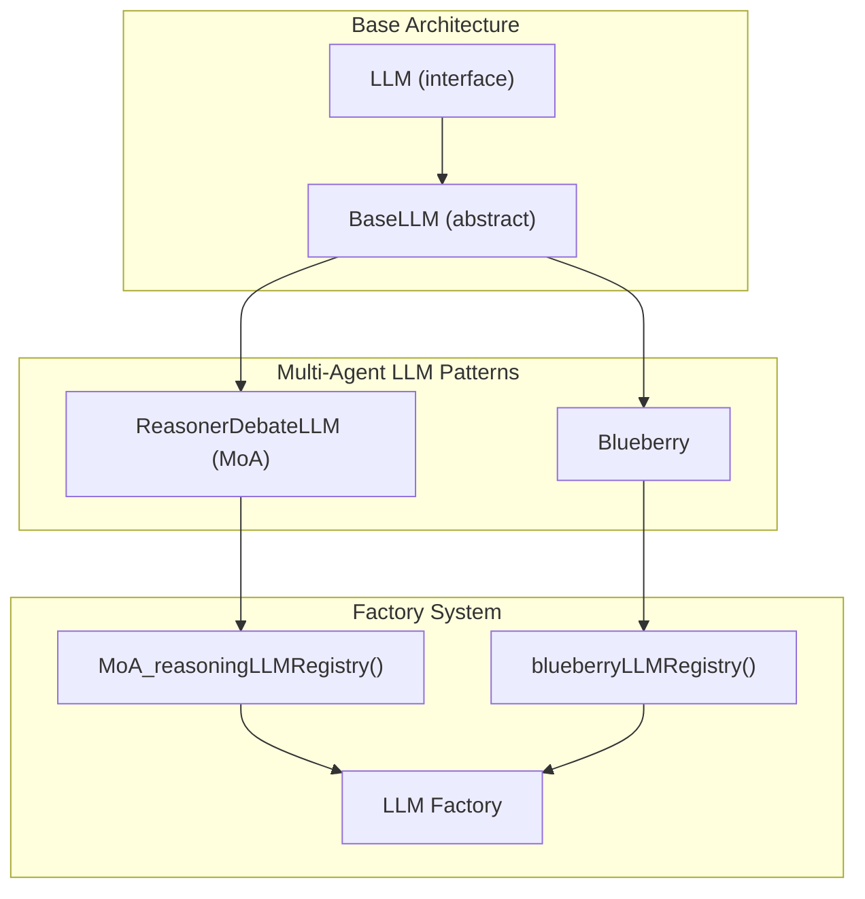
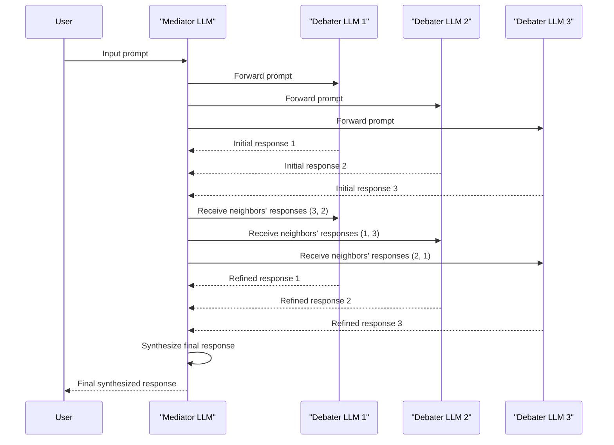
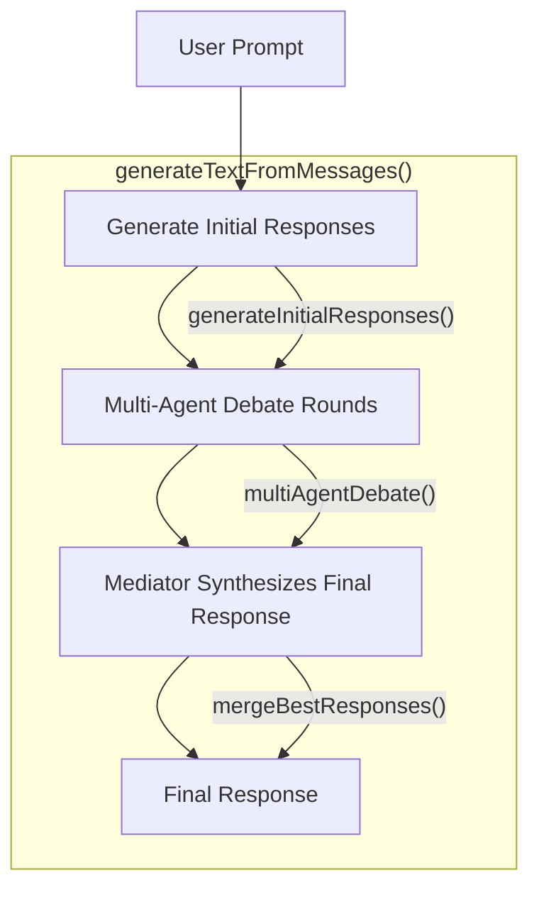
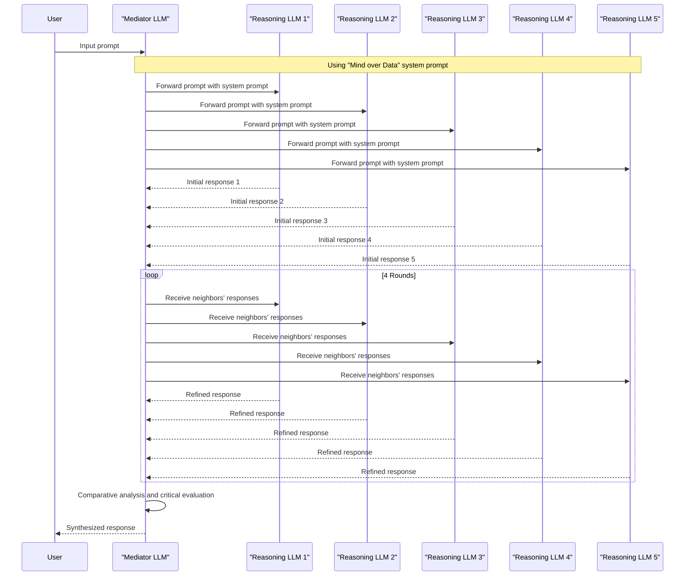
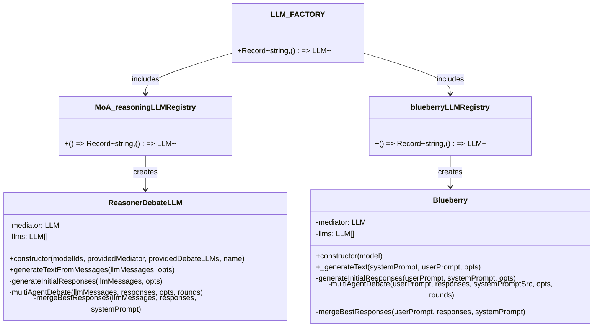

<!-- source: DeepWiki mcp.deepwiki.com · repo TrafficGuard/typedai · page 4.3 Multi-Agent LLM Implementations · fetched 2026-10-26 -->

# Multi-Agent LLM Implementations

<details>
<summary>Relevant source files</summary>

The following files were used as context for generating this wiki page:

- [src/llm/llmFactory.ts](src/llm/llmFactory.ts)
- [src/llm/multi-agent/blueberry.ts](src/llm/multi-agent/blueberry.ts)
- [src/llm/multi-agent/reasoning-debate.ts](src/llm/multi-agent/reasoning-debate.ts)

</details>


## Purpose and Scope

This document covers the multi-agent LLM patterns implemented in TypedAI that use multiple language models working together to generate higher quality responses. The system implements research-based approaches that leverage model debate, criticism, and refinement to enhance reasoning capabilities beyond what single models can achieve.

For information about basic LLM interfaces and abstraction, see [LLM Interface & Abstraction](#4.1). For details on individual LLM providers, see [Supported LLM Providers](#4.2).

## Overview of Multi-Agent Patterns

TypedAI implements two primary multi-agent patterns:

1. **MoA (Multi-agent of Agents)** - A sparse communication topology debate system where multiple LLMs generate responses, debate with neighboring models, and have their outputs synthesized by a mediator LLM
2. **Blueberry** - A structured reasoning approach based on the "Mind over Data" methodology to enhance LLM reasoning through comparative analysis and direct reasoning

Both implementations extend the `BaseLLM` class and integrate with the LLM factory system, making them available throughout the platform.



Sources: [src/llm/multi-agent/reasoning-debate.ts:1-184](), [src/llm/multi-agent/blueberry.ts:1-193](), [src/llm/llmFactory.ts:1-92]()

## ReasonerDebateLLM Implementation

The `ReasonerDebateLLM` class implements a sparse multi-agent debate pattern based on research ([arxiv.org/abs/2406.11776](https://arxiv.org/abs/2406.11776)). In this approach, multiple LLMs generate responses and debate with neighboring models to refine their answers. A mediator LLM then synthesizes the final response.

### Architecture and Flow



Sources: [src/llm/multi-agent/reasoning-debate.ts:64-184]()

### Implementation Details

The `ReasonerDebateLLM` class has the following key components:

- **Mediator LLM**: A single LLM responsible for synthesizing the final response
- **Debater LLMs**: An array of LLMs that generate initial responses and engage in debate
- **Debate Rounds**: Configurable number of rounds for refinement (default: 2)

The process follows these steps:

1. **Initial Response Generation**: Each debater LLM generates a response to the user prompt
2. **Multi-Agent Debate**: For multiple rounds, each LLM refines its response after seeing responses from its left and right neighbors
3. **Response Synthesis**: The mediator LLM synthesizes a final response by analyzing all debater outputs



Sources: [src/llm/multi-agent/reasoning-debate.ts:121-132]()

### Registered MoA Configurations

The system provides several pre-configured MoA implementations with different model combinations:

| Registry ID | Mediator | Debaters | Description |
|-------------|----------|----------|-------------|
| `MoA:R1x3 DeepSeek` | deepSeekV3 | [deepSeekR1, deepSeekR1, deepSeekR1] | DeepSeek models only |
| `MoA:R1x3-Together-Fireworks` | DeepSeekR1_Together_Fireworks_Nebius_SambaNova | [DeepSeekR1_Together_Fireworks_Nebius_SambaNova, DeepSeekR1_Together_Fireworks_Nebius_SambaNova, DeepSeekR1_Together_Fireworks_Nebius_SambaNova] | DeepSeek with Together and Fireworks backends |
| `MoA:Sonnet_Sonnet,o3-mini,R1` | Claude3_7_Sonnet_Vertex | [DeepSeekR1_Together_Fireworks_Nebius_SambaNova, openAIo3mini, Claude3_7_Sonnet_Vertex] | Multi-provider implementation with Claude, DeepSeek and OpenAI |
| `MoA:Sonnet-Claude-R1,o1,Gemini` | Claude3_7_Sonnet_Vertex | [togetherDeepSeekR1, openAIo1, Gemini_2_0_Flash_Thinking] | Multi-provider implementation with Claude, DeepSeek, OpenAI and Gemini |

Sources: [src/llm/multi-agent/reasoning-debate.ts:14-27](), [src/llm/multi-agent/reasoning-debate.ts:30-59]()

## Blueberry Implementation

The `Blueberry` class implements another multi-agent pattern that focuses more on structured reasoning techniques. It's based on multiple research papers including:
- Sparse multi-agent debate (arxiv.org/abs/2406.11776)
- Self-refine (arxiv.org/pdf/2303.17651)
- "Mind over Data: Elevating LLMs from Memorization to Cognition"

### Architecture and Flow



Sources: [src/llm/multi-agent/blueberry.ts:77-192]()

### Mind over Data Methodology

The Blueberry implementation uses a structured reasoning methodology called "Mind over Data" which guides LLMs through a rigorous process of comparative problem analysis and direct reasoning. This system prompt includes 14 steps:

1. Problem Transcription
2. Similar Problem Identification
3. Comparative Analysis
4. Direct Observation
5. Assumption Awareness
6. Direct Reasoning
7. Solution Proposal
8. Verification
9. Differentiation Explanation
10. Devil's Advocate Analysis
11. Alternative Perspectives
12. Refinement and Synthesis
13. Limitations and Future Work

This structured approach helps models avoid relying on memorized patterns and instead develop solutions through critical thinking and reasoning.

Sources: [src/llm/multi-agent/blueberry.ts:18-75]()

### Implementation Details

The `Blueberry` class follows a flow similar to `ReasonerDebateLLM` but with some key differences:

1. Uses a fixed system prompt from the "Mind over Data" methodology
2. Implements 4 debate rounds (compared to 2 in ReasonerDebateLLM)
3. Uses a more sophisticated synthesis prompt focusing on:
   - Comparative analysis of different responses
   - Critical evaluation including logical fallacies and cognitive biases
   - Synthesized response based on analysis

By default, Blueberry uses Gemini 2.0 Flash as both mediator and reasoning LLMs, though this can be customized.

Sources: [src/llm/multi-agent/blueberry.ts:113-115](), [src/llm/multi-agent/blueberry.ts:138-154](), [src/llm/multi-agent/blueberry.ts:156-191]()

## Integration with LLM Factory

Both multi-agent implementations are integrated with the TypedAI LLM factory system, making them available throughout the platform. They are registered in the factory using specific registry functions:



The integration works as follows:

1. `MoA_reasoningLLMRegistry()` and `blueberryLLMRegistry()` functions return objects mapping IDs to factory functions
2. These mappings are included in the global `LLM_FACTORY` registry
3. The `getLLM()` function can instantiate these implementations by their IDs
4. This allows the multi-agent LLMs to be used interchangeably with other LLM implementations

Sources: [src/llm/llmFactory.ts:1-45](), [src/llm/multi-agent/reasoning-debate.ts:14-27](), [src/llm/multi-agent/blueberry.ts:12-16]()

## Usage and Configuration

Multi-agent LLMs can be configured and used in two ways:

### 1. Using Predefined Configurations

The system includes several predefined configurations registered with specific IDs:

```
// Using a predefined MoA configuration
const moa = getLLM('MoA:R1x3-Together-Fireworks');

// Using the Blueberry implementation
const blueberry = getLLM('MoA:blueberry');
```

### 2. Custom Configuration

Custom multi-agent configurations can be created by specifying a model string with the format:

```
mediatorLLMId|debaterLLMId1|debaterLLMId2|debaterLLMId3...
```

For example:
```
// Custom MoA with Claude mediator and mix of debater LLMs
const customMoa = new ReasonerDebateLLM('anthropic:claude-3-7-sonnet|openai:gpt-4o|google:gemini-pro|deepseek:deepseek-coder');
```

The system supports any combination of available LLM models and can leverage the strengths of different provider implementations to create robust multi-agent systems.

Sources: [src/llm/multi-agent/reasoning-debate.ts:64-107](), [src/llm/multi-agent/blueberry.ts:84-116]()

---

