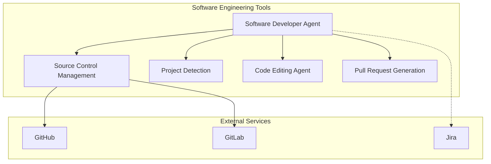
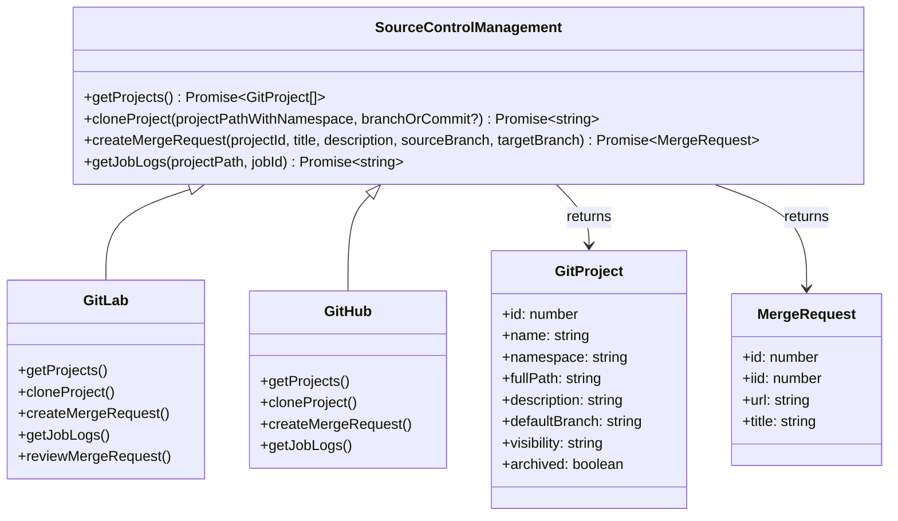
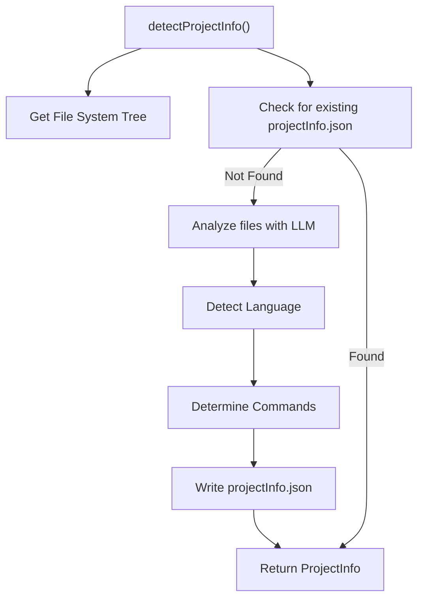
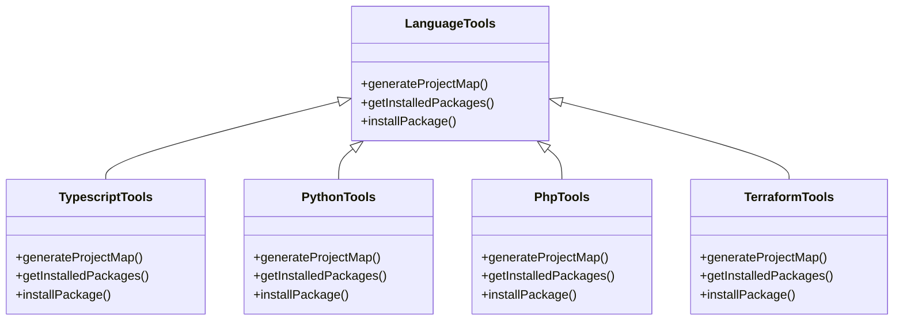
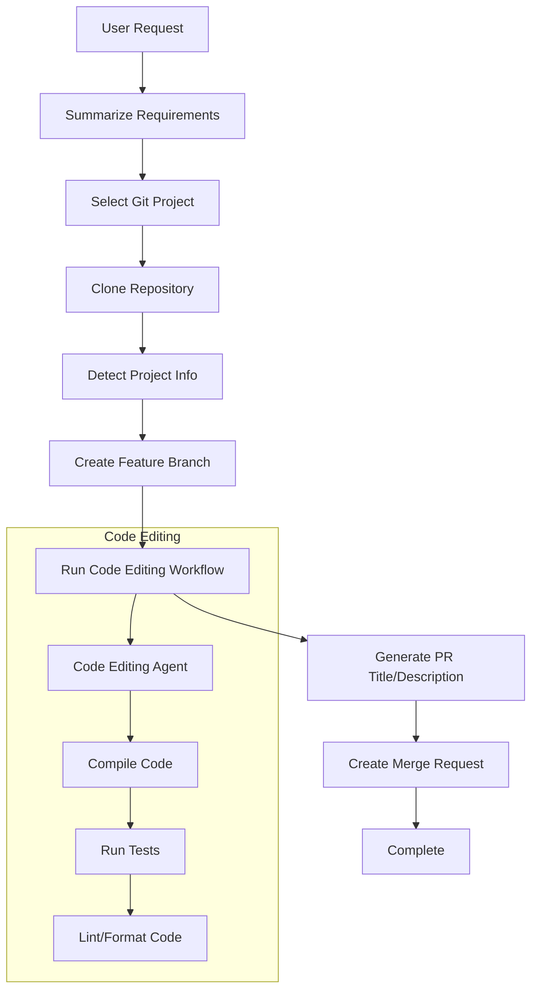
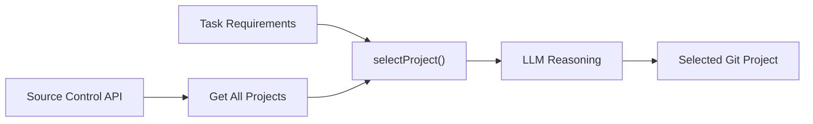
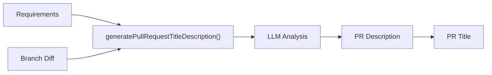
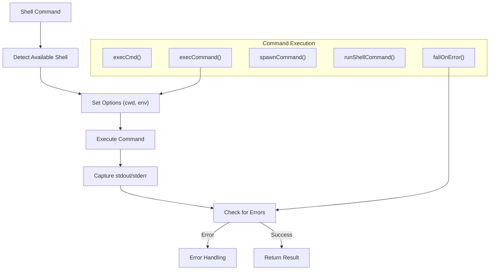
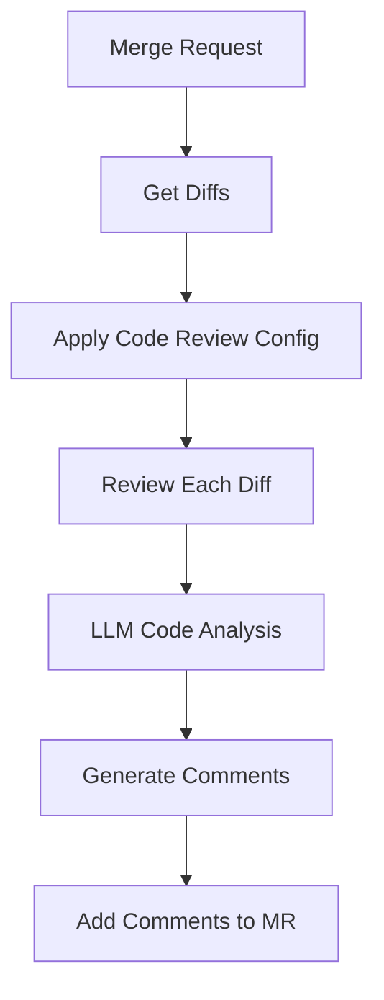
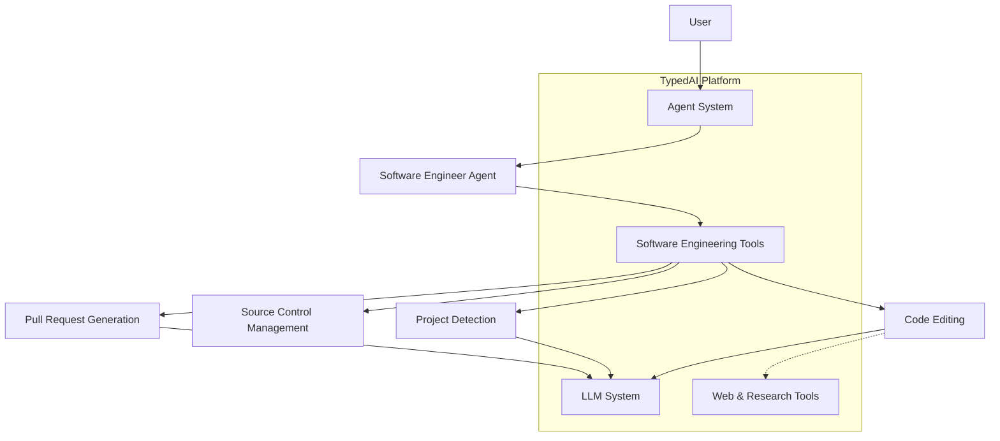

<!-- source: DeepWiki mcp.deepwiki.com · repo TrafficGuard/typedai · page 5 Software Engineering Tools · fetched 2026-10-26 -->

# Software Engineering Tools

<details>
<summary>Relevant source files</summary>

The following files were used as context for generating this wiki page:

- [README.md](README.md)
- [docs/docs/autonomous-agents.md](docs/docs/autonomous-agents.md)
- [docs/docs/examples.md](docs/docs/examples.md)
- [docs/docs/index.md](docs/docs/index.md)
- [docs/docs/roadmap.md](docs/docs/roadmap.md)
- [docs/docs/setup.md](docs/docs/setup.md)
- [docs/docs/software-engineer.md](docs/docs/software-engineer.md)
- [docs/mkdocs.yml](docs/mkdocs.yml)
- [src/functions/scm/gitProject.ts](src/functions/scm/gitProject.ts)
- [src/functions/scm/github.ts](src/functions/scm/github.ts)
- [src/functions/scm/gitlab.ts](src/functions/scm/gitlab.ts)
- [src/functions/scm/sourceControlManagement.ts](src/functions/scm/sourceControlManagement.ts)
- [src/swe/projectDetection.ts](src/swe/projectDetection.ts)
- [src/swe/pullRequestTitleDescription.ts](src/swe/pullRequestTitleDescription.ts)
- [src/swe/selectProject.ts](src/swe/selectProject.ts)
- [src/swe/softwareDeveloperAgent.ts](src/swe/softwareDeveloperAgent.ts)
- [src/utils/exec.ts](src/utils/exec.ts)

</details>


This document provides an overview of the Software Engineering Tools component in TypedAI, which enables autonomous agents to perform software development tasks by interacting with source code repositories, detecting project structures, making code changes, and creating pull/merge requests. For information about specific code editing capabilities, see [Code Editing Agent](#5.2).

## Overview

The Software Engineering Tools module provides a comprehensive set of components that enable TypedAI agents to perform software engineering tasks. These tools facilitate source code management, project configuration detection, code editing, and automated pull/merge request creation.



Sources: [src/functions/scm/sourceControlManagement.ts](), [src/swe/softwareDeveloperAgent.ts](), [src/swe/projectDetection.ts]()

## Source Control Management

The Source Control Management (SCM) component provides a unified interface for interacting with different Git providers such as GitHub and GitLab. It abstracts away the platform-specific details, allowing TypedAI to work with multiple source control systems through a consistent API.

### SCM Interface

The `SourceControlManagement` interface defines the core operations that can be performed on Git repositories:



Sources: [src/functions/scm/sourceControlManagement.ts](), [src/functions/scm/gitProject.ts]()

### SCM Implementations

TypedAI includes implementations for two popular Git platforms:

1. **GitLab** - Provides integration with GitLab repositories, supporting project discovery, code cloning, merge request creation, and code review.
2. **GitHub** - Offers similar capabilities for GitHub repositories, allowing agents to interact with GitHub projects.

Both implementations use authentication tokens for secure access to repositories and API endpoints.

Sources: [src/functions/scm/gitlab.ts](), [src/functions/scm/github.ts]()

### Key SCM Operations

| Operation | Description | 
|-----------|-------------|
| `getProjects()` | Retrieves a list of accessible Git projects from the provider |
| `cloneProject()` | Clones a repository to the local filesystem |
| `createMergeRequest()` | Creates a pull/merge request with changes |
| `getJobLogs()` | Fetches logs from CI/CD pipeline jobs |

Sources: [src/functions/scm/sourceControlManagement.ts:15-22](), [src/functions/scm/github.ts:124-218](), [src/functions/scm/gitlab.ts:131-546]()

## Project Detection and Configuration

The Project Detection system analyzes repository contents to automatically determine project structure, language, and build tools. This information is crucial for the automated workflow to properly initialize, build, test, and deploy changes.



Sources: [src/swe/projectDetection.ts]()

### Project Info Structure

The project detection process creates a `projectInfo.json` file containing essential information about the project:

| Field | Description |
|-------|-------------|
| `baseDir` | The base directory of the project |
| `language` | Detected programming language (nodejs, typescript, python, etc.) |
| `initialise` | Command to initialize the project |
| `compile` | Command to compile the project |
| `format` | Command to format code |
| `staticAnalysis` | Command for static analysis/linting |
| `test` | Command to run tests |
| `devBranch` | Default development branch for creating feature branches |
| `languageTools` | Language-specific tooling for the project |

Sources: [src/swe/projectDetection.ts:33-43](), [src/swe/projectDetection.ts:81-202]()

### Language-Specific Tools

The system includes specialized tools for different programming languages:



Sources: [src/swe/projectDetection.ts:206-224]()

## Software Developer Workflow

The Software Developer Agent orchestrates the end-to-end workflow for implementing software changes across repositories. It encapsulates the entire process from requirements analysis to merge request creation.



Sources: [src/swe/softwareDeveloperAgent.ts](), [docs/docs/software-engineer.md:6-65]()

### Workflow Steps

1. **Requirements Analysis**: The agent first summarizes and clarifies the requirements to ensure a clear understanding of the task.
2. **Project Selection**: It searches through available repositories to identify the correct project for implementation.
3. **Repository Setup**: Clones the repository and creates a feature branch for the changes.
4. **Code Editing**: Delegates to the Code Editing Agent to make the necessary code changes.
5. **Pull Request Creation**: Generates a descriptive title and description for the pull/merge request and submits it.

Sources: [src/swe/softwareDeveloperAgent.ts:39-92](), [docs/docs/software-engineer.md:54-65]()

### Project Selection

The project selection process uses LLM reasoning to identify the most relevant repository for a given task:



Sources: [src/swe/selectProject.ts](), [src/swe/softwareDeveloperAgent.ts:110-114]()

### Pull Request Generation

The system automatically generates appropriate titles and descriptions for pull/merge requests based on the changes made:



Sources: [src/swe/pullRequestTitleDescription.ts](), [src/swe/softwareDeveloperAgent.ts:88-89]()

## Command Execution Utilities

The Software Engineering Tools include robust utilities for executing shell commands, which are essential for interacting with the local file system, running build tools, and performing Git operations.



Sources: [src/utils/exec.ts]()

### Key Command Utilities

| Utility | Description |
|---------|-------------|
| `execCommand()` | Executes a shell command and returns stdout/stderr |
| `spawnCommand()` | Spawns a process for running a shell command |
| `failOnError()` | Throws an error if command execution fails |
| `shellEscape()` | Properly escapes strings for shell commands |

These utilities handle shell detection, working directory management, environment variables, and proper error handling to ensure reliable command execution.

Sources: [src/utils/exec.ts:152-191](), [src/utils/exec.ts:193-225](), [src/utils/exec.ts:133-140](), [src/utils/exec.ts:357-360]()

## Code Review Capabilities

The Software Engineering Tools include capabilities for automated code reviews, particularly implemented in the GitLab integration. These features allow the system to review merge requests, apply code review configurations, and add comments directly to the code.



Sources: [src/functions/scm/gitlab.ts:367-431]()

### Code Review Configuration

Code reviews are configured through project-specific rules that determine what types of issues to look for in the code. These configurations include:

- File extension filters
- Project path patterns
- Required text patterns
- Review guidelines and standards

The system applies these configurations to the diffs in a merge request and uses LLM to analyze the code and generate appropriate comments.

Sources: [src/functions/scm/gitlab.ts:437-451](), [src/functions/scm/gitlab.ts:458-524]()

## Integration with TypedAI Platform

The Software Engineering Tools integrate with the broader TypedAI platform, particularly with the Agent System and LLM components.



Sources: [README.md:19-71](), [docs/docs/index.md:19-37]()

### Function Decorators

The Software Engineering Tools use TypedAI's function decoration system to expose their capabilities to agents:

```typescript
@funcClass(__filename)
export class SoftwareDeveloperAgent {
    @func()
    async runSoftwareDeveloperWorkflow(requirements: string, scmFullProjectPath?: string): Promise<MergeRequest> {
        // Implementation
    }
}
```

This allows agents to discover and call these functions with proper type information and documentation.

Sources: [src/swe/softwareDeveloperAgent.ts:30-39](), [src/functions/scm/gitlab.ts:77-141](), [src/functions/scm/github.ts:26-61]()

## Conclusion

The Software Engineering Tools provide TypedAI with powerful capabilities for automating software development tasks. By integrating with source control systems, detecting project configurations, and orchestrating the development workflow, these tools enable AI agents to make meaningful contributions to software projects.

The modular design allows for extending the system with additional SCM implementations, language tools, and workflow improvements, making it adaptable to various development environments and requirements.

---

